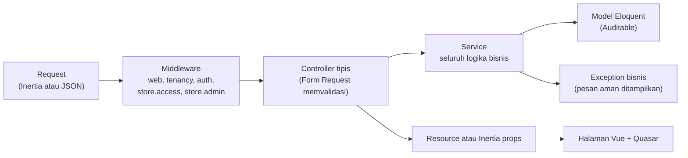
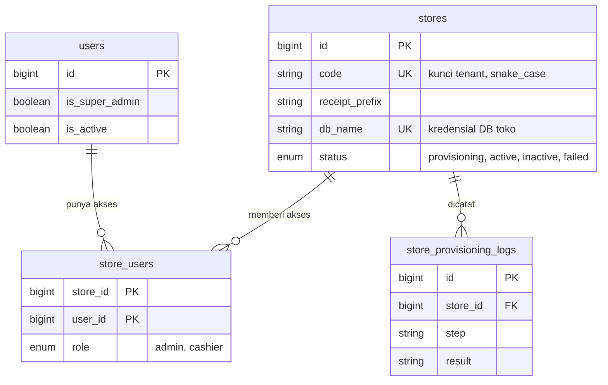
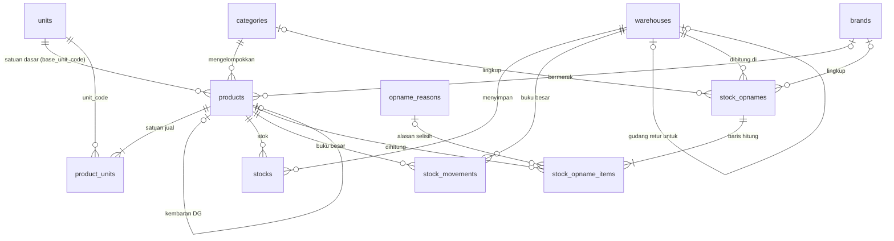
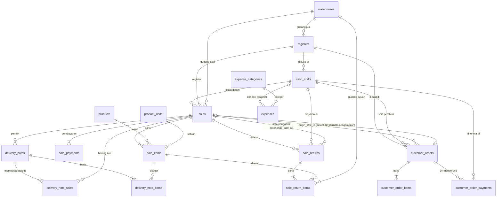
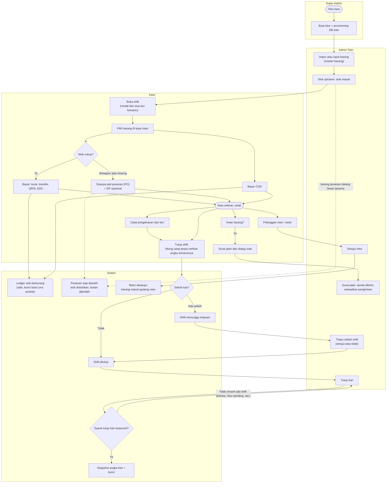
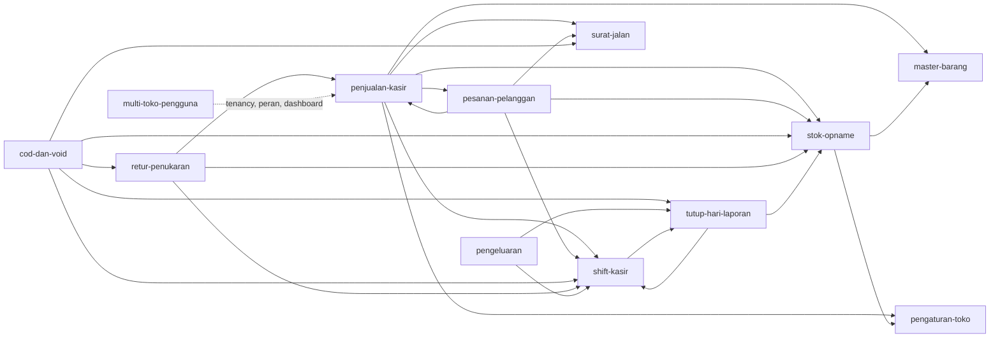

# Mitra Hub — Arsitektur dan Peta Dokumentasi Teknis

> **Modul:** seluruh aplikasi (indeks dari dokumentasi per fitur)
> **Stack:** Laravel 13 (PHP 8.3), Inertia 3, Vue 3 (JavaScript), Quasar 2, MySQL, stancl/tenancy 3.10, owen-it/laravel-auditing
> **Audiens:** Engineer yang baru bergabung, atau yang perlu tahu dokumen mana yang harus dibuka
> **Terakhir diperbarui:** 2026-11-17

Dokumen ini adalah **pintu masuk**. Detail tiap fitur ada di dokumennya sendiri (tabel di bawah); di sini hanya ada hal yang melintasi fitur: bentuk arsitektur, kebiasaan teknis yang dipakai di mana-mana, ERD tingkat sistem, proses ujung ke ujung, dan peta ketergantungan antarmodul.

Cara membaca: mulai dari bagian 1 untuk memilih dokumen, baca bagian 2 sekali (kebiasaan yang berulang di semua dokumen), lalu loncat ke dokumen modul yang sedang dikerjakan.

## 1. Peta Dokumen

Dokumentasi dipecah **per fitur**, satu file per fitur, ditambah dokumen ini. Alasannya: ERD seluruh sistem (sekitar 45 tabel toko) tidak terbaca dalam satu diagram, perubahan satu fitur cukup menyentuh satu file (diff kecil, mudah direview), dan satu halaman wiki per fitur mudah dicari dan diberi pemilik.

| Dokumen | Isi | DB |
|---|---|---|
| [multi-toko-pengguna-docs.md](multi-toko-pengguna-docs.md) | Tenancy, login, peran, manajemen toko dan provisioning, pengguna pusat, dashboard, deploy Hostinger | pusat |
| [pengaturan-toko-docs.md](pengaturan-toko-docs.md) | Pengaturan toko: kop nota, kertas, opname, alasan opname, daftar sopir | toko |
| [master-barang-docs.md](master-barang-docs.md) | Barang, satuan dan konversi, kategori, merek, harga, ubah harga massal, label barcode, impor barang lama | toko |
| [stok-opname-docs.md](stok-opname-docs.md) | Buku besar stok, kemasan utuh, stok opname, barang rusak (DG), gudang | toko |
| [penjualan-kasir-docs.md](penjualan-kasir-docs.md) | Layar kasir, checkout, nota, pembayaran, penomoran, cetak nota, riwayat nota | toko |
| [shift-kasir-docs.md](shift-kasir-docs.md) | Buka dan tutup shift (tutup buta), selisih, tinjauan Admin, register | toko |
| [tutup-hari-laporan-docs.md](tutup-hari-laporan-docs.md) | Tutup hari, laporan penjualan, dashboard toko | toko |
| [retur-penukaran-docs.md](retur-penukaran-docs.md) | Retur, penukaran, persetujuan Admin, gudang retur | toko |
| [pesanan-pelanggan-docs.md](pesanan-pelanggan-docs.md) | Pesanan (PO), uang muka, barang datang, penyisihan stok, pengambilan | toko |
| [cod-dan-void-docs.md](cod-dan-void-docs.md) | Pembayaran COD, "sudah diantar", void nota COD | toko |
| [surat-jalan-docs.md](surat-jalan-docs.md) | Surat jalan (termasuk gabungan dua nota) dan daftar sopir | toko |
| [pengeluaran-docs.md](pengeluaran-docs.md) | Pengeluaran dari laci atau sumber lain, kategori | toko |

Dokumen lain yang sudah ada dan **berbeda fungsinya**:

| Dokumen | Fungsi | Hubungan dengan dokumen teknis |
|---|---|---|
| `analisis-sistem.md` | Kebutuhan dan aturan bisnis (sumber kebenaran **scope**) | Dokumen teknis ditulis dari **kode**. Bila keduanya berbeda, kode yang jadi acuan dan perbedaannya dicatat di bagian "Keterbatasan" tiap dokumen |
| `wireframe.html`, `diagram.html` | Rancangan layar dan alur (`-r2` = Release 2) | Rancangan awal; BPMN di dokumen teknis menggambarkan yang **dibangun** |
| `hasil-review-kode.md` | Daftar temuan review yang masih terbuka | Beberapa temuan di dokumen modul berasal dari sini dan sudah diverifikasi ulang ke kode |
| `estimasi-biaya.md` | Estimasi | tidak terkait |

Setiap dokumen modul mengikuti kerangka yang sama (Ringkasan dengan alur dan BPMN, Skema dan ERD, Model, Hak akses, Konfigurasi, Rute, Komponen backend, Validasi, Guard kepemilikan dan status, Keterbatasan, Indeks file). Bagian yang tidak berlaku sengaja tidak dibuat, sehingga nomor bagian bisa loncat.

## 2. Arsitektur dan Kebiasaan yang Berulang

### 2.1 Lapisan

Controller hanya memvalidasi, memanggil satu service, dan membentuk respons. Semua aturan bisnis hidup di `app/Services`. Kegagalan bisnis dilempar sebagai exception khusus (`SaleException`, `DeliveryNoteException`, `CodSaleException`, dst.) yang pesannya aman ditampilkan, lalu diterjemahkan controller menjadi flash `error` (halaman Admin) atau JSON bergalat (layar kasir). Aplikasi **online-only**: tidak ada PWA, offline, atau sinkronisasi.

### 2.2 Multi-toko

Satu **DB pusat** (`mitra_manager`: toko, pengguna, akses toko, log provisioning, sesi, cache, antrean) ditambah **satu DB per toko** (semua data toko; migrasi di `database/migrations/tenant`). Toko dikenali dari path: `t/{tenant}/...`, kunci `stores.code` (snake_case nama toko). Ringkasnya:

- Rute toko di `routes/tenant.php`, middleware `web` → `InitializeTenancyByPath` → `auth` → `store.access` → `shift.remember`. Halaman Admin ditambah `store.admin`.
- **Jebakan:** selama tenancy aktif, koneksi default berpindah ke DB toko. Karena itu sesi, cache, dan antrean dipaksa ke koneksi pusat di `config/session.php|cache.php|queue.php`, dan **model yang tinggal di DB pusat wajib memakai trait `CentralConnection`**.
- Pengguna ada di DB pusat, sehingga kolom seperti `created_by`, `cashier_id`, `approved_by` di DB toko berisi id pengguna pusat **tanpa foreign key** (lintas database). Nama pengguna disalin sebagai snapshot (`created_by_name`) supaya dokumen lama tetap terbaca bila pengguna berganti nama.
- DB toko **tidak pernah dibuat atau dihapus otomatis** (Hostinger hPanel, satu pengguna per DB). Kredensial ada di baris `stores` (`db_name`, `db_username`, `db_password` terenkripsi, `db_host`).

Rinciannya di [multi-toko-pengguna-docs.md](multi-toko-pengguna-docs.md).

### 2.3 Kebiasaan teknis lintas fitur

| Kebiasaan | Aturannya | Dibahas di |
|---|---|---|
| **Transaksi** | Metode yang menulis dua kali atau lebih dibungkus `DB::transaction()`; satu tulis tidak perlu. **Tidak pernah** membungkus panggilan HTTP eksternal | semua modul |
| **Kunci baris** | Baris dikunci `lockForUpdate` lalu **status dibaca ulang dari DB** (bukan dari klien) sebelum bertindak. Baris stok dikunci **urut `product_id`** supaya dua transaksi tidak saling menunggu. Pesan galat basi menyuruh memuat ulang | [stok-opname](stok-opname-docs.md), [penjualan-kasir](penjualan-kasir-docs.md), [surat-jalan](surat-jalan-docs.md) |
| **Retry deadlock** | `StockService::DEADLOCK_ATTEMPTS` (3) dipakai `DB::transaction(..., attempts)` di jalur yang mengunci beberapa tabel (penjualan, void, pembatalan pesanan, tanda barang datang) | [stok-opname](stok-opname-docs.md), [cod-dan-void](cod-dan-void-docs.md) |
| **Idempoten** | Tulis transaksional dari kasir membawa `client_uuid` (unique): pengiriman ganda mengembalikan dokumen pertama, bukan membuat kedua. Berlaku untuk nota, pesanan, surat jalan, retur, dll. uuid milik orang atau dokumen lain ditolak | [penjualan-kasir](penjualan-kasir-docs.md), [surat-jalan](surat-jalan-docs.md) |
| **Penomoran dokumen** | `DocumentNumberGenerator::next(type, date, register?)` menghasilkan `TYPE/PREFIKS/[REGISTER/]YYMM/0001`, urutan berulang tiap bulan (per register untuk nota), disimpan di `document_sequences`, dipanggil di dalam transaksi pemanggil. Tipe: `INV` (nota), `SJ`, `RET`, `OPN`, `PGL`, dst. | [penjualan-kasir](penjualan-kasir-docs.md) |
| **Cetak dua langkah** | `POST .../print` menaikkan `print_count` (dengan kunci) dan menjawab URL kertas **bertanda tangan** (30 menit) yang memuat nomor cetak; kertas hanya bisa dibuka lewat URL itu. Cetak pertama = asli, kedua dst. = SALINAN. Dipakai nota, surat jalan, dan nota pesanan (`PrintCounter`, `AnswersPrints`) | [penjualan-kasir](penjualan-kasir-docs.md), [surat-jalan](surat-jalan-docs.md) |
| **Audit** | Model implement `OwenIt\Auditing\Contracts\Auditable` (pusat dan toko). Perubahan harga barang di R1 hanya terekam di sini; itu sumber backfill `price_histories` R2 | [master-barang](master-barang-docs.md) |
| **Uang dan jumlah** | Kolom `decimal`, hitungan dengan `Brick\Math\BigDecimal`. **Tanpa pembulatan, tanpa PPN.** Margin saja: `harga = modal / (1 − margin%)`, bukan markup | [master-barang](master-barang-docs.md) |
| **Snapshot, bukan referensi** | Nama barang, satuan, nama sopir, nama pembuat disalin ke dokumen supaya mengganti nama master tidak mengubah dokumen lama | [surat-jalan](surat-jalan-docs.md) |
| **Kode galat JSON** | Tubuh `{code, message, more_info}`. Digit pertama kode = status HTTP (`ApiErrorCode`): 4031 nota bukan milik, 4041 nota tidak ada, 4091 shift belum dibuka, 4221 retur, 4222 pengeluaran, 4223 COD, 4224 pesanan, 4231 shift masih terbuka | tiap modul |
| **Penamaan** | Tabel dan kolom Inggris, snake_case, jamak (tabel pivot juga); UI dan dokumen bahasa Indonesia | `CLAUDE.md` |

### 2.4 Peran

| Peran | Cakupan |
|---|---|
| Super Admin | Dashboard pusat, kelola toko dan pengguna, pencarian stok lintas toko; boleh masuk toko mana pun |
| Admin Toko | Semua halaman toko (`store.admin`): barang, opname, retur, surat jalan, shift, laporan, tutup hari, pengaturan |
| Kasir | Hanya layar kasir (`cashier/*`), dan hanya untuk nota miliknya (`User::canHandleReceipt`) |

Pengguna non-Super Admin langsung diarahkan ke tokonya. Detail di [multi-toko-pengguna-docs.md](multi-toko-pengguna-docs.md).

## 3. ERD Tingkat Sistem

Diagram di bawah memuat **tabel dan relasi saja** (kunci dan kolom penting tidak diulang): kolom lengkap ada di bagian 2 tiap dokumen modul. Relasi diambil dari migrasi (`foreignId ... constrained`); garis putus-putus secara konsep (mis. id pengguna pusat) tidak digambar karena tidak ada foreign key.

### 3.1 DB pusat

Peran toko ada di `store_users.role` (`admin` atau `cashier`; nilai `warehouse` dibuang oleh migrasi `restrict_store_users_roles`), sedangkan Super Admin ditandai `users.is_super_admin`. Satu pengguna bisa punya peran berbeda di toko berbeda.

Tabel pusat lain (tanpa relasi bisnis): `app_settings`, `sessions`, `cache`, `cache_locks`, `jobs`, `job_batches`, `failed_jobs`, `password_reset_tokens`, `personal_access_tokens`, `audits`.

### 3.2 DB toko — katalog dan stok

### 3.3 DB toko — penjualan dan turunannya

Hal yang **tidak** punya foreign key dan dihubungkan secara logis:

| Hubungan | Cara terhubung | Dokumen |
|---|---|---|
| Id pengguna (`cashier_id`, `created_by`, `approved_by`, ...) → `users` pusat | id biasa, lintas database | [multi-toko-pengguna](multi-toko-pengguna-docs.md) |
| `stock_movements.reference_type/reference_id` → opname, nota, retur | polimorfik | [stok-opname](stok-opname-docs.md) |
| `daily_closings` ↔ shift, nota, pengeluaran | `business_date` | [tutup-hari-laporan](tutup-hari-laporan-docs.md) |
| `expenses.business_date` → `daily_closings` | relasi Eloquent lewat tanggal | [pengeluaran](pengeluaran-docs.md) |
| `document_sequences.register_id` | 0 untuk dokumen yang tidak per register | [penjualan-kasir](penjualan-kasir-docs.md) |
| `delivery_notes.driver_name` ← `drivers` | salinan nama | [surat-jalan](surat-jalan-docs.md) |

Tabel toko lain: `settings`, `document_sequences`, `audits`, `drivers`, `daily_closings`, `expense_categories`, `opname_reasons`. Tabel `sale_cancellations` ada di migrasi tetapi tidak punya model dan tidak pernah ditulis (lihat [penjualan-kasir](penjualan-kasir-docs.md)).

## 4. Proses Ujung ke Ujung (BPMN)

Satu hari di toko, dari barang masuk sampai hari ditutup. Setiap proses punya diagram rinci di dokumen modulnya; yang di bawah hanya menunjukkan **bagaimana modul-modul tersambung**.

Dua catatan agar diagram ini tidak menyesatkan:

- Pesanan **tidak** menggerakkan stok saat dibuat atau saat ditandai datang; ia hanya **menyisihkan** (dihitung dari pesanan berstatus `ready`). Stok baru bertambah saat Admin memasukkan barang lewat opname, dan baru berkurang saat nota pengambilan dibuat ([pesanan-pelanggan](pesanan-pelanggan-docs.md)).
- Surat jalan tidak pernah menggerakkan stok. Barang yang kembali ke toko diselesaikan lewat retur ([surat-jalan](surat-jalan-docs.md), [retur-penukaran](retur-penukaran-docs.md)).

## 5. Peta Ketergantungan Antarmodul

Panah berarti "memanggil atau membaca". Berguna untuk menilai dampak sebuah perubahan: mengubah modul di ujung panah bisa menembus ke semua modul di pangkalnya.

Titik temu yang paling sering menyentuh banyak modul sekaligus:

| Titik temu | Dipakai oleh |
|---|---|
| `StockService::record`, `lockedStocks`, `lockedQuantities` | penjualan, void, retur, pesanan, opname |
| `ShiftService::openShiftOf` dan kunci baris `cash_shifts` | penjualan, retur, pengeluaran, pesanan (DP), void; kunci inilah yang menyerialkan penutupan shift dengan transaksi yang sedang masuk |
| `DailyClosing::isClosedOn`, `lockAgainstClosing` | pengeluaran, pembatalan pesanan, void, buka shift |
| `Sale::deliveryNotes()` (lewat pivot `delivery_note_sales`) | status COD sudah diantar, daftar COD, blokir void, ringkasan shift |
| `CustomerOrderItem::reservedQuantities` dan `reservedPacks` | kasir (stok tersedia), penjualan lain, tanda barang datang |
| `StockOpnameService::productIdsBeingCounted` | kunci penjualan saat opname, penanda kasir, blokir persetujuan retur |

## 6. Temuan Lintas Modul

Ringkasan temuan penting dari bagian "Keterbatasan" tiap dokumen. Kolom **Status** menyatakan siapa yang memeriksa. Yang berstatus "diverifikasi ulang" saya baca sendiri di kode setelah dokumen ditulis; yang lain dikutip dari penulis dokumen modul, yang masing-masing menyebut file dan baris. **Periksa ulang sebelum memperbaiki.** Tidak satu pun dari ini diperbaiki dalam pekerjaan dokumentasi ini.

| # | Temuan | Dokumen | Status |
|---|---|---|---|
| 1 | ~~Laporan penjualan menghitung "COD sudah diantar" dari `delivery_notes.sale_id` (nota pemilik saja), sedangkan ringkasan shift memakai pivot `delivery_note_sales`~~ | [cod-dan-void](cod-dan-void-docs.md) | **diperbaiki 2026-11-17**: laporan kini memakai pivot yang sama, dijaga `SalesReportTest` |
| 2 | `Product::HAS_TRANSACTIONS_SQL` tidak memeriksa `customer_order_items`, padahal FK-nya tidak cascade: barang yang hanya pernah dipesan dianggap boleh dihapus lalu berisiko galat 500 | [master-barang](master-barang-docs.md) | diverifikasi ulang (`Product.php:109-112`) |
| 3 | `CodSaleService::markDelivered` tanpa retry deadlock, padahal mengunci nota lalu surat jalan dan Admin bisa menyelesaikan surat jalan yang sama bersamaan (void sudah memakai retry) | [cod-dan-void](cod-dan-void-docs.md) | diverifikasi ulang |
| 4 | Idempotensi nota putus di jalur HTTP bila shift sudah ditutup: controller menolak "Buka shift dulu" sebelum service sempat mengembalikan nota pertama | [penjualan-kasir](penjualan-kasir-docs.md) | dikutip (`SaleController.php:24-28`) |
| 5 | "Sudah diantar" tidak bisa dibalik dan boleh dilakukan kasir mana pun; satu klik menutup kemungkinan void nota itu selamanya | [cod-dan-void](cod-dan-void-docs.md) | dikutip |
| 6 | `SaleVoidService::voidBlocker` tidak melihat `origin_sale_id`: nota asal pesanan yang COD-nya ditahan boleh di-void selagi pesanan masih terbuka | [cod-dan-void](cod-dan-void-docs.md) | dikutip |
| 7 | Pengecekan hari tertutup memakai `today()`, bukan tanggal bisnis shift, di pembatalan pesanan dan void | [cod-dan-void](cod-dan-void-docs.md), [tutup-hari-laporan](tutup-hari-laporan-docs.md) | dikutip |
| 8 | Kunci hari tertutup tidak menyeluruh: `isClosedOn` hanya dicek di lima tempat, sedangkan teks dialog menyebut nota, retur, pengeluaran, dan shift semuanya terkunci | [tutup-hari-laporan](tutup-hari-laporan-docs.md) | dikutip |
| 9 | `order_deposits_received/refunded` ditulis ke snapshot tutup hari tetapi tidak dirender di halaman maupun laporan cetak | [tutup-hari-laporan](tutup-hari-laporan-docs.md) | dikutip |
| 10 | "Stok sistem" di opname adalah stok hidup, bukan snapshot: `stock_opname_items.snapshot_quantity` hanya ditulis, tidak pernah dibaca | [stok-opname](stok-opname-docs.md) | dikutip (setelah Grep) |
| 11 | `StockService::record()` tidak menjaga saldo tidak negatif dan tidak ada perintah rekonsiliasi `stocks` terhadap `stock_movements` | [stok-opname](stok-opname-docs.md) | dikutip |
| 12 | `countUncountedAsZero` untuk barang berkemasan menghapus semua rol utuh tanpa peringatan di konfirmasi posting | [stok-opname](stok-opname-docs.md) | dikutip |
| 13 | Retur: pesan "Stok sudah kembali" menyesatkan (barang masuk gudang retur); `refund_method` nullable tetapi di-dereferensi tanpa penjaga; penolakan tanpa alasan dan tanpa audit pada baris | [retur-penukaran](retur-penukaran-docs.md) | dikutip |
| 14 | Shift `pending_review` yang tidak diputuskan membuat kasir tidak bisa keluar dan register tidak bisa dibuka, tanpa eskalasi dan tanpa penjadwalan penutupan shift terlupa | [shift-kasir](shift-kasir-docs.md) | dikutip |
| 15 | Admin tidak bisa mencetak ulang nota lama lewat UI (rute cetak hanya di grup kasir, dialog hanya memuat nota shift berjalan) | [penjualan-kasir](penjualan-kasir-docs.md) | dikutip |
| 16 | `legacy_sku` hanya diisi skrip SQL, tidak oleh `LegacyProductImporter`; cakupan impor (`owners_id = 1`) berbeda dengan skrip SQL (semua barang). Skrip SQL menulis langsung tanpa audit dan `01-clear-store-data.sql` menghapus semua transaksi tanpa bisa dibatalkan | [master-barang](master-barang-docs.md) | dikutip |
| 17 | Kolom dan tabel mati: `sale_cancellations`, `sales.discount_total`, `legacy_number`, `is_price_estimated`, `registers.last_sale_sequence`, `cash_shifts.client_uuid` (acak, tidak dibaca) | [penjualan-kasir](penjualan-kasir-docs.md), [shift-kasir](shift-kasir-docs.md) | dikutip (setelah Grep) |
| 18 | Deploy: `tenants:migrate` berhenti di toko pertama yang DB-nya bermasalah (`runForMultiple` tanpa try/catch di stancl), dan karena `set -e` maka `optimize:clear` ikut tidak jalan padahal `rsync` sudah selesai; tidak ada `artisan down` | [multi-toko-pengguna](multi-toko-pengguna-docs.md) | urutan `set -e` di workflow diverifikasi ulang (`build-for-hostinger.yml:105-110`); perilaku stancl dikutip |
| 19 | Deploy berakhir hijau (`exit 0`) tanpa mengunggah apa pun bila secret `HOSTINGER_*` kosong | [multi-toko-pengguna](multi-toko-pengguna-docs.md) | diverifikasi ulang (`build-for-hostinger.yml:72-75`) |
| 20 | `.env.example` menyetel `DB_CONNECTION=sqlite` padahal aplikasi hanya jalan di MySQL; `config/tenancy.php` dan `config/session.php` membaca env yang sama, jadi "pemaksaan koneksi pusat" bergantung pada nilai env itu | [multi-toko-pengguna](multi-toko-pengguna-docs.md) | diverifikasi ulang (`.env.example:23`, `tenancy.php:45`, `session.php:76`) |
| 21 | Audit ditulis ke koneksi default saat itu, bukan koneksi model: audit `Store` saat `tenants:migrate` lewat HTTP mendarat di DB toko, dan dari artisan tidak diaudit sama sekali (`audit.console=false`) | [multi-toko-pengguna](multi-toko-pengguna-docs.md) | dikutip |
| 22 | `EnsureUserHasNoOpenShift` tidak memeriksa status toko: toko yang dinonaktifkan saat kasir memegang shift membuat logout terkunci | [multi-toko-pengguna](multi-toko-pengguna-docs.md) | dikutip |
| 23 | `StoreSettingService::update` menulis `null` untuk kunci yang tidak dikirim, jadi PUT tanpa kop, teks penutup, atau ambang selisih menghapusnya; simpan pertama juga mengunci teks penutup bawaan sebagai nilai tersimpan | [pengaturan-toko](pengaturan-toko-docs.md) | dikutip |

### 6.1 Dokumen kebutuhan yang tertinggal dari kode

`analisis-sistem.md` tidak diubah dalam pekerjaan ini. Penulis dokumen modul mencatat bagian yang sudah tidak sesuai kode, antara lain: BPMN pembuatan toko menyebut rollback, impor barang awal, dan pilih admin di form toko padahal kode tidak melakukannya, dan BPMN login punya layar pilih toko yang tidak ada; kunci pengaturan `allow_negative_stock`, `receiving_requires_*`, `receipt_header`, dan `paper_size` tidak ada di kode; tombol Tahan (F4) masih tertulis "belum dibangun" padahal ada; keranjang disebut memakai IndexedDB padahal `localStorage`; opsi stok minus tidak ada di kode; impor Excel barang dijanjikan tetapi tidak ada kodenya; BPMN opname menampilkan peran "Petugas Hitung" dan persetujuan terpisah yang tidak ada di kode; `client_uuid` anti-kirim-ganda pengeluaran dan kunci hari tertutup untuk pengeluaran disebut "belum" padahal sudah ada; ERD retur belum memuat beberapa kolom baru; "selisih bertingkat" shift tidak ada (selisih berapa pun menahan shift). Daftar lengkapnya ada di bagian "Keterbatasan" masing-masing dokumen.

## 7. Cara Memelihara Dokumen Ini

- Satu perubahan fitur = ubah **satu** dokumen modul (dan bila menambah tabel atau titik sambung baru, bagian 3 dan 5 di sini).
- Fakta di dokumen modul harus bisa dilacak ke file. Bila Anda menambah klaim "tidak dipakai di mana pun", Grep dulu ke `app/`, `resources/js`, `routes/`, `config/`, `database/`.
- Diagram ditulis sebagai Mermaid. Semua blok sudah lolos `mermaid.parse` (v11) pada 2026-11-17; pemeriksaan yang sama layak diulang setelah mengubah diagram.
- Contoh request dan response di bagian Rute tiap dokumen **ilustratif** (disusun dari kode dan test), kecuali dinyatakan lain.
