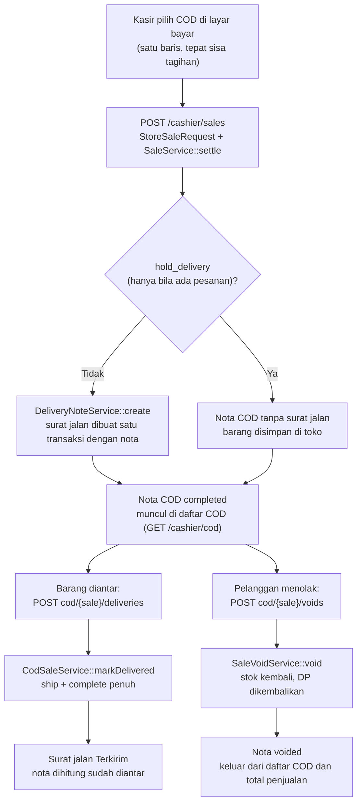
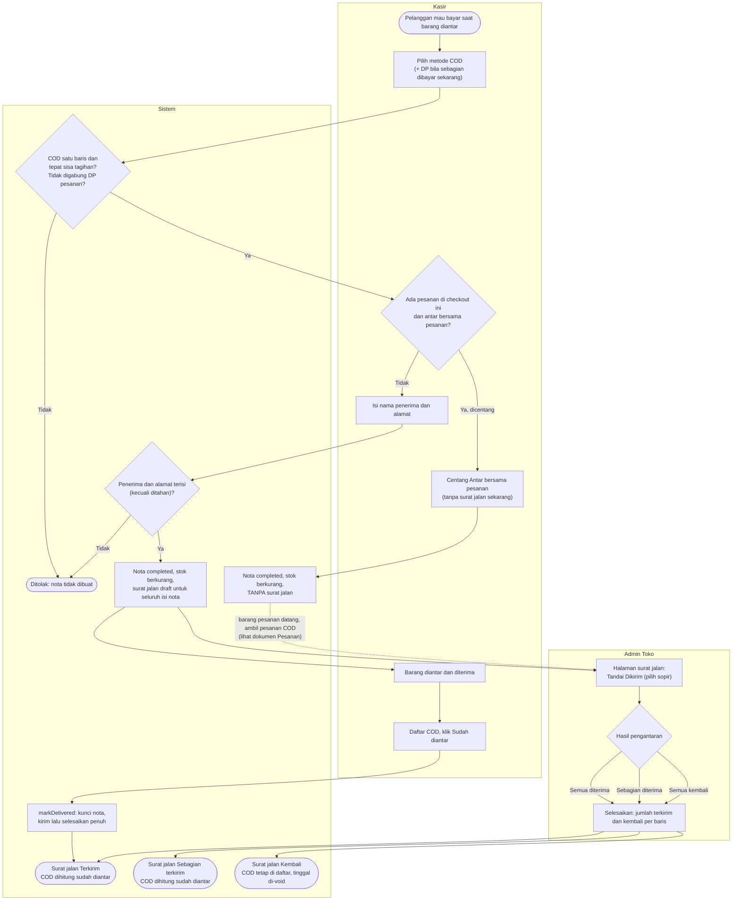
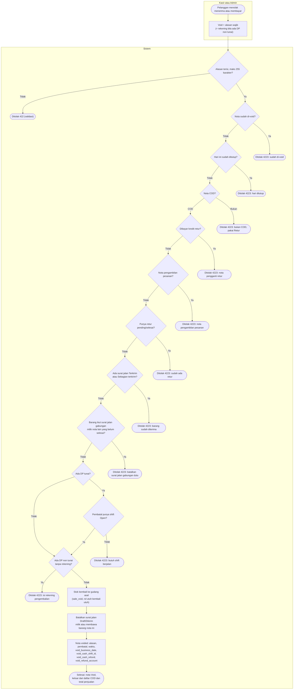
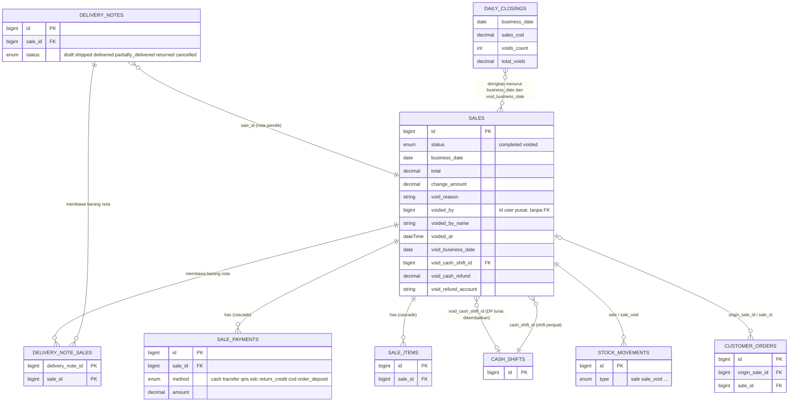
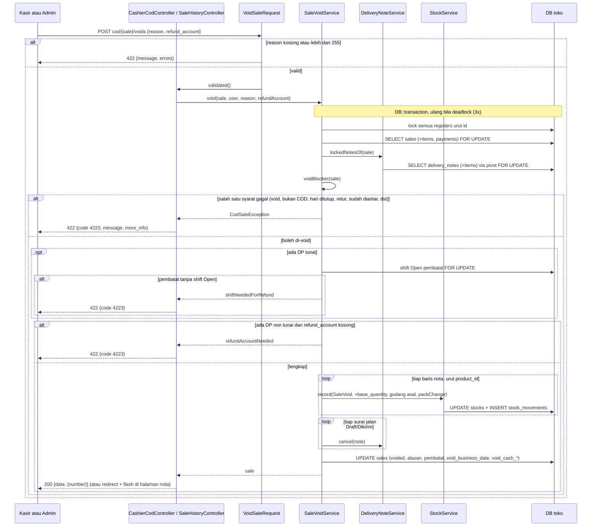

# COD dan Void Nota — Dokumentasi Teknis

> **Modul:** Pembayaran COD (bayar saat barang diantar), daftar COD kasir, tanda "sudah diantar", penahanan pengantaran (`hold_delivery`), dan void nota COD
> **Stack:** Laravel 13 (PHP 8.3), Inertia 3, Vue 3, Quasar 2, stancl/tenancy
> **Database:** per toko (kolom COD/void ada di tabel `sales`, `sale_payments`, `daily_closings` milik DB toko)
> **Audiens:** Engineer yang memelihara atau memperluas fitur ini
> **Terakhir diperbarui:** 2026-11-17
> **Dokumen terkait:** [pesanan-pelanggan-docs.md](pesanan-pelanggan-docs.md) (pesanan, DP, pengambilan pesanan), modul Surat Jalan (`DeliveryNoteService`, dikerjakan di dokumen lain; di sini hanya dipakai, tidak dijelaskan ulang), [analisis-sistem.md](analisis-sistem.md) bagian 7.5 (COD dan void COD) dan D17

## 1. Ringkasan

COD adalah metode bayar di layar bayar: sisa tagihan dibayar pelanggan ketika barang diantar. Nota COD tetap nota penjualan biasa (stok langsung berkurang, `status = completed`) tetapi bagian COD-nya **bukan uang di laci**, jadi tidak menyentuh tunai seharusnya shift. Aturan utamanya: COD hanya satu baris pembayaran dan harus **tepat** sisa tagihan setelah pembayaran lain (boleh ada DP tunai/transfer/QRIS/EDC di depan, tidak ada kembalian). Nota COD tidak boleh keluar tanpa surat jalan: surat jalan seluruh isi nota dibuat dalam transaksi yang sama dengan nota. Satu pengecualian adalah nota COD yang dibuat bersama pesanan pelanggan (`hold_delivery`): barangnya disimpan di toko dan keluar bersama surat jalan pesanan nanti.

Di layar kasir, tombol **COD** membuka daftar nota COD yang belum diantar dari semua hari. Dari sana kasir menekan **Sudah diantar** (surat jalan yang masih berjalan dikirim lalu diselesaikan penuh) atau **Void** bila pelanggan menolak menerima/membayar. Void membatalkan nota, mengembalikan barang ke gudang asal, membatalkan surat jalan yang masih berjalan, dan mengembalikan DP (tunai dari laci shift pembatal, non tunai ke rekening yang diisi). Void **hanya untuk nota COD yang barangnya belum diterima pelanggan**; nota non COD dan nota yang barangnya sudah diterima memakai Retur.

Alasan desain yang paling menentukan: **void tanpa persetujuan Admin, tetapi dengan jejak dan pengaman uang**. Keputusan pemilik toko (pengecualian atas D17) adalah kasir boleh mem-void COD karena pelanggan menolak di pintu sering terjadi dan menunggu Admin tidak praktis. Pengamannya: alasan wajib, nota menyimpan siapa/kapan/mengapa, DP tunai yang dikembalikan **mengurangi tunai seharusnya shift pembatal** (jadi hitungan fisik laci tetap harus cocok), dan "sudah diantar" yang tidak bisa dibatalkan menutup jalan untuk mem-void nota yang barangnya sudah dibawa pelanggan.

### 1.1 Alur tingkat tinggi



### 1.2 BPMN: bayar COD sampai selesai



Catatan membaca diagram: jalur Admin dan jalur "Sudah diantar" kasir sama-sama berujung pada surat jalan yang diselesaikan; kasir hanya punya jalan pintas "semua terkirim penuh". Selisih barang (sebagian terkirim atau kembali) hanya bisa dicatat Admin di halaman surat jalan.

### 1.3 BPMN: void nota COD dengan semua penolakan



Urutan gateway mengikuti `SaleVoidService::voidBlocker` lalu `void()` persis (lihat 7.3). Seluruh penolakan terjadi **sebelum** penulisan apa pun, dan transaksi tidak menyisakan setengah void.

---

## 2. Skema Database

Modul ini tidak punya tabel sendiri. Ia memakai kolom yang ditambahkan ke tabel nota dan tutup hari. Semua di **DB toko**.

### `sales` (kolom void dan hal yang dibaca modul COD)

Tabel dibuat oleh `2026_10_27_152507_create_sales_tables.php` (modul Penjualan). Yang relevan di sini:

| Kolom | Tipe | Null | Catatan |
|---|---|---|---|
| `status` | enum `completed, voided` | tidak | Default `completed`. Hanya dua nilai, jadi pengecekan `notCompleted` di `voidBlocker` tidak pernah tercapai (lihat 11) |
| `void_reason` | string | ya | Alasan pembatal (maks 255) |
| `voided_by` | unsigned bigint | ya | id user pusat, **tanpa FK** (lintas database) |
| `voided_by_name` | string | ya | Snapshot nama (migrasi `2026_11_03_100000`); nota tetap terbaca bila user diganti |
| `voided_at` | dateTime | ya | Indeks `voided_at` ditambah di migrasi yang sama |
| `void_business_date` | date | ya | Migrasi `2026_11_10_110000`. **Hari bisnis void**: hari bisnis shift berjalan pembatal, atau `today()` bila ia tidak punya shift. Indeks. Nullable karena nota yang tidak pernah di-void tidak punya nilai; backfill menyalin hari bisnis shift pengembali DP, atau tanggal `voided_at` |
| `void_cash_shift_id` | bigint, FK `cash_shifts` | ya | Restrict. Shift tempat DP tunai dikeluarkan dari laci. **Null bila tidak ada DP tunai**, walau pembatal punya shift (shift itu hanya dipakai untuk `void_business_date`) |
| `void_cash_refund` | decimal(15,2) | tidak | Default 0. DP tunai yang dikembalikan (setelah kembalian) |
| `void_refund_account` | string | ya | Rekening penerima pengembalian DP non tunai; hanya dicatat, tidak ada pergerakan kas |
| `change_amount` | decimal(15,2) | tidak | Dipakai `cashDeposit()` (tunai diterima dikurangi kembalian). Untuk nota COD selalu 0 karena pembayaran harus pas |
| `print_count` | unsigned int | tidak | Dipakai cetak ulang; nota void tercetak bertanda **VOID** |

Kolom void **tidak ada di `#[Fillable]`** model `Sale`; `SaleVoidService` menulisnya dengan `forceFill`. `Sale` hanya mengaudit event `updated`, sehingga void tercatat di tabel `audits` sebagai perubahan nota.

### `sale_payments`

| Kolom | Tipe | Catatan |
|---|---|---|
| `method` | enum | Awalnya `cash, transfer, qris, edc, return_credit`; `cod` ditambah `2026_11_03_100000`; `order_deposit` ditambah `2026_11_05_130000` (keduanya `ALTER TABLE ... MODIFY`, MySQL-spesifik). Bagian COD sebuah nota = jumlah baris `method = cod` (maks satu, ditegakkan `SaleService::settle`, bukan constraint DB) |

### `daily_closings` (kolom yang ditambah modul ini)

| Kolom | Tipe | Catatan |
|---|---|---|
| `sales_cod` | decimal(15,2) default 0 | Jumlah COD nota **selesai** yang `business_date`-nya hari itu (tanpa pemisahan sudah/belum diantar) |
| `voids_count` | unsigned int default 0 | Jumlah nota void menurut `void_business_date` |
| `total_voids` | decimal(15,2) default 0 | Jumlah `sales.total` nota itu (total **penuh**, termasuk bagian COD yang tidak pernah diterima) |

Kolom `order_deposits_received/refunded` milik modul pesanan, dibahas di dokumen itu.

### `delivery_note_sales` (milik modul Surat Jalan; hanya ringkasan)

Pivot `(delivery_note_id, sale_id)` dengan PK komposit, dibuat `2026_11_07_100000`. Satu surat jalan punya satu nota pemilik (`delivery_notes.sale_id`), tetapi bisa membawa barang nota lain (nota asal pesanan). `Sale::deliveryNotes()` adalah BelongsToMany lewat pivot ini, **bukan** `hasMany` lewat `delivery_notes.sale_id`: dari sinilah "sudah diantar", daftar COD, dan void bekerja untuk kedua nota sebuah surat jalan gabungan.

### Diagram relasi



---

## 3. Model / Entity

| Model | Tabel | Hal penting untuk modul ini |
|---|---|---|
| `App\Models\Sale` | `sales` | **Auditable** (hanya event `updated`). `payments()`, `items()`, `deliveryNotes()` (BelongsToMany `delivery_note_sales`). Helper yang semuanya **butuh `payments` sudah dimuat**: `isCod()` (ada baris `cod`), `codAmount()` (jumlah baris `cod`, string 2 desimal, "0.00" untuk bukan COD), `cashDeposit()` (tunai - `change_amount`), `nonCashDeposit()` (transfer + QRIS + EDC). Cast `void_cash_refund` decimal:2, `voided_at`/`void_business_date` tanggal, `status` -> `SaleStatus` |
| `App\Models\SalePayment` | `sale_payments` | Cast `method` -> `PaymentMethod` |
| `App\Enums\PaymentMethod` | | `Cod` ada di `forSale()` (ditawarkan di layar bayar) tetapi **tidak** di `forCashier()` (daftar metode uang masuk/keluar: refund, tukar, ringkasan laci). Itu sebabnya COD tidak pernah masuk `payments` ringkasan shift |
| `App\Enums\SaleStatus` | | `Completed`, `Voided` |
| `App\Enums\DeliveryNoteStatus` | | Dipakai untuk semantik COD: `hasDeliveredGoods()` (Terkirim atau Sebagian terkirim) = "sudah diantar"; `isUnfinished()` (Draft atau Dikirim) = "masih berjalan"; `canBeCancelled()` = `isUnfinished()`; `canBeShipped()` = Draft saja. **Terkirim tidak bisa dibatalkan**, itulah yang membuat tanda "sudah diantar" tak dapat dibalik |
| `App\Exceptions\CodSaleException` | | Named constructor per alasan; pesan aman ditampilkan |
| `App\Exceptions\SaleException` | | `codMoreThanOnce`, `codMustBeTheRest`, `codWithOrderDeposit`, `deliveryNoteRequired`, `deliveryHoldNeedsOrder` untuk sisi pembuatan nota COD |

---

## 4. Hak Akses

| Aksi | Rute | Siapa | Catatan |
|---|---|---|---|
| Membuat nota COD | `POST /cashier/sales` | Pengguna toko dengan shift **Open** | Grup `cashier`: `web`, `InitializeTenancyByPath`, `auth`, `store.access`, `shift.remember` |
| Daftar COD, "Sudah diantar", void | `GET cod`, `POST cod/{sale}/deliveries`, `POST cod/{sale}/voids` | **Setiap pengguna toko** (Kasir, Admin Toko, Super Admin) | Tanpa `store.admin`, tanpa pengecekan pemilik nota, tanpa syarat punya shift (shift hanya wajib bila ada DP tunai yang harus dikembalikan). Disengaja: keputusan pemilik toko (komentar `CashierCodController`; D17) |
| Void dari halaman nota | `POST /sales/{sale}/voids` | `store.admin` (Admin Toko, Super Admin) | Mengenai service yang sama; hanya responsnya berbeda (redirect + flash) |
| Lihat alasan void tertolak | `GET /sales/{sale}` | `store.admin` | Menyertakan `void_blocker` (pesan `voidBlocker`) agar tombol Void bisa dinonaktifkan dengan alasannya |

Tes `test_a_cashier_can_use_the_till_routes_and_they_are_open_only_to_store_users` memastikan pengguna di luar toko mendapat 403, dan `test_any_cashier_of_the_store_may_void_a_cod_sale_of_another` bahwa kasir mana pun boleh mem-void nota kasir lain. Konsekuensinya: **kasir mana pun bisa menandai nota kasir lain "sudah diantar"**, yang menutup kemungkinan void nota itu secara permanen (lihat 11).

---

## 5. Konfigurasi

Tidak ada kunci `config/`, `.env`, atau jadwal yang khusus COD/void (Grep atas `config/` dan `routes/console.php` tanpa hasil). Yang ada:

| Nama | Nilai | Lokasi | Dibaca oleh |
|---|---|---|---|
| `LIST_LIMIT` | 50 | `CashierCodController` | Jumlah nota COD terbaru di daftar kasir (urut `id` turun) |
| `StockService::DEADLOCK_ATTEMPTS` | 3 | `StockService` | `SaleVoidService::void` dan `CheckoutService::checkout`. **Tidak** dipakai `CodSaleService::markDelivered` |
| Pengaturan toko `lock_sales_during_opname` | bawaan mati | `StoreSettingService` | Tidak memengaruhi void (void menambah stok); memengaruhi pembuatan nota COD seperti nota biasa |

---

## 6. Rute / API

Prefiks `/t/{tenant}`. Grup kasir bernama `tenant.cashier.*`.

| Method | Path | Action | Nama rute | Middleware tambahan |
|---|---|---|---|---|
| POST | `/cashier/sales` | `SaleController@store` | `tenant.cashier.sales.store` | Form Inertia; pembuatan nota COD |
| GET | `/cashier/cod` | `CashierCodController@index` | `tenant.cashier.cod.index` | JSON |
| POST | `/cashier/cod/{sale}/deliveries` | `CashierCodController@delivered` | `tenant.cashier.cod.delivered` | JSON |
| POST | `/cashier/cod/{sale}/voids` | `CashierCodController@void` | `tenant.cashier.cod.void` | JSON, `VoidSaleRequest` |
| GET | `/sales/{sale}` | `SaleHistoryController@show` | `tenant.sales.show` | `store.admin` |
| POST | `/sales/{sale}/voids` | `SaleHistoryController@void` | `tenant.sales.void` | `store.admin`, `VoidSaleRequest`, redirect + flash |

Pola galat rute JSON kasir: status **422** dengan `{code: 4223, message, more_info}` (`ApiErrorCode::CodRefused`, trait `AnswersJsonErrors`). `more_info` selalu "Muat ulang daftar COD untuk melihat keadaan nota yang terbaru, lalu coba lagi." Validasi form (alasan kosong) memakai bentuk Laravel `{message, errors}`, juga 422. Frontend (`postJson`) menampilkan `errors` pertama atau `message`.

Contoh berikut **ilustratif** (disusun dari bentuk resource dan tes, bukan tangkapan nyata), kecuali bentuk galat 4223 yang persis seperti `assertExactJson` di `CodSaleTest::test_a_refused_till_action_answers_with_the_standard_error_body`.

**`POST /t/mitra_utama/cashier/sales`: nota COD dengan DP tunai 40.000 dan sisa COD 60.000, surat jalan dibuat sekarang:**

```json
{
  "client_uuid": "0c5b2c1e-8c34-4d6d-8a0b-7b3c9f3e5a11",
  "customer_name": "Pak Budi",
  "items": [{ "product_unit_id": 11, "quantity": "10" }],
  "payments": [
    { "method": "cash", "amount": 40000 },
    { "method": "cod", "amount": 60000 }
  ],
  "delivery_note": {
    "recipient_name": "Pak Budi",
    "recipient_phone": "081234567890",
    "recipient_address": "Jl. Mawar 5, Sidoarjo",
    "notes": null,
    "include_linked_sale_items": false
  }
}
```

Sukses: redirect ke layar kasir dengan flash `last_sale` (berisi `is_cod`, `cod_amount`, dan `delivery_notes[]` dengan `print_url`). Galat bisnis, mis. COD tidak pas: redirect balik dengan flash `error` = "Jumlah COD harus sisa tagihan setelah pembayaran lain, tidak lebih dan tidak kurang."

**`GET /cashier/cod`:**

```json
{
  "data": [
    {
      "id": 58,
      "number": "INV/MU/K1/2611/0042",
      "sold_at": "2026-11-16T09:14:00+07:00",
      "customer_name": "Pak Budi",
      "recipient_name": "Pak Budi",
      "cod_amount": "60000.00",
      "deposit_amount": "40000.00",
      "has_cash_deposit": true,
      "has_non_cash_deposit": false,
      "delivery_status": "draft",
      "delivery_status_label": "Draft",
      "can_mark_delivered": true,
      "delivered_url": "/t/mitra_utama/cashier/cod/58/deliveries",
      "void_url": "/t/mitra_utama/cashier/cod/58/voids"
    }
  ],
  "meta": { "total": 1 }
}
```

`delivery_status` null dan `delivery_status_label` "Belum ada surat jalan" untuk nota COD yang ditahan. URL pada respons nyata absolut.

**`POST /cashier/cod/58/deliveries`** sukses `{ "data": { "number": "INV/MU/K1/2611/0042" } }`. Dipanggil lagi: 422

```json
{
  "code": 4223,
  "message": "Nota ini tidak punya surat jalan yang masih berjalan.",
  "more_info": "Muat ulang daftar COD untuk melihat keadaan nota yang terbaru, lalu coba lagi."
}
```

**`POST /cashier/cod/58/voids`** body `{"reason": "Pelanggan menolak", "refund_account": null}`. Sukses `{ "data": { "number": "INV/MU/K1/2611/0042" } }`. Ditolak (barang sudah diterima), 422:

```json
{
  "code": 4223,
  "message": "Barang nota ini sudah diantar dan diterima pelanggan, jadi tidak bisa di-void. Pakai Retur untuk barang yang dikembalikan.",
  "more_info": "Muat ulang daftar COD untuk melihat keadaan nota yang terbaru, lalu coba lagi."
}
```

Alasan kosong (bentuk validasi Laravel, 422):

```json
{ "message": "Isi alasan void.", "errors": { "reason": ["Isi alasan void."] } }
```

---

## 7. Komponen Backend

### 7.1 Pembayaran COD: tiga lapis aturan

Aturan COD ditegakkan di tiga tempat, dan hanya lapis server yang dipercaya:

1. **`StoreSaleRequest`**: `payments.*.method` harus salah satu `PaymentMethod::forSale()` (tunai, transfer, QRIS, EDC, COD). `order_deposit` dan `return_credit` ditolak di sini, jadi kasir tidak bisa mengirimnya. `delivery_note.recipient_name` dan `recipient_address` wajib (`Rule::requiredIf`) bila ada baris COD dan `hold_delivery` tidak benar.
2. **`SaleService::settle`** (`app/Services/SaleService.php`): menghitung total dibayar (ditambah DP pesanan yang sedang diambil). COD lebih dari satu baris -> `codMoreThanOnce`. Total dibayar < total nota -> `codMustBeTheRest` bila ada baris COD (selain itu `paymentTooLow`). Ada COD dan total dibayar tidak persis sama dengan total -> `codMustBeTheRest`. Dengan begitu **COD selalu baris yang membuat pembayaran pas**, sehingga kembalian selalu 0 dan `cashDeposit()` selalu sama dengan tunai yang diterima.
3. **`TenderSplitter`** (hanya bila checkout juga membuat pesanan dengan DP): COD bersama DP pesanan ditolak (`codWithOrderDeposit`), karena DP adalah uang yang diterima sekarang. Layar bayar (`PaymentDialog.vue`) mencerminkan ketiganya (tombol COD dinonaktifkan bila sudah ada baris COD atau ada DP), tetapi itu hanya kenyamanan.

Hal yang sengaja **tidak** ada: pencatatan uang COD yang akhirnya diterima. COD tidak pernah menjadi pembayaran/penerimaan kas di sistem (lihat 11).

### 7.2 Surat jalan wajib dan `hold_delivery` (`SaleService::recordDeliveryNoteOfCod`)

Dipanggil di akhir transaksi `SaleService::create`, jadi nota dan surat jalannya satu transaksi: tidak bisa ada nota COD tanpa surat jalan dan tidak bisa ada surat jalan tanpa nota.

- Bukan COD, atau `hold_delivery` benar -> tidak membuat apa pun.
- Penerima atau alamat kosong -> `SaleException::deliveryNoteRequired` (pengaman kedua setelah request, karena service bisa dipanggil tanpa request).
- Selain itu `DeliveryNoteService::create` dengan `client_uuid` acak baru. Barisnya dari `linesOfCodNote`: semua sisa baris nota ini, ditambah sisa baris nota asal pesanan hanya bila `include_linked_sale_items` benar (satu pengantaran untuk dua nota). Gagal -> `DeliveryNoteException` dibungkus `SaleException` agar sampai ke kasir.

`hold_delivery` ("Antar bersama pesanan") hanya sah bila checkout yang sama membuat pesanan: request menolaknya (`prohibitedIf` order kosong) dan `CheckoutService` juga (`deliveryHoldNeedsOrder`). Efeknya: nota COD dibuat dan stok keluar, tetapi **tanpa surat jalan**; barangnya tetap fisik di toko dan nanti keluar bersama barang pesanan dalam satu surat jalan gabungan saat pesanan diambil sebagai COD (tombol "Antar sekalian barang nota ... yang belum diantar"). `hold_delivery` yang dikirim bersama pembayaran non COD diterima tanpa efek (lihat 11).

### 7.3 `SaleVoidService` (`app/Services/SaleVoidService.php`)

**`void(Sale, User, reason, refundAccount)`**: satu `DB::transaction` dengan retry deadlock (`DEADLOCK_ATTEMPTS`). Urutan sebenarnya:

1. `DailyClosing::lockAgainstClosing()`: mengunci semua baris `registers` menurut id, supaya void dan penutupan hari saling menunggu (tanpa ini void yang commit tepat setelah tutup hari membaca hari itu akan tertinggal dari snapshot atau mendarat di hari tertutup).
2. Kunci nota (`lockForUpdate`, dengan `items.productUnit`, `payments`) lalu `deliveryNotes->lockedNotesOf()`: semua surat jalan nota itu (lewat pivot) dikunci berikut barisnya, menurut urutan `id`. Admin yang sedang menyelesaikan/membatalkan surat jalan yang sama menunggu, bukan mengubahnya di bawah void.
3. `requireVoidable` -> `voidBlocker` (di bawah).
4. DP: `cashDeposit()` dan `nonCashDeposit()`. Bila ada DP tunai, `runningShiftOf` mengambil shift Open pembatal dan **mengunci** barisnya (shift tidak bisa ditutup selama refund dibukukan); tanpa shift Open -> `shiftNeededForRefund`. Shift berstatus `pending_review` (sudah dihitung, menunggu keputusan Admin) juga ditolak, karena `openShiftOf` memang mengembalikannya tetapi `runningShiftOf` mensyaratkan `Open`.
5. `voidBusinessDate` = `business_date` shift tadi, atau shift milik pembatal bila ia punya (meski tanpa DP tunai), atau `today()`. Hari bisnis shift sengaja dipakai (bukan tanggal kalender `voided_at`) supaya count void dan refund tunainya mendarat di hari yang sama walau shift melewati tengah malam.
6. DP non tunai tanpa `refund_account` -> `refundAccountNeeded`.
7. `putGoodsBack`: per baris nota, urut `product_id` (urutan yang sama dengan penjualan agar tidak deadlock), `StockService::record` bertipe `SaleVoid` dengan `+base_quantity` ke **gudang asal nota** (`sale.warehouse_id`) dan `packChange` = `wholePacksIn(quantity)`: satuan kemasan (rol) kembali utuh, rol yang sudah terlanjur dibuka tetap terbuka dan potongannya kembali eceran.
8. Surat jalan yang `canBeCancelled()` (Draft/Dikirim) dibatalkan lewat `DeliveryNoteService::cancel`.
9. `forceFill` nota: `status = voided`, `void_reason`, `voided_by`, `voided_by_name`, `voided_at`, `void_business_date`, `void_cash_shift_id`, `void_cash_refund` (selalu terisi, 0 bila tanpa DP tunai), `void_refund_account` (hanya bila ada DP non tunai).

Void **tidak punya `client_uuid`**: idempotensinya berbasis status (void kedua -> `alreadyVoided`).

**`voidBlocker(Sale): ?CodSaleException`**: satu-satunya tempat aturan "boleh di-void", dipakai tombol di halaman nota (lewat `void_blocker`) dan `void()` sendiri. Urutan `match(true)` (yang pertama cocok menang, jadi pesannya mengikuti urutan ini):

| # | Kondisi | Pesan (`CodSaleException`) |
|---|---|---|
| 1 | status sudah `voided` | `alreadyVoided` |
| 2 | status bukan `completed` | `notCompleted` (tak tercapai, lihat 11) |
| 3 | bukan COD | `notCod`: "Hanya nota COD yang bisa diproses di sini. Nota lain memakai Retur." |
| 4 | hari ini sudah ditutup (`DailyClosing::isClosedOn(today())`) | `dayClosed` |
| 5 | ada pembayaran `return_credit` | `paidByReturnCredit` (nota pengganti retur) |
| 6 | nota mengambil pesanan (`customer_orders.sale_id = sale.id`) | `collectsCustomerOrder` |
| 7 | ada retur `pending` atau `completed` | `hasReturns` |
| 8 | ada surat jalan Terkirim atau Sebagian terkirim | `alreadyDelivered` |
| 9 | ada surat jalan yang belum selesai **milik nota lain** (`note.sale_id != sale.id`) yang membawa barang nota ini | `onCombinedDeliveryNote` |
| - | selain itu | `null` (boleh) |

Beberapa keputusan di balik daftar itu:

- **Hari dari nota tidak diperiksa.** Hanya hari *ini* yang harus belum ditutup: nota yang dijual kemarin boleh di-void hari ini (COD ditolak di pintu keesokan harinya), dan snapshot hari yang sudah tertutup **tidak berubah** (void dibukukan di hari void).
- **Butir 6 diperiksa dari pesanan, bukan dari pembayaran.** Pesanan yang diambil tanpa DP tidak punya baris `order_deposit`, padahal mem-void nota pengambilannya akan mengembalikan barang ke rak sementara pesanan tetap `completed` dan tidak bisa diambil lagi (ada tes: `test_the_receipt_that_collects_an_order_cannot_be_voided_even_when_no_deposit_was_paid`).
- **Butir 8 dan 9 berurutan.** Surat jalan gabungan yang sudah Terkirim menjawab "sudah diantar"; yang masih Draft/Dikirim menjawab "batalkan surat jalan gabungannya dulu". Surat jalan yang **Kembali** atau Dibatalkan tidak menghalangi (tes `test_a_receipt_on_a_combined_note_that_came_back_whole_can_be_voided`). Surat jalan Draft/Dikirim milik nota ini sendiri tidak menghalangi, karena void-lah yang membatalkannya (langkah 8).
- **Tidak ada pemeriksaan hubungan ke pesanan *asal*.** `voidBlocker` tidak melihat `customer_orders.origin_sale_id`; lihat 11.

### 7.4 Diagram urutan: void



Semua `throw` terjadi sebelum penulisan pertama (`putGoodsBack` adalah penulisan pertama), dan bila terjadi sesudahnya transaksi di-rollback; tidak ada void setengah jadi.

### 7.5 `CodSaleService` (`app/Services/CodSaleService.php`)

Semantik inti: **nota COD "sudah diantar" bila ada surat jalan yang membawa barangnya (lewat pivot) yang berakhir Terkirim atau Sebagian terkirim.** Surat jalan masih berjalan, Kembali, Dibatalkan, atau tidak ada surat jalan sama sekali berarti "belum diantar".

- **`isDelivered(Sale)`**: butuh relasi `deliveryNotes` dimuat.
- **`undeliveredSales($limit)`** dan **`undeliveredCount()`**: nota `completed` dengan baris COD dan **tanpa** surat jalan berstatus "sudah diantar", dari semua hari, `id` turun, dibatasi 50. Nota yang ditahan (tanpa surat jalan) dan nota yang surat jalannya Kembali tetap ada di daftar sampai di-void atau diantar ulang.
- **`totalsOfShift(CashShift)`**: nota `completed` milik shift itu (`cash_shift_id`) yang punya baris COD, dibagi `delivered`/`undelivered`; `amount` = jumlah `codAmount()` (bagian COD per nota, bukan total nota, karena DP bukan COD). Nota void tidak ikut karena hanya `completed`. Dipakai `ShiftService::summarize` (lihat bagian 10).
- **`markDelivered(Sale)`**: satu `DB::transaction` (tanpa retry deadlock): mengunci nota (`with payments`) lalu surat jalannya. Urutan penolakan: `voided` -> `alreadyVoided`; bukan `completed` -> `notCompleted`; bukan COD -> `notCod`; tidak ada surat jalan yang masih berjalan -> `nothingToDeliver`. Lalu untuk **setiap** surat jalan Draft/Dikirim: bila Draft dikirim dulu (`ship`, tanpa sopir) kemudian `complete` dengan semua baris `quantity_delivered = quantity`, `quantity_returned = 0`. Surat jalan gabungan ikut: menandai salah satu dari dua nota yang berbagi surat jalan menyelesaikan surat jalan itu, jadi keduanya "sudah diantar". Selisih barang dan "sebagian terkirim" hanya bisa dilakukan Admin di halaman surat jalan. **Tidak ada pengecekan retur, hari ditutup, atau shift** di jalur ini.

### 7.6 `CashierCodController` (`app/Http/Controllers/Tenant/CashierCodController.php`)

Tipis. `index` -> `CodSaleResource::collection(undeliveredSales(50))` ditambah `meta.total`. `delivered` dan `void` memanggil service, menangkap `CodSaleException` menjadi 422 kode 4223. `CodSaleResource` mengharuskan `payments` dan `deliveryNotes` dimuat; "surat jalan terbaru" diambil dari surat jalan yang tidak Dibatalkan dengan `id` terbesar (itu yang menentukan `recipient_name`, `delivery_status`, dan label), dan `can_mark_delivered` benar bila ada surat jalan aktif yang masih berjalan. `deposit_amount` = `cashDeposit() + nonCashDeposit()`, dan dua flag `has_*_deposit` dipakai dialog void untuk menanyakan rekening hanya bila perlu.

`SaleHistoryController::void` adalah pintu Admin dengan service yang sama: sukses -> flash `success` "Nota di-void. Barangnya kembali ke stok.", galat -> flash `error`.

### 7.7 Frontend

| Komponen | Peran |
|---|---|
| `resources/js/Components/Cashier/CodDialog.vue` | Daftar COD (`GET cod`), konfirmasi **Sudah diantar** (peringatan bahwa nota lalu tidak bisa di-void), dialog **Void** yang menanyakan alasan, dan rekening hanya bila `has_non_cash_deposit`. Dialog void tetap terbuka bila server menolak agar alasan yang diketik tidak hilang. Menampilkan "Menampilkan N dari M" bila lebih dari 50 yang menunggu |
| `Components/Cashier/PaymentDialog.vue` | Pilih COD (satu baris, terisi otomatis sisa tagihan), form penerima/alamat, kotak "Antar bersama pesanan" (`hold_delivery`), peringatan COD + DP |
| `Components/Cashier/SaleDoneDialog.vue` | Panel COD ("COD, ditagih saat barang diantar") dan tombol Cetak Surat Jalan, atau pesan bahwa barang disimpan di toko bila ditahan |
| `Components/Cashier/CloseShiftDialog.vue` | Jumlah nota COD sudah dan belum diantar (tanpa nominal, tutup shift buta) |
| `Pages/Tenant/Sales/Show.vue` | Tombol Void Nota COD (aktif bila `void_blocker` null), alasan mengapa tidak bisa, detail void (pembatal, alasan, DP dikembalikan) |
| `Composables/postJson.js` | POST JSON + token XSRF; melempar `Error(message)` yang ditampilkan apa adanya |

---

## 8. Aturan Validasi

`VoidSaleRequest` (dipakai kedua pintu void):

| Field | Aturan | Masuk ke | Pesan |
|---|---|---|---|
| `reason` | `required, string, max:255` | `sales.void_reason` | "Isi alasan void." |
| `refund_account` | `nullable, string, max:255` | `sales.void_refund_account` | Diperiksa di service, bukan di request, karena butuh tahu ada tidaknya DP non tunai |

Pembuatan nota COD (`StoreSaleRequest`, bagian yang berkaitan):

| Field | Aturan | Masuk ke | Pesan |
|---|---|---|---|
| `payments.*.method` | `required, in: cash/transfer/qris/edc/cod` (`forSale()`) | `sale_payments.method` | "Metode pembayaran tidak valid." |
| `payments.*.amount` | `required, numeric, gt:0, max:999999999999, decimal:0,2` | `sale_payments.amount` | "Jumlah pembayaran harus lebih dari 0." / "...maksimal 2 angka desimal." |
| `delivery_note.recipient_name` | `required` bila COD dan bukan `hold_delivery`; `string, max:255` | `delivery_notes.recipient_name` | "Nama penerima wajib diisi untuk nota COD." |
| `delivery_note.recipient_address` | sama; `max:1000` | `delivery_notes.recipient_address` | "Alamat pengantaran wajib diisi untuk nota COD." |
| `delivery_note.recipient_phone`, `.notes` | `nullable, string, max:255` / `max:1000` | idem | standar |
| `delivery_note.include_linked_sale_items` | `nullable, boolean` | memilih baris surat jalan | |
| `hold_delivery` | `nullable, boolean`, dilarang bila `order` kosong | menahan surat jalan | standar |

Perilaku gagal **semua-atau-tidak**: pembuatan nota COD, surat jalan, dan (bila ada) pesanan satu transaksi; void satu transaksi; `markDelivered` satu transaksi (kirim dan selesaikan semua surat jalan atau tidak sama sekali).

---

## 9. Guard Kepemilikan & Status

| Endpoint | Diperiksa ulang dari DB | Diblokir |
|---|---|---|
| `POST cod/{sale}/deliveries` | `sales.status`, baris `sale_payments` (COD), status tiap surat jalan, semuanya di bawah kunci | Sudah void (`alreadyVoided`), bukan `completed` (`notCompleted`), bukan COD (`notCod`), tanpa surat jalan berjalan (`nothingToDeliver`, juga untuk panggilan kedua) |
| `POST cod/{sale}/voids`, `POST sales/{sale}/voids` | Seluruh tabel di 7.3 dibaca ulang di bawah kunci nota dan surat jalan; `daily_closings` hari ini; shift Open pembatal | Lihat 7.3; tidak ada pengecekan pemilik nota maupun peran |
| `GET cod` | Tidak ada | Hanya mengembalikan nota `completed` ber-COD tanpa surat jalan "sudah diantar" |
| `POST /cashier/sales` (COD) | Shift Open di bawah kunci, `client_uuid`, harga/stok dari DB | Lihat dokumen Pesanan 9 untuk bagian checkout |

Status dari klien (flag `can_mark_delivered`, `void_blocker` di props halaman) hanya menyembunyikan tombol; server tidak membacanya.

Pesan galat `CodSaleException` (semuanya 422 kode 4223 pada rute JSON): `notCod`, `alreadyVoided`, `notCompleted`, `alreadyDelivered`, `onCombinedDeliveryNote`, `hasReturns`, `paidByReturnCredit`, `collectsCustomerOrder`, `shiftNeededForRefund`, `refundAccountNeeded`, `dayClosed`, `nothingToDeliver`.

---

## 10. Dampak ke Shift dan Tutup Hari

**Ringkasan shift (`ShiftService::summarize`):**

- `payments` per metode hanya memuat `forCashier()`, jadi COD **tidak pernah** masuk ke tunai/transfer/QRIS/EDC dan tidak memengaruhi `expected_cash` (tes `test_cod_never_counts_as_cash_in_the_drawer`).
- `cod.delivered` dan `cod.undelivered` (jumlah nota dan nominal COD) dari `CodSaleService::totalsOfShift`. Admin melihat keduanya lengkap (`ShiftRecapResource::cashFigures`); kasir yang shiftnya masih berjalan hanya melihat jumlah nota (`summarizeForCashier`, `hiddenCashFigures`), tanpa nominal, karena hitung laci dilakukan buta.
- **Nota void masih dihitung sebagai uang yang pernah masuk** pada pembayaran per metode dan kembalian shift penjualnya (`moneyTakenInStatuses = Completed + Voided`), sementara `sale_count`, `total_sales`, dan total COD hanya menghitung nota `completed`. `void_deposits` menamai uang itu agar bisa dibedakan.
- DP tunai yang dikembalikan masuk `void_cash_refunds` pada shift **pembatal** (`sales.void_cash_shift_id`), dan mengurangi `expected_cash` shift itu: `expected_cash = modal + tunai nota + DP pesanan tunai - refund retur - void_cash_refunds - pengeluaran laci`. Void di shift yang sama dengan penjualnya saling menghapus di laci (tes `test_a_deposit_voided_in_the_same_shift_nets_out_in_the_drawer`).

**Tutup hari (`DailyClosingService`):**

- `sales_cod` = jumlah baris COD nota `completed` pada `business_date` hari itu; **tidak** memisahkan sudah/belum diantar.
- `voids_count` dan `total_voids` dihitung menurut `void_business_date`, bukan tanggal nota: nota yang dijual kemarin dan di-void hari ini dihitung sebagai void **hari ini**, dan snapshot kemarin tidak berubah (tes `test_voiding_on_a_later_day_leaves_the_saved_figures_of_the_closed_day_as_they_were`). `total_voids` adalah `sales.total` penuh.
- `refunds_cash` hari itu = refund retur tunai + `void_cash_refund` nota yang `void_cash_shift_id`-nya shift hari itu.
- Daftar nota void hari itu (`voidsOf`) tampil di halaman dan laporan cetak.
- Nota COD yang belum diantar **tidak** menghalangi tutup hari; yang jadi pengingat hanya jumlah surat jalan belum selesai (`unfinished_delivery_note_count`).
- Hari ini yang sudah ditutup menolak void sampai Super Admin membukanya kembali (`voidBlocker` #4).

**Laporan penjualan (`SalesReportService`):** nota void dikeluarkan dari penjualan dan metode, dan dihitung terpisah per `void_business_date`. Baris metode menampilkan `COD (sudah diantar)` dan `COD (belum diantar)`, dengan cacat konsistensi yang dicatat di bagian 11.

---

## 11. Keterbatasan / Utang Teknis

1. **Laporan penjualan dan ringkasan shift tidak sepakat soal "COD sudah diantar" untuk surat jalan gabungan.** `SalesReportService.php:226-228` menentukan COD terkirim dengan `whereIn('sales.id', DeliveryNote::...->select('sale_id'))`, yaitu **nota pemilik** (`delivery_notes.sale_id`) saja, sedangkan `CodSaleService` memakai pivot `delivery_note_sales`. Nota asal pesanan yang COD-nya ditahan lalu terantar lewat surat jalan gabungan milik nota pengambilan akan tampil "sudah diantar" di ringkasan shift dan "belum diantar" di laporan penjualan. Belum ada tes yang menjaga kesepakatan itu.
2. **`markDelivered` tanpa retry deadlock.** `CodSaleService.php:100-135` memanggil `DB::transaction(fn)` tanpa `DEADLOCK_ATTEMPTS`, padahal ia mengunci nota lalu surat jalan, dan Admin bisa menyelesaikan/membatalkan surat jalan yang sama pada saat itu. Yang kalah deadlock berakhir 500, bukan diulang seperti `void`. Pembuktian penguncian di tes hanya lewat urutan query, bukan dua proses (R, `hasil-review-kode.md` bagian 2); dan perilaku `FOR UPDATE` lewat `whereRelation` pada `DeliveryNoteService::lockedNotesOf` (subquery) ditandai belum diverifikasi (R, bagian 12).
3. **"Sudah diantar" tidak bisa dibalik dan bisa dilakukan siapa pun.** Rute `cod.delivered` tidak membatasi pemilik/peran, dan surat jalan Terkirim tidak bisa dibatalkan (`DeliveryNoteStatus::canBeCancelled` hanya Draft/Dikirim). Satu klik kasir lain menutup void nota itu selamanya; koreksi hanya lewat Retur. Konfirmasi di `CodDialog.vue` adalah satu-satunya pengaman.
4. **Uang COD yang akhirnya diterima tidak tercatat di mana pun.** Tidak ada tabel/pembayaran penerimaan COD; `sales_cod` hanya "yang masih ditagih saat diantar" per hari penjualan, dan setelah diantar tidak ada pencatatan setoran. Sesuai bagian "Belum" `analisis-sistem.md` 7.5 ("setoran atau pelunasan COD ke kas"); konsekuensinya angka COD tidak bisa direkonsiliasi dengan kas.
5. **Penanda `notCompleted` tidak tercapai.** `SaleStatus` hanya `Completed`/`Voided`, jadi cabang kedua `voidBlocker` (`SaleVoidService.php:93`) dan pemeriksaan serupa di `markDelivered` hanya pertahanan terhadap status baru di masa depan.
6. **Pemeriksaan hari ditutup memakai tanggal kalender.** `SaleVoidService.php:95` memeriksa `DailyClosing::isClosedOn(today())` sementara void dibukukan di `void_business_date` (hari bisnis shift pembatal). Untuk shift yang melewati tengah malam keduanya bisa berbeda; tidak ada tes untuk kombinasi ini.
7. **Void nota asal pesanan yang COD-nya ditahan tidak dipertimbangkan.** `voidBlocker` tidak memeriksa `customer_orders.origin_sale_id`. Nota COD asal (tanpa surat jalan, `hold_delivery`) boleh di-void selagi pesanannya masih terbuka: barang kembali ke stok, pesanan tetap terbuka dengan `origin_sale_id` ke nota void, dan `DeliveryNoteService::linkedSaleOf` kemudian mengabaikannya (hanya nota `completed`). Berdasarkan pembacaan kode; tidak ditemukan tes yang menyentuh kombinasi ini, dan `analisis-sistem.md` tidak menyebut aturan untuk kasus ini.
8. **`hold_delivery` diterima diam-diam tanpa efek untuk pembayaran non COD.** `StoreSaleRequest` hanya melarangnya bila `order` kosong; `SaleService::recordDeliveryNoteOfCod` (baris 139-143) kembali lebih awal untuk non COD. Tidak berbahaya.
9. **`total_voids` adalah total nota penuh.** Termasuk bagian COD yang tidak pernah diterima, sehingga angkanya bukan "uang yang dikembalikan". Uang yang benar-benar keluar ada di `refunds_cash` (hanya DP tunai) dan `void_refund_account` (non tunai, tidak ada angka agregat di tutup hari).
10. **Resource riwayat nota meneruskan detail void ke layar kasir.** `SaleDetailResource` (dipakai riwayat nota kasir) meneruskan `void_refund_account` dan `void_reason` ke layar kasir, sementara `PrintableSaleResource` sengaja menyembunyikannya dari kertas (prinsip Hyrum: apa yang diekspos akan dipakai). Tidak dianggap masalah selama kasir memang boleh melihat nota di shiftnya.
11. **Daftar COD memotong di 50 terbaru.** Nota yang lebih lama baru muncul setelah yang di atas selesai/di-void (UI memberi tahu). Sebuah nota COD lama yang terlupa tidak akan tampak di antara tumpukan baru.
12. **Perbedaan dengan `analisis-sistem.md`.** Tidak ditemukan pertentangan pada aturan COD/void di 7.5 (syarat void, hari bisnis void, kode 4223, batas 50, penolakan surat jalan gabungan) terhadap kode yang dibaca. Dokumen itu mencatat dengan tepat bahwa void nota non COD belum ada. Catatan dokumen "void sesudah bayar butuh persetujuan Admin" (D17/A2) belum diimplementasikan sama sekali di modul ini.

---

## 12. Indeks File

| Concern | Path |
|---|---|
| Migrasi | `database/migrations/tenant/2026_10_27_152507_create_sales_tables.php`, `2026_11_03_100000_add_cod_and_void_details.php`, `2026_11_05_130000_create_customer_orders_tables.php` (enum `order_deposit`), `2026_11_07_100000_create_delivery_note_sales_table.php`, `2026_11_10_110000_add_void_business_date_to_sales_table.php` |
| Model | `app/Models/Sale.php`, `SalePayment.php`, `DeliveryNote.php`, `DailyClosing.php` |
| Enum | `app/Enums/PaymentMethod.php`, `SaleStatus.php`, `DeliveryNoteStatus.php`, `StockMovementType.php`, `ApiErrorCode.php` |
| Service | `app/Services/CodSaleService.php`, `SaleVoidService.php`, `SaleService.php` (`settle`, `recordDeliveryNoteOfCod`), `CheckoutService.php`, `TenderSplitter.php`, `DeliveryNoteService.php` (modul lain), `ShiftService.php`, `DailyClosingService.php`, `SalesReportService.php`, `StockService.php` |
| Controller | `app/Http/Controllers/Tenant/CashierCodController.php`, `SaleHistoryController.php`, `SaleController.php` |
| Trait controller | `app/Http/Controllers/Concerns/AnswersJsonErrors.php` |
| Request | `app/Http/Requests/Tenant/VoidSaleRequest.php`, `StoreSaleRequest.php` |
| Resource | `app/Http/Resources/CodSaleResource.php`, `SaleDetailResource.php`, `PrintableSaleResource.php`, `ShiftRecapResource.php` |
| Exception | `app/Exceptions/CodSaleException.php`, `SaleException.php`, `ShiftException.php` (`AWAITING_REVIEW_HINT`) |
| Rute | `routes/tenant.php` (baris 70-72 COD kasir, 135-137 riwayat nota dan void admin) |
| Halaman Vue | `resources/js/Pages/Tenant/Sales/Show.vue`, `Pages/Tenant/Cashier/Index.vue`, `Pages/Tenant/DailyClosings/Show.vue` |
| Komponen Vue | `resources/js/Components/Cashier/CodDialog.vue`, `PaymentDialog.vue`, `SaleDoneDialog.vue`, `CloseShiftDialog.vue`, `Components/ReceiptSheet.vue`, `Components/ShiftReportSheet.vue`, `Components/DailyReportSheet.vue` |
| Composable | `resources/js/Composables/postJson.js` |
| Test | `tests/Feature/Tenancy/CodSaleTest.php`, `SaleVoidTest.php`, `CustomerOrderTest.php` (COD ditahan dan surat jalan gabungan), `ShiftReportTest.php`, `SalesReportTest.php` |
