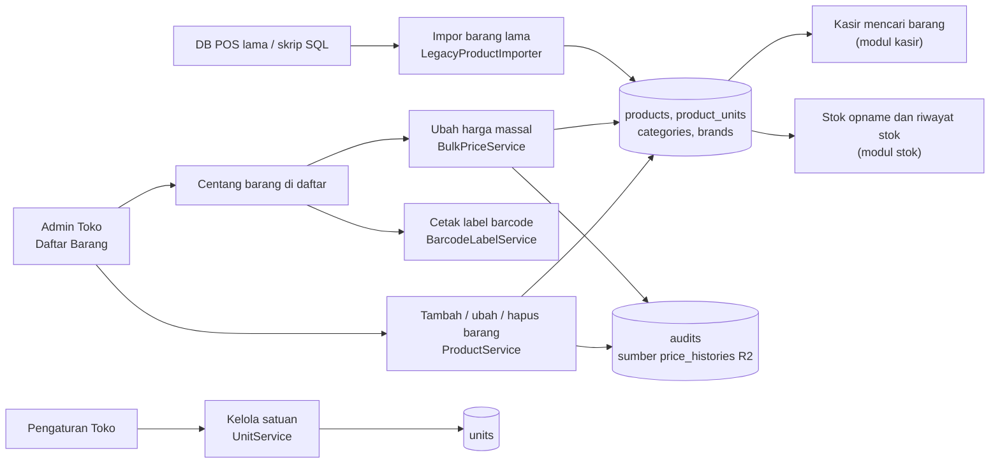
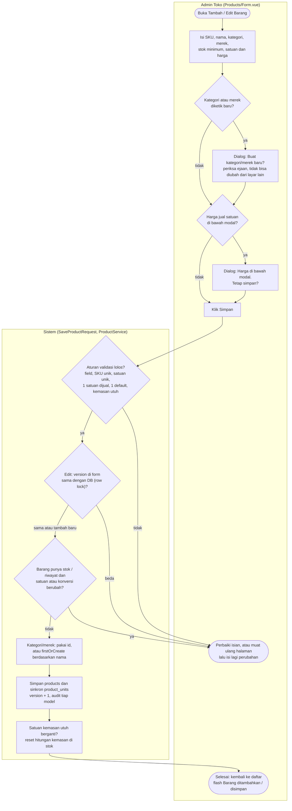
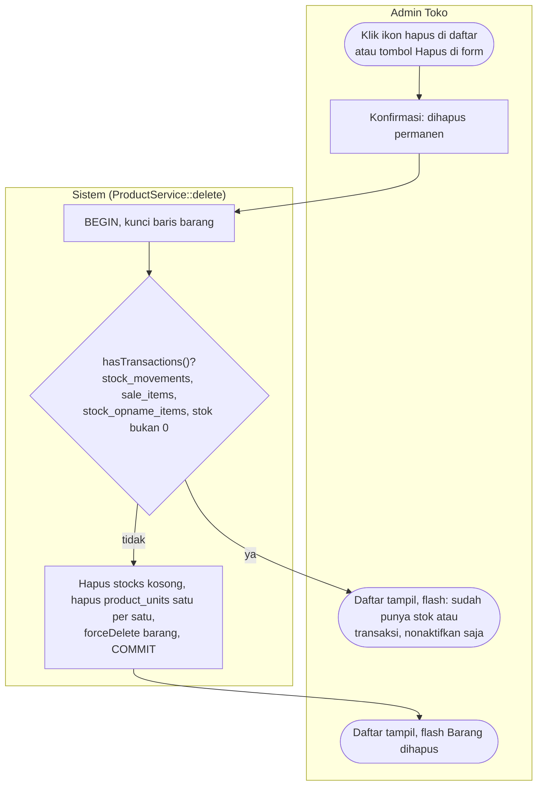
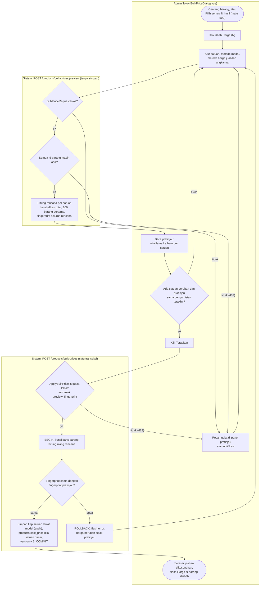
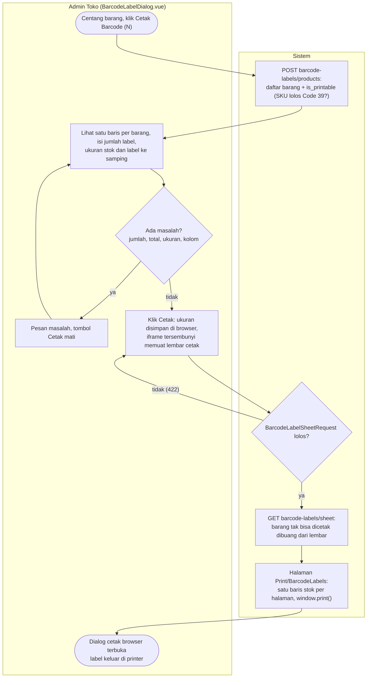
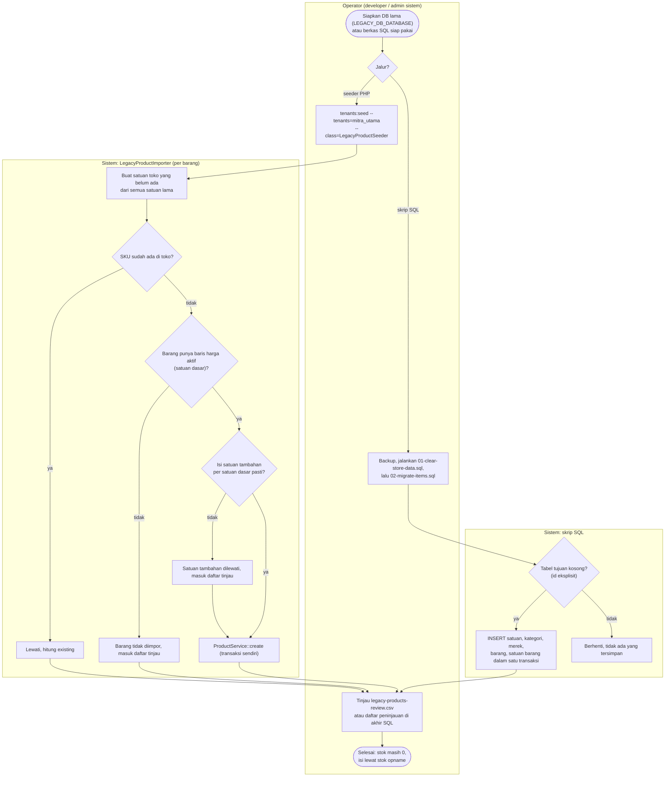
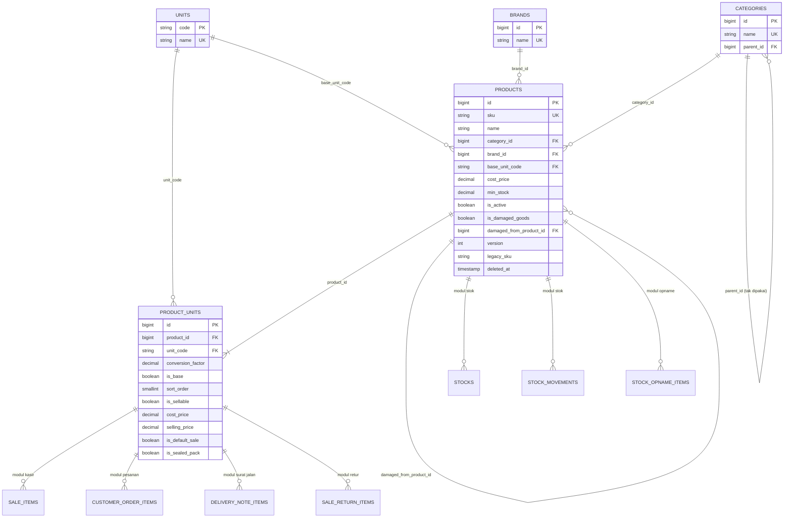
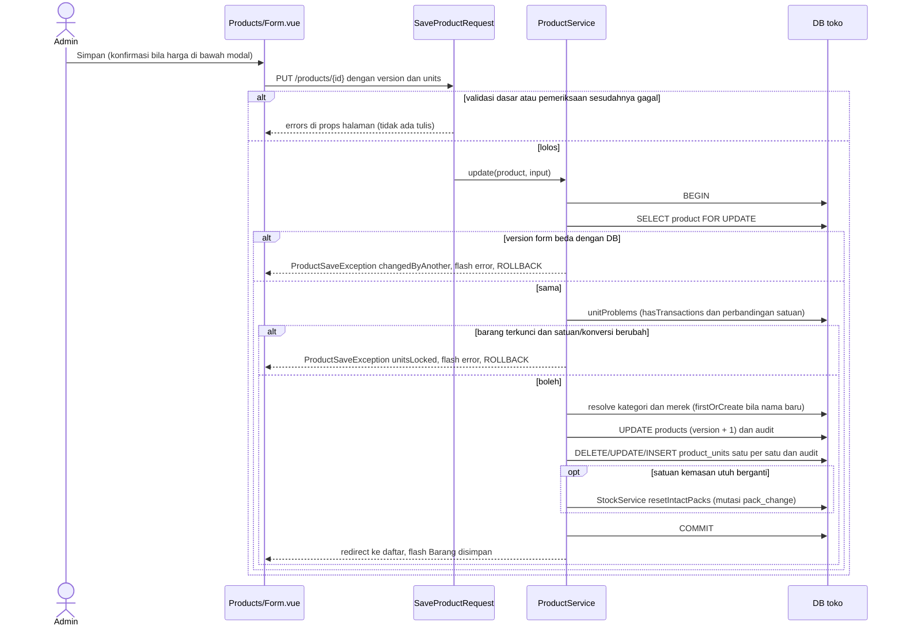
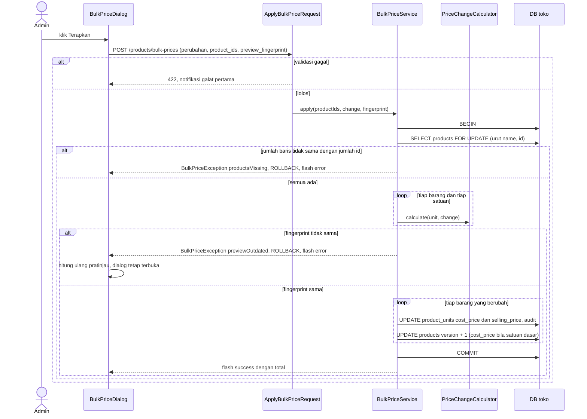

# Master Barang — Dokumentasi Teknis

> **Modul:** Master barang per toko: `Product`, `ProductUnit` (satuan jual dengan konversi), `Unit`, `Category`, `Brand`, ubah harga massal, cetak label barcode, impor barang lama
> **Stack:** Laravel 13 (PHP 8.3), Inertia 3, Vue 3, Quasar 2, stancl/tenancy
> **Database:** per toko (semua tabel modul ini ada di DB toko, bukan di DB pusat `mitra_manager`)
> **Audiens:** Engineer yang memelihara atau memperluas fitur ini
> **Terakhir diperbarui:** 2026-11-17

Cakupan dokumen: katalog barang satu toko (SKU, kategori, merek, satuan, konversi, modal dan harga jual per satuan), pengelolaan satuan, ubah harga massal, cetak label barcode, dan dua jalur impor barang dari POS lama. Logika stok untuk satuan "kemasan utuh" (`is_sealed_pack`) ada di modul stok dan hanya disentuh di sini sejauh field master-nya. Pembuatan barang kembar DG (`is_damaged_goods`) dikerjakan modul opname (`DamagedGoodsService`); modul ini hanya menyaringnya di daftar.

## 1. Ringkasan

Admin Toko (dan Super Admin) memelihara katalog barang satu toko di halaman **Daftar Barang**. Satu barang punya satu atau lebih **satuan jual** (mis. PCS sebagai satuan dasar, DUS isi 12). Tiap satuan menyimpan konversinya ke satuan dasar, modalnya sendiri (`cost_price`), harga jual (`selling_price`), apakah boleh dijual, apakah menjadi default di kasir, dan apakah ia "kemasan utuh". Stok selalu dihitung dalam satuan dasar; konversi inilah yang menerjemahkan penjualan DUS menjadi pengurangan PCS. Karena itu, begitu barang punya stok atau riwayat, satuan dan konversinya dikunci.

Dari daftar yang sama admin bisa mencentang banyak barang lalu (a) mengubah modal/harga jual sekaligus lewat jendela pratinjau-lalu-terapkan, atau (b) mencetak label barcode (Code 39 dari SKU) ke printer label. Barang lama dari POS sebelumnya masuk lewat seeder PHP (`LegacyProductSeeder`) atau lewat skrip SQL siap pakai di `database/legacy-sql/`. Setiap perubahan harga tercatat di `audits` (laravel-auditing); inilah satu-satunya jejak riwayat harga di R1 dan sumber isi awal `price_histories` di R2.

Kasir tidak mengelola barang; ia hanya membaca master ini lewat `CashierCatalogService` (modul kasir).



### BPMN 1 — Tambah / ubah barang

Percabangan yang nyata: kategori/merek baru butuh konfirmasi sebelum ada; harga jual di bawah modal butuh konfirmasi; versi form yang kedaluwarsa dan satuan yang terkunci ditolak server.



### BPMN 1b — Hapus barang



Ikon hapus hanya muncul bila `can_delete` (kebalikan flag `has_transactions` dari query daftar) dan tombol Hapus di form hanya bila barang tidak `is_locked`. Keduanya hanya petunjuk UI; keputusan ada di `ProductService::delete()`.

### BPMN 2 — Ubah harga massal (pratinjau lalu terapkan)



### BPMN 3 — Cetak label barcode



Catatan: pada cabang 422 lembar dimuat di iframe tersembunyi, jadi galat server tidak terlihat oleh admin (lihat bagian 13).

### BPMN 4 — Impor barang lama



## 2. Skema Database

Semua tabel di bawah ada di **DB toko** (migrasi di `database/migrations/tenant`). Tabel dibuat di `2026_10_27_152459_create_catalog_tables.php` lalu diubah oleh migrasi susulan yang disebut per kolom.

### `units`

Satuan milik toko. Sejak `2026_10_28_115552_key_units_by_code` tabel ini **tidak punya kolom `id`**: kuncinya adalah `code` teks, supaya `product_units.unit_code` dan `products.base_unit_code` terbaca apa adanya.

| Kolom | Tipe | Null | Catatan |
|---|---|---|---|
| `code` | string(20) | tidak | **PK**. Huruf besar, spasi tunggal (`Unit::normalizeCode`). Tambahan migrasi `add_code_to_units_table` (awalnya unique, lalu dijadikan PK) |
| `name` | string(255) | tidak | **unique**. Keterangan (mis. Pieces). Bila kosong saat dibuat, diisi sama dengan `code` |
| `created_at`, `updated_at` | timestamp | ya | |

Kolom `allows_decimal` ada di migrasi awal lalu dibuang (`drop_allows_decimal_from_units_table`): semua satuan boleh berdesimal sampai 3 angka. Karena `code` memakai collation `utf8mb4_unicode_ci`, PK ini tidak membedakan huruf besar/kecil.

### `categories`

| Kolom | Tipe | Null | Catatan |
|---|---|---|---|
| `id` | bigint unsigned | tidak | PK |
| `name` | string(255) | tidak | **unique** |
| `parent_id` | bigint unsigned | ya | FK ke `categories.id`, `nullOnDelete`. Dibuat di migrasi awal untuk kategori bertingkat, **tidak dipakai kode mana pun** (hasil Grep `app/`, `resources/js`, `routes`, `config`: nol hit). Kategori R1 datar |
| `created_at`, `updated_at` | timestamp | ya | |

### `brands`

| Kolom | Tipe | Null | Catatan |
|---|---|---|---|
| `id` | bigint unsigned | tidak | PK |
| `name` | string(255) | tidak | **unique** |
| `created_at`, `updated_at` | timestamp | ya | |

### `products`

| Kolom | Tipe | Null | Catatan |
|---|---|---|---|
| `id` | bigint unsigned | tidak | PK |
| `sku` | string(255) | tidak | **unique** (validasi form membatasi 64 karakter). Dipakai juga sebagai isi barcode |
| `name` | string(255) | tidak | index |
| `category_id` | bigint unsigned | tidak | FK `categories.id`, restrict |
| `brand_id` | bigint unsigned | **ya** | FK `brands.id`, restrict. Nullable karena merek opsional (`resolveBrand` mengembalikan `null` bila kosong) |
| `base_unit_code` | string(20) | tidak | FK `units.code`, `cascadeOnUpdate`, hapus ditolak. Selalu sama dengan `unit_code` baris `product_units` ber-`is_base` |
| `cost_price` | decimal(15,2) | tidak | default 0. **Salinan** modal satuan dasar (`product_units.cost_price` baris dasar); dijaga kode, bukan constraint |
| `min_stock` | decimal(15,3) | tidak | default 0, dalam satuan dasar; 0 berarti tanpa minimum |
| `is_active` | boolean | tidak | default true |
| `is_damaged_goods` | boolean | tidak | default false, index. Diisi modul opname saat membuat barang kembar DG (`DamagedGoodsService::makeTwin`), tidak bisa diubah dari form barang |
| `damaged_from_product_id` | bigint unsigned | ya | FK `products.id`, `nullOnDelete`. Barang asal si kembar DG; null untuk barang biasa |
| `version` | unsigned int | tidak | default 1. Penghitung simpan untuk penguncian optimistis (`2026_11_02_130000_add_version_to_products_table`). Dikecualikan dari audit |
| `legacy_sku` | string(255) | ya | Kode lama dari POS lama. Hanya diisi skrip SQL; **tidak pernah ditulis kode PHP maupun dibaca** (lihat bagian 13) |
| `created_at`, `updated_at` | timestamp | ya | |
| `deleted_at` | timestamp | ya | Soft delete. Aplikasi hanya memakai `forceDelete()` (lihat bagian 13) |

`version` ada karena perubahan harga saja tidak menyentuh baris `products` (harga ada di `product_units`), sehingga `updated_at` tidak menunjukkan dua admin yang menyunting bersamaan.

### `product_units`

Satu baris per barang x satuan.

| Kolom | Tipe | Null | Catatan |
|---|---|---|---|
| `id` | bigint unsigned | tidak | PK; dirujuk `sale_items`, `customer_order_items`, dst. |
| `product_id` | bigint unsigned | tidak | FK `products.id`, `cascadeOnDelete`; index |
| `unit_code` | string(20) | tidak | FK `units.code`, `cascadeOnUpdate`, hapus ditolak. **unique bersama `product_id`** |
| `conversion_factor` | decimal(15,3) | tidak | default 1. Berapa satuan dasar dalam satu satuan ini. Baris dasar selalu 1 |
| `is_base` | boolean | tidak | default false |
| `sort_order` | unsigned smallint | tidak | default 0. Urutan tampil; indeks 0 adalah satuan dasar |
| `is_sellable` | boolean | tidak | default true |
| `cost_price` | decimal(15,2) | tidak | default 0. Modal per satuan ini (ditambahkan `add_cost_price_to_product_units_table`, nilai awal = modal dasar x konversi) |
| `selling_price` | decimal(15,2) | tidak | default 0 |
| `is_default_sale` | boolean | tidak | default false. Satuan yang masuk keranjang kasir saat barang dipilih/di-scan |
| `is_sealed_pack` | boolean | tidak | default false (`add_sealed_packs_to_stock`). Kemasan yang tak bisa disambung lagi setelah dipotong (rol kawat); perilaku stoknya milik modul stok |
| `created_at`, `updated_at` | timestamp | ya | |

Kolom `barcode` (nullable unique) pernah ada dan dibuang di `2026_11_10_100000_drop_barcode_from_product_units_table`: barcode kini dibuat dari SKU saat dicetak dan kasir mencari barang lewat SKU.

> **Yang tidak dijaga database:** "tepat satu satuan dasar", "tepat satu default kasir", dan "paling banyak satu kemasan utuh" per barang tidak punya unique index sebagian atau constraint. Semuanya hanya dijaga `SaveProductRequest` dan `ProductService`. Skrip SQL impor menulis langsung ke tabel dan harus menjaganya sendiri.

### Tabel tetangga dan audit

Barang dirujuk lewat FK (tanpa cascade, jadi menghalangi penghapusan) oleh `stocks.product_id`, `stock_movements.product_id`, `stock_opname_items.product_id`, `sale_items.product_id/product_unit_id`, `sale_return_items.product_id/product_unit_id`, `delivery_note_items.product_id/product_unit_id` dan `customer_order_items.product_id/product_unit_id`. Tabel `audits` (di DB toko, polimorfik `auditable_type/auditable_id`) menampung riwayat `Product`, `ProductUnit`, `Category`, `Brand`. `Unit` **tidak diaudit** karena `auditable_id` berupa bigint sedangkan kunci satuan teks (perubahan kode dicatat ke log aplikasi, lihat bagian 7).



## 3. Model / Entity

Semua model modul ini ada di DB toko; tidak ada yang memakai `CentralConnection` (itu hanya untuk model DB pusat). Atribut mass-assignment memakai atribut PHP `#[Fillable([...])]` (gaya Laravel 13), bukan `$fillable`.

| Model | Tabel | Relasi, cast, scope, trait penting |
|---|---|---|
| `App\Models\Product` | `products` | Traits `Auditable` (+ `AuditableContract`), `HasFactory`, `SoftDeletes`; `$auditExclude = ['version']`. Cast: `cost_price` decimal:2, `min_stock` decimal:3, boolean `is_active`/`is_damaged_goods`, `version` integer. Relasi: `category()`, `brand()`, `damagedFrom()`, `baseUnit()` (FK `base_unit_code`), `productUnits()` (urut `sort_order`), `stocks()`. Method: `sealedPackUnit()`, `hasTransactions()`. Scope: `withTransactionFlag` (kolom `has_transactions`), `withStockTotals` (`sellable_stock`, `dead_stock`, `returns_stock`, `sellable_intact_packs`, `dead_intact_packs`, `is_below_minimum`), `search` (nama atau SKU, `%`/`_` di-escape), `belowMinimumStock` |
| `App\Models\ProductUnit` | `product_units` | `Auditable`, `HasFactory`. Cast decimal:3 untuk `conversion_factor`, decimal:2 untuk dua harga, boolean untuk empat flag. Relasi: `product()`, `unit()` (FK `unit_code`). Tidak soft delete: unit dihapus permanen satu per satu agar tiap penghapusan tercatat di audit |
| `App\Models\Unit` | `units` | `HasFactory`; `$primaryKey = 'code'`, `$incrementing = false`, `$keyType = 'string'`. **Tidak diaudit**. `CODE_MAX_LENGTH = 20`; `normalizeCode()`; relasi `productUnits()`. Route key adalah `code` |
| `App\Models\Category` | `categories` | `Auditable`, `HasFactory`; hanya `name` yang fillable |
| `App\Models\Brand` | `brands` | `Auditable`, `HasFactory`; hanya `name` yang fillable |

Auditing memakai konfigurasi default `config/audit.php`: event `created/updated/deleted/restored`, driver `database` ke tabel `audits` pada koneksi default (yaitu DB toko saat tenancy aktif), antrean audit mati (`queue.enable = false`), `timestamps = false` (`created_at/updated_at` tidak diaudit), `threshold = 0`.

## 4. Hak Akses

Semua rute master barang berada di grup `t/{tenant}` dengan middleware `web` -> `InitializeTenancyByPath` -> `auth` -> `store.access` -> `shift.remember`, **ditambah `store.admin`** (`EnsureUserIsStoreAdmin`): hanya peran `SuperAdmin` dan `StoreAdmin` (nilai `admin`) lolos; `Cashier` mendapat 403. `store.access` menolak pengguna nonaktif, toko non-`Active`, dan pengguna yang bukan Super Admin atau anggota `store_users` toko itu. Tamu diarahkan ke login oleh `auth`.

Pengecualian: `GET cashier/products` (`CashierProductController`) ada di grup kasir tanpa `store.admin`; itu milik modul kasir dan hanya membaca master barang. Form request modul ini semuanya `authorize(): true`; otorisasi sepenuhnya di middleware rute (diuji `ProductManagementTest::test_only_admins_may_manage_items`, `BulkPriceTest::test_only_admins_may_change_prices_in_bulk`, `BarcodeLabelTest::test_only_admins_may_print_barcodes`).

## 5. Konfigurasi

Hampir semua batas modul ini adalah **konstanta kelas**, bukan kunci `config/` atau env; mengubahnya berarti mengubah kode.

| Kunci | Nilai | Dibaca oleh | Catatan |
|---|---|---|---|
| `BulkPriceService::MAX_PRODUCTS` | 500 | `BulkPriceRequest` (`max:`), `ProductService::matchingIds`, `ProductController::index` (props `bulk_price.max_products`), `Index.vue` | Diukur ±15 md per barang dengan audit menyala (200 barang ±3 detik) |
| `BulkPriceService::PREVIEW_PRODUCT_LIMIT` | 100 | `BulkPriceService::preview` | Jumlah barang yang dirinci di pratinjau; total dan fingerprint tetap memuat semua |
| `PriceChangeCalculator::MONEY_SCALE` / `MAX_MONEY` | 2 / `9999999999999.99` | `PriceChangeCalculator` | Batas kolom `decimal(15,2)`; hasil di atasnya dilewati, bukan gagal simpan |
| `ProductController::PER_PAGE` | 25 | `ProductController::index` | |
| `ProductService::PICKER_LIMIT` | 15 | `ProductService::searchForPicker` | Pencarian untuk pemilih barang opname/riwayat stok |
| `BarcodeLabelService::MAX_PRODUCTS` | 200 | `PickBarcodeLabelProductsRequest`, `BarcodeLabelSheetRequest` | |
| `BarcodeLabelService::MAX_COPIES_PER_PRODUCT` | 500 | `BarcodeLabelSheetRequest`, `BarcodeLabelDialog.vue` | |
| `BarcodeLabelService::MAX_LABELS` | 500 | `BarcodeLabelSheetRequest::after`, dialog | Total label sekali cetak |
| `BarcodeLabelSheetRequest::MIN/MAX_WIDTH_MM` | 20 / 210 | request dan dialog (lewat props `barcode_label.limits`) | |
| `BarcodeLabelSheetRequest::MIN/MAX_HEIGHT_MM` | 10 / 297 | idem | |
| `BarcodeLabelSheetRequest::MAX_COLUMNS` | 6 | idem | `columns` kosong dianggap 1 |
| `BarcodeLabelService::CODE_39_PATTERN` | `/^[0-9A-Za-z\-. $\/+%]+$/` | `isPrintable()` | Karakter `*` sengaja tidak ada (itu pembatas awal/akhir Code 39) |
| `UnitService::SORTABLE_COLUMNS` | `code`, `name`, `products_count` | `UnitService::filtersFrom` | |
| `UnitService::PER_PAGE_OPTIONS` | 10, 25, 50, 100 | `filtersFrom`, `StoreSettingController` | Nilai di luar daftar jatuh ke 10 |
| `config('database.connections.legacy')` | DB `LEGACY_DB_DATABASE` (default `mitra_utama_existing`) | `LegacyProductImporter` | Memakai `DB_HOST`, `DB_PORT`, `DB_USERNAME`, `DB_PASSWORD` yang sama dengan koneksi utama; DB lama harus ada di server MySQL yang sama |
| `LegacyProductImporter::MITRA_UTAMA_OWNER_ID` | 1 | importer | Hanya barang pemilik ini yang diambil |
| `LegacyProductImporter::PLACEHOLDER_PRICE` | 1 | importer | Harga beli 0 atau 1 di data lama dianggap tidak ada |
| `LegacyProductSeeder::REVIEW_FILE` | `storage/app/legacy-products-review.csv` | seeder | |
| `config/audit.php` | lihat bagian 3 | laravel-auditing | |
| Frontend: `SIZE_STORAGE_KEY` | `barcode-label-size` (localStorage) | `BarcodeLabelDialog.vue` | Ukuran stok diingat per browser; bawaan 99 x 15 mm, 3 label ke samping |
| Frontend: `PREVIEW_DELAY_MS` | 450 | `BulkPriceDialog.vue` | Jeda mengetik sebelum pratinjau dihitung ulang |

Kunci yang didefinisikan tetapi tidak dibaca: hanya `categories.parent_id` (kolom, bukan config; lihat bagian 2).

## 6. Rute / API

Semua di bawah prefix `t/{tenant}/` dengan middleware `web, InitializeTenancyByPath, auth, store.access, shift.remember, store.admin` (kecuali baris kasir). `{tenant}` adalah `stores.code`. Sumber: `routes/tenant.php` baris 139-147.

| Method | Path | Action | Nama rute |
|---|---|---|---|
| GET | `products` | `ProductController@index` | `tenant.products.index` |
| GET | `products/create` | `ProductController@create` | `tenant.products.create` |
| POST | `products` | `ProductController@store` | `tenant.products.store` |
| GET | `products/{product}/edit` | `ProductController@edit` | `tenant.products.edit` |
| PUT/PATCH | `products/{product}` | `ProductController@update` | `tenant.products.update` |
| DELETE | `products/{product}` | `ProductController@destroy` | `tenant.products.destroy` |
| GET | `products/search` | `ProductSearchController` (invokable) | `tenant.products.search` |
| POST | `products/bulk-prices/preview` | `BulkPriceController@preview` | `tenant.bulk-prices.preview` |
| POST | `products/bulk-prices` | `BulkPriceController@apply` | `tenant.bulk-prices.apply` |
| POST | `products/barcode-labels/products` | `BarcodeLabelController@products` | `tenant.barcode-labels.products` |
| GET | `products/barcode-labels/sheet` | `BarcodeLabelController@sheet` | `tenant.barcode-labels.sheet` |
| POST | `settings/units` | `UnitController@store` | `tenant.units.store` |
| PUT/PATCH | `settings/units/{unit}` | `UnitController@update` | `tenant.units.update` |
| DELETE | `settings/units/{unit}` | `UnitController@destroy` | `tenant.units.destroy` |
| GET | `settings` | `StoreSettingController@index` (memuat daftar satuan, modul pengaturan) | `tenant.settings.index` |
| GET | `cashier/products` | `CashierProductController` (modul kasir, tanpa `store.admin`) | `tenant.cashier.products` |

Rute resource produk dibuat dengan `->except(['show'])`. `{unit}` terikat lewat `code` (route key `code`, bukan id), sehingga URL memuat kode satuan.

Pola respons: halaman dan simpan lewat Inertia (redirect + flash `success`/`error`), hanya tiga endpoint yang JSON: `bulk-prices/preview`, `barcode-labels/products` dan `products/search`. Modul ini **tidak memakai `ApiErrorCode`** (itu dipakai respons kasir); galat JSON berbentuk `{ "message": ... }` atau galat validasi Laravel standar `{ "message", "errors": {...} }`. `postJson.js` menerjemahkan keduanya menjadi `Error` dengan pesan galat pertama.

### Contoh payload

> Semua contoh di bawah **ilustratif**, disusun dari bentuk kode dan angka rekaan, bukan hasil tangkapan dari sistem berjalan.

**`POST /t/mitra_utama/products/bulk-prices/preview`** — naikkan modal 10 persen dan pertahankan margin lama, semua satuan:

```json
{
  "product_ids": [12, 13],
  "unit_code": null,
  "cost_method": "percent",
  "cost_value": "10",
  "selling_method": "keep_margin",
  "selling_value": null
}
```

Sukses (200). Untuk satuan modal 6.000 dan harga 10.000, modal baru 6.600,00 dan harga 6.600 x 10.000 / 6.000 = 11.000,00:

```json
{
  "data": {
    "products": [
      {
        "id": 12, "sku": "MU0012", "name": "CAT TEMBOK", "category": "Cat", "brand": "Avian",
        "units": [
          { "unit_id": 31, "code": "PCS", "is_base": true,
            "old_cost": "6000.00", "new_cost": "6600.00",
            "old_price": "10000.00", "new_price": "11000.00",
            "is_changed": true, "skip_reason": null }
        ],
        "is_changed": true, "has_skipped": false
      }
    ],
    "is_truncated": false,
    "totals": { "products_selected": 2, "products_changed": 1, "units_changed": 1, "units_skipped": 1 },
    "fingerprint": "<64 karakter hex sha256>"
  }
}
```

Galat barang hilang (409): `{ "message": "Sebagian barang yang dipilih sudah tidak ada. Muat ulang halaman, lalu pilih lagi." }`. Galat validasi (422), mis. nominal tanpa satuan:

```json
{
  "message": "Nominal Rp perlu dibatasi ke satu satuan: ...",
  "errors": { "unit_code": ["Nominal Rp perlu dibatasi ke satu satuan: ..."] }
}
```

**`POST /t/mitra_utama/products/bulk-prices`** (Inertia, bukan JSON) — badan sama dengan di atas ditambah `"preview_fingerprint": "<64 hex>"`. Sukses: redirect `back()` dengan flash `success` ("Harga 1 barang diubah (1 satuan). 1 satuan dilewati."). Pratinjau kedaluwarsa: redirect `back()` dengan flash `error` ("Harga barang berubah sejak pratinjau dibuat, jadi belum ada yang disimpan. ..."); dialog mendeteksi `flash.error` pada props halaman, tetap terbuka, dan menghitung ulang pratinjau.

**`POST /t/mitra_utama/products` (simpan barang, Inertia form)**

```json
{
  "version": null,
  "name": "CAT TEMBOK 5KG",
  "sku": "MU0100",
  "category": { "id": null, "name": "Cat" },
  "brand": { "id": 4, "name": "Avian" },
  "min_stock": 2,
  "is_active": true,
  "units": [
    { "id": null, "unit": { "code": "PCS" }, "conversion_factor": 1, "is_sellable": true,
      "cost_price": 72875, "selling_price": 116600, "is_default_sale": true, "is_sealed_pack": false },
    { "id": null, "unit": { "code": "DUS" }, "conversion_factor": 12, "is_sellable": true,
      "cost_price": 874500, "selling_price": 1300000, "is_default_sale": false, "is_sealed_pack": false }
  ]
}
```

Sukses: redirect 302 ke `tenant.products.index` dengan flash "Barang ditambahkan.". Galat validasi: Inertia mengembalikan `errors` pada props halaman (kunci seperti `units.1.unit.code`), bukan JSON. Galat dari service pada edit (`ProductSaveException`): `back()->withInput()->with('error', ...)`.

**`GET /t/mitra_utama/products/barcode-labels/sheet?labels[17]=3&labels[18]=1&width=99&height=15&columns=3`** — mengembalikan halaman Inertia `Tenant/Print/BarcodeLabels` dengan props `sheet: { labels: [{ name, sku, copies }], width_mm, height_mm, columns }`; barang dengan SKU tak bisa dicetak sudah dibuang. **`POST .../barcode-labels/products`** dengan `{ "product_ids": [17, 18] }` menjawab `{ "data": [ { "id": 17, "sku": "MU0017", "name": "...", "is_printable": true } ] }`.

## 7. Komponen Backend

### `ProductController` (`app/Http/Controllers/Tenant/ProductController.php`)

Tipis. `index` membaca `search`, `category`, `brand`, `status`, `condition` dari query (`ProductStatusFilter::tryFrom`/`ProductConditionFilter::tryFrom` membuang nilai yang tidak dikenal menjadi "semua"), memanggil `ProductService::paginateProducts`, dan menyuplai props untuk tiga jendela: daftar, `barcode_label` (batas dan URL) dan `bulk_price` (kode satuan, metode, batas, URL). Props `matching_ids` dibungkus `Inertia::optional`: closure-nya (satu query tambahan sampai 500 id) hanya dijalankan saat klien meminta lewat `router.reload({ only: ['matching_ids'] })`, supaya kunjungan biasa tidak membayarnya. `categories` dan `brands` dikirim lengkap tiap kunjungan (di data nyata 215 kategori dan 461 merek per skrip SQL).

`edit` membungkus barang dengan `ProductFormResource` (memuat `version` dan `is_locked`); `update` menangkap `ProductSaveException` dan `destroy` menangkap `ProductHasTransactionsException`, keduanya menjadi flash `error` tanpa 500.

### `ProductService` (`app/Services/ProductService.php`)

Seluruh logika tulis barang. Konstruktor menerima `StockService` (hanya untuk `resetIntactPacks`).

- **`paginateProducts` / `matchingIds` / `filteredProducts`**: satu sumber pembentuk query filter (pencarian nama/SKU, kategori, merek, `is_active`, `is_damaged_goods`), diurutkan `name` lalu `id`. `matchingIds` memakai query yang sama dengan `limit(500)` supaya "Pilih semua hasil" selalu sama dengan isi daftar.
- **`create`**: `DB::transaction` membungkus `save()`.
- **`update`**: dalam transaksi, mengunci baris barang (`lockForUpdate`), membandingkan `version` form dengan DB (beda -> `ProductSaveException::changedByAnother`), memeriksa ulang `unitProblems` di bawah kunci, lalu `save()`. Pemeriksaan di bawah kunci ada karena penjualan bisa masuk di antara validasi form dan penyimpanan.
- **`save`**: `fill` + `forceFill(['version' => ...])` (create = 1, edit = versi lama + 1), memutuskan `base_unit_code` dan `cost_price` dari baris pertama, lalu `syncUnits`. Versi dinaikkan lewat `forceFill` karena `version` tidak fillable.
- **`syncUnits`**: baris yang tak ada di daftar dihapus satu per satu (agar tiap penghapusan masuk audit), baris ber-`id` diperbarui, tanpa `id` dibuat. Urutan daftar menjadi `sort_order`; indeks 0 dipaksa `is_base = true` dan `conversion_factor = 1`; `is_sealed_pack` dipaksa false untuk indeks 0.
- **`startOrStopCountingPacks`**: membandingkan id satuan kemasan utuh sebelum dan sesudah; bila berbeda memanggil `StockService::resetIntactPacks` (modul stok menulis mutasi `OpnameAdjustment` berjumlah 0 dengan `pack_change`). Menyimpan satuan yang sama lagi tidak mengubah apa pun.
- **`unitProblems`** (dipakai form request **dan** `update`): (1) id baris tak dikenal untuk barang ini, (2) dua baris bertukar satuan dalam satu simpan (tidak bisa disimpan baris-per-baris tanpa bentrok unique `(product_id, unit_code)`, jadi diminta bertahap), (3) bila `hasTransactions()`: satuan terpakai tak boleh dihapus, satuan dasar tak boleh diganti, satuan dan konversi baris lama tak boleh berubah. Satuan baru tetap boleh ditambah, dan harga/status jual boleh berubah.
- **`delete`**: transaksi, `lockForUpdate`, tolak bila `hasTransactions()`, hapus `stocks` kosong dan `product_units` satu per satu, lalu `forceDelete()` (SKU bisa dipakai lagi; kondisi terakhir tersisa di `audits`).
- **`resolveCategory` / `resolveBrand`**: bila `id` terisi dipakai `findOrFail`; bila hanya `name`, `firstOrCreate(['name' => trim])`. Merek dengan `id` dan `name` kosong berarti tanpa merek. Pembuatan kategori/merek baru terjadi **saat barang disimpan**, bukan saat mengetik (konfirmasi di UI hanya janji).
- **`resolveUnit`**: satuan hanya dicari (`findOrFail` setelah `normalizeCode`), tidak pernah dibuat di sini; satuan dibuat lewat `UnitService`/pengaturan toko atau importer.

Aturan "kunci setelah ada stok/riwayat" berpijak pada `Product::hasTransactions()` (bagian 9 dan 13).



### `PriceChangeCalculator` (`app/Services/PriceChangeCalculator.php`)

Menghitung apa yang dilakukan satu perubahan harga pada **satu satuan**; semua uang memakai `Brick\Math\BigDecimal` dengan pembulatan `HalfUp` ke 2 desimal saja (toko menghargai sampai sen). Hasilnya "rencana satuan": `old/new_cost`, `old/new_price`, `is_changed`, `skip_reason`.

- Satuan di luar `unit_code` yang dipilih dibiarkan (bukan diubah, bukan dilewati).
- **Modal**: `Percent` (`x (100 + persen) / 100`), `Nominal` (tambah), `Set` (setarakan). Hasil negatif atau melebihi `MAX_MONEY` -> dilewati dengan alasan.
- **Harga jual** (hanya satuan `is_sellable`): `Percent`, `Nominal`, `Set`, `Margin` (**`harga = modal / (1 − margin%)`**, dengan modal yang sudah baru bila modal ikut diubah; margin dari harga jual, bukan markup; modal 0 -> dilewati) dan `KeepMargin` (`modal baru x harga lama / modal lama`, mempertahankan `(harga − modal) / harga`; modal atau harga lama 0 -> dilewati).
- Bila modal berhasil dihitung tetapi harga jual gagal, **seluruh satuan** dikembalikan ke nilai lama dan alasan ditambah "Modal satuan ini juga tidak diubah." (jangan setengah mengubah satuan).
- `is_changed` dibandingkan pada teks 2 desimal, sehingga perubahan di bawah satu sen tidak dihitung.

Dua padanan rumus margin hidup di tempat berbeda dan harus identik: PHP di sini dan JS `usePriceMargin.js` (`priceFromMargin`, `marginFromPrice`, `costFromBase`, memakai `BigInt` agar 1,15 x 1,5 tidak meleset satu sen dibanding server). Tidak ada tes otomatis paritas keduanya (belum ada runner JS).

### `BulkPriceService` (`app/Services/BulkPriceService.php`)

- **`preview`**: memuat barang tanpa kunci, menghitung rencana semua satuan lewat calculator, mengembalikan hanya barang yang berubah atau dilewati (maks 100), `is_truncated`, total dan **`fingerprint`** = `sha256` dari JSON rencana (id barang + rencana semua satuannya) untuk **seluruh** barang terpilih, bukan hanya 100 yang tampil.
- **`apply`**: dalam satu `DB::transaction`: muat barang dengan `lockForUpdate` (urut nama lalu id), hitung ulang rencana dari data yang terkunci, bandingkan `hash_equals` dengan fingerprint pratinjau. Beda -> `BulkPriceException::previewOutdated` dan rollback tanpa menyimpan apa pun; jumlah baris tidak sama dengan jumlah id -> `productsMissing` (barang sudah dihapus: seluruh proses berhenti). Sama -> `save` per barang.
- **`save`**: tiap satuan yang berubah disimpan lewat modelnya (`fill()->save()`), itulah yang membuat entri `audits` per satuan; bila satuan dasar berubah `products.cost_price` ikut; `version` naik agar form barang yang terbuka sebelumnya ditolak. Bila hanya `version` yang kotor (satuan non-dasar berubah), barang disimpan lewat `Product::withoutAuditing` karena `version` dikecualikan dari audit dan entri audit akan kosong.
- **Mengapa fingerprint, bukan angka dari pratinjau:** server tidak pernah memercayai angka hasil klien; ia menghitung ulang dan hanya memeriksa bahwa hasilnya sama dengan yang dilihat admin. Konsekuensinya admin selalu menyimpan persis yang ia lihat, dan perubahan harga oleh admin lain di sela waktu menggagalkan seluruh operasi (semua-atau-tidak).



### `UnitService` dan `UnitController`

- `create`: `normalizeCode`, nama kosong -> sama dengan kode. `update`: mengganti `code` aman walau terpakai karena FK `cascadeOnUpdate`; perubahan kode ditulis ke `Log::info` (`store_code`, `previous_code`, `new_code`, `user_id`) karena `Unit` tidak diaudit dan log itulah satu-satunya jejak nama lama.
- `delete`: tolak bila `isInUse` (ada `product_units` atau barang, termasuk yang trashed, memakainya sebagai `base_unit_code`); sisa jendela balapan ditangkap lewat `QueryException` galat MySQL 1451 dan diubah menjadi `UnitInUseException` yang sama.
- `paginate` untuk kartu Satuan di halaman Pengaturan Toko: pencarian kode/nama (`%`, `_`, `\` di-escape), urut kolom yang diizinkan, `withCount('productUnits')`, nama halaman `unit_page`. `filtersFrom` membersihkan sort/arah/halaman-per-halaman yang tak dikenal. Jumlah "Dipakai" menghitung baris `product_units`, jadi satuan dasar ikut terhitung.
- `UnitController` memakai `back()` agar bisa dipanggil dari Pengaturan Toko maupun dari dialog "Tambah satuan" di form barang tanpa kehilangan isian form.

### `BarcodeLabelService` dan lembar cetak

Barcode **tidak disimpan**: ia dibuat dari SKU saat cetak, dengan Code 39. `pickableProducts` mengembalikan barang terpilih beserta `is_printable` (SKU lolos regex Code 39); `labels` menyusun satu entri per barang dengan jumlah salinan dan **membuang** barang yang tak bisa dicetak. Barang yang id-nya tak ditemukan hilang begitu saja (tanpa galat). Lembar cetak (`Tenant/Print/BarcodeLabels.vue`) membungkus `PrintPage` yang memanggil `window.print()` setelah mount, memakai `@page { size: {lebar}mm {tinggi}mm }` sehingga **satu baris stok = satu halaman**, dengan tinggi baris dikurangi 0,5 mm agar baris yang persis setinggi halaman tidak memuntahkan halaman kosong. Label setinggi 25 mm atau lebih memakai huruf lebih besar dan nama dua baris. `Code39Barcode.vue` menggambar SVG dari tabel pola Code 39 (rasio lebar 3:1, `preserveAspectRatio="none"` sehingga batang diregangkan mengisi lebar label) dan mencetak huruf kecil sebagai kapital. Pencetakan berjalan dari iframe tersembunyi (`printSheet.js`); ukuran stok yang dipakai terakhir disimpan di `localStorage` karena gulungan stiker bertahan berminggu-minggu di printer. Printer yang dituju toko (Argox CP-2140M, stok 99 x 15 mm, tiga label ke samping, jadi 33 mm per label) disebut di `docs/analisis-sistem.md` butir 16; kode hanya menyimpan angka bawaan 99 x 15 x 3.

### Impor barang lama: `LegacyProductImporter`, `LegacyCatalogLookups`, `LegacyProductSeeder`, skrip SQL

`LegacyProductImporter::import()` membaca DB lama lewat koneksi `legacy` (tabel `satuans`, `brands`, `jenis`, `barangs`, `konversi`) dan membuat barang lewat `ProductService::create` di DB toko yang sedang aktif (karena itu dijalankan lewat `tenants:seed`). `LegacyCatalogLookups` hanyalah value object `final readonly` berisi empat koleksi lookup (nama satuan, merek, kategori, baris harga aktif) agar kode per barang tidak menyentuh array tak bertipe.

Aturan pemetaan (dari docblock dan kode):

- Hanya barang `owners_id = 1` (Mitra Utama).
- Baris harga aktif = baris `konversi` tidak ber-`deleted_at`; bila ada beberapa per barang x satuan x jenis (`beli`/`jual`), yang terbaru (urut `created_at`, `keyBy` menimpa) dipakai.
- Satuan dasar = satuan baris `beli`; harga belinya menjadi modal (nilai <= 1 dianggap placeholder -> modal 0). Bila tak ada baris `beli`, satuan jual pertama menjadi dasar. Tanpa satuan sama sekali, barang tidak diimpor dan masuk daftar tinjau.
- Satuan tambahan datang dari baris `jual`. `konversi` lama bernilai 1 hampir di mana-mana, jadi **angka 1 hanya dipercaya bila nama satuan membawa angkanya** ("50 METER" di atas METER, LUSIN = 12); angka bukan 1 dipercaya; selebihnya dilewati dan dicatat, karena konversi salah memotong stok salah. Modal satuan tambahan = modal dasar x konversi (harga beli lama satuan itu diabaikan).
- Kategori kosong -> "Lain-lain"; merek kosong -> tanpa merek; barcode lama tidak diimpor. `status_aktif === 'Aktif'` -> `is_active`; `minimal_stok` di-cast `(int)`.
- SKU = kode lama tanpa spasi; bila bentrok dengan kode lain setelah spasi dibuang (`MU 2409` vs `MU2409`), spasi diganti tanda hubung (`MU-2409`).
- Satuan toko dibuat dari **semua** satuan lama lebih dulu (tabel `STANDARD_UNITS` memetakan nama lama ke kode pendek, mis. GALON -> GLN), dicari dengan kode lalu nama sebelum dibuat.
- Aman dijalankan ulang: barang yang SKU-nya sudah ada (termasuk yang trashed) dilewati. Tidak ada transaksi pembungkus; tiap barang bertransaksi sendiri. Stok, penjualan dan riwayat tidak diimpor.

`LegacyProductSeeder` memanggil importer lalu menulis `storage/app/legacy-products-review.csv` (SKU, Nama, Yang ditinjau, Nilai lama, Alasan).

**Skrip SQL** (`database/legacy-sql/`): `01-clear-store-data.sql` menghapus (DELETE berurutan anak-ke-induk, bukan TRUNCATE, karena TRUNCATE ditolak MySQL di hosting bila tabel dirujuk FK) barang dan **semua data transaksi** toko `u225207914_store_mu`, mempertahankan gudang, register, pengaturan, kategori pengeluaran, alasan opname dan sopir, dan mereset `registers.last_sale_sequence`; `02-migrate-items.sql` (±8.700 baris, "tidak membaca database lain") menyisipkan 40 satuan, 215 kategori, 461 merek, 3.858 barang dan 3.905 satuan barang dengan id eksplisit dalam satu transaksi, lalu menjalankan query pemeriksaan "hasil vs seharusnya" dan menyertakan daftar peninjauan satuan yang tak dimasukkan. Id eksplisit berarti tabel tujuan harus kosong; bila tidak, skrip gagal dan transaksi tidak menyimpan apa pun. Skrip SQL mengisi `legacy_sku`; importer PHP tidak (bagian 13).

### Frontend

| Berkas | Peran |
|---|---|
| `Pages/Tenant/Products/Index.vue` | Daftar, pencarian (tunda 300 md), lima filter, pilihan lintas halaman (`selectedIds`), "Pilih semua N hasil" (`matching_ids`), pembuka dua dialog |
| `Pages/Tenant/Products/Form.vue` | Form tambah/ubah: margin dua arah, modal satuan non-dasar otomatis mengikuti modal dasar x konversi sampai diketik sendiri (`cost_is_manual`), konfirmasi harga di bawah modal, konfirmasi ubah kemasan utuh pada barang terkunci, kalkulator konversi |
| `Components/SearchableSelect.vue` | `q-select` dengan ketik-untuk-menyaring (tanpa membuat baru); dipakai filter kategori dan merek |
| `Components/PickOrCreateSelect.vue` | Pilih atau ketik kategori/merek; nama yang sudah ada (tanpa membedakan huruf) dipilih, nama baru memunculkan dialog "Buat ... baru?" lalu menghasilkan `{ id: null, name }` |
| `Components/UnitSelect.vue`, `UnitFormDialog.vue`, `ConversionCalculatorDialog.vue` | Pilih satuan, tambah/ubah satuan tanpa meninggalkan form, kalkulator "1 DUS = ... PCS" dari dua arah (peringatan bila tidak pas dalam 3 desimal) |
| `Components/BulkPriceDialog.vue` | Atur perubahan, pratinjau otomatis (`postJson`), cegah jawaban lambat menimpa yang baru (`previewRequest`), tombol Terapkan hanya aktif bila pratinjau sesuai isian terakhir |
| `Components/BarcodeLabelDialog.vue`, `Pages/Tenant/Print/BarcodeLabels.vue`, `Components/Code39Barcode.vue` | Jumlah label per barang, ukuran stok, lembar cetak, penggambar Code 39 |
| `Composables/usePriceMargin.js`, `useUnitConversion.js`, `postJson.js`, `printSheet.js` | Rumus margin `BigInt`, konversi, POST JSON dengan XSRF, cetak dari iframe |

Pilihan di daftar: `select()` menolak seluruh penambahan (bukan memotong) bila gabungan pilihan melebihi 500 dan menampilkan peringatan.

## 8. Aturan Validasi

Semua validasi tambahan (`after()`) di `SaveProductRequest` hanya berjalan bila aturan dasar tidak menghasilkan galat; semuanya semua-atau-tidak (tidak ada penyimpanan sebagian).

### `SaveProductRequest` (tambah dan ubah barang)

| Field | Aturan | Masuk ke | Catatan galat |
|---|---|---|---|
| `name` | required, string, max 255 | `products.name` | |
| `sku` | required, string, max 64, unique `products.sku` (mengabaikan barang yang disunting) | `products.sku` | Tidak diperiksa terhadap Code 39 |
| `category` | required, array; `category.id` nullable integer exists; `category.name` nullable string max 255 | `products.category_id` | Tambahan: salah satu `id`/`name` wajib ("Pilih atau ketik kategori.") |
| `brand` | nullable array; `brand.id` exists; `brand.name` max 255 | `products.brand_id` | Kosong = tanpa merek |
| `min_stock` | required, numeric, 0..999999999999, `decimal:0,3` | `products.min_stock` | |
| `is_active` | required, boolean | `products.is_active` | |
| `version` | tambah: nullable; edit: required, integer | dibandingkan dengan `products.version` | Beda -> flash "Barang ini diubah orang lain..." |
| `units` | required, array, min 1 | `product_units` | |
| `units.*.id` | nullable integer | identitas baris | Tak dikenal -> "Satuan tidak dikenal." (`unitProblems`) |
| `units.*.unit.code` | required string, exists `units.code` | `unit_code` | "Pilih satuan." / "Satuan tidak ditemukan. Tambahkan dulu lewat Tambah satuan." |
| `units.*.conversion_factor` | required, numeric, `gt:0`, max 999999999999, `decimal:0,3` | `conversion_factor` | Baris pertama diabaikan, dipaksa 1 |
| `units.*.cost_price` / `selling_price` | required, numeric, 0..9999999999999, `decimal:0,2` | dua kolom harga | Harga jual di bawah modal **diterima** (konfirmasi hanya di UI) |
| `units.*.is_sellable`, `is_default_sale` | required, boolean | kolom sama | |
| `units.*.is_sealed_pack` | sometimes, boolean | `is_sealed_pack` | |

Pemeriksaan sesudah aturan dasar: satuan unik per barang (kode tanpa membedakan huruf: "Satuan ini sudah dipakai di baris lain."); minimal satu satuan dijual; **tepat satu** default kasir dan harus dijual; kemasan utuh paling banyak satu, bukan satuan dasar, harus dijual, konversi di atas 1; dan (hanya edit) `ProductService::unitProblems` (satuan terkunci, dua baris bertukar satuan).

### `SaveUnitRequest`

| Field | Aturan | Catatan |
|---|---|---|
| `code` | `prepareForValidation` menormalkan (kapital, spasi tunggal); required, string, max 20, regex `^[A-Za-z0-9][A-Za-z0-9 ._-]*$`, unique `units.code` (mengabaikan satuan yang disunting) | Tidak boleh memuat `/` dan karakter lain di luar regex |
| `name` | nullable, string, max 255, unique `units.name` | Bila kosong, nama = kode; bila kode itu sudah menjadi nama satuan lain -> galat "Tanpa nama, nama mengikuti kode, tetapi nama itu sudah dipakai satuan lain." |

### `BulkPriceRequest` / `ApplyBulkPriceRequest` (ditambah `preview_fingerprint`: required, string, size 64)

| Field | Aturan | Catatan |
|---|---|---|
| `product_ids` | required, array, 1..500; `*` integer distinct | Tidak diperiksa keberadaannya di request; service yang menolak |
| `unit_code` | nullable, exists `units.code` | Membatasi perubahan ke satu satuan |
| `cost_method` / `selling_method` | nullable, enum `CostChangeMethod` / `SellingChangeMethod` | |
| `cost_value` | required bila ada `cost_method`; numeric, `decimal:0,2`, antara -999999999999 dan 999999999999; persen `gt:-100`; setarakan `gte:0` | |
| `selling_value` | required bila metode butuh angka (bukan `keep_margin`); numeric, `decimal:0,2`, rentang sama; persen `gt:-100`; setarakan `gte:0`; margin `min:0` dan `lt:100` | |

Aturan lintas field: harus ada minimal satu metode ("Pilih harga yang mau diubah..."); metode `nominal` (modal atau jual) mewajibkan `unit_code` (tambahan Rp yang sama untuk PCS dan DUS isi 12 tak masuk akal); `keep_margin` mewajibkan `cost_method`.

### `PickBarcodeLabelProductsRequest` dan `BarcodeLabelSheetRequest`

`product_ids`: required, array, 1..200, tiap item integer distinct. Lembar: `labels` required array 1..200, nilai integer 1..500 per barang, total <= 500; `width` integer 20..210; `height` integer 10..297; `columns` nullable integer 1..6. Kunci `labels` (id barang) tidak divalidasi sebagai integer; kunci yang bukan angka menjadi id 0 dan tidak menemukan barang.

## 9. Guard Kepemilikan & Status

Modul ini tidak punya kepemilikan per pengguna; isolasi antar toko dijamin tenancy (DB per toko), dan hak akses oleh `store.admin`. Yang dicek ulang server pada endpoint yang mengubah state:

| Endpoint | Dicek ulang di server | Diblokir |
|---|---|---|
| `PUT products/{product}` | `version` dibaca ulang dari DB di bawah `lockForUpdate`, bukan percaya form; `hasTransactions()` dihitung di DB (bukan flag `is_locked` dari klien); tiap `units.*.id` harus milik barang ini (`unitProblems`) | Simpan dari versi lama; hapus/ganti satuan, ganti satuan dasar, ubah konversi pada barang bertransaksi |
| `DELETE products/{product}` | `hasTransactions()` di bawah kunci baris | Hapus barang yang punya stok != 0, mutasi stok, `sale_items` atau `stock_opname_items` |
| `POST products` | Keunikan SKU (request) lalu unique index DB | SKU ganda (balapan hanya tertangkap index sebagai galat DB) |
| `POST products/bulk-prices` | Semua id harus ada; rencana dihitung ulang di bawah kunci; fingerprint dibandingkan | Terapkan bila harga berubah sejak pratinjau atau ada barang hilang; satuan yang akan negatif, melebihi batas kolom, atau tak bisa dihitung marginnya dilewati |
| `POST settings/units`, `PUT/DELETE settings/units/{unit}` | Keunikan kode/nama; `isInUse` lalu FK MySQL 1451 | Hapus satuan yang dipakai barang |
| `POST barcode-labels/products`, `GET .../sheet` | Hanya baca; SKU dicek Code 39 di server | Barang dengan SKU di luar Code 39 dibuang dari lembar (UI juga mematikan inputnya) |

Barang nonaktif (`is_active = false`) dan barang DG tidak diblokir dari ubah massal maupun cetak label.

## 12. Konvensi i18n

UI dan semua pesan galat berbahasa Indonesia. Pesan modul ini **ditulis langsung di kode** (properti `messages()` dan `attributes()` di form request, pesan statis di kelas `*Exception`, string di komponen Vue); satu-satunya berkas bahasa adalah `lang/id/validation.php` untuk pesan validasi bawaan dengan `APP_LOCALE=id` (fallback `en`). Pola khusus: pesan pengecualian dengan sengaja "aman ditampilkan ke admin" dan langsung dipakai sebagai flash `error`.

## 13. Keterbatasan / Utang Teknis

1. **`hasTransactions()` tidak melihat pesanan pelanggan.** `Product::HAS_TRANSACTIONS_SQL` (`app/Models/Product.php:109-112`) hanya memeriksa `stock_movements`, `sale_items`, `stock_opname_items` dan `stocks.quantity != 0`. Pesanan pelanggan berstatus `ordered`/`ready`/`cancelled` tidak menulis mutasi stok (`CustomerOrderService` hanya memanggil `lockedStocks`, tidak `record`) dan `customer_order_items.product_id`/`product_unit_id` adalah FK tanpa cascade (`2026_11_05_130000_create_customer_orders_tables.php:51-52`). Akibat (disimpulkan dari kode, belum direproduksi): barang yang hanya pernah dipesan dianggap boleh dihapus; `forceDelete` atau penghapusan baris `product_units` lalu melempar `QueryException` (500) alih-alih `ProductHasTransactionsException`, dan satuan/konversinya juga tidak terkunci. Belum ada tes untuk kasus ini (`ProductManagementTest` hanya menguji stok, mutasi, opname dan penjualan).
2. **`legacy_sku` setengah jalan.** Kolom hanya ditulis skrip SQL (`02-migrate-items.sql`); `LegacyProductImporter` tidak mengisinya (tidak ada di `#[Fillable]` `Product` maupun `ProductService::save`), dan tak ada kode `app/`, `resources/js`, `routes` atau `config` yang membacanya (Grep). `docs/analisis-sistem.md` (baris 1997, 2007) menyatakan kode lama disimpan di `legacy_sku`; itu hanya benar untuk jalur SQL. Dua jalur impor menghasilkan data yang berbeda.
3. **Dua jalur impor tidak sepakat soal cakupan.** Importer PHP hanya mengambil `owners_id = 1` (`LegacyProductImporter.php:37`; analisis-sistem 1997: 1.759 barang Mitra Utama). Header `02-migrate-items.sql` (baris 9) menyatakan **semua** barang, pemilik Mitra Utama dan Cahaya Baru, 3.858 barang. Salah satu mengikuti keputusan bisnis yang lain; kode tidak menjelaskan mana yang berlaku.
4. **Skrip SQL berbahaya bila salah sasaran.** `01-clear-store-data.sql` menghapus tanpa bisa dibatalkan semua transaksi dan barang di DB yang ditulis keras `u225207914_store_mu`; `02-migrate-items.sql` adalah potret data per 17 Nov 2026 dengan id eksplisit dan menulis langsung tanpa model, sehingga **tidak membuat entri `audits`** dan tidak memanggil validasi `ProductService`. Pengamannya hanya komentar "ambil backup dulu".
5. **Properti dinamis di seeder.** `LegacyProductSeeder::reviewFile()` membaca `$this->reviewFilePath` (`LegacyProductSeeder.php:32`) padahal properti itu tidak dideklarasikan; tes mengisinya dari luar (`LegacyProductImportTest.php:284`). Membuat properti dinamis sudah dideprekasi sejak PHP 8.2. Perbaikan: deklarasikan `public ?string $reviewFilePath = null`. Belum diverifikasi apakah deprecation muncul di keluaran tes.
6. **Kategori dan merek tak bisa dikelola.** Tidak ada layar atau controller untuk mengganti nama, menggabung atau menghapusnya; salah ketik bertahan selamanya (itu sebabnya `PickOrCreateSelect` meminta konfirmasi). `categories.parent_id` tidak dipakai. `firstOrCreate` (`ProductService.php:333`, `:347`) bisa kalah balapan terhadap unique index dan membuat simpan gagal dengan galat DB; nama yang hanya beda huruf besar/kecil menyatu ke satu rekaman karena collation `utf8mb4_unicode_ci`.
7. **SKU tidak divalidasi untuk Code 39 saat simpan** (`SaveProductRequest.php:35` hanya `max:64`); masalahnya baru ketahuan saat mencetak (`is_printable = false`). Dua SKU yang hanya beda huruf besar/kecil tidak bisa ada bersama (unique ci), dan barcode mencetak huruf kecil sebagai kapital. Selain itu, `Code39Barcode.vue:30` membuang diam-diam karakter di luar tabel; aman hanya karena server sudah menyaring.
8. **Kualitas barcode bergantung panjang SKU dan tidak diperingatkan.** Batang diregangkan mengisi lebar label (`preserveAspectRatio="none"`). Hitungan kasar dari kode: satu karakter Code 39 = 16 modul (rasio 3:1) sehingga SKU 6 karakter (8 dengan bintang) = 127 modul, pada label 33 mm kurang lebih 0,24 mm per modul; SKU 10 karakter = 191 modul, kurang lebih 0,16 mm. Bila printernya 203 dpi (asumsi, tidak terverifikasi dari repo; satu titik kira-kira 0,125 mm), SKU panjang berisiko batang tidak bulat dalam titik. Tidak ada batas panjang SKU maupun peringatan di dialog.
9. **Batas pilihan tidak selaras.** Pilihan di daftar boleh sampai 500 barang (`BulkPriceService::MAX_PRODUCTS`), tetapi cetak barcode hanya 200 barang (`BarcodeLabelService::MAX_PRODUCTS`); `BarcodeLabelDialog.vue` tidak memeriksa jumlah di klien, sehingga pilihan 201-500 baru ditolak server (422, tampil sebagai pesan galat memuat). Kegagalan lembar (GET di iframe tersembunyi, `printSheet.js`) tidak terlihat oleh admin.
10. **Terapkan harga massal sinkron dan tanpa retry deadlock.** Satu request memegang kunci sampai 500 baris barang dengan perkiraan ±7,5 detik (`BulkPriceService.php:28` mengutip ±15 md per barang). `ProductService::update`/`BulkPriceService::apply` tidak memakai percobaan ulang deadlock seperti `StockService::DEADLOCK_ATTEMPTS` yang dipakai modul pesanan; apakah deadlock pernah terjadi belum terverifikasi. Pemindahan ke antrean menunggu keputusan deploy Hostinger (`docs/hasil-review-kode.md` bagian 8). Audit satu proses ubah massal juga tak punya tag bersama.
11. **Pemindaian di kasir bukan pencocokan persis.** `analisis-sistem.md` (baris 1064, 1697) menyebut scan mencocokkan `sku` persis; `CashierCatalogService::search` (baris 57-65) memakai `Product::search` (LIKE `%term%` pada nama atau SKU), jadi scan `MU12` ikut membawa `MU123`. Apakah layar kasir otomatis memasukkan bila hasilnya satu belum diverifikasi (modul kasir).
12. **`products.deleted_at` tidak pernah terisi oleh aplikasi.** Satu-satunya jalur hapus adalah `forceDelete()` (`ProductService.php:150`); Grep tidak menemukan `delete()` lunak atau `restore()` untuk barang. Trait `SoftDeletes` dan pemakaian `withTrashed()` (importer, `DamagedGoodsService`, laporan) berjaga-jaga atas baris yang tak pernah ada, kecuali bila data dihapus lunak lewat SQL di luar aplikasi.
13. **Invarian tanpa constraint DB.** Satu satuan dasar, satu default kasir, satu kemasan utuh per barang, dan `products.cost_price` = modal satuan dasar hanya dijaga kode (`ProductService`, `BulkPriceService.php:162-164`, `DamagedGoodsService.php:158-166`). Jalur tulis di luar service (SQL impor) harus menjaganya sendiri.
14. **Impor Excel barang belum ada.** `analisis-sistem.md` (F1 baris 113 dan butir 9) menyebut template, validasi per baris dan pratinjau; `composer.json` tidak memuat paket spreadsheet dan tak ada kode impor Excel. Yang ada hanya dua jalur impor DB lama di atas.
15. **Detail importer PHP.** `min_stock` di-cast `(int)` (`LegacyProductImporter.php:158`) sehingga minimum desimal terpotong; modal satuan tambahan diturunkan dari modal dasar x konversi, bukan dari harga beli lama satuan itu; tidak ada transaksi pembungkus (aman diulang berkat pemeriksaan SKU, tetapi kegagalan di tengah meninggalkan sebagian barang).
16. **Riwayat harga hanya di `audits`.** Sesuai keputusan R1 (analisis-sistem butir 9). Karena harga ada di `ProductUnit`, riwayat harga ada pada audit model itu (baris satuan yang dihapus tetap tercatat berkat penghapusan satu per satu); ekstraksi `price_histories` R2 harus menyaring `auditable_type = App\Models\ProductUnit` dan kolom `cost_price`/`selling_price` di `old_values`/`new_values` (teks, bukan JSON tersendiri), serta audit `Product` untuk `cost_price` dasar. Perubahan kode satuan tidak ada di `audits`, hanya di log aplikasi (`UnitService::update`). Entri audit dari skrip SQL impor tidak ada sama sekali (butir 4).
17. **Rumus margin ganda PHP dan JS** tanpa tes paritas otomatis (`docs/hasil-review-kode.md` bagian 8); ubah massal juga memengaruhi HPP penjualan berikutnya karena `CartPricer` membaca `product_units.cost_price` (modul kasir).

## 14. Indeks File

| Concern | Path |
|---|---|
| Migrasi (toko) | `database/migrations/tenant/2026_10_27_152459_create_catalog_tables.php`, `..._214107_add_cost_price_to_product_units_table.php`, `..._220801_drop_allows_decimal_from_units_table.php`, `2026_10_28_114424_add_code_to_units_table.php`, `2026_10_28_115552_key_units_by_code.php`, `2026_11_02_130000_add_version_to_products_table.php`, `2026_11_05_100000_add_opname_reasons_review_and_damaged_goods.php` (kolom DG), `2026_11_05_120000_add_sealed_packs_to_stock.php` (`is_sealed_pack`), `2026_11_10_100000_drop_barcode_from_product_units_table.php`, `2026_10_26_135418_create_audits_table.php` |
| Model | `app/Models/Product.php`, `ProductUnit.php`, `Unit.php`, `Category.php`, `Brand.php` |
| Factory | `database/factories/ProductFactory.php`, `ProductUnitFactory.php`, `UnitFactory.php`, `CategoryFactory.php`, `BrandFactory.php` |
| Service | `app/Services/ProductService.php`, `PriceChangeCalculator.php`, `BulkPriceService.php`, `UnitService.php`, `BarcodeLabelService.php`, `LegacyProductImporter.php`, `LegacyCatalogLookups.php` (tetangga: `StockService.php`, `DamagedGoodsService.php`, `CashierCatalogService.php`) |
| Enum | `app/Enums/ProductStatusFilter.php`, `ProductConditionFilter.php`, `CostChangeMethod.php`, `SellingChangeMethod.php` |
| Exception | `app/Exceptions/ProductSaveException.php`, `ProductHasTransactionsException.php`, `BulkPriceException.php`, `PriceChangeSkippedException.php`, `UnitInUseException.php` |
| Controller | `app/Http/Controllers/Tenant/ProductController.php`, `BulkPriceController.php`, `BarcodeLabelController.php`, `UnitController.php`, `ProductSearchController.php`, `StoreSettingController.php` (daftar satuan), `CashierProductController.php` (kasir) |
| Request | `app/Http/Requests/Tenant/SaveProductRequest.php`, `SaveUnitRequest.php`, `BulkPriceRequest.php`, `ApplyBulkPriceRequest.php`, `PickBarcodeLabelProductsRequest.php`, `BarcodeLabelSheetRequest.php` |
| Resource | `app/Http/Resources/ProductListResource.php`, `ProductFormResource.php`, `UnitResource.php` |
| Middleware | `app/Http/Middleware/EnsureUserCanAccessStore.php`, `EnsureUserIsStoreAdmin.php`, `HandleInertiaRequests.php` (`products_url`, `unit_create_url`, flash) |
| Rute | `routes/tenant.php` (baris 139-147) |
| Config | `config/audit.php`, `config/database.php` (koneksi `legacy`), `lang/id/validation.php` |
| Seeder dan SQL | `database/seeders/LegacyProductSeeder.php`, `DemoProductSeeder.php`, `StoreDatabaseSeeder.php`, `database/legacy-sql/01-clear-store-data.sql`, `02-migrate-items.sql` |
| Halaman Vue | `resources/js/Pages/Tenant/Products/Index.vue`, `Products/Form.vue`, `Print/BarcodeLabels.vue`, `Settings/Index.vue` (kartu Satuan) |
| Komponen Vue | `resources/js/Components/BulkPriceDialog.vue`, `BarcodeLabelDialog.vue`, `Code39Barcode.vue`, `PrintPage.vue`, `SearchableSelect.vue`, `PickOrCreateSelect.vue`, `UnitSelect.vue`, `UnitFormDialog.vue`, `ConversionCalculatorDialog.vue`, `ProductSearchSelect.vue`, `UnitPartsInput.vue` |
| Composable | `resources/js/Composables/usePriceMargin.js`, `useUnitConversion.js`, `postJson.js`, `printSheet.js`, `useQuantityFormat.js`, `useUnitParts.js` |
| Test | `tests/Feature/Tenancy/ProductManagementTest.php`, `UnitManagementTest.php`, `BulkPriceTest.php`, `BarcodeLabelTest.php`, `LegacyProductImportTest.php`, `DemoProductSeederTest.php`, `CashierProductLookupTest.php`, `tests/Unit/PriceChangeCalculatorTest.php` |
