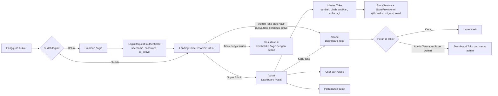
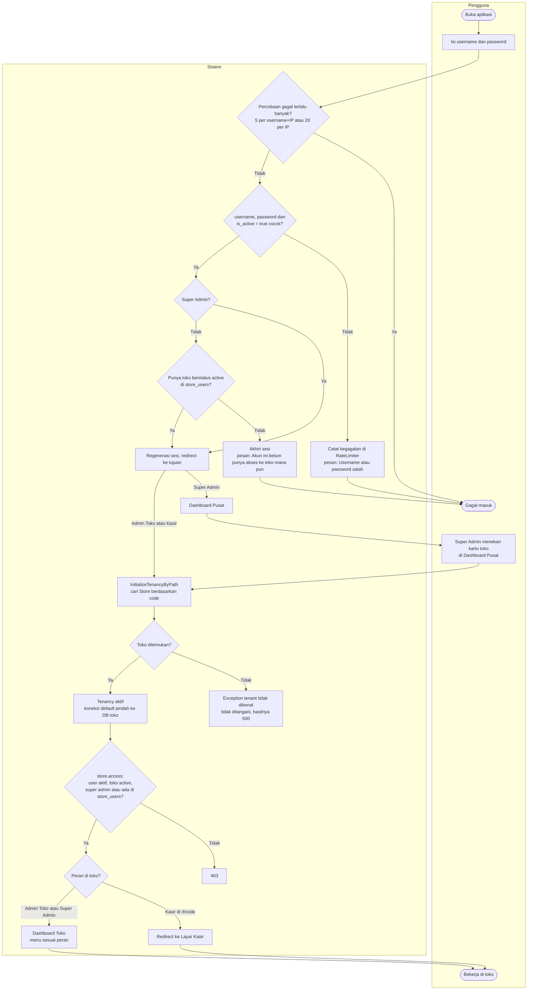
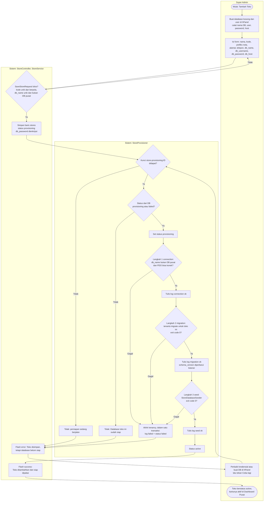
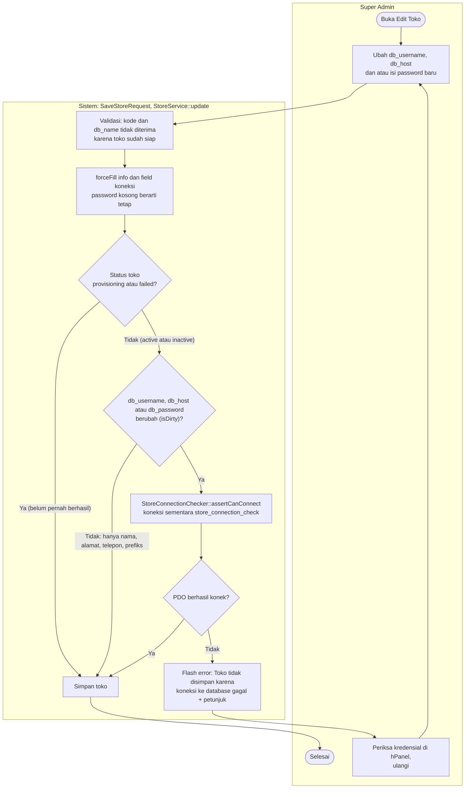
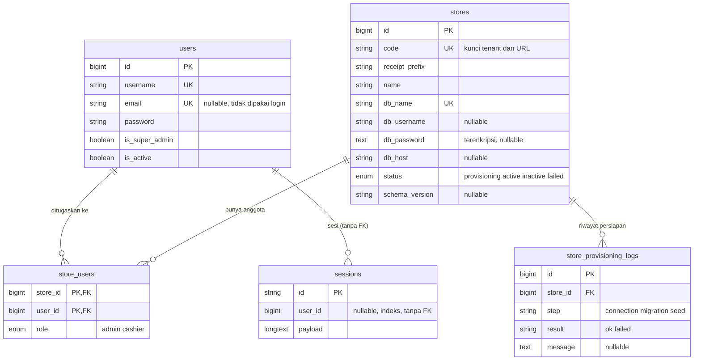
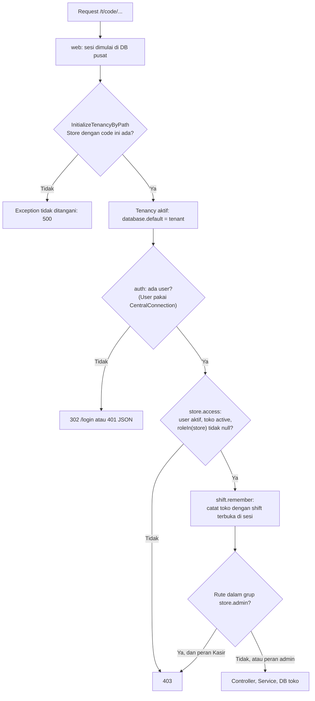
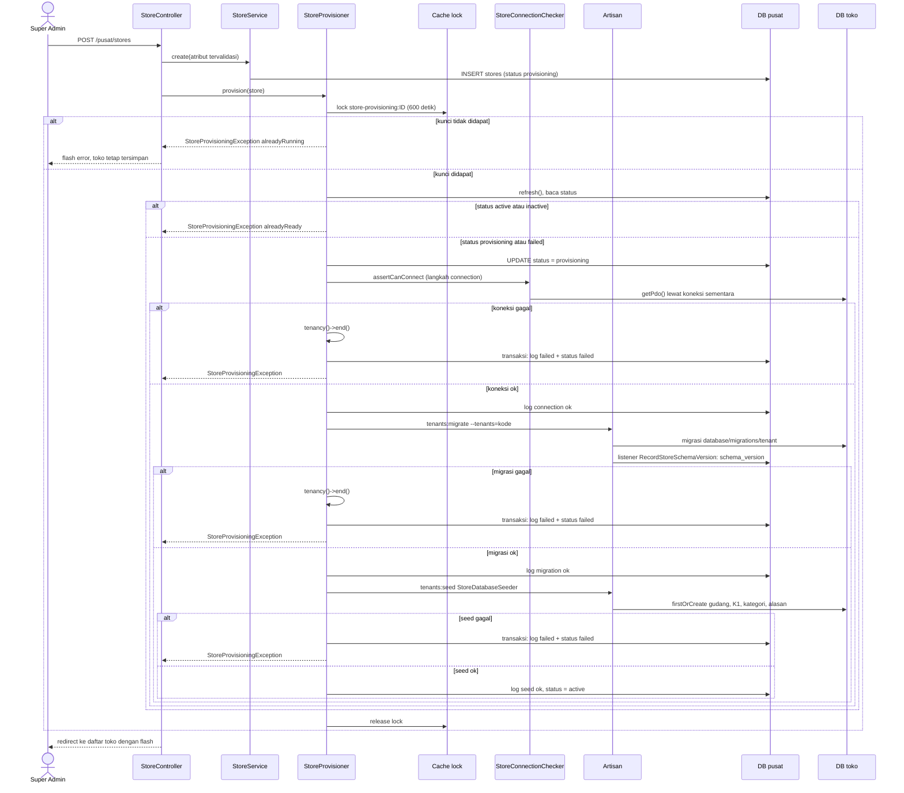

# Multi-Toko, Pengguna, dan Akses — Dokumentasi Teknis

> **Modul:** Arsitektur multi-toko (tenancy per path), login dan sesi, peran, manajemen toko (Master Toko + provisioning), manajemen user pusat, Dashboard Pusat dan Dashboard Toko, serta jalur deploy ke Hostinger
> **Stack:** Laravel 13 (PHP 8.3), Inertia 3, Vue 3, Quasar 2, stancl/tenancy 3.10
> **Audiens:** Engineer yang memelihara atau memperluas fitur ini
> **Database:** pusat (`mitra_manager`) untuk hampir semua tabel di dokumen ini; DB toko hanya disentuh lewat koneksi tenancy
> **Terakhir diperbarui:** 2026-11-17

Dokumen kembarannya, [pengaturan-toko-docs.md](pengaturan-toko-docs.md), membahas halaman Pengaturan (toko dan pusat). Dokumen ini berhenti di pintu halaman-halaman toko; isi tiap fitur toko ada di dokumen modulnya masing-masing.

## 1. Ringkasan

Mitra Hub adalah POS multi-toko: **satu DB pusat** (toko, user, akses, sesi, cache) dan **satu DB per toko** (semua data bisnis). Super Admin masuk lewat login username, mendarat di Dashboard Pusat (`/pusat`), lalu menekan kartu toko untuk masuk ke `/t/{code}`. Admin Toko dan Kasir tidak melihat pusat sama sekali: begitu login mereka langsung dikirim ke toko mereka (Kasir diteruskan lagi ke layar kasir). Toko dibuat oleh Super Admin di Master Toko: ia menyiapkan database kosong beserta user-nya **secara manual di hPanel Hostinger**, mengisi kredensialnya di form, lalu sistem menguji koneksi, memigrasi sekitar 30 tabel toko, dan mengisi data awal (gudang, terminal kasir K1, kategori pengeluaran, alasan opname). Toko tidak pernah dihapus dan DB toko tidak pernah dibuat atau di-drop oleh aplikasi; toko hanya dinonaktifkan.

Dua keputusan desain membentuk hampir semua kode di modul ini. Pertama, **toko dikenali dari path URL** (`/t/{tenant}/...`, kunci tenant = `stores.code`), bukan dari domain, sehingga satu domain dan satu deployment melayani semua toko. Kedua, begitu tenancy aktif, stancl **memindahkan koneksi default ke DB toko**; semua yang harus tetap di pusat (sesi, cache, antrean, model `User`, `Store`, log provisioning, `AppSetting`) harus dipaku ke koneksi pusat secara eksplisit. Lupa memaku satu model pusat berarti query-nya diam-diam mengarah ke DB toko.



### BPMN — login, pemilihan toko, masuk toko

Tidak ada layar "pilih toko" untuk non-Super-Admin: kebijakan MVP menugaskan satu user ke tepat satu toko (lihat §13 untuk selisihnya dengan `analisis-sistem.md` BPMN-2). "Pemilihan toko" hanya terjadi pada Super Admin lewat kartu di Dashboard Pusat.



### BPMN — pembuatan toko dan provisioning

Database toko dibuat manusia di luar sistem. Aplikasi hanya mencatat kredensialnya, mengujinya, memigrasi, dan mengisi data awal, dan setiap langkah meninggalkan satu baris di `store_provisioning_logs`.



Catatan membaca diagram: `B3` adalah satu flash `error` untuk tiga penyebab (kunci tidak didapat, toko sudah siap, langkah gagal), dan setelah itu hanya jalur `failed` yang membawa Super Admin ke "Coba lagi" yang benar-benar menjalankan ulang langkah (`A8` kembali ke `C1`). Jalur gagal tidak melakukan rollback tabel yang sudah terbentuk; migrasi dan seeder dirancang aman diulang (lihat §7.4).

### BPMN — mengubah kredensial database toko yang sudah aktif



## 2. Skema Database

Semua tabel di bagian ini ada di **DB pusat** kecuali dinyatakan lain. Migrasi pusat ada di `database/migrations`, migrasi toko di `database/migrations/tenant` (dijalankan `tenants:migrate`, lihat `config/tenancy.php` kunci `migration_parameters`). stancl tidak membuat tabel `tenants` atau `domains`: model tenant adalah `App\Models\Store` di tabel `stores`, dan identifikasi lewat domain tidak dipakai.

### `users`

Migrasi: `0001_01_01_000000_create_users_table`, `2026_10_27_114607_add_username_to_users_table`, `2026_10_27_134602_make_users_email_nullable`.

| Kolom | Tipe | Null | Catatan |
|---|---|---|---|
| `id` | bigint, PK | tidak | |
| `name` | string(255) | tidak | |
| `username` | string(50) | tidak | **Unique.** Dipakai untuk login. Awalnya ditambahkan nullable lalu diisi dari bagian email sebelum `@` (ditambah `id` bila bentrok), baru dijadikan wajib dan unik |
| `email` | string(255) | ya | Dari migrasi awal kolom ini `unique` dan wajib; migrasi `make_users_email_nullable` hanya melepas `NOT NULL`. Tidak dipakai untuk login, form user tidak memintanya. Nilai `NULL` berulang diizinkan MySQL pada indeks unik; indeks unik itu sendiri belum saya verifikasi langsung di DB, hanya dari kode migrasi |
| `email_verified_at` | timestamp | ya | Tidak dibaca di mana pun (Grep `app/`, `routes/`, `resources/js`) |
| `password` | string(255) | tidak | Cast `hashed` di model, tidak pernah tampil di Resource |
| `is_super_admin` | boolean | tidak | Default `false`. Satu-satunya tempat status Super Admin disimpan |
| `is_active` | boolean | tidak | Default `true` |
| `remember_token` | string(100) | ya | Dipakai `Auth::attempt(..., remember)` |
| `created_at`, `updated_at` | timestamp | ya | |

Default kolom (`is_super_admin`, `is_active`) tidak ikut ada pada model yang dibangun factory kecuali di-set; `UserFactory` mengisinya secara eksplisit.

### `stores`

Migrasi: `2026_10_26_135523_create_stores_table`. Satu baris = satu toko = satu database.

| Kolom | Tipe | Null | Catatan |
|---|---|---|---|
| `id` | bigint, PK | tidak | Dipakai sebagai route key di `/pusat/stores/{store}` dan sebagai FK |
| `code` | string(40) | tidak | **Unique.** Kunci tenant (`Store::getTenantKeyName()` mengembalikan `code`) dan bagian URL `/t/{code}`. Tidak bisa diubah setelah dibuat (tidak ada di rules saat edit) |
| `receipt_prefix` | string(10) | tidak | Awalan nomor dokumen (mis. `MU`), dibaca `DocumentNumberGenerator` |
| `name` | string(255) | tidak | |
| `address` | string(255) | ya | Dipakai sebagai cadangan kop nota (lihat dokumen pengaturan) |
| `phone` | string(30) | ya | Idem |
| `db_name` | string(255) | tidak | **Unique.** Nama database toko. Aturan form membatasi 64 karakter (batas MySQL), kolom 255 |
| `db_username` | string(255) | ya | Null berarti "pakai user koneksi pusat" (hanya masuk akal di lokal); lihat accessor di §3 |
| `db_password` | text | ya | **Terenkripsi** (`Crypt::encryptString`). Null berarti "pakai password koneksi pusat" |
| `db_host` | string(255) | ya | Null berarti "pakai host koneksi pusat" |
| `status` | enum | tidak | `provisioning`, `active`, `inactive`, `failed`. Default DB `provisioning` |
| `schema_version` | string(255) | ya | Nama migrasi tenant terakhir, diisi listener `RecordStoreSchemaVersion` |
| `data` | json | ya | Tempat bawaan stancl untuk atribut non-kolom (trait `HasDataColumn`). Semua kolom aplikasi terdaftar di `Store::getCustomColumns()`, jadi aplikasi tidak menulis ke sini; isinya belum diverifikasi di DB nyata. Dikecualikan dari audit |
| `created_at`, `updated_at` | timestamp | ya | |

Mengapa tiga kolom kredensial boleh null: di Laragon semua toko berbagi satu server MySQL dengan user yang sama, sehingga cukup mengisi `db_name`. Di Hostinger setiap DB punya user sendiri (satu user per DB), jadi ketiganya diisi. Accessor di model menutup selisih ini (§3), dan itu **bukan sekadar kenyamanan**: `DatabaseConfig::tenantConfig()` milik stancl menggabungkan setiap atribut `db_*` mentah ke konfigurasi koneksi, jadi nilai `null` mentah tanpa accessor akan menimpa host/user/password koneksi pusat dengan `null`.

### `store_users` (pivot)

Migrasi: `2026_10_26_135524_create_store_users_table`, `2026_10_27_134603_restrict_store_users_roles`.

| Kolom | Tipe | Null | Catatan |
|---|---|---|---|
| `store_id` | bigint, FK | tidak | `stores.id`, `ON DELETE CASCADE`. PK gabungan dengan `user_id` |
| `user_id` | bigint, FK | tidak | `users.id`, `ON DELETE CASCADE` |
| `role` | enum | tidak | `admin`, `cashier`. Nilai `warehouse` dibuang oleh migrasi kedua (migrasi sengaja gagal bila masih ada baris yang memakainya) |
| `created_at`, `updated_at` | timestamp | ya | `withTimestamps()` |

Skema mengizinkan satu user di banyak toko, tetapi **aturan "satu toko per user" hanya ditegakkan di kode** (`UserService::assignStore` memakai `sync([$storeId => ...])`). Super Admin tidak punya baris di tabel ini; statusnya hanya dari `users.is_super_admin`, sehingga enum `role` memang tidak punya nilai `super_admin`. Karena toko tidak pernah dihapus, `ON DELETE CASCADE` praktis tidak terpakai di jalur aplikasi.

### `store_provisioning_logs`

Migrasi: `2026_10_26_135526_create_store_provisioning_logs_table`. Riwayat persiapan DB toko, tulis-sekali.

| Kolom | Tipe | Null | Catatan |
|---|---|---|---|
| `id` | bigint, PK | tidak | |
| `store_id` | bigint, FK | tidak | `stores.id`, `ON DELETE CASCADE` |
| `step` | string(255) | tidak | Nilai enum `ProvisioningStep`: `connection`, `migration`, `seed` |
| `result` | string(20) | tidak | Nilai enum `ProvisioningResult`: `ok`, `failed` |
| `message` | text | ya | Hanya diisi pada `failed` (pesan yang sudah diberi petunjuk, maks 500 karakter) |
| `created_at` | timestamp | ya | Tidak ada `updated_at` (`UPDATED_AT = null` di model) |

Tabel ini tidak `Auditable`: tabel ini sendiri adalah catatan audit proses. Daftar toko membaca log gagal terbaru lewat subquery `failure_message`.

### Tabel infrastruktur di DB pusat

| Tabel | Dipakai untuk | Catatan |
|---|---|---|
| `sessions` | Sesi login (`SESSION_DRIVER=database`) | `id` string PK, `user_id` bigint null **tanpa FK** (indeks), `payload` longText, `last_activity` int berindeks |
| `cache`, `cache_locks` | Cache dan kunci (`CACHE_STORE=database`) | Dipakai `RateLimiter` login dan kunci provisioning |
| `jobs`, `job_batches`, `failed_jobs` | Antrean (`QUEUE_CONNECTION=database`) | **Belum ada job yang dikirim** (§10) |
| `password_reset_tokens` | Bawaan skeleton | Tidak ada rute atau kode yang memakainya (§13) |
| `personal_access_tokens` | Bawaan Sanctum | `User` memakai `HasApiTokens`, tetapi tidak ada token, middleware, atau rute Sanctum di `app/`, `routes/`, `bootstrap/`, `resources/`, `database/`, `tests/` selain migrasi dan trait itu sendiri (§13) |
| `audits` | Audit trail model pusat (`User`, `Store`, `AppSetting`) | Skema paket `owen-it/laravel-auditing`. **Setiap DB toko punya tabel `audits` sendiri** (migrasi `database/migrations/tenant/2026_10_26_135418_create_audits_table.php`) untuk model toko. Baris ditulis ke koneksi default saat itu (§7.1 butir 3) |
| `app_settings` | Pengaturan seluruh aplikasi | Dibahas di [pengaturan-toko-docs.md](pengaturan-toko-docs.md) |

### Referensi ke user dari DB toko

User hidup di DB pusat, jadi tabel toko merujuknya dengan **angka biasa tanpa FK** ditambah snapshot nama, mis. `cash_shifts.cashier_id`, `sales.cashier_id`, `stock_opnames.created_by` / `approved_by`, `expenses.created_by` + `created_by_name`, `delivery_notes.created_by` + `created_by_name`. Konsekuensinya: tidak ada integritas referensial lintas DB, dan mengganti `users.name` tidak mengubah nama yang sudah tercetak di dokumen lama (itu memang tujuannya).

### Diagram relasi



Tabel milik modul lain yang merujuk user pusat hanya lewat angka (tanpa FK) tidak digambar: `cash_shifts`, `sales`, `stock_opnames`, `expenses`, `delivery_notes`.

## 3. Model / Entity

| Model | Tabel | Relasi, cast, trait penting |
|---|---|---|
| `App\Models\User` | `users` | Trait `CentralConnection` (**wajib**, lihat §7.1), `Auditable` (audit `password` dan `remember_token` dikecualikan), `HasApiTokens` (tidak terpakai), `Notifiable`. Cast `is_super_admin`, `is_active` boolean, `password` hashed. `stores()` BelongsToMany via `store_users` dengan pivot `role`. Method: `assignedStore()` (toko pertama), `roleIn(Store)` (Super Admin dianggap `SuperAdmin` di semua toko), `isAdminIn(Store)`, `canHandleReceipt(Sale, Store)`. Atribut turunan `role` (null hanya untuk non-Super-Admin tanpa toko) |
| `App\Models\Store` | `stores` | Turunan `Stancl\Tenancy\Database\Models\Tenant` (yang sudah memakai `CentralConnection`) + `HasDatabase` + `Auditable`, mengimplementasi `TenantWithDatabase`. `internalPrefix()` kosong sehingga kolom `db_name`, `db_username`, `db_password`, `db_host` dipakai apa adanya. `$hidden = ['db_password']`; `$auditExclude = ['db_password', 'data']`. Cast `status` ke `StoreStatus`. Accessor `dbHost`, `dbUsername` (cadangan ke koneksi pusat bila kosong) dan `dbPassword` (dekripsi saat dibaca, enkripsi saat ditulis, cadangan ke password pusat bila `NULL`). `users()` dan `provisioningLogs()` |
| `App\Models\StoreProvisioningLog` | `store_provisioning_logs` | `CentralConnection` (ditulis saat tenancy toko mungkin masih aktif, mis. migrasi yang gagal meninggalkannya), cast `step` dan `result` ke enum, `store()` BelongsTo |
| `App\Models\AppSetting` | `app_settings` | `CentralConnection`, `Auditable`. Lihat dokumen pengaturan |

Enum terkait: `UserRole` (`super_admin`, `admin`, `cashier`; nilai `admin` dan `cashier` harus sama dengan kolom `store_users.role`), `StoreStatus` (dengan `isAwaitingProvisioning()` dan `canBeToggled()`), `ProvisioningStep`, `ProvisioningResult`. Label enum berbahasa Indonesia ("Admin Toko", "Kasir", "Disiapkan", dst.) hidup di enum, bukan di berkas bahasa.

## 4. Hak Akses

Tidak ada `Gate` atau `Policy` (Grep `Gate::`, `Policy` di `app/`, `routes/`, `bootstrap/` kosong); semua otorisasi lewat middleware route. Lima alias middleware terdaftar di `bootstrap/app.php` (`store.access`, `super.admin`, `store.admin`, `shift.none-open`, `shift.remember`); selain itu `auth` dan `guest` bawaan Laravel:

| Alias | Kelas | Aturan |
|---|---|---|
| `super.admin` | `EnsureUserIsSuperAdmin` | `user` ada, `is_active`, dan `is_super_admin`; selain itu `abort(403)` |
| `store.access` | `EnsureUserCanAccessStore` | Berjalan **setelah** tenancy aktif dan `auth`. `user.is_active` dan `store.status === active`, lalu `User::roleIn($store)` tidak boleh `null`. Peran disimpan di `$request->attributes['store_role']` supaya middleware dan controller sesudahnya tidak query `store_users` lagi. Gagal = 403 |
| `store.admin` | `EnsureUserIsStoreAdmin` | Peran dari atribut request harus `SuperAdmin` atau `StoreAdmin`; Kasir = 403 |
| `shift.none-open` | `EnsureUserHasNoOpenShift` | Mengunci logout dan seluruh halaman pusat selama user punya shift terbuka (§7.2) |
| `shift.remember` | `RememberOpenShift` | Mencatat di sesi toko mana saja user punya shift terbuka; tidak pernah memblokir |
| `auth`, `guest` | bawaan Laravel | Tamu ke halaman terproteksi: redirect ke `login` (HTML) atau 401 (JSON). User yang sudah login membuka `/login`: redirect ke `home` (`redirectUsersTo`) |

Matriks per kelompok rute:

| Rute | Tamu | Kasir | Admin Toko | Super Admin |
|---|---|---|---|---|
| `GET /`, `GET /login`, `POST /login` | ya (login hanya untuk tamu) | redirect | redirect | redirect |
| `POST /logout` | redirect login | ya, **kecuali ada shift terbuka** | ya (idem) | ya (idem) |
| `/pusat/*` | redirect login | 403 | 403 | ya, kecuali ada shift terbuka |
| `GET /t/{code}` (dashboard) | redirect login | diteruskan ke `tenant.cashier.index` | ya | ya (toko mana pun) |
| `/t/{code}/cashier/*` | redirect login | ya, **hanya toko yang ditugaskan** | ya | ya |
| `/t/{code}/*` lainnya (grup `store.admin`) | redirect login | 403 | ya | ya |

Seorang non-Super-Admin yang membuka `/t/{kode toko lain}` mendapat 403, bukan 404. Super Admin yang masuk toko tidak memerlukan baris `store_users`. Deaktivasi user atau toko berlaku **pada request berikutnya** (middleware memeriksa DB tiap request), tanpa perlu menghancurkan sesi.

## 5. Konfigurasi

| Kunci / env | Default | Dibaca oleh |
|---|---|---|
| `tenancy.tenant_model` | `App\Models\Store` | stancl (resolver, `tenant()`) |
| `tenancy.database.central_connection` / `DB_CONNECTION` | `central` jika env kosong. **Tidak ada koneksi bernama `central` di `config/database.php`**, jadi `DB_CONNECTION` wajib diisi eksplisit (mis. `mysql`) | `Store::centralConnectionSetting`, trait `CentralConnection`, `StoreProvisioner::centralDatabaseName`, `SaveStoreRequest::centralDatabaseName`, stancl saat kembali ke pusat |
| `tenancy.bootstrappers` | `DatabaseTenancyBootstrapper`, `QueueTenancyBootstrapper` | stancl. Bootstrapper cache, filesystem, dan redis **tidak aktif**; cache dan storage tidak dipisah per toko |
| `tenancy.database.template_tenant_connection` | `null` (memakai koneksi pusat sebagai template; host, user, password toko menimpanya) | `DatabaseConfig::connection()` |
| `tenancy.migration_parameters` | `--path=database/migrations/tenant`, `--realpath`, `--force` | `tenants:migrate` |
| `tenancy.seeder_parameters` | `--class=DatabaseSeeder` | `tenants:seed`; `StoreProvisioner` menimpanya dengan `StoreDatabaseSeeder` |
| `tenancy.central_domains` | `127.0.0.1`, `localhost` | **Tidak pernah dibaca**: hanya relevan untuk identifikasi domain/subdomain dan `PreventAccessFromCentralDomains`, yang tidak dipasang di route mana pun |
| `tenancy.database.prefix/suffix/managers`, `tenancy.cache.*`, `tenancy.filesystem.*`, `tenancy.redis.*`, `tenancy.features` | bawaan stancl | `prefix` dan `suffix` hanya berlaku bila `db_name` kosong (tidak pernah, kolom wajib); selebihnya inert karena bootstrapper-nya mati |
| `session.driver` / `SESSION_DRIVER` | `database` | Laravel |
| `session.connection` / `SESSION_CONNECTION` lalu `DB_CONNECTION` | nilai `DB_CONNECTION` | Laravel; inilah "pemaksaan koneksi pusat": nama koneksi dibekukan saat konfigurasi dimuat, sebelum tenancy mengubah koneksi default |
| `session.lifetime` / `SESSION_LIFETIME` | `120` menit | Laravel |
| `cache.default` / `CACHE_STORE`; `cache.stores.database.connection` / `DB_CACHE_CONNECTION` lalu `DB_CONNECTION` | `database`; koneksi pusat | `RateLimiter` login, `Cache::lock` provisioning |
| `queue.default` / `QUEUE_CONNECTION`; `queue.connections.database.connection` / `DB_QUEUE_CONNECTION` lalu `DB_CONNECTION` | `database`; koneksi pusat; `retry_after` 90 | **Tidak ada job** yang dikirim (§10) |
| `auth.defaults.guard`, `auth.providers.users.model` | guard `web` (session), `App\Models\User` | Laravel. `auth.passwords.users` didefinisikan tetapi tidak ada alur reset password |
| `audit.console` | `false` | `laravel-auditing`: perubahan lewat artisan (mis. `schema_version` saat `tenants:migrate` di deploy) **tidak diaudit** |
| `audit.queue.enable` | `false` | Audit ditulis sinkron |
| `app.timezone`, `APP_LOCALE` | `Asia/Jakarta`, `id` | `today()` di dashboard toko, pesan validasi `lang/id/validation.php` |
| Konstanta kode `LoginRequest::MAX_ATTEMPTS` / `MAX_ATTEMPTS_PER_IP` | `5` per pasangan username dan IP, `20` per IP | Penahan login; `RateLimiter::hit` memakai peluruhan bawaan 60 detik |
| Konstanta `StoreProvisioner::LOCK_SECONDS` | `600` | TTL kunci persiapan |
| Konstanta `StoreConnectionChecker::MAX_MESSAGE_LENGTH` | `500` | Pemotongan pesan galat koneksi |
| Konstanta `StoreDashboardService::APPROVAL_LIMIT` | `5` | Jumlah baris di tiap daftar dashboard |
| Secret GitHub `HOSTINGER_SSH_HOST`, `_SSH_PORT` (bawaan 22), `_SSH_USER`, `_SSH_KEY`, `_SSH_PASSWORD`, `_SSH_KNOWN_HOSTS`, `HOSTINGER_APP_PATH` | tanpa default | `.github/workflows/build-for-hostinger.yml`; tanpa host, path, dan (key atau password) langkah deploy dilewati |
| `APP_KEY` | tanpa default | Enkripsi `stores.db_password`; mengganti kunci ini membuat semua toko tidak bisa dibuka (§13) |

Variabel uji di `phpunit.xml`: `APP_ENV=testing`, `CACHE_STORE=array`, `DB_CONNECTION=mysql`, `DB_DATABASE=mitra_manager_test`, `QUEUE_CONNECTION=sync`, `SESSION_DRIVER=array`.

## 6. Rute / API

Aplikasi tidak punya API publik: `routes/api.php` kosong (hanya komentar) dan sesi memakai cookie, bukan token. Path lama `/api/t/{code}/...` menghasilkan 404 (diuji `test_old_api_path_is_gone`). Semua rute di bawah adalah rute web yang mengembalikan halaman Inertia atau redirect dengan flash `success`/`error`.

### Autentikasi dan pintu masuk

| Method | Path | Action | Nama rute | Middleware |
|---|---|---|---|---|
| GET | `/` | `HomeController` (invokable) | `home` | `web` |
| GET | `/login` | `AuthenticatedSessionController@create` | `login` | `web`, `guest` |
| POST | `/login` | `AuthenticatedSessionController@store` | tanpa nama | `web`, `guest` |
| POST | `/logout` | `AuthenticatedSessionController@destroy` | `logout` | `web`, `auth`, `shift.none-open` |
| GET | `/up` | health check Laravel | tanpa nama | tanpa |

### Pusat (prefiks `pusat`, nama `central.`)

Middleware seluruh grup: `web`, `auth`, `super.admin`, `shift.none-open`.

| Method | Path | Action | Nama rute |
|---|---|---|---|
| GET | `/pusat` | `Central\DashboardController` | `central.dashboard` |
| GET | `/pusat/stores` | `Central\StoreController@index` | `central.stores.index` |
| GET | `/pusat/stores/create` | `@create` | `central.stores.create` |
| POST | `/pusat/stores` | `@store` | `central.stores.store` |
| GET | `/pusat/stores/{store}/edit` | `@edit` | `central.stores.edit` |
| PUT/PATCH | `/pusat/stores/{store}` | `@update` | `central.stores.update` |
| PATCH | `/pusat/stores/{store}/status` | `StoreStatusController` | `central.stores.status` |
| POST | `/pusat/stores/{store}/provision` | `StoreProvisionController` | `central.stores.provision` |
| GET | `/pusat/users` | `Central\UserController@index` | `central.users.index` |
| GET | `/pusat/users/create` | `@create` | `central.users.create` |
| POST | `/pusat/users` | `@store` | `central.users.store` |
| GET | `/pusat/users/{user}/edit` | `@edit` | `central.users.edit` |
| PUT/PATCH | `/pusat/users/{user}` | `@update` | `central.users.update` |
| PATCH | `/pusat/users/{user}/status` | `UserStatusController` | `central.users.status` |
| GET, PUT | `/pusat/settings` | `Central\SettingController@index`, `@update` | `central.settings.index`, `central.settings.update` |

Toko dan user tidak punya rute `show` dan `destroy` (diuji `test_stores_have_no_delete_route`).

### Toko

Grup `t/{tenant}` di `routes/tenant.php` memakai middleware `web`, `InitializeTenancyByPath`, `auth`, `store.access`, `shift.remember` (urutan itu dikonfirmasi oleh `php artisan route:list`). `InitializeTenancyByPath` hanya jalan bila `tenant` adalah parameter **pertama** route, kalau tidak melempar `RouteIsMissingTenantParameterException`. Di dokumen ini hanya satu rute yang relevan:

| Method | Path | Action | Nama rute | Middleware tambahan |
|---|---|---|---|---|
| GET | `/t/{tenant}` | `Tenant\DashboardController` | `tenant.dashboard` | tidak ada (Kasir dialihkan di controller) |

Rute toko lainnya ada di dokumen modul masing-masing. Rute di bawah `cashier/*` terbuka untuk semua pengguna toko; sisanya dibungkus `store.admin`.

### Contoh respons

Semua contoh di bawah **ilustratif** (disusun dari kode, bukan hasil tangkapan lalu lintas nyata).

**`POST /login`, kredensial salah (Inertia).** Respons adalah redirect kembali ke `/login`; galat muncul sebagai props `errors.username` pada halaman berikutnya:

```json
{ "errors": { "username": "Username atau password salah." } }
```

Pesan yang sama dipakai untuk user nonaktif, supaya form tidak membocorkan username mana yang ada (`LoginRequest::authenticate`). Setelah 5 kegagalan untuk pasangan `username|IP`, atau 20 untuk satu IP:

```json
{ "errors": { "username": "Terlalu banyak percobaan. Coba lagi dalam 42 detik." } }
```

Kredensial benar tetapi tidak ada toko berstatus `active`: sesi dihancurkan dan galat `username` berisi `Akun ini belum punya akses ke toko mana pun.` (`LandingRouteResolver::NO_ACCESS_MESSAGE`).

**Logout atau halaman pusat saat shift terbuka (`EnsureUserHasNoOpenShift`).** Untuk permintaan JSON, status **423** dengan kode internal dari `ApiErrorCode::ShiftIsOpen` (4231):

```json
{
  "code": 4231,
  "message": "Tutup shift dulu sebelum keluar atau membuka halaman pusat.",
  "more_info": "Tutup shift di kasir toko Mitra Utama."
}
```

Untuk permintaan HTML, user dialihkan ke `tenant.cashier.index` toko itu dengan flash `error`. Bila shift sudah dihitung dan menunggu keputusan Admin, pesannya: `Shift Anda sudah dihitung dan menunggu keputusan Admin. Anda bisa keluar setelah shift ditutup.`

**`POST /pusat/stores`, DB belum dibuat di hPanel.** Toko tetap tersimpan, statusnya `failed`, dan halaman daftar menampilkan flash `error`:

```
Toko disimpan, tetapi database belum siap. Uji koneksi database gagal: Database belum dibuat di hPanel. (SQLSTATE[HY000] [1049] Unknown database 'u123_store_baru')
```

Petunjuk di depan berasal dari tabel `StoreConnectionChecker::FAILURE_HINTS` (kode MySQL 1049, 1045, 1044, 2002); kode lain hanya menampilkan pesan mentah.

**`PUT /pusat/stores/{store}`, kredensial toko aktif tidak bisa konek.** Tidak ada yang disimpan, dan halaman kembali dengan flash:

```
Toko tidak disimpan karena koneksi ke database gagal. Username atau password database salah. (SQLSTATE[HY000] [1045] Access denied for user ...)
```

**`PATCH /pusat/stores/{store}/status`** menerima `{ "is_active": true|false }`. Untuk toko berstatus `provisioning` atau `failed`, flash `error`: `Toko ini belum selesai disiapkan.`

**`POST /pusat/stores/{store}/provision`** berhasil: flash `success` `Database toko siap dipakai.`; toko sudah `active`/`inactive`: flash `error` `Database toko ini sudah siap.`; sedang berjalan di proses lain: `Persiapan database toko ini sedang berjalan. Tunggu sampai selesai.`

## 7. Komponen Backend

### 7.1 Tenancy dan jebakan koneksi default

`config/tenancy.php` hanya mengaktifkan `DatabaseTenancyBootstrapper` dan `QueueTenancyBootstrapper`. Saat `InitializeTenancyByPath` menemukan `Store` dengan `code` yang sama dengan segmen path, stancl mengisi `config('database.connections.tenant')` dari kredensial toko, lalu **`database.default` diganti menjadi `tenant`**. Sampai `tenancy()->end()`, setiap `DB::`, `Model::query()`, dan migrasi memakai DB toko.

Akibatnya, apa pun yang masih harus berbicara dengan DB pusat dipaku seperti ini:

1. **Sesi, cache, antrean**: `session.connection`, `cache.stores.database.connection`, dan `queue.connections.database.connection` semuanya berasal dari `env('DB_CONNECTION')`, nama koneksi pusat, yang dibekukan saat konfigurasi dimuat (sebelum request menyentuh tenancy). Ini diuji oleh `test_session_cache_and_queue_stay_on_the_central_connection`. Mekanisme ini bersandar pada `DB_CONNECTION` yang benar-benar menunjuk koneksi pusat.
2. **Model**: trait `CentralConnection` membuat `getConnectionName()` selalu mengembalikan `tenancy.database.central_connection`. `User` memerlukannya karena urutan middleware adalah **tenancy lalu `auth`**: guard mengambil user setelah koneksi default sudah pindah ke DB toko. `StoreProvisioningLog` memerlukannya karena ditulis ketika tenancy mungkin masih aktif. `Store` mewarisinya dari kelas dasar stancl, dan `AppSetting` memakainya langsung. **Model pusat baru wajib memakai trait ini.**
3. **Audit**: baris `audits` ditulis ke **koneksi default pada saat penulisan**, bukan ke koneksi model yang diaudit. `Audit::getConnectionName()` di paket mengembalikan `audit.drivers.database.connection`, yang di proyek ini `null` (`config/audit.php`). Selama tenancy tidak aktif (halaman `/pusat`), audit `User`/`Store`/`AppSetting` masuk ke pusat; selama tenancy aktif, audit model toko masuk ke `audits` DB toko, **dan audit model pusat yang kebetulan diubah saat itu ikut masuk ke DB toko**. Contoh nyatanya: `RecordStoreSchemaVersion` menyimpan `Store` di tengah `tenants:migrate`, sehingga audit `schema_version` toko itu mendarat di `audits` DB toko itu sendiri (bila dijalankan dari request web, karena dari artisan audit mati). Ini turunan dari kode vendor `owen-it/laravel-auditing` v14, bukan sesuatu yang diuji.

Sebaliknya, model toko (mis. `StoreSetting`, `Driver`, `Sale`) **tidak** memakai trait apa pun dan hanya benar saat tenancy aktif; memakainya di luar tenancy akan menembak tabel yang tidak ada di DB pusat.

Pencocokan toko oleh stancl dilakukan di `PathTenantResolver` lewat `tenancy()->find($code)`. Bila kode tidak ada, `TenantCouldNotBeIdentifiedByPathException` dilempar dan **tidak ada penangan khusus** di `bootstrap/app.php`, jadi hasilnya halaman galat 500, bukan 404 (turunan dari kode vendor; belum ada tes).

Pada `APP_ENV=local`, `DatabaseTenancyBootstrapper` memeriksa dulu apakah databasenya ada dan melempar `TenantDatabaseDoesNotExistException`; di environment lain pemeriksaan itu dilewati dan kegagalan baru muncul sebagai galat PDO pada query pertama.

`TenancyServiceProvider` memetakan event stancl dengan sengaja minimal: event `TenantCreated`, `DatabaseCreated`, `TenantDeleted` dan sejenisnya **sengaja kosong** (keputusan "DB toko tidak pernah dibuat atau di-drop aplikasi", lihat komentar di berkasnya). Satu-satunya listener proyek adalah `RecordStoreSchemaVersion` pada `DatabaseMigrated`.

Alur sebuah request toko, dengan titik penolakannya:



### 7.2 Middleware yang mengikat shift ke akses

`RememberOpenShift` (di setiap halaman toko) menyimpan daftar kode toko tempat user punya shift `Open` atau `PendingReview` di kunci sesi `open_shift_stores`. `EnsureUserHasNoOpenShift` (di logout dan seluruh `/pusat`) membaca daftar itu, membuka tiap toko dengan `Store::run()` untuk memastikan shift **benar-benar** masih ada (lewat `ShiftService::openShiftOf`), membuang kode yang sudah tidak cocok, dan memblokir bila masih ada yang terbuka. Alasan desain: halaman pusat dan logout berjalan di luar tenancy, jadi tanpa catatan di sesi mereka tidak tahu toko mana yang harus ditanya. Bila DB sebuah toko tidak terjangkau (`QueryException`), tenancy diakhiri, galat dicatat ke log, dan toko itu tetap diingat tetapi **tidak mengunci** user, supaya satu toko yang rusak tidak membuat logout mustahil bagi semua orang.

### 7.3 Login, sesi, dan landing

- `LoginRequest::authenticate()` memanggil `Auth::attempt([... 'is_active' => true])`. Menyertakan `is_active` di kredensial membuat user nonaktif gagal dengan pesan yang sama dengan password salah. Dua penahan laju berbasis cache: `username|IP` (maks 5) yang dibersihkan saat login sukses, dan `login-ip|IP` (maks 20) yang **sengaja tidak dibersihkan** saat sukses, agar penyerang yang memegang satu akun sah tidak bisa mereset hitungan IP-nya. Tiap kegagalan menaikkan keduanya.
- `AuthenticatedSessionController::store()` memanggil `LandingRouteResolver::urlFor()`. Resolver mengembalikan `route('central.dashboard')` untuk Super Admin aktif, atau dashboard toko aktif pertama (urut `stores.name`) milik user, atau `null`. Bila `null`, sesi dihancurkan lewat `SessionTerminator` dan `ValidationException` pada `username` dilempar. Bila ada, `session()->regenerate()` lalu `redirect()->intended($landingUrl)`.
- `HomeController` memakai resolver yang sama untuk `/`. User yang masih login tetapi tidak punya tujuan (dinonaktifkan atau tokonya dinonaktifkan saat sesi berjalan) **dikeluarkan dulu**; kalau tidak, middleware `guest` pada `/login` akan melempar mereka kembali ke `/` tanpa henti.
- `SessionTerminator::end()` melakukan `Auth::guard('web')->logout()`, `session()->invalidate()`, dan `regenerateToken()`. Dipakai oleh logout, login yang tanpa tujuan, dan `HomeController`.
- `HandleInertiaRequests` (middleware web global) membagikan `auth.user` (`name`, `email`, `is_super_admin`), flash, `store` (kode, nama, prefiks, dan URL menu; hanya saat tenancy aktif), `menu_badges.returns` (jumlah retur menunggu), `has_open_shift`, dan `app_urls`. Prop `store` tidak mengandung kredensial DB.

### 7.4 `StoreService` dan `StoreProvisioner`

**`StoreService::create()`** menyimpan baris `stores` dengan status `provisioning`; `db_password` ditulis lewat mutator (terenkripsi). Ia tidak menyentuh DB toko.

**`StoreService::update()`** punya tiga aturan yang masing-masing punya alasan:

1. `code` tidak pernah berubah (tidak ada di rules maupun `Arr::only`).
2. `db_name` hanya diterima selama `status->isAwaitingProvisioning()`; setelah persiapan berhasil, mengubahnya akan menunjuk ke database kosong.
3. `db_username`, `db_host`, dan password boleh berubah kapan saja karena memang dirotasi di hPanel. Password kosong berarti tetap. Pada toko yang sudah selesai disiapkan, bila salah satu dari tiga kolom itu `isDirty`, kredensial baru **diuji dulu** lewat `StoreConnectionChecker`; kegagalan dilempar sebagai `StoreConnectionException` dan **tidak ada yang disimpan**, karena kredensial salah akan menjatuhkan toko yang sedang berjalan. Perubahan nama, alamat, telepon, atau prefiks tidak memicu uji koneksi.

**`StoreService::setActive()`** hanya mengubah `active` <-> `inactive`; status lain melempar `StoreStatusException`. Daftar toko hanya menampilkan saklar untuk status itu (`StoreResource::can_toggle_active`).

**`StoreProvisioner::provision()`** adalah operasi paling rumit di modul ini:

- Kunci `Cache::lock('store-provisioning:'.$store->getKey(), 600)` mencegah dua proses (klik ganda, dua tab) menjalankan migrasi yang sama bersamaan. TTL 600 detik dimaksudkan lebih panjang dari persiapan mana pun, sehingga proses yang mati di tengah tidak memblokir percobaan ulang lama-lama.
- Setelah mendapat kunci, `$store->refresh()` lalu status **dibaca ulang dari DB**; bukan dari request. Hanya `provisioning` atau `failed` yang boleh lanjut; selain itu `alreadyReady`.
- Status dijadikan `provisioning`, lalu tiga langkah berurutan lewat `runStep()`: (1) `connection`: menolak bila `db_name` sama dengan nama DB pusat, lalu `StoreConnectionChecker::assertCanConnect`; (2) `migration`: `Artisan::call('tenants:migrate', ['--tenants' => [kode]])`, exit code bukan 0 dilempar sebagai `RuntimeException` berisi keluaran artisan; (3) `seed`: `tenants:seed --class=StoreDatabaseSeeder --force`.
- `StoreDatabaseSeeder` memakai `firstOrCreate` pada setiap baris sehingga aman diulang. Isinya: kategori pengeluaran bawaan, empat alasan opname bawaan, gudang `MAIN` (sellable), `DEAD` (dead stock), dan `RETUR` (retur, `returns_for_warehouse_id` ke `MAIN`), serta terminal kasir `K1` ("Kasir 1"). Label langkah ini (`ProvisioningStep::Seed`) adalah "Gudang awal", yang tampil di pesan galat ("Gudang awal gagal: ...") dan lebih sempit daripada isinya.
- Kegagalan langkah mana pun ditangani `recordFailure()`: **`tenancy()->end()` dulu**, karena migrasi atau seeder yang melempar meninggalkan DB toko sebagai koneksi default (stancl `Tenant::run()` tidak memakai `finally`), lalu dalam satu `DB::transaction` ditulis log `failed` dan status `failed` ke pusat. Pengecualian dibungkus `StoreProvisioningException` dengan pesan `"{label langkah} gagal: {pesan berpetunjuk}"`, dan `report()` tetap mencatat aslinya ke log aplikasi.
- Setelah tiga langkah sukses, status menjadi `active`. Kunci selalu dilepas di `finally`.



**`StoreConnectionChecker`** membuat koneksi bernama `store_connection_check` dari `$store->database()->connection()`, memanggil `getPdo()`, lalu selalu mem-purge koneksi itu (`finally`). Ia tidak menyentuh koneksi default, yang bisa milik pusat atau toko yang sedang aktif. `describeFailure()` mengambil kode `[xxxx]` dari pesan PDO dan menaruh petunjuk berbahasa Indonesia di depan pesan mentah (maks 500 karakter).

**`RecordStoreSchemaVersion`** berjalan pada event `DatabaseMigrated` (saat tenancy toko aktif) dan menulis nama migrasi terakhir ke `stores.schema_version`. Karena yang mengikatnya adalah event, nilainya ikut terjaga oleh siapa pun yang menjalankan `tenants:migrate`: provisioner maupun deploy CI.

### 7.5 `UserService` dan manajemen user

`create()` dan `update()` masing-masing membungkus dua tulis atau lebih dalam `DB::transaction` (user, lalu penugasan toko). Aturan: Super Admin tidak punya toko (`detach()`), peran toko memakai `sync([$storeId => ['role' => ...]])` yang menggantikan penugasan lama, sehingga satu user tetap satu toko. Password kosong saat edit berarti tidak berubah. `setActive()` hanya mengubah `is_active` (satu tulis, tanpa transaksi).

Audit penugasan ditulis **manual** (`store_assignment_changed` lewat event `AuditCustom`) karena `auditSync` milik paket hanya membandingkan kunci relasi: kasir yang dipromosikan menjadi admin pada toko yang sama tidak akan meninggalkan jejak. Tidak ada audit bila penugasan tidak berubah (diuji).

Karena `UserController::index()` memuat semua user tanpa paginasi, daftar ini hanya cocok untuk puluhan akun (§13).

### 7.6 Dashboard

**Dashboard Pusat** (`Central\DashboardController`) hanya daftar kartu toko (`StoreCardResource`: `code`, `name`, `receipt_prefix`, `status`, `is_enterable`, `url`) urut nama, ditambah tautan Tambah Toko. Tombol "Masuk ke toko" nonaktif bila status bukan `active`. Tidak ada angka agregat lintas toko dan **tidak ada pencarian stok lintas toko**: fitur itu adalah R2 (`analisis-sistem.md` 4.8, 5.14, 7.4b; `CHANGELOG.md` menyebutnya "not included yet").

**Dashboard Toko** (`Tenant\DashboardController`): Kasir langsung dialihkan ke layar kasir (angka dashboard tidak pernah sampai ke mereka); peran lain menerima prop `summary` dari `StoreDashboardService::summary(today())`. Service itu hanya valid selama tenancy aktif dan mengembalikan uang sebagai string desimal tanpa pembulatan:

- `sales`: total nota `completed` pada `business_date` hari ini, dikurangi `credit_amount` retur `completed` yang jatuh di shift pada tanggal bisnis yang sama (angka yang sama dihitung penutupan hari dan laporan penjualan).
- `low_stock_count`: `Product::belowMinimumStock()` (produk aktif di bawah stok minimum pada gudang `sellable`).
- `pending`: retur `pending`, selisih kas `pending_approval`, surat jalan belum selesai (`DeliveryNoteStatus::unfinished()`), plus `total`.
- `approvals`: sampai 5 retur menunggu dan sampai 5 selisih kas menunggu (maksimum 10 baris), terbaru di atas.
- `unfinished_delivery_notes`: 5 surat jalan terlama yang belum selesai.
- `open_shifts`: semua shift `open` beserta kasir dan terminalnya.

Selisih kas yang hanya bisa diputuskan Super Admin tetap muncul di kartu Admin Toko (temuan terbuka di `docs/hasil-review-kode.md` bagian 7, UX).

## 8. Aturan Validasi

Semua validasi memakai Form Request dan gagal secara **semua-atau-tidak** (tidak ada penyimpanan parsial). Pesan galat ditulis inline di `messages()` dalam bahasa Indonesia, dilengkapi `lang/id/validation.php`.

### `LoginRequest`

| Field | Aturan | Catatan |
|---|---|---|
| `username` | `required`, `string` | Kunci laju per pasangan: username huruf kecil (ditransliterasi) digabung dengan IP; kunci kedua hanya IP |
| `password` | `required`, `string` | |
| `should_remember` | `boolean` | Diteruskan ke `Auth::attempt` sebagai remember |

Pesan: `Username wajib diisi.`, `Password wajib diisi.`, `Username atau password salah.`, `Terlalu banyak percobaan. Coba lagi dalam N detik.`

### `SaveStoreRequest` (tambah dan ubah toko)

`prepareForValidation()` mengecilkan huruf `code` dan membesarkan `receipt_prefix`, lalu membuang yang kosong supaya tidak menimpa dengan string kosong.

| Field | Aturan | Masuk ke | Catatan |
|---|---|---|---|
| `name` | `required`, `string`, `max:255` | `stores.name` | |
| `address` | `nullable`, `string`, `max:255` | `stores.address` | |
| `phone` | `nullable`, `string`, `max:30` | `stores.phone` | |
| `receipt_prefix` | `required`, `string`, regex `^[A-Z0-9]{2,10}$` | `stores.receipt_prefix` | `Prefiks nota 2-10 karakter, huruf besar atau angka.` |
| `code` | `required`, `string`, `min:3`, `max:40`, regex `^[a-z][a-z0-9_]*$`, `unique:stores,code` | `stores.code` | **Hanya ada saat menambah** |
| `db_name` | `required`, `string`, `max:64`, regex `^[A-Za-z0-9_]+$`, `unique:stores,db_name` (mengabaikan toko yang diedit), `not_in:` nama DB pusat | `stores.db_name` | **Hanya ada saat menambah atau saat status `provisioning`/`failed`**; untuk toko siap, field ini tidak divalidasi sehingga tidak ikut `validated()` dan diabaikan walau dikirim |
| `db_username` | `required`, `string`, `max:64`, regex `^[A-Za-z0-9_.-]+$` | `stores.db_username` | |
| `db_password` | `nullable`, `string`, `max:255` | `stores.db_password` (terenkripsi) | Kosong saat edit = password lama tetap |
| `db_host` | `nullable`, `string`, `max:255`, regex `^[A-Za-z0-9.-]+$` | `stores.db_host` | |

### `SaveUserRequest` (tambah dan ubah user)

| Field | Aturan | Masuk ke |
|---|---|---|
| `name` | `required`, `string`, `max:255` | `users.name` |
| `username` | `required`, `string`, `min:3`, `max:50`, regex `^[a-z0-9._-]+$`, `unique:users,username` (mengabaikan user yang diedit) | `users.username` |
| `password` | `required` saat tambah, `nullable` saat ubah; `string`; `min:` nilai `AppSettingService::passwordMinLength()` | `users.password` (di-hash cast) |
| `role` | `required`, `Rule::enum(UserRole)`, dan tidak boleh berbeda dari peran sekarang bila yang diedit adalah akun sendiri (`Anda tidak bisa mengubah peran akun sendiri.`) | `users.is_super_admin` atau `store_users.role` |
| `store_id` | `required` bila peran adalah peran toko; `nullable`, `integer`, `exists:stores,id` | `store_users.store_id` (diabaikan untuk Super Admin) |
| `is_active` | `required`, `boolean`, `NotDeactivatingOwnAccount` (`Anda tidak bisa menonaktifkan akun sendiri.`) | `users.is_active` |

### `SetUserActiveRequest` dan `StoreStatusController`

| Endpoint | Field | Aturan |
|---|---|---|
| `PATCH /pusat/users/{user}/status` | `is_active` | `required`, `boolean`, `NotDeactivatingOwnAccount` |
| `PATCH /pusat/stores/{store}/status` | `is_active` | `required`, `boolean` (divalidasi inline di controller). Status toko diperiksa lagi di `StoreService::setActive` |

## 9. Guard Kepemilikan & Status

Di sini tidak ada "kepemilikan" per baris; yang ada adalah status akun, status toko, dan peran. Semuanya dibaca ulang dari DB pada setiap request, bukan dari sesi atau klien.

| Endpoint | Yang dicek ulang di server | Yang diblokir |
|---|---|---|
| Semua `/t/{code}/*` | `Store` dicari dari `code`; `users.is_active`; `stores.status`; `roleIn($store)` dari `users.is_super_admin` dan `store_users` | Akun nonaktif, toko bukan `active`, user tanpa penugasan ke toko itu: 403 |
| Grup `store.admin` | Peran dari hasil `store.access` pada request yang sama | Kasir: 403 |
| `POST /login` | `Auth::attempt` dengan `is_active = true`; penahan laju; resolver tujuan | Kredensial salah atau akun nonaktif (pesan sama), terlalu banyak percobaan, tidak ada toko aktif |
| `POST /logout`, seluruh `/pusat/*` | `ShiftService::openShiftOf` di setiap toko yang diingat sesi | Selama ada shift `Open`/`PendingReview`: 423 JSON atau redirect ke kasir |
| `POST /pusat/stores` | `unique` pada `code` dan `db_name`; `db_name` bukan DB pusat; di provisioner status dibaca ulang setelah mendapat kunci | Kode atau DB ganda, memakai DB pusat sebagai DB toko |
| `PUT /pusat/stores/{store}` | Status toko dari DB menentukan apakah `db_name` divalidasi dan apakah kredensial diuji | Mengganti `code`; mengganti `db_name` toko yang sudah siap; menyimpan kredensial yang tidak bisa konek pada toko siap |
| `PATCH /pusat/stores/{store}/status` | `StoreStatus::canBeToggled()` dari status di DB | Mengaktifkan toko yang belum selesai disiapkan |
| `POST /pusat/stores/{store}/provision` | Kunci cache, lalu `isAwaitingProvisioning()` dari status di DB | Persiapan ganda bersamaan; menyiapkan ulang toko yang sudah siap |
| `POST/PUT /pusat/users` | `unique:username`; `exists:stores,id`; `NotDeactivatingOwnAccount`; larangan ubah peran sendiri (dibandingkan dengan `role` hasil hitung dari DB) | Menonaktifkan atau mengubah peran akun sendiri; username ganda |
| `PATCH /pusat/users/{user}/status` | `NotDeactivatingOwnAccount` membandingkan model dari DB dengan user login | Menonaktifkan diri sendiri dari daftar |
| `/pusat/*` | `users.is_active` dan `is_super_admin` dari DB | Siapa pun selain Super Admin aktif: 403 |

## 10. Job / Jadwal

**Belum ada job maupun jadwal yang berjalan.** Grep `ShouldQueue`, `dispatch(`, dan `Schedule::` di `app/` dan `routes/` hanya menemukan satu `Event::dispatch(AuditCustom)` di `UserService`; `routes/console.php` hanya berisi perintah `inspire` bawaan. Konfigurasi antrean (`QUEUE_CONNECTION=database`, tabel `jobs`, `QueueTenancyBootstrapper`) sudah siap, tetapi tidak ada yang memakainya.

Provisioning toko berjalan **sinkron di dalam request HTTP**; memindahkannya ke job antrean sengaja ditunda sampai deploy Hostinger (`docs/hasil-review-kode.md` bagian 1, `CHANGELOG.md` "Known limitations").

Panduan di `README.md` dan `CLAUDE.md` menyebut cron Hostinger `php artisan schedule:run` dan `php artisan queue:work --stop-when-empty`. Itu **hanya dokumentasi**: repo tidak berisi konfigurasi cron, dan workflow CI tidak memasangnya. Saya tidak bisa memastikan dari repo apakah cron sudah dipasang di server.

### Jalur deploy ke Hostinger

`.github/workflows/build-for-hostinger.yml` (nama workflow "Build for Hostinger") berjalan pada push ke `main`, pull request ke `main`, dan `workflow_dispatch`, dengan `concurrency` per ref dan `cancel-in-progress: false` (deploy beruntun menunggu giliran, tidak saling membatalkan).

1. Checkout, PHP 8.3, `composer install --no-dev --optimize-autoloader`, Node 22, `npm ci`, `npm run build`. Ini satu-satunya yang dilakukan pull request: membuktikan build berhasil.
2. Hanya pada `main` dan bukan pull request: bila `HOSTINGER_SSH_HOST`, `HOSTINGER_APP_PATH`, dan salah satu dari `HOSTINGER_SSH_KEY`/`HOSTINGER_SSH_PASSWORD` kosong, langkah deploy **berakhir sukses tanpa melakukan apa-apa** (`exit 0` dengan pesan "skipping").
3. `rsync -az --delete` seluruh direktori kerja ke `$APP_PATH` (ini sebabnya `vendor/` dan `public/build/` yang tidak ada di Git tetap sampai ke server). Filter `P` melindungi dari `--delete`: `/.env`, `/storage/***`, `/bootstrap/cache/*.php`, `/public/storage`. `--exclude` menjaga `.git`, `.github`, `node_modules`, `tests`, `docs` tidak diunggah. SSH memakai `StrictHostKeyChecking=yes` dengan `known_hosts` dari secret, sehingga secret `HOSTINGER_SSH_KNOWN_HOSTS` wajib benar.
4. Lewat SSH, dengan `set -e`: `php artisan migrate --force` (pusat), `php artisan tenants:migrate --force` (seluruh DB toko), `php artisan optimize:clear`.

`tenants:migrate` tanpa `--tenants` berjalan untuk **semua** baris `stores` (termasuk `inactive`, `failed`, dan `provisioning`) dan, dalam kode stancl (`Commands/Migrate.php`), tidak menangkap pengecualian per toko. Konsekuensinya di §13.

## 11. Mode Uji / Mock

Tidak ada mock atau mode demo di kode produksi. Pengujian memakai MySQL asli:

- `phpunit.xml` mengarahkan ke DB `mitra_manager_test` dengan `RefreshDatabase` (menjalankan `migrate:fresh`; aman hanya pada DB uji, lihat aturan di `CLAUDE.md`).
- `Tests\Concerns\PreparesStoreDatabase` membuat DB toko nyata (`CREATE DATABASE IF NOT EXISTS`), menyiapkannya lewat `StoreProvisioner` **satu kali per kelas**, lalu mengosongkan semua tabelnya (kecuali `migrations`) dan menjalankan ulang `StoreDatabaseSeeder` sebelum tiap tes. Setiap kelas mendefinisikan konstanta `STORE_DATABASE`; DB itu di-drop di `tearDownAfterClass`. Tenancy diakhiri di `tearDown`.
- Pada `CACHE_STORE=array`, kunci provisioning tidak benar-benar lintas proses; `test_a_second_retry_while_setup_is_running_is_refused` menguji penolakan lewat kunci yang dipegang di tes yang sama.
- `DatabaseSeeder` (pusat) membuat Super Admin `admin`, toko `mitra_utama`, Admin `admin.mu`, dan Kasir `kasir.mu` untuk pengembangan lokal. `UserFactory` memberi password `admin` untuk semua akun; komentar di berkasnya menandai ini bukan untuk produksi.

## 12. Konvensi i18n

UI dan pesan galat berbahasa Indonesia. Tidak ada berkas terjemahan aplikasi: teks tertanam di `messages()` Form Request, di method statis exception (`StoreProvisioningException`, `StoreStatusException`, `StoreConnectionException`), konstanta middleware, dan label enum (`label()`). Hanya `lang/id/validation.php` yang ada. `APP_LOCALE=id` di `.env.example`; `app.timezone` `Asia/Jakarta`. Identifier (tabel, kolom, rute, nilai enum) tetap Inggris.

## 13. Keterbatasan / Utang Teknis

1. **Provisioning sinkron di dalam request** (`StoreController::store`, `StoreProvisionController`). Migrasi ±30 tabel dan seed bisa melewati batas waktu eksekusi shared hosting. Bila proses mati di tengah, status toko tertahan `provisioning` dan kunci cache bertahan sampai TTL 600 detik habis; "Coba lagi" tetap diizinkan setelah itu karena `isAwaitingProvisioning()` mencakup `provisioning`. Rencana antrean ditunda (`docs/hasil-review-kode.md` bagian 1).
2. **Deploy bisa berhenti di tengah dan kode sudah terlanjur terunggah.** `tenants:migrate` (`vendor/stancl/tenancy/src/Commands/Migrate.php:51`, `Tenancy::runForMultiple`) mengulang semua toko tanpa `try/catch`. Satu toko dengan kredensial salah atau DB belum dibuat membuat migrasi toko lain yang belum diproses ikut tidak berjalan, `set -e` menghentikan skrip, dan `optimize:clear` tidak dieksekusi, padahal `rsync` sudah selesai. Tidak ada `php artisan down` di antara `rsync` dan migrasi, jadi ada jendela kode baru berhadapan dengan skema lama (di DB pusat maupun DB toko). Derivasi dari kode, belum ada tes.
3. **Deploy "hijau" tanpa deploy.** Bila secret `HOSTINGER_*` tidak diisi, langkah berakhir `exit 0` (`.github/workflows/build-for-hostinger.yml:72-75`); pada run di GitHub tampak sukses padahal tidak ada yang berpindah. Tidak ada langkah verifikasi pasca-deploy (cek `/up`) dan tidak ada rollback.
4. **`.env.example` menyetel `DB_CONNECTION=sqlite`** (baris 23) padahal aplikasi hanya jalan di MySQL, dan `tenancy.database.central_connection` bersandar pada nilai itu (cadangan `central` tidak ada di `config/database.php`). Mengosongkan `DB_CONNECTION` membuat `session.connection` menjadi `null` (koneksi default yang berpindah) dan tenancy menunjuk koneksi yang tidak ada. `CLAUDE.md` menyebut pemaksaan di `config/session.php|cache.php|queue.php`; yang sebenarnya terjadi adalah ketiganya membaca `DB_CONNECTION` yang sama dengan tenancy.
5. **Kode toko tidak dikenal berujung 500, bukan 404** (§7.1). Pemindai atau tautan lama ke toko yang salah menghasilkan galat server yang tercatat di log.
6. **Kunci shift dan toko nonaktif bisa saling mengunci.** `EnsureUserHasNoOpenShift::storeWithOpenShift` (baris 73-75) tidak memeriksa status toko. Bila toko dinonaktifkan saat kasir memegang shift, redirect middleware menuju `tenant.cashier.index` yang kini 403 (`store.access`), sedangkan `/logout` terkunci. Jalan keluar yang terbaca dari kode adalah membuka `/` (tidak dibungkus `shift.none-open`, lalu `HomeController` mengeluarkan user) atau mengaktifkan lagi tokonya. Belum diuji (`OpenShiftLockTest` tidak menyentuh toko nonaktif).
7. **Ketergantungan pada `APP_KEY`.** `stores.db_password` didekripsi saat tenancy menyusun koneksi (`Store::dbPassword` memanggil `Crypt::decryptString`). Mengganti `APP_KEY` membuat seluruh halaman toko melempar `DecryptException`; hanya `StoreFormResource` yang membaca nilai mentah agar form tetap terbuka. Tidak ada perintah untuk mengenkripsi ulang.
8. **Perangkap penamaan kolom `db_*`.** Karena `Store::internalPrefix()` kosong, `DatabaseConfig::tenantConfig()` memasukkan setiap atribut berawalan `db_` ke konfigurasi koneksi PDO. Kolom baru di `stores` yang kebetulan bernama `db_...` akan diam-diam menjadi opsi koneksi.
9. **Form Edit Toko menampilkan nilai cadangan.** `StoreFormResource` membaca accessor, sehingga toko dengan `db_username`/`db_host` mentah `NULL` menampilkan user dan host koneksi pusat (mis. `root`). Menyimpan form itu menulis nilai tersebut secara eksplisit ke toko.
10. **Perbedaan dengan `analisis-sistem.md`** (kode yang menang): (a) BPMN-1 menggambarkan "Rollback, status failed" dan "impor barang awal" serta pemilihan admin toko dan register di form toko; kode tidak melakukan rollback (migrasi dan seeder idempoten, tabel yang sudah terbentuk dibiarkan), provisioning tidak mengimpor barang, dan form toko tidak menugaskan admin; (b) BPMN-1 menyebut gudang default "Main Warehouse dan Dead Stock", kode juga membuat `RETUR` dan register `K1`; (c) BPMN-2 punya cabang "Pilih toko (multi-toko)", kode tidak punya layar itu: non-Super-Admin otomatis ke toko aktif pertama (urut nama); (d) 7.0 aturan 5 menyebut "policy per role", kode memakai middleware, tanpa `Policy`; (e) 7.0 aturan 3 menyebut `db_name` = `store_{code}` dengan prefiks akun: kode hanya menyarankan nilai itu di form (`Stores/Form.vue`) dan tidak memaksanya; (f) bagian 8 menyebut "sesi perangkat dapat dicabut" dan 4.7 "layar Audit Trail": keduanya belum ada; (g) 4.7 menyebut `store_users` sebagai model `Auditable`, kode mengauditnya hanya lewat event kustom penugasan pada `User`; (h) 4.1 dan 4.2 menggambar antrean untuk provisioning dan koneksi `central`, yang belum terwujud.
11. **Penugasan ke toko yang belum aktif diperbolehkan.** `SaveUserRequest` hanya memeriksa `exists:stores,id`. User yang ditugaskan ke toko `failed`/`inactive` gagal login dengan pesan yang menyesatkan ("Akun ini belum punya akses ke toko mana pun").
12. **Sisa skeleton yang tidak terpakai:** `password_reset_tokens` dan broker `auth.passwords` (tidak ada alur lupa password), `personal_access_tokens`, trait `HasApiTokens`, `config/sanctum.php`, `users.email_verified_at`, `tenancy.central_domains`, dan kolom `stores.data`. `HandleInertiaRequests` masih membagikan `auth.user.email` ke setiap halaman.
13. **Password: tidak ada reset sendiri dan sesi tidak dicabut.** Hanya Super Admin yang bisa mengganti password lewat form user. Tidak ada middleware `AuthenticateSession` (Grep `app/`, `routes/`, `bootstrap/`), jadi sesi dan token remember yang sudah ada tetap berlaku sesudah password diganti atau akun dinonaktifkan; yang berhenti hanya request berikutnya pada halaman dengan pemeriksaan `is_active`.
14. **Daftar toko dan user tanpa paginasi** (`StoreController::index`, `UserController::index`). Cukup untuk puluhan baris.
15. **Dua query ekstra di tiap halaman toko**: `RememberOpenShift` (cek shift) dan `HandleInertiaRequests::menuBadges` (hitung retur menunggu, termasuk untuk Kasir yang tidak melihat menu). Murah, tetapi tidak diukur.
16. **Audit mengikuti koneksi default, bukan koneksi model** (§7.1 butir 3). Perubahan `schema_version` oleh deploy tidak diaudit sama sekali (`audit.console = false`); saat provisioning lewat web audit-nya tercatat tetapi di DB toko, bukan di pusat tempat `Store` berada. Siapa pun yang kelak membuat layar Audit Trail harus tahu bahwa riwayat satu entitas pusat bisa tersebar di dua DB.

## 14. Indeks File

| Concern | Path |
|---|---|
| Migrasi pusat | `database/migrations/0001_01_01_000000_create_users_table.php`, `..._000001_create_cache_table.php`, `..._000002_create_jobs_table.php`, `2026_10_26_135418_create_audits_table.php`, `2026_10_26_135418_create_personal_access_tokens_table.php`, `2026_10_26_135523_create_stores_table.php`, `2026_10_26_135524_create_store_users_table.php`, `2026_10_26_135526_create_store_provisioning_logs_table.php`, `2026_10_27_114607_add_username_to_users_table.php`, `2026_10_27_134602_make_users_email_nullable.php`, `2026_10_27_134603_restrict_store_users_roles.php` |
| Migrasi audit toko | `database/migrations/tenant/2026_10_26_135418_create_audits_table.php` |
| Model | `app/Models/User.php`, `app/Models/Store.php`, `app/Models/StoreProvisioningLog.php` |
| Enum | `app/Enums/UserRole.php`, `StoreStatus.php`, `ProvisioningStep.php`, `ProvisioningResult.php`, `ApiErrorCode.php` |
| Exception | `app/Exceptions/StoreProvisioningException.php`, `StoreStatusException.php`, `StoreConnectionException.php` |
| Service | `app/Services/StoreService.php`, `StoreProvisioner.php`, `StoreConnectionChecker.php`, `UserService.php`, `LandingRouteResolver.php`, `SessionTerminator.php`, `StoreDashboardService.php` |
| Listener | `app/Listeners/RecordStoreSchemaVersion.php` |
| Provider | `app/Providers/TenancyServiceProvider.php`, `bootstrap/providers.php` |
| Middleware | `app/Http/Middleware/EnsureUserCanAccessStore.php`, `EnsureUserIsStoreAdmin.php`, `EnsureUserIsSuperAdmin.php`, `EnsureUserHasNoOpenShift.php`, `RememberOpenShift.php`, `HandleInertiaRequests.php`; alias di `bootstrap/app.php` |
| Controller | `app/Http/Controllers/Auth/AuthenticatedSessionController.php`, `HomeController.php`, `Central/DashboardController.php`, `Central/StoreController.php`, `Central/StoreProvisionController.php`, `Central/StoreStatusController.php`, `Central/UserController.php`, `Central/UserStatusController.php`, `Tenant/DashboardController.php` |
| Request | `app/Http/Requests/Auth/LoginRequest.php`, `Central/SaveStoreRequest.php`, `Central/SaveUserRequest.php`, `Central/SetUserActiveRequest.php` |
| Rule | `app/Rules/NotDeactivatingOwnAccount.php` |
| Resource | `app/Http/Resources/StoreResource.php`, `StoreFormResource.php`, `StoreCardResource.php`, `UserResource.php` |
| Seeder | `database/seeders/DatabaseSeeder.php`, `StoreDatabaseSeeder.php`; factory `database/factories/StoreFactory.php`, `UserFactory.php` |
| Rute | `routes/web.php`, `routes/tenant.php`, `routes/api.php` (kosong), `routes/console.php` |
| Konfigurasi | `config/tenancy.php`, `config/session.php`, `config/cache.php`, `config/queue.php`, `config/auth.php`, `config/audit.php`, `config/database.php`, `.env.example` |
| Deploy | `.github/workflows/build-for-hostinger.yml` |
| Halaman Vue | `resources/js/Pages/Auth/Login.vue`, `Pages/Central/Dashboard.vue`, `Pages/Central/Stores/Index.vue`, `Pages/Central/Stores/Form.vue`, `Pages/Central/Users/Index.vue`, `Pages/Central/Users/Form.vue`, `Pages/Tenant/Dashboard.vue` |
| Layout Vue | `resources/js/Layouts/CentralLayout.vue`, `StoreLayout.vue`, `AppShell.vue` |
| Test | `tests/Feature/Auth/LoginTest.php`, `tests/Feature/Central/CentralAccessTest.php`, `DashboardTest.php`, `StoreManagementTest.php`, `UserManagementTest.php`, `tests/Feature/Tenancy/StoreAccessTest.php`, `StorePathTenancyTest.php`, `StoreRouteAccessTest.php`, `StoreDashboardTest.php`, `OpenShiftLockTest.php`, `tests/Concerns/PreparesStoreDatabase.php` |
