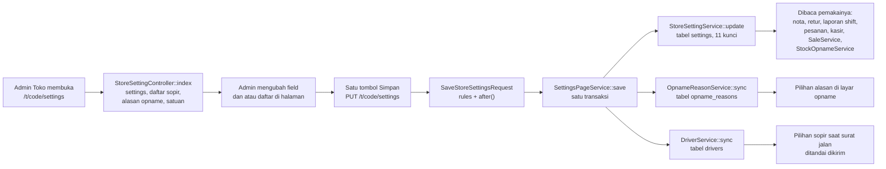
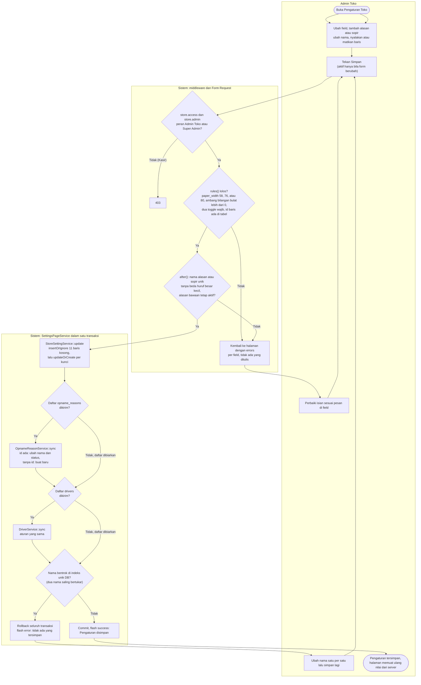
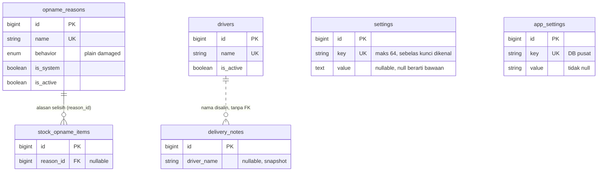
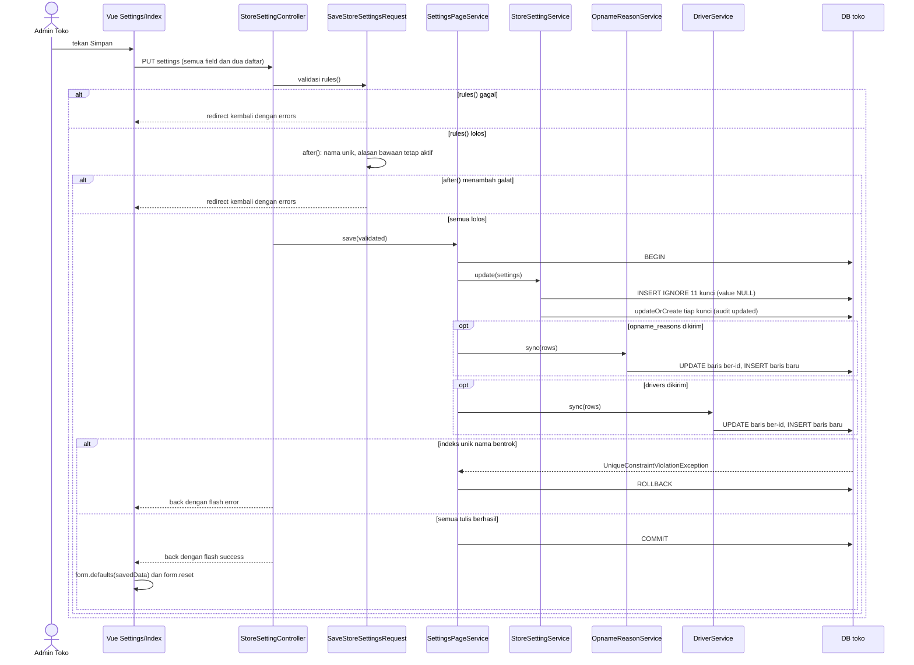

# Pengaturan Toko dan Pengaturan Pusat — Dokumentasi Teknis

> **Modul:** Halaman Pengaturan toko (kop dan kertas cetak, nama printer struk dan surat jalan dengan cetak langsung lewat QZ Tray, cetak nota otomatis, aturan stok opname, alasan selisih opname, daftar sopir, satuan) dan halaman Pengaturan pusat milik Super Admin (panjang minimal password)
> **Stack:** Laravel 13 (PHP 8.3), Inertia 3, Vue 3, Quasar 2, stancl/tenancy
> **Audiens:** Engineer yang memelihara atau memperluas fitur ini
> **Database:** per toko untuk `settings`, `opname_reasons`, `drivers`; pusat untuk `app_settings`
> **Terakhir diperbarui:** 2026-11-17

Dokumen ini berpasangan dengan [multi-toko-pengguna-docs.md](multi-toko-pengguna-docs.md) (tenancy, peran, middleware). Daftar sopir juga dibahas dari sisi surat jalan di [surat-jalan-docs.md](surat-jalan-docs.md); di sini hanya sisi pengaturannya. Satuan (`units`) tampil di halaman yang sama tetapi disimpan satu per satu lewat dialognya sendiri dan dibahas di modul barang.

## 1. Ringkasan

Admin Toko (atau Super Admin yang sedang masuk ke toko) membuka **Pengaturan Toko** untuk mengatur hal-hal yang memengaruhi seluruh kertas dan beberapa aturan stok di toko itu: nama, alamat, dan telepon di kop nota, teks penutup nota, lebar kertas nota (58, 76, atau 80 mm), **nama printer struk dan printer surat jalan** beserta pilihan **cetak langsung lewat QZ Tray** (tanpa dialog cetak), cetak nota otomatis setelah bayar, ambang selisih opname yang wajib diberi catatan, dan kunci penjualan barang yang sedang dihitung opname. Halaman yang sama memuat dua daftar yang tidak pernah dihapus, hanya dinonaktifkan: **alasan selisih opname** dan **sopir**. Semuanya disimpan dengan **satu tombol Simpan** dan ditulis semua-atau-tidak sama sekali. Super Admin punya halaman lain, **Pengaturan pusat**, yang saat ini hanya berisi satu angka: panjang minimal password untuk semua toko.

Setiap pengaturan punya **nilai bawaan yang berlaku sampai diubah**, dan teks yang dikosongkan kembali ke bawaannya. Karena itu tabel `settings` boleh kosong dan tetap benar: pembaca (`StoreSettingService`) selalu menyediakan bawaan.



### BPMN — menyimpan pengaturan toko



## 2. Skema Database

### `settings` (DB toko)

Migrasi: `2026_10_27_152515_create_settings_and_document_sequences_tables` (bentuk awal), lalu `2026_11_03_120000_recreate_settings_table_with_an_id` (bentuk berlaku). Satu baris = satu pengaturan toko sebagai kunci dan teks.

| Kolom | Tipe | Null | Catatan |
|---|---|---|---|
| `id` | bigint, PK | tidak | |
| `key` | string(64) | tidak | **Unique.** Sebelas kunci yang dikenal `StoreSettingService::KEYS` (lihat §5) |
| `value` | text | ya | Null berarti "pakai bawaan". Boolean disimpan `'1'`/`'0'`, angka sebagai teks |
| `created_at`, `updated_at` | timestamp | ya | |

Mengapa tabel dibuat ulang dengan `id`: bentuk pertama memakai `key` sebagai PK string, sedangkan audit trail mencatat `auditable_id` berupa angka dan tidak bisa menunjuk baris itu. Tabel lama memang belum pernah berisi data; migrasi yang baru sengaja **berhenti dengan galat** bila tabelnya ternyata berisi baris, karena `DROP TABLE` tidak bisa dibatalkan bila pembuatan tabel baru gagal sesudahnya, dan tidak melakukan apa-apa bila kolom `id` sudah ada. `down()` mengembalikan bentuk lama.

Kolom `value` boleh `NULL` karena `insertOrIgnore` membuat kesebelas baris dalam keadaan kosong lebih dulu (§7.1), dan karena teks yang dikosongkan disimpan sebagai `NULL`, bukan string kosong.

### `opname_reasons` (DB toko)

Migrasi: `2026_11_05_100000_add_opname_reasons_review_and_damaged_goods`. Alasan yang dipilih per barang yang selisih saat opname.

| Kolom | Tipe | Null | Catatan |
|---|---|---|---|
| `id` | bigint, PK | tidak | |
| `name` | string(255) | tidak | **Unique** (collation `utf8mb4_unicode_ci`, jadi tidak membedakan huruf besar kecil). Form membatasi 100 karakter |
| `behavior` | enum | tidak | `plain` atau `damaged`, default `plain`. `damaged` membuat layar opname meminta keputusan barang rusak |
| `is_system` | boolean | tidak | Default `false`. Empat alasan bawaan bernilai `true` |
| `is_active` | boolean | tidak | Default `true` |
| `created_at`, `updated_at` | timestamp | ya | |

Empat baris bawaan (`Pembelian`, `Cek stok`, `Hilang` plain; `Rusak` damaged, semuanya `is_system = true`) dimasukkan langsung oleh migrasi, **dan** didefinisikan lagi di `OpnameReason::DEFAULTS` yang dipakai `StoreDatabaseSeeder` (`firstOrCreate`). Pada toko baru migrasi lebih dulu, sehingga seeder tidak menambah apa-apa; dua sumber itu harus diubah bersamaan (§13).

### `drivers` (DB toko)

Migrasi: `2026_11_07_110000_create_drivers_table`.

| Kolom | Tipe | Null | Catatan |
|---|---|---|---|
| `id` | bigint, PK | tidak | |
| `name` | string(255) | tidak | **Unique** (tidak membedakan huruf besar kecil). Form membatasi 100 karakter |
| `is_active` | boolean | tidak | Default `true` |
| `created_at`, `updated_at` | timestamp | ya | |

Sopir **tidak dihapus**, hanya dinonaktifkan. Surat jalan menyalin nama sopir ke `delivery_notes.driver_name` saat ditandai dikirim (kolom string null, **tanpa FK**), sehingga mengganti nama atau menonaktifkan sopir tidak mengubah surat jalan lama. Daftar ini ada di halaman pengaturan "sampai data karyawan ada" (komentar migrasi).

### `app_settings` (DB pusat)

Migrasi: `2026_11_02_170000_create_app_settings_table`. Pengaturan untuk seluruh aplikasi, dipegang Super Admin.

| Kolom | Tipe | Null | Catatan |
|---|---|---|---|
| `id` | bigint, PK | tidak | |
| `key` | string(255) | tidak | **Unique.** Kunci yang dipakai kode saat ini hanya `password_min_length` |
| `value` | string(255) | tidak | Tidak boleh null: tidak ada baris tanpa nilai, bawaan hidup di kode (`AppSettingService`) |
| `created_at`, `updated_at` | timestamp | ya | |

### Kolom milik modul lain yang menunjuk ke sini

- `stock_opname_items.reason_id`: FK nullable ke `opname_reasons.id` tanpa `ON DELETE` (jadi `RESTRICT`), alasan lain untuk "alasan tidak pernah dihapus". Kolom teks lamanya `reason` diganti nama menjadi `note`.
- `delivery_notes.driver_name`: snapshot nama, tanpa FK ke `drivers`.

### Diagram relasi



`settings`, `opname_reasons`, `drivers` ada di DB toko; `app_settings` di DB pusat. `stock_opname_items` dan `delivery_notes` digambar hanya sebagai kotak tetangga dari modul lain.

## 3. Model / Entity

| Model | Tabel | Relasi, cast, trait penting |
|---|---|---|
| `App\Models\StoreSetting` | `settings` | `Auditable`; `$table = 'settings'` (nama kelas dan tabel berbeda); `#[Fillable(['key', 'value'])]`. **Tidak memakai `CentralConnection`**: berjalan di koneksi default sehingga hanya benar saat tenancy toko aktif |
| `App\Models\OpnameReason` | `opname_reasons` | `Auditable`, `HasFactory`; cast `behavior` ke `OpnameReasonBehavior`, `is_system` dan `is_active` boolean; konstanta `DEFAULTS` (nama ke perilaku) |
| `App\Models\Driver` | `drivers` | `Auditable`, `HasFactory`; cast `is_active` boolean |
| `App\Models\AppSetting` | `app_settings` | `Auditable`, **`CentralConnection`**; `#[Fillable(['key', 'value'])]` |

Enum terkait: `OpnameReasonBehavior` (`plain`, `damaged`; method `needsDamageDecision()`). Enum `StockOpnameReason` (alasan **seluruh opname**: rutin, stok awal, penambahan stok, dst.) adalah konsep berbeda dari `OpnameReason` (alasan **per barang yang selisih**) dan bukan bagian dari pengaturan ini.

## 4. Hak Akses

| Halaman | Rute (ringkas) | Siapa |
|---|---|---|
| Pengaturan Toko dan Satuan | `t/{tenant}/settings*` | Grup `store.admin`: Admin Toko atau Super Admin yang masuk ke toko itu. Kasir mendapat 403 untuk `GET` maupun `PUT` (`StoreSettingTest::test_only_admins_may_use_the_settings`) |
| Pengaturan pusat | `pusat/settings` | `super.admin` (dan `shift.none-open`). Admin Toko dan Kasir: 403 (`Central\SettingsTest::test_store_roles_cannot_see_or_change_settings`) |

`SaveStoreSettingsRequest::authorize()` dan `UpdateSettingsRequest::authorize()` selalu `true`; seluruh otorisasi ada di middleware route. Aturan peran lengkap ada di dokumen multi-toko §4.

## 5. Konfigurasi

Tidak ada kunci `config/` atau env untuk modul ini; pengaturannya hidup di database dan konstanta kode.

### Sebelas kunci tabel `settings`

| Kunci | Bawaan | Disimpan sebagai | Dibaca lewat | Pemakai |
|---|---|---|---|---|
| `receipt_name` | nama toko (`stores.name`) | teks atau `NULL` | `letterhead()['name']` | Kop semua cetakan: nota (`ShiftReceiptController`), surat jalan (`DeliveryNoteController`, `CashierDeliveryNoteController`), bukti retur (`SaleReturnController`, `CashierSaleReturnController`), pesanan (`CashierOrderController`), laporan shift (`ShiftController`, `ShiftRecapController`), tutup hari (`DailyClosingController`), laporan penjualan (`ReportController`) |
| `receipt_address` | `stores.address` | teks atau `NULL` | `letterhead()['address']` | idem |
| `receipt_phone` | `stores.phone` | teks atau `NULL` | `letterhead()['phone']` | idem |
| `receipt_footer` | `StoreSettingService::DEFAULT_RECEIPT_FOOTER` (dua baris: syarat tukar barang dan terima kasih) | teks atau `NULL` | `receiptFooter()` | Nota penjualan (`ShiftReceiptController`) dan lembar pesanan (`CashierOrderController`) |
| `paper_width` | `80` (`DEFAULT_PAPER_WIDTH`) | `'58'`, `'76'`, atau `'80'` | `paperWidth()` (nilai di luar `PAPER_WIDTHS` kembali ke 80; 76 mm untuk printer struk dot matrix seperti Epson TM-U220B) | Nota, bukti retur, lembar pesanan, laporan shift (`ShiftReceiptController`, `SaleReturnController`, `CashierSaleReturnController`, `CashierOrderController`, `ShiftController`, `ShiftRecapController`). **Tidak** dipakai surat jalan, tutup hari, dan laporan penjualan |
| `receipt_printer` | tanpa printer (`null`) | nama printer atau `NULL` | `receiptPrintTarget()` (`name`, `width_mm` = `paperWidth()`, tanpa tinggi) | Prop bersama `print_targets.receipt`: tujuan cetak langsung nota, bukti retur, lembar pesanan, dan laporan shift |
| `delivery_note_printer` | tanpa printer (`null`) | nama printer atau `NULL` | `deliveryNotePrintTarget()` (kertas tetap 241,3 x 139,7 mm = 9,5 x 5,5 inci, `DELIVERY_NOTE_PAGE_MM`) | Prop bersama `print_targets.delivery_note`: tujuan cetak langsung surat jalan |
| `is_qz_tray_enabled` | `false` | `'1'`/`'0'` | `isQzTrayEnabled()` | Prop bersama `print_targets.is_qz_tray_enabled`: bila `true`, `PrintPage` mengirim cetakan langsung ke printer lewat QZ Tray tanpa dialog cetak; bila `false`, dialog cetak browser dipakai dan nama printer hanya mengingatkan |
| `auto_print_receipt` | `false` | `'1'`/`'0'` | `isReceiptPrintedAutomatically()` | `CashierController` (prop `is_receipt_printed_automatically` untuk layar kasir) |
| `large_variance_threshold` | tanpa batas (`null`) | rupiah bulat sebagai teks, atau `NULL` | `largeVarianceThreshold()` (`BigDecimal`, hanya bila lebih dari 0) | `StockOpnameService::requireNotesForLargeVariances` saat posting |
| `lock_sales_during_opname` | `false` | `'1'`/`'0'` | `isSalesLockedDuringOpname()` | `SaleService::requireNoOpnameLock` (menolak penjualan), `CashierCatalogService` (penanda `is_being_counted` pada hasil pencarian; daftar terlaris tidak menampilkan barang yang sedang dihitung) |

Konstanta lain: `StoreSettingService::PAPER_WIDTHS = [58, 76, 80]`; `SaveStoreSettingsRequest::MAX_AMOUNT = 999999999999` (batas ambang); `AppSettingService`: `DEFAULT_PASSWORD_MIN_LENGTH = 5`, `LOWEST_PASSWORD_MIN_LENGTH = 5`, `HIGHEST_PASSWORD_MIN_LENGTH = 64`; kunci `password_min_length`.

Kunci yang disebut `analisis-sistem.md` 6.7 tetapi **tidak ada** di kode (Grep `app/`, `routes/`, `config/`, `database/`, `resources/js`, `tests/` kosong): `allow_negative_stock`, `receipt_header` (diganti tiga kunci `receipt_name/address/phone`), `paper_size` (diganti `paper_width`), `receiving_requires_approval`, `receiving_requires_purchase`.

## 6. Rute / API

Semua rute web (Inertia dan redirect); tidak ada JSON API.

| Method | Path | Action | Nama rute | Middleware |
|---|---|---|---|---|
| GET | `/t/{tenant}/settings` | `Tenant\StoreSettingController@index` | `tenant.settings.index` | `web`, tenancy, `auth`, `store.access`, `shift.remember`, `store.admin` |
| PUT | `/t/{tenant}/settings` | `Tenant\StoreSettingController@update` | `tenant.settings.update` | idem |
| POST | `/t/{tenant}/settings/units` | `UnitController@store` | `tenant.units.store` | idem (modul barang) |
| PUT/PATCH | `/t/{tenant}/settings/units/{unit}` | `UnitController@update` | `tenant.units.update` | idem (modul barang) |
| DELETE | `/t/{tenant}/settings/units/{unit}` | `UnitController@destroy` | `tenant.units.destroy` | idem (modul barang) |
| GET | `/pusat/settings` | `Central\SettingController@index` | `central.settings.index` | `web`, `auth`, `super.admin`, `shift.none-open` |
| PUT | `/pusat/settings` | `Central\SettingController@update` | `central.settings.update` | idem |

### Prop halaman `Tenant/Settings/Index`

`settings` (sebelas nilai dalam bentuk yang siap diedit, lihat `StoreSettingService::all()`), `store_letterhead` (nama, alamat, telepon toko, dipakai sebagai placeholder), `paper_widths` (`[58, 76, 80]`), `units` (satu halaman paginasi), `unit_filters`, `unit_per_page_options`, `drivers` (`id`, `name`, `is_active`), `opname_reasons` (`id`, `name`, `is_system`, `is_active`), dan `urls` (`update`, `unit_create`). Semua halaman toko juga mendapat prop bersama `print_targets` (`is_qz_tray_enabled`, serta `receipt` dan `delivery_note` berisi `name`, `width_mm`, `height_mm` atau `null` bila printernya belum dinamai; seluruhnya `null` di halaman pusat), diisi `HandleInertiaRequests::printTargets()`. Satuan dimuat ulang sebagian lewat `only: ['units', 'unit_filters']` (parameter query `unit_search`, `unit_sort`, `unit_direction`, `unit_per_page`, `unit_page`); bila halaman satuan yang diminta kosong dan lebih besar dari 1, controller mengalihkan ke halaman terakhir.

### Contoh permintaan dan respons

Contoh berikut **ilustratif** (disusun dari kode dan tes, bukan tangkapan lalu lintas nyata).

**`PUT /t/mitra_utama/settings`** (badan JSON, setara dengan yang dikirim `form.put`):

```json
{
  "receipt_name": "MITRA UTAMA",
  "receipt_address": "Jl. Poros Kuprik",
  "receipt_phone": "",
  "receipt_footer": "Terima kasih\nDatang lagi",
  "paper_width": 76,
  "receipt_printer": "EPSON TM-U220 Receipt",
  "delivery_note_printer": "EPSON LX-310",
  "is_qz_tray_enabled": true,
  "large_variance_threshold": "50000",
  "lock_sales_during_opname": true,
  "auto_print_receipt": false,
  "opname_reasons": [
    { "id": 2, "name": "Cek stok rutin", "is_active": true },
    { "id": null, "name": "Kadaluarsa", "is_active": true }
  ],
  "drivers": [
    { "id": 5, "name": "Pak Joko", "is_active": false },
    { "id": null, "name": "Pak Adi", "is_active": true }
  ]
}
```

Sukses: redirect kembali dengan flash `success` bernilai `Pengaturan disimpan.` Halaman memuat ulang props; baris baru kini punya `id`.

Validasi gagal: redirect kembali dengan galat per field, dengan kunci bertitik untuk baris daftar:

```json
{
  "errors": {
    "paper_width": "Lebar kertas nota hanya 58, 76, atau 80 mm.",
    "large_variance_threshold": "Ambang selisih harus bilangan bulat rupiah.",
    "opname_reasons.1.name": "Alasan dengan nama itu sudah ada.",
    "drivers.0.name": "Nama sopir sudah ada."
  }
}
```

Nama yang saling bertukar antar baris lolos validasi tetapi bentrok di indeks unik; transaksi digulung dan flash `error` berbunyi `Ada nama yang bentrok saat disimpan, sehingga tidak ada yang tersimpan. Ubah nama satu per satu, lalu simpan lagi.`

**`PUT /pusat/settings`** `{ "password_min_length": 8 }` berhasil dengan flash `Pengaturan disimpan.`; nilai di luar 5 sampai 64 atau bukan bilangan bulat memberi galat `Panjang minimal password antara 5 dan 64 karakter.` atau `Panjang minimal password harus berupa angka bulat.`

## 7. Komponen Backend

### 7.1 `StoreSettingService` (`app/Services/StoreSettingService.php`)

Pembaca dan penulis sebelas kunci toko. Harus berjalan saat tenancy toko aktif (memakai `tenant()` untuk cadangan kop).

- **Pembacaan murah dan konsisten.** `stored()` membaca seluruh kesebelas baris sekali per instance service (`$storedSettings ??=`), karena satu nota atau satu pencarian kasir meminta beberapa pengaturan berurutan. Cache itu dibuang (`= null`) setiap kali `update()` selesai, sehingga service yang sama langsung melihat nilai barunya (diuji `test_the_service_reads_the_settings_once_and_sees_a_save_made_through_it`).
- **Bawaan tersembunyi di pembaca, bukan di data.** `letterhead()` memakai nilai tersimpan bila `filled`, kalau tidak data toko; `paperWidth()` menolak nilai di luar `PAPER_WIDTHS`; `largeVarianceThreshold()` mengembalikan `null` bila kosong atau tidak positif; dua boolean dibandingkan dengan `'1'`.
- **`all()`** menyusun nilai untuk form: teks kosong tetap `''`, tetapi `receipt_footer` dikembalikan sebagai `receiptFooter()` yang berarti **teks bawaan ikut terisi di form**, dan ambang dibulatkan ke rupiah penuh dengan `RoundingMode::HalfUp` (data lama yang tersimpan dengan desimal tetap membuka halaman: `test_a_limit_that_was_stored_with_decimals_still_shows_the_page`).
- **`update(array $settings)`** dalam `DB::transaction`:
  1. `StoreSetting::insertOrIgnore` memasukkan kesebelas kunci dengan `value = NULL` bila belum ada. Ini ada karena dua simpan pertama yang bersamaan dengan `updateOrCreate` saja akan sama-sama mencoba membuat kunci yang sama dan salah satunya gagal di indeks unik `key`.
  2. Lalu untuk **setiap** kunci `updateOrCreate(['key' => $key], ['value' => $value])`. Nilai ditulis sebagai **update** (bukan insert) dengan sengaja: `insertOrIgnore` memakai query builder dan tidak memicu event model, sedangkan `updateOrCreate` memicu `updated` sehingga audit trail mencatat tiap perubahan (`old_values` dan `new_values` berisi `value`). Konsekuensinya: baris yang dibuat oleh `insertOrIgnore` sendiri tidak punya audit `created`, dan simpan ulang tanpa perubahan nilai tidak menghasilkan audit.
  3. Konversi nilai: boolean ke `'1'`/`'0'`; nilai `filled` di-`trim` menjadi teks; selain itu `NULL`. Kunci yang **tidak ada** di array masukan diperlakukan sebagai `NULL` (§13 butir 1).

### 7.2 `SettingsPageService` (`app/Services/SettingsPageService.php`)

Memenuhi pola "satu tombol Simpan". `save(array $input)` membungkus tiga pekerjaan dalam satu `DB::transaction`: `StoreSettingService::update`, `OpnameReasonService::sync` bila `opname_reasons` ada di masukan, dan `DriverService::sync` bila `drivers` ada. **Daftar yang tidak dikirim dibiarkan apa adanya**; daftar yang dikirim sebagai array kosong dianggap dikirim dan menghasilkan `sync([])` yang tidak melakukan apa-apa (memang tidak ada penghapusan). Transaksi bersarang (service pengaturan punya transaksinya sendiri) bukan masalah di Laravel; yang terluar yang menentukan commit.



### 7.3 `OpnameReasonService` dan `DriverService`

Keduanya bentuknya kembar (§13 mencatat duplikasinya).

- **`sync(rows)`**: baris dengan `id` diubah (nama di-`trim`, `is_active`) lewat `findOrFail`; baris tanpa `id` dibuat. Baris yang **tidak ada** di masukan tidak disentuh, sebab alasan dan sopir tidak pernah dihapus.
- **`OpnameReasonService::create()`** selalu membuat alasan `plain` dengan `is_system = false`: hanya `Rusak` bawaan yang meminta keputusan barang rusak, admin tidak bisa membuat alasan baru yang berperilaku `damaged`. **`update()`** hanya mengubah `name` dan `is_active`, jadi `behavior` dan `is_system` tidak pernah berubah. Nama alasan bawaan **boleh diganti** (hanya penonaktifan yang dilarang di request), perilakunya tetap.
- **`DriverService::active()`** (hanya sopir aktif, urut nama) dipakai `DeliveryNoteController` untuk pilihan sopir, dan `ShipDeliveryNoteRequest` menolak `driver_id` yang tidak ada atau tidak aktif (`Rule::exists('drivers', 'id')->where('is_active', true)`).
- `OpnameReasonService::all()` mengurutkan alasan bawaan lebih dulu lalu `id`; `DriverService::all()` urut nama. Layar opname memakai `all()` (termasuk yang nonaktif) supaya opname lama tetap menampilkan alasannya; permintaan hitung dan review menolak alasan nonaktif **kecuali** itu alasan yang sudah tersimpan pada barang itu (`SaveStockOpnameCountsRequest`, `SaveStockOpnameReviewRequest`, galat `Alasan itu sudah dinonaktifkan.`).

### 7.4 `StoreSettingController` dan `SettingsPageService` dari sisi HTTP

`index()` menyusun halaman (§6) dan `update()` memanggil `SettingsPageService::save($request->validated())`. Satu-satunya pengecualian yang ditangkap adalah `UniqueConstraintViolationException`, diubah menjadi flash `error`; semua galat lain menjadi 500 biasa. Setelah sukses, `back()` mengembalikan ke halaman yang sama sehingga props dimuat ulang dari server.

### 7.5 Frontend: `Tenant/Settings/Index.vue` dan `NamedListCard.vue`

- `form = useForm(savedData())` memegang semua yang dikirim satu `PUT`: sebelas nilai ditambah dua daftar. Tombol Simpan nonaktif selama `!form.isDirty`. Pada `onSuccess` form diset ulang ke data server (`form.defaults(savedData())` lalu `form.reset()`), sehingga baris baru langsung memakai `id` dari server.
- Satuan **bukan** bagian dari form itu: dialog `UnitFormDialog` menyimpan satu per satu. Teks petunjuk di halaman memberitahu pengguna pembedaan ini.
- **Kartu Printer.** Toggle *Cetak langsung lewat QZ Tray*, tombol *Cek QZ Tray* (`listPrinters()` menyambung ke QZ Tray dan mengambil nama printer komputer itu), dan dua `PrinterNameField` (printer struk, printer surat jalan): kolom nama yang bisa diketik, menu untuk memilih nama dari daftar yang terdeteksi, dan tombol *Tes* (`printTestPage()`) yang mencetak halaman uji dengan kertas printer itu sebelum disimpan. Nama harus sama persis dengan nama printer di Windows.
- **Petunjuk di tombol cetak.** `usePrintTargets()` membaca prop bersama `print_targets`; `printHintOf(kind)` memberi teks "Dicetak langsung ke printer X" (QZ Tray aktif) atau "Pilih printer X di dialog cetak" (tidak). Tampil di dialog "nota selesai" kasir dan sebagai tooltip tombol cetak surat jalan (`SaleDoneDialog`, `DeliveryNoteDialog`, `DeliveryNotes/Show`).
- **Cetak langsung lewat QZ Tray.** `PrintPage` (dipakai semua halaman cetak) menerima `printerKind` (`receipt` untuk nota, bukti retur, lembar pesanan, laporan shift; `delivery_note` untuk surat jalan; kosong untuk laporan A4 dan label). Bila `is_qz_tray_enabled` dan printer untuk jenis itu sudah dinamai, `print()` memanggil `printSheetElement()` (`Composables/qzTray.js`): isi sheet beserta seluruh CSS-nya dijadikan HTML satu berkas, lalu `qz.print` dengan `type: 'pixel'`, `format: 'html'`, ukuran halaman printer (tinggi roll = tinggi isi), margin 0, hitam putih. Sesudahnya halaman menembakkan `afterprint` supaya `printSheet.js` melepas iframe seperti sehabis dialog cetak. Bila QZ Tray gagal (tidak berjalan, ditolak, nama printer salah), halaman memberi tahu halaman induknya lewat `postMessage` (`SHEET_QZ_FALLBACK_MESSAGE`, ditampilkan `printSheet.js` sebagai notifikasi) dan membuka dialog cetak browser, sehingga cetakan tidak hilang. Klien `qz-tray` dimuat dengan `import()` pada pemakaian pertama.
- `NamedListCard` dipakai ulang untuk alasan opname dan sopir. Baris yang ada tidak punya tombol hapus; baris baru ditandai "baru" dan hanya ada di daftar lokal sampai disimpan; alasan bawaan ditandai "bawaan" dan toggle-nya dikunci. Galat per baris dicocokkan lewat kunci `{errorKey}.{index}.name` atau `.is_active`, jadi urutan array yang dikirim harus sama dengan urutan yang ditampilkan.

### 7.6 `AppSettingService` dan Pengaturan pusat

`passwordMinLength()` membaca satu baris `app_settings` (`key = 'password_min_length'`) dan mengembalikan `(int)` nilainya, atau 5 bila tidak ada baris. `setPasswordMinLength()` memakai `updateOrCreate` dan menyimpan `(string)`. Dibaca oleh `SaveUserRequest::rules()` (`min:` pada password, wajib saat tambah user, boleh kosong saat ubah) dan `SettingController::index()`; tidak berlaku untuk password yang sudah ada. Alasan batas bawah 5: password diketik kasir di mesin kasir (komentar di service), dan `LOWEST_PASSWORD_MIN_LENGTH` mencegah Super Admin menurunkannya di bawah kesepakatan. Perubahan diaudit di pusat (`AppSetting` `Auditable`; `SettingsTest::test_super_admin_changes_the_password_minimum_and_it_is_audited`).

## 8. Aturan Validasi

### `SaveStoreSettingsRequest`

Gagal = tidak ada yang ditulis (validasi terjadi sebelum `SettingsPageService`).

| Field | Aturan | Masuk ke | Pesan galat |
|---|---|---|---|
| `receipt_name` | `nullable`, `string`, `max:255` | `settings.receipt_name` | (bawaan Laravel) |
| `receipt_address` | `nullable`, `string`, `max:500` | `settings.receipt_address` | (bawaan) |
| `receipt_phone` | `nullable`, `string`, `max:100` | `settings.receipt_phone` | (bawaan) |
| `receipt_footer` | `nullable`, `string`, `max:1000` | `settings.receipt_footer` | (bawaan) |
| `paper_width` | `required`, `integer`, `in:58,76,80` | `settings.paper_width` | `Lebar kertas nota hanya 58, 76, atau 80 mm.` |
| `receipt_printer` | `nullable`, `string`, `max:255` | `settings.receipt_printer` | (bawaan) |
| `delivery_note_printer` | `nullable`, `string`, `max:255` | `settings.delivery_note_printer` | (bawaan) |
| `is_qz_tray_enabled` | `required`, `boolean` | `settings.is_qz_tray_enabled` | (bawaan) |
| `large_variance_threshold` | `nullable`, `numeric`, `gt:0`, `max:999999999999`, `decimal:0` | `settings.large_variance_threshold` | `Ambang selisih harus berupa angka.` / `Ambang selisih harus lebih dari 0. Kosongkan untuk tanpa batas.` / `Ambang selisih harus bilangan bulat rupiah.` |
| `lock_sales_during_opname` | `required`, `boolean` | `settings.lock_sales_during_opname` | (bawaan) |
| `auto_print_receipt` | `required`, `boolean` | `settings.auto_print_receipt` | (bawaan) |
| `opname_reasons` | `sometimes`, `array` | memicu `OpnameReasonService::sync` | |
| `opname_reasons.*.id` | `nullable`, `integer`, `exists:opname_reasons,id` | menentukan ubah atau buat | (bawaan) |
| `opname_reasons.*.name` | `required`, `string`, `max:100` | `opname_reasons.name` | `Isi nama alasan.` / `Nama alasan maksimal :max huruf.` |
| `opname_reasons.*.is_active` | `required`, `boolean` | `opname_reasons.is_active` | (bawaan) |
| `drivers` | `sometimes`, `array` | memicu `DriverService::sync` | |
| `drivers.*.id` | `nullable`, `integer`, `exists:drivers,id` | menentukan ubah atau buat | (bawaan) |
| `drivers.*.name` | `required`, `string`, `max:100` | `drivers.name` | `Nama sopir wajib diisi.` / `Nama sopir maksimal :max karakter.` |
| `drivers.*.is_active` | `required`, `boolean` | `drivers.is_active` | (bawaan) |

Pemeriksaan `exists` berjalan di koneksi default, yaitu DB toko, karena Form Request di-resolve setelah tenancy diinisialisasi.

### Pemeriksaan `after()` (tiga closure)

1. **`requireDistinctNames` untuk `opname_reasons`** (pesan `Alasan dengan nama itu sudah ada.`) dan **untuk `drivers`** (`Nama sopir sudah ada.`). Daftar nama yang "sudah terpakai" dibentuk dari baris DB yang **tidak ada** di daftar yang dikirim (`whereNotIn('id', $sentIds)`), lalu setiap baris yang dikirim dicek terhadap daftar itu dan ditambahkan ke sana. Jadi nama bentrok dengan baris yang tidak ikut dikirim, atau dengan baris sebelumnya di daftar yang sama, ditolak di baris ke-dua. Pembandingan memakai `mb_strtolower(trim())` di kedua sisi, selaras dengan collation case-insensitive di MySQL. Baris dengan nama kosong dilewati (sudah ditangkap `required`).
2. **`requireSystemReasonsStayOn`**: baris yang `id`-nya adalah alasan `is_system` tidak boleh `is_active = false` (galat pada `opname_reasons.{index}.is_active`: `Alasan {nama} bawaan toko dan tidak bisa dinonaktifkan.`).

Dua nama yang **saling bertukar** antar baris (A menjadi B dan B menjadi A) lolos pemeriksaan pertama karena kedua nama ada di daftar yang dikirim dan tidak ada yang "terpakai oleh baris luar", tetapi bentrok pada indeks unik saat ditulis berurutan. Itu ditangkap di controller sebagai `UniqueConstraintViolationException` (§7.4).

### `UpdateSettingsRequest` (pusat)

| Field | Aturan | Masuk ke | Pesan |
|---|---|---|---|
| `password_min_length` | `required`, `integer`, `between:5,64` | `app_settings.value` (kunci `password_min_length`) | `Isi panjang minimal password.` / `Panjang minimal password harus berupa angka bulat.` / `Panjang minimal password antara :min dan :max karakter.` |

## 9. Guard Kepemilikan & Status

| Endpoint | Yang dicek ulang di server | Yang diblokir |
|---|---|---|
| `GET/PUT /t/{tenant}/settings` | Peran dari `store.access` (DB), toko `active`, akun aktif | Kasir dan siapa pun tanpa penugasan toko: 403 |
| `PUT .../settings`, baris dengan `id` | `exists` pada tabel toko dan `findOrFail` di service | Menyunting baris dengan `id` yang tidak ada di toko ini (tabel terpisah per toko, jadi id toko lain tidak bisa dijangkau) |
| `PUT .../settings`, alasan | `is_system` dibaca dari DB (bukan dari klien) | Menonaktifkan alasan bawaan |
| `PUT .../settings`, nama | Nama baris di DB yang tidak ikut dikirim | Nama duplikat (tanpa beda huruf besar kecil) |
| Penyimpanan | Transaksi tunggal | Simpan sebagian: bentrok unik membatalkan semuanya |
| Mengirim `behavior` atau `is_system` | Tidak masuk `rules()`, jadi tidak ada di `validated()` | Mengubah perilaku atau status bawaan lewat request |
| `PUT /pusat/settings` | `users.is_super_admin` dan `is_active` dari DB | Siapa pun selain Super Admin aktif: 403 |

## 10. Job / Jadwal

Tidak ada. Semua penyimpanan sinkron dalam request.

## 11. Mode Uji / Mock

Tidak ada mock. Pengujian memakai DB toko nyata lewat `PreparesStoreDatabase` (lihat dokumen multi-toko §11): `tests/Feature/Tenancy/StoreSettingTest.php` (hampir semua perilaku di atas, termasuk audit dan pembacaan sekali per instance), `OpnameReasonTest.php`, `DriverTest.php`, dan `tests/Feature/Central/SettingsTest.php`. Pengujian audit menyalakan `audit.console` karena tes berjalan di konsol.

## 12. Konvensi i18n

Teks UI dan pesan galat berbahasa Indonesia dan tertanam di `messages()` request, pesan exception, dan komponen Vue; tidak ada berkas terjemahan aplikasi selain `lang/id/validation.php`. Teks penutup nota bawaan (`DEFAULT_RECEIPT_FOOTER`) adalah string Indonesia dua baris di konstanta service. Nama kunci pengaturan, tabel, dan kolom tetap Inggris.

## 13. Keterbatasan / Utang Teknis

1. **`PUT /settings` adalah "ganti semua" untuk sebelas nilai, tetapi "biarkan" untuk dua daftar.** Di `StoreSettingService::update` (baris 134) `$settings[$key] ?? null` memperlakukan kunci yang tidak dikirim sebagai kosong. Halaman Vue selalu mengirim semuanya sehingga aman, tetapi klien lain yang mengirim `PUT` sebagian tanpa `receipt_name`, `receipt_address`, `receipt_phone`, `receipt_footer`, atau `large_variance_threshold` akan menghapus nilai itu kembali ke bawaan tanpa galat (hanya `paper_width` dan dua boolean wajib oleh `rules()`). Daftar sopir dan alasan bersifat sebaliknya: yang tidak dikirim dibiarkan.
2. **Teks penutup nota bawaan "terkunci" pada simpan pertama.** `StoreSettingService::all()` (baris 108) mengembalikan `receiptFooter()` sehingga form terisi teks bawaan; menyimpan form tanpa mengubahnya menulis teks itu sebagai nilai tersimpan, bukan `NULL`. Setelahnya mengganti `DEFAULT_RECEIPT_FOOTER` di kode tidak lagi memengaruhi toko itu, dan "kosongkan untuk kembali ke bawaan" tidak terlihat oleh pengguna karena field tidak pernah tampak kosong.
3. **`paper_width` hanya memengaruhi sebagian cetakan** (nota, bukti retur, lembar pesanan, laporan shift). Surat jalan, tutup hari, dan laporan penjualan hanya memakai `letterhead()`; teks bantuan "Dipakai di nota, surat jalan, bukti retur, dan laporan" di halaman berlaku untuk kop, bukan untuk lebar kertas. Surat jalan selalu 9,5 x 5,5 inci.
4. **Kunci dari `analisis-sistem.md` tidak ada di kode** (§5): `allow_negative_stock`, `receiving_requires_approval`, `receiving_requires_purchase`, dan nama lama `receipt_header`/`paper_size`. Dokumen kebutuhan 7.0 aturan 6 masih menyebutnya. Dokumen itu juga menyebut `settings` memakai `key` sebagai PK (6.7); kode kini memakai `id`.
5. **`AppSettingService::setPasswordMinLength` memakai `updateOrCreate` saja**, tanpa `insertOrIgnore` seperti pola pengaturan toko. Dua simpan pertama yang bersamaan bisa menabrak indeks unik `key`; risikonya kecil karena hanya Super Admin yang menulis, tetapi polanya tidak konsisten dengan `StoreSettingService`. `passwordMinLength()` juga mengembalikan nilai tersimpan apa adanya tanpa menjepit ke `LOWEST_PASSWORD_MIN_LENGTH`, sehingga nilai yang ditulis di luar form (mis. langsung ke DB) bisa lebih rendah dari batas bawah, dan membacanya memerlukan satu query setiap kali `SaveUserRequest` divalidasi (tidak di-cache).
6. **Dua sumber untuk alasan opname bawaan.** Nama dan perilaku keempat alasan ada di migrasi `2026_11_05_100000...` (angka literal) dan di `OpnameReason::DEFAULTS` (dipakai `StoreDatabaseSeeder`). Perubahan salah satunya tidak otomatis mengikuti yang lain; di toko baru migrasi menang karena berjalan lebih dulu.
7. **Duplikasi `OpnameReasonService` dan `DriverService`** (`sync`, `update`, `create` hampir identik, juga duplikasi `requireDistinctNames` untuk dua model di request). `NamedListCard.vue` sudah generik di frontend; backend belum.
8. **Pengunci penjualan saat opname tidak dikunci terhadap mulai-opname** (`SaleService::requireNoOpnameLock`): satu penjualan yang lolos pemeriksaan tepat sebelum opname dimulai tetap masuk. Stok aman karena posting membaca stok langsung di bawah lock; diterima di `docs/hasil-review-kode.md` bagian 3.
9. **Bacaan rapuh bila data rusak.** `largeVarianceThreshold()` memanggil `BigDecimal::of()` pada teks tersimpan; nilai non-numerik yang ditulis di luar form melempar `NumberFormatException` di tiap pembacaan (form tidak akan pernah menulisnya, `decimal:0` dan `numeric` mencegahnya).
10. **Daftar tidak bisa dirampingkan.** Alasan dan sopir tidak pernah dihapus (keputusan sadar: opname dan surat jalan lama harus tetap bernama), sehingga daftar hanya bertambah; halaman tidak punya penyaring atau lipatan untuk baris nonaktif. Bertukar nama dua baris tidak dimungkinkan dalam satu simpan (§8).
11. **Tombol Simpan tidak mencakup satuan.** `form.isDirty` mengabaikan perubahan di dialog satuan karena disimpan terpisah; pengguna yang mengubah satuan lalu menekan Simpan tidak akan melihat perubahan status tombol.
12. **Pengaturan toko hanya valid saat tenancy aktif.** `StoreSetting`, `OpnameReason`, dan `Driver` tidak punya trait koneksi; memakainya dari konteks pusat (mis. perintah artisan tanpa `Store::run`) menembak tabel yang tidak ada di DB pusat.
13. **Browser sendiri tidak bisa memilih printer; cetak langsung bergantung pada QZ Tray.** Tanpa QZ Tray (pengaturan mati, belum dipasang, atau gagal), aplikasi memanggil `window.print()` dari iframe tersembunyi sehingga printer ditentukan dialog cetak browser; nama printer hanya **mengingatkan** di tombol cetak, dan salah memilih printer di dialog tidak dicegah. Nama printer tidak diperiksa terhadap daftar printer komputer: salah ketik baru ketahuan saat mencetak (QZ Tray menolak, dan dialog cetak dibuka sebagai cadangan) atau lewat tombol *Tes*.
14. **Cetak lewat QZ Tray belum diuji dengan QZ Tray dan printer sungguhan.** Kodenya ditulis menurut API `qz-tray` 2.3 (`qz.print` dengan data `pixel`/`html`/`plain` dan opsi `pageWidth`/`pageHeight` dalam mm); yang tidak bisa dipastikan tanpa perangkat: ketepatan ukuran halaman roll (tinggi diukur dari isi), perilaku driver Windows TM-U220B dan LX-310 pada mode grafis (lebih lambat daripada teks mentah ESC/P), dan font Courier New. Jalur cetak teks mentah (ESC/P, ESC/POS) belum ada; bila hasil HTML kurang baik atau lambat, itulah langkah berikutnya. Halaman tidak ditandatangani, jadi QZ Tray meminta izin sekali per komputer (Allow dan Remember), dan Chrome dapat menanyakan izin akses jaringan lokal.

## 14. Indeks File

| Concern | Path |
|---|---|
| Migrasi toko | `database/migrations/tenant/2026_10_27_152515_create_settings_and_document_sequences_tables.php`, `2026_11_03_120000_recreate_settings_table_with_an_id.php`, `2026_11_05_100000_add_opname_reasons_review_and_damaged_goods.php`, `2026_11_07_110000_create_drivers_table.php` |
| Migrasi pusat | `database/migrations/2026_11_02_170000_create_app_settings_table.php` |
| Model | `app/Models/StoreSetting.php`, `OpnameReason.php`, `Driver.php`, `AppSetting.php` |
| Enum | `app/Enums/OpnameReasonBehavior.php` (terkait: `StockOpnameReason.php`) |
| Service | `app/Services/StoreSettingService.php`, `SettingsPageService.php`, `OpnameReasonService.php`, `DriverService.php`, `AppSettingService.php` |
| Seeder dan factory | `database/seeders/StoreDatabaseSeeder.php`; `database/factories/OpnameReasonFactory.php`, `DriverFactory.php` |
| Controller dan middleware | `app/Http/Controllers/Tenant/StoreSettingController.php`, `app/Http/Controllers/Central/SettingController.php`, `app/Http/Middleware/HandleInertiaRequests.php` (prop `print_targets`) |
| Request | `app/Http/Requests/Tenant/SaveStoreSettingsRequest.php`, `app/Http/Requests/Central/UpdateSettingsRequest.php`; pemakai terkait: `Tenant/ShipDeliveryNoteRequest.php`, `Tenant/SaveStockOpnameCountsRequest.php`, `Tenant/SaveStockOpnameReviewRequest.php`, `Central/SaveUserRequest.php` |
| Rute | `routes/tenant.php` (grup `store.admin`), `routes/web.php` (`pusat/settings`) |
| Halaman Vue | `resources/js/Pages/Tenant/Settings/Index.vue`, `resources/js/Pages/Central/Settings/Index.vue` |
| Komponen Vue | `resources/js/Components/NamedListCard.vue`, `PrinterNameField.vue`, `UnitFormDialog.vue`, `PrintPage.vue`; `resources/js/Composables/usePrintTargets.js`, `qzTray.js`, `printSheet.js`; pemakai petunjuk cetak: `Components/Cashier/SaleDoneDialog.vue`, `Components/Cashier/DeliveryNoteDialog.vue`, `Pages/Tenant/DeliveryNotes/Show.vue`; dependensi `qz-tray` (package.json) |
| Pemakai nilai | `app/Services/SaleService.php` (`requireNoOpnameLock`), `CashierCatalogService.php`, `StockOpnameService.php` (`requireNotesForLargeVariances`), `app/Http/Controllers/Tenant/CashierController.php`, `ShiftReceiptController.php`, `CashierOrderController.php`, `ShiftController.php`, `ShiftRecapController.php`, `SaleReturnController.php`, `CashierSaleReturnController.php`, `DeliveryNoteController.php`, `CashierDeliveryNoteController.php`, `DailyClosingController.php`, `ReportController.php` |
| Test | `tests/Feature/Tenancy/StoreSettingTest.php`, `OpnameReasonTest.php`, `DriverTest.php`, `tests/Feature/Central/SettingsTest.php` |
