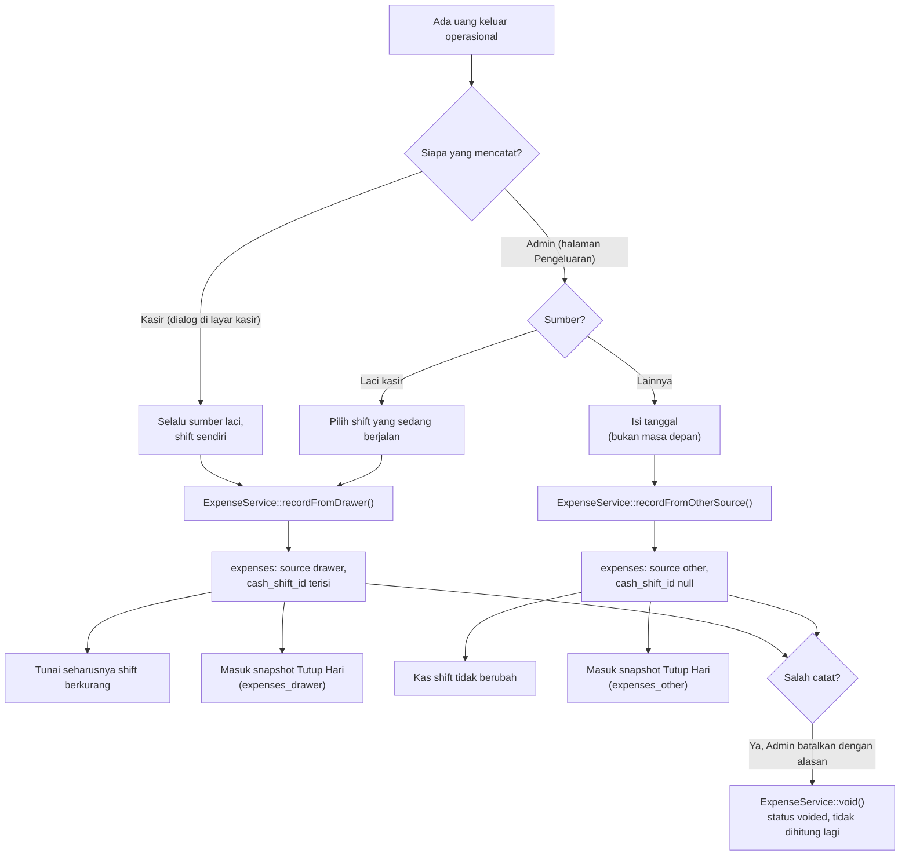
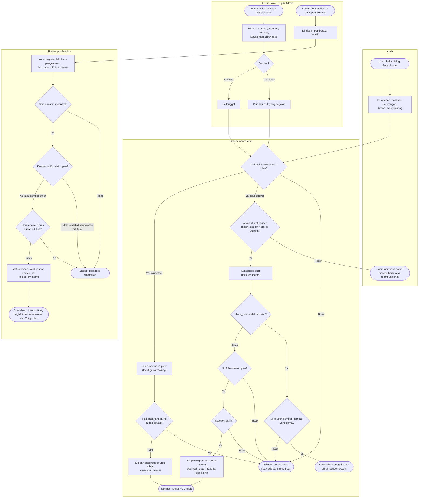
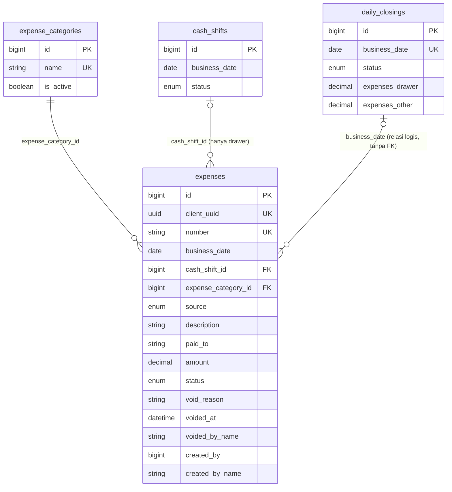
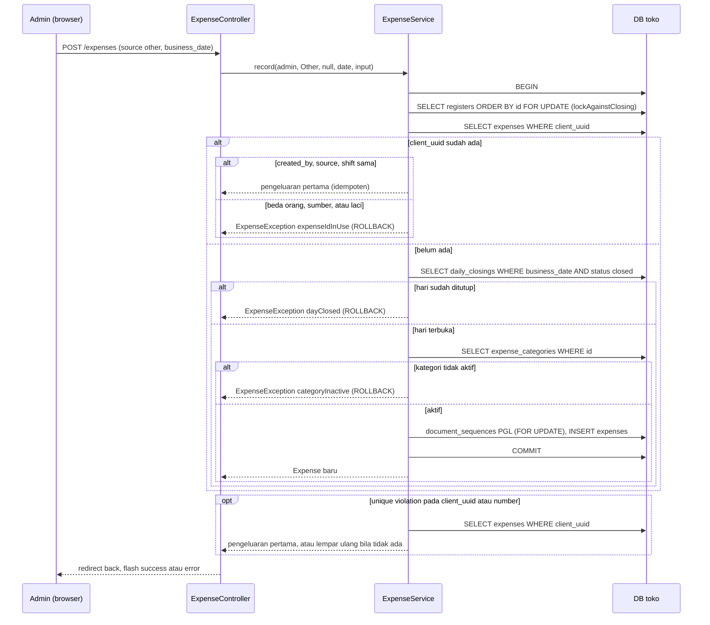

# Pengeluaran (Expenses) — Dokumentasi Teknis

> **Modul:** Pengeluaran operasional toko (uang keluar untuk bensin, galon, listrik, upah harian, dan sejenisnya), kategori pengeluaran, dan pembatalannya
> **Stack:** Laravel 13 (PHP 8.3), Inertia 3, Vue 3, Quasar 2, stancl/tenancy
> **Audiens:** Engineer yang memelihara atau memperluas fitur ini
> **Database:** per toko (kedua tabel modul ini ada di DB toko, bukan DB pusat)
> **Terakhir diperbarui:** 2026-11-17

## 1. Ringkasan

Kasir dan Admin mencatat uang yang keluar untuk biaya operasional. Ada dua sumber uang. **Laci kasir (`drawer`)**: uang diambil dari laci sebuah shift yang sedang berjalan, sehingga tunai yang seharusnya ada di laci itu berkurang (dan kasir yang menghitung laci saat tutup shift tidak diberi tahu angkanya). **Sumber lain (`other`)**: dibayar dari luar laci (mis. transfer dari rekening toko), punya tanggal sendiri, dan tidak menyentuh kas shift mana pun. Kasir hanya bisa mencatat dari laci **shiftnya sendiri** lewat dialog di layar kasir; Admin mencatat dari halaman Pengeluaran dan boleh memilih sumber mana pun. Pengeluaran tidak pernah dihapus: salah catat dikoreksi dengan **pembatalan (void)** oleh Admin dengan alasan wajib, dan baris tetap tampil sebagai *Dibatalkan*. Angka pengeluaran (hanya yang berstatus `recorded`) masuk ke tunai seharusnya shift dan ke snapshot Tutup Hari.

Alur tingkat tinggi:



BPMN pencatatan dari laci, dari sumber lain, dan pembatalannya (termasuk cabang gagal):



Catatan membaca diagram: pada jalur `other`, pemeriksaan idempotensi dan kategori aktif juga terjadi setelah penguncian register (lihat `ExpenseService::recordFromOtherSource()`); disederhanakan di gambar agar tidak ganda. Rincian urutan ada di bagian 7.

## 2. Skema Database

Kedua tabel ada di **DB toko**. Dibuat oleh `database/migrations/tenant/2026_10_27_152513_create_expenses_and_daily_closings_tables.php` (bersama `daily_closings`, yang merupakan modul tutup hari dan hanya disinggung di sini).

### `expense_categories`

| Kolom | Tipe | Null | Catatan |
|---|---|---|---|
| `id` | bigint PK | | |
| `name` | string | tidak | **unique** |
| `is_active` | boolean | tidak | default `true`. Kategori tidak dihapus, hanya dinonaktifkan |
| `created_at`, `updated_at` | timestamp | ya | |

Tidak ada kolom `deleted_at` dan tidak ada rute hapus: kategori hanya ditambah, diganti nama, dan di-on/off-kan. Alasannya tertulis di docblock `ExpenseCategory`: pengeluaran lama harus tetap punya nama kategorinya.

### `expenses`

| Kolom | Tipe | Null | Catatan |
|---|---|---|---|
| `id` | bigint PK | | |
| `client_uuid` | uuid | tidak | **unique**. Penanda anti-kirim-ganda (satu-satunya tabel modul ini yang mewajibkannya sejak awal) |
| `number` | string | tidak | **unique**. Format `PGL/{receipt_prefix}/{yymm}/{0001}`; `yymm` diambil dari **tanggal bisnis** pengeluaran, bukan dari hari ini |
| `business_date` | date | tidak | Diindeks. Untuk `drawer` = tanggal bisnis shift; untuk `other` = tanggal yang diisi Admin |
| `cash_shift_id` | FK `cash_shifts` | **ya** | restrict. Terisi hanya untuk sumber `drawer`; `other` tidak terkait shift mana pun, itulah mengapa kolom ini nullable |
| `expense_category_id` | FK `expense_categories` | tidak | restrict |
| `source` | enum `drawer`, `other` | tidak | |
| `description` | string | tidak | Wajib, maksimal 255 |
| `paid_to` | string | ya | Penerima/vendor, opsional |
| `amount` | decimal(15,2) | tidak | Selalu positif (divalidasi `gt:0`) |
| `status` | enum `recorded`, `voided` | tidak | default `recorded` |
| `void_reason` | string | ya | Terisi saat dibatalkan |
| `voided_at` | dateTime | ya | Ditambah migrasi `2026_11_02_150000` |
| `voided_by_name` | string | ya | Nama pembatal saat itu (denormalisasi, sama seperti `created_by_name`), migrasi yang sama |
| `created_by` | unsignedBigInteger | tidak | Id user **pusat**, tanpa foreign key (beda database) |
| `created_by_name` | string | tidak | Nama pencatat saat itu, supaya daftar tidak perlu menengok DB pusat |
| `created_at`, `updated_at` | timestamp | ya | |

Hanya `business_date` yang diindeks secara eksplisit (selain unique pada `client_uuid` dan `number`, serta indeks otomatis dari FK). Filter `source` dan `status` di daftar Admin tidak punya indeks sendiri.

Pembatalan tidak menyimpan **siapa** pembatal sebagai id, hanya `voided_by_name`.



Semua tabel di diagram ada di DB toko. `cash_shifts` (modul shift) dan `daily_closings` (modul tutup hari) hanya kotak singkat; hubungan `expenses.business_date` ke `daily_closings.business_date` adalah relasi Eloquent (`Expense::dailyClosing()`), bukan foreign key.

## 3. Model / Entity

| Model | Tabel | Relasi, cast, trait penting |
|---|---|---|
| `App\Models\Expense` | `expenses` | `implements Auditable` (laravel-auditing, ke DB toko). `cashShift()`, `category()`, `dailyClosing()` (BelongsTo ke `DailyClosing` lewat `business_date`). Cast: `business_date` date, `voided_at` datetime, `amount` `decimal:2`, `source` ke `ExpenseSource`, `status` ke `ExpenseStatus`. `voidBlocker()` dan `isVoidable()`: satu-satunya tempat aturan "bisa dibatalkan atau tidak" (dipakai tombol di daftar **dan** proses pembatalan) |
| `App\Models\ExpenseCategory` | `expense_categories` | `implements Auditable`. `expenses()`. Cast `is_active` boolean. Konstanta `DEFAULT_NAMES` (enam kategori bawaan) |
| `App\Enums\ExpenseSource` | | `Drawer` ("Laci kasir"), `Other` ("Lainnya"), `label()`, `options()` |
| `App\Enums\ExpenseStatus` | | `Recorded` ("Tercatat"), `Voided` ("Dibatalkan"), `label()`, `options()` |
| `App\Exceptions\ExpenseException` | | Semua penolakan bisnis: `shiftNotOpen`, `categoryInactive`, `expenseIdInUse`, `alreadyVoided`, `dayClosed`, `drawerShiftClosed`; pesan Indonesia aman ditampilkan |

`Expense::voidBlocker()` urutannya penting: (1) sudah `voided` → `alreadyVoided`; (2) sumber `drawer` dan shift-nya bukan `open` → `drawerShiftClosed` (status `pending_review` juga masuk sini, karena laci sudah dihitung); (3) hari tanggal bisnis berstatus `closed` → `dayClosed`. Untuk (3), jika relasi `dailyClosing` sudah dimuat (daftar Admin memuatnya sekaligus untuk semua baris) dipakai itu; jika belum, `DailyClosing::isClosedOn()` bertanya ke DB, karena pembatalan harus melihat hari seperti pada saat itu.

## 4. Hak Akses

Semua rute di grup `t/{tenant}` dengan middleware `web`, `InitializeTenancyByPath`, `auth`, `store.access`, `shift.remember`.

| Area | Middleware tambahan | Siapa | Catatan |
|---|---|---|---|
| Layar kasir `tenant.cashier.expenses.*` | tidak ada `store.admin` | Kasir dan Admin | Selalu mencatat ke laci **shift user itu sendiri** (`ShiftService::openShiftOf($request->user())`); tidak ada parameter shift atau sumber yang diterima |
| Halaman Admin `tenant.expenses.*` | `store.admin` (`EnsureUserIsStoreAdmin`: role Super Admin atau Admin Toko, selain itu 403) | Admin | Daftar, catat, batalkan, kelola kategori |

Pembatalan dan pengelolaan kategori **hanya Admin**; kasir tidak punya rute untuk keduanya. Admin yang memilih sumber `drawer` boleh memilih laci **shift mana pun yang sedang berjalan**, termasuk milik kasir lain (lihat bagian 13).

## 5. Konfigurasi

Modul ini **tidak memiliki kunci di `config/` maupun env** (Grep `config/` tidak menemukan apa pun untuk pengeluaran). Yang berperan hanyalah konstanta di kode:

| Konstanta | Nilai | Dibaca oleh |
|---|---|---|
| `ExpenseService::NUMBER_TYPE` | `PGL` | `create()` lewat `DocumentNumberGenerator::next()` |
| `ExpenseController::LIST_PER_PAGE` | 25 | Daftar Admin |
| `ExpenseCategory::DEFAULT_NAMES` | `Operasional`, `Listrik/Air`, `Transport/Bensin`, `Upah/Gaji`, `ATK/Perlengkapan`, `Lain-lain` | `StoreDatabaseSeeder` (toko baru, dijalankan `StoreProvisioner`) dan migrasi `2026_11_02_160000_add_default_expense_categories_to_existing_stores` (toko yang sudah ada) |
| `SaveExpenseRequest::MAX_AMOUNT` | 999999999999 | Validasi nominal |

Kedua jalur penyemaian memakai `firstOrCreate(['name' => ...], ['is_active' => true])`, sehingga aman dijalankan ulang dan **tidak mengaktifkan kembali** kategori bawaan yang sengaja dinonaktifkan Admin. `down()` migrasinya kosong (kategori mungkin sudah dipakai).

## 6. Rute / API

Halaman Admin (Inertia; mutasi menjawab redirect `back()` dengan flash `success` atau `error`, bukan JSON):

| Method | Path | Action | Nama rute | Middleware |
|---|---|---|---|---|
| GET | `/t/{tenant}/expenses` | `ExpenseController@index` | `tenant.expenses.index` | `store.admin` |
| POST | `/t/{tenant}/expenses` | `ExpenseController@store` | `tenant.expenses.store` | `store.admin` |
| POST | `/t/{tenant}/expenses/{expense}/voids` | `ExpenseController@void` | `tenant.expenses.void` | `store.admin` |
| POST | `/t/{tenant}/expenses/categories` | `ExpenseCategoryController@store` | `tenant.expenses.categories.store` | `store.admin` |
| PUT | `/t/{tenant}/expenses/categories/{category}` | `ExpenseCategoryController@update` | `tenant.expenses.categories.update` | `store.admin` |

Layar kasir (JSON):

| Method | Path | Action | Nama rute | Middleware |
|---|---|---|---|---|
| GET | `/t/{tenant}/cashier/expenses` | `CashierExpenseController@index` | `tenant.cashier.expenses.index` | (grup dasar) |
| POST | `/t/{tenant}/cashier/expenses` | `CashierExpenseController@store` | `tenant.cashier.expenses.store` | (grup dasar) |

Rute pembatalan sengaja berbentuk kata benda (`.../voids`, bukan `.../void`), ada tesnya (`test_the_void_address_is_a_noun`). Filter daftar (`GET /expenses`) lewat query string: `from`, `to` (hari `Y-m-d`; nilai tidak valid diabaikan oleh `DateRangeRequest`), `category` (id), `source`, `status`, `search` (nomor, keterangan, atau penerima).

Kode galat JSON layar kasir memakai trait `AnswersJsonErrors` (`{code, message, more_info}`) dengan `ApiErrorCode`:

| Kode | HTTP | Pemakaian |
|---|---|---|
| `4091` `ShiftNotOpen` | 409 | User tidak punya shift sama sekali (`openShiftOf() === null`), baik di `index` maupun `store` |
| `4222` `ExpenseRefused` | 422 | Semua `ExpenseException` dari `recordFromDrawer()` (shift review/tertutup, kategori nonaktif, `client_uuid` milik orang lain) |

Galat validasi `FormRequest` memakai bentuk bawaan Laravel `{message, errors: {...}}` (422).

Contoh berikut **ilustratif, bukan hasil tangkapan**; bentuknya mengikuti `CashierExpenseResource` dan `ExpenseResource`.

`POST /t/mitra_utama/cashier/expenses` (JSON):

```json
{
  "client_uuid": "6c2f1c1e-1d6a-4a77-8d0e-5d8c9b1a2f33",
  "expense_category_id": 3,
  "amount": 25000,
  "description": "Beli galon",
  "paid_to": "Depot Air Jaya"
}
```

Sukses (201):

```json
{
  "data": {
    "id": 17,
    "number": "PGL/MU/2611/0004",
    "category_name": "Operasional",
    "description": "Beli galon",
    "paid_to": "Depot Air Jaya",
    "amount": "25000.00",
    "status": "recorded",
    "status_label": "Tercatat",
    "created_at": "2026-11-17T09:12:44+00:00"
  }
}
```

Kategori sudah dinonaktifkan (422):

```json
{
  "code": 4222,
  "message": "Kategori ini sudah dinonaktifkan. Pilih kategori lain.",
  "more_info": "Perbaiki isian pengeluaran sesuai pesan ini, lalu coba lagi."
}
```

Shift sudah dihitung tetapi menunggu keputusan Admin (422, bukan 409, karena user masih punya baris shift):

```json
{
  "code": 4222,
  "message": "Buka shift dulu untuk mencatat pengeluaran dari laci kasir. Bila shift Anda sudah dihitung, tunggu keputusan Admin.",
  "more_info": "Perbaiki isian pengeluaran sesuai pesan ini, lalu coba lagi."
}
```

Tanpa shift (409): `{"code": 4091, "message": "Buka shift dulu untuk mencatat pengeluaran dari laci kasir. Bila shift Anda sudah dihitung, tunggu keputusan Admin.", "more_info": "Pengeluaran dari laci dicatat di shift yang sedang terbuka. Buka shift di kasir."}`.

`GET /t/mitra_utama/cashier/expenses` (200): `{"data": {"categories": [{"id": 1, "name": "Operasional", "is_active": true}, ...], "expenses": [ ... CashierExpenseResource ... ]}}`. `categories` hanya yang aktif; `expenses` adalah **semua** pengeluaran laci shift ini (termasuk yang `voided`, diurutkan `id` naik), dan dialog mencoret yang dibatalkan.

Respons halaman Admin tidak berupa JSON; contoh flash: `success` = "Pengeluaran dicatat." / "Pengeluaran dibatalkan." / "Kategori ditambahkan." / "Kategori disimpan."; `error` = pesan `ExpenseException` (mis. "Hari 17/11/2026 sudah ditutup, jadi pengeluaran pada tanggal itu tidak bisa ditambah atau dibatalkan. Minta Super Admin membuka kembali hari itu.").

## 7. Komponen Backend

### `ExpenseService` (`app/Services/ExpenseService.php`)

**Baca:** `paginate()` (terbaru dulu: `business_date` desc lalu `id` desc; memuat `category`, `cashShift.register`, `dailyClosing` sekaligus agar `isVoidable()` per baris tidak menambah query); `totals()` menjumlah `amount` per sumber **tanpa yang `voided`**, memakai filter yang sama dengan daftar (ringkasan *Dari laci / Sumber lain / Total*); `drawerTotalOf(CashShift)` dan `drawerExpensesOf(CashShift)` untuk shift (yang pertama dibaca `ShiftService::summarize()`); `openDrawerOptions()` membuat opsi laci untuk form Admin dari semua shift berstatus `open` (label `kode register · nama kasir`).

**`record(User, ExpenseSource, ?CashShift, ?CarbonInterface, input)`** hanya mengarahkan: `Drawer` ke `recordFromDrawer()` (tanpa shift → `shiftNotOpen`), `Other` ke `recordFromOtherSource()` (tanpa tanggal → `today()`).

**`recordFromDrawer()`** dalam satu `DB::transaction`: (1) `CashShift::lockForUpdate()` supaya tidak ada pengeluaran yang masuk sementara shift ditutup (`ShiftService::close()` juga mengunci baris yang sama); (2) cek idempotensi `alreadyRecorded()`; (3) shift harus `open` (jadi `pending_review` ditolak); (4) `create()`. Tanggal bisnis diambil dari shift, bukan dari `today()`, supaya shift yang melewati tengah malam tetap membukukan ke hari buka.

**`recordFromOtherSource()`**: transaksi yang pertama kali memanggil `DailyClosing::lockAgainstClosing()` (mengunci semua baris `registers` urut `id`, kunci yang sama diambil proses Tutup Hari dan pembukaan shift), lalu idempotensi, lalu `DailyClosing::isClosedOn($businessDate)` → `dayClosed`, lalu `create()`. Seluruh transaksi dibungkus `try/catch UniqueConstraintViolationException`: bila dua kiriman `client_uuid` yang sama sama-sama lolos pengecekan, yang kedua terhenti oleh unique index, transaksinya di-rollback (nomor `PGL` tidak terpakai sia-sia), dan pemanggil dikembalikan pengeluaran pertama lewat `alreadyRecorded()`. Komentar kode menyebut alasannya: penguncian register mencegah penutupan hari bersamaan, **bukan** pengiriman ganda.



**`void(Expense, User $admin, string $reason)`** dalam satu transaksi, urutan kunci **register → pengeluaran → shift (hanya untuk drawer)**. Register dikunci supaya pembatalan dan Tutup Hari saling antre. Pengeluaran dibaca ulang `lockForUpdate()`; untuk `drawer`, shift-nya dikunci dan dipasang sebagai relasi `cashShift` agar `voidBlocker()` melihat statusnya saat itu, bukan salinan lama dari klien. Bila `voidBlocker()` mengembalikan galat, galat itu dilempar. Bila lolos: `status = voided`, `void_reason` (di-`trim`), `voided_at = now()`, `voided_by_name = admin->name`.

Efek pembatalan ke uang tidak memerlukan langkah kompensasi apa pun: semua penjumlah (`drawerTotalOf`, `totals`, `DailyClosingService::expenseFigures`) hanya menghitung `status = recorded`, jadi pembatalan drawer di shift yang masih berjalan langsung "mengembalikan" tunai seharusnya.

**`create()` (privat)**: membaca kategori (`findOrFail`, lalu `is_active` harus true → `categoryInactive`), lalu menulis baris dengan `number = DocumentNumberGenerator::next('PGL', $businessDate)` (di dalam transaksi pemanggil, sehingga nomor tidak bolong bila di-rollback; `test_expense_numbers_run_on_without_gaps`), nominal diubah ke skala 2 lewat `BigDecimal`, `description` dan `paid_to` di-`trim` (`paid_to` kosong menjadi null), `created_by_name` disalin dari user.

**`alreadyRecorded()`**: `client_uuid` yang ditemukan hanya dianggap retry bila `created_by`, `source`, dan `cash_shift_id` **semuanya sama**. Selain itu `expenseIdInUse()`: menyerahkan pengeluaran orang lain akan menyembunyikan fakta bahwa pengeluaran baru tidak tercatat (dan membocorkan data). Ada tes khusus untuk uuid yang dipakai ulang lintas sumber dan lintas laci.

### `ExpenseCategoryService`

`all()` (dengan `withCount('expenses')`, urut nama; untuk dialog kelola kategori), `active()` (hanya `is_active`, urut nama; untuk dialog kasir), `create($name)` (aktif, nama di-`trim`), `update($category, $input)` (nama di-`trim`; `is_active` tetap bila tidak dikirim). Tidak ada metode hapus. Dua tulisan terpisah, jadi tanpa `DB::transaction`.

### Controller

- `ExpenseController::store()` memetakan input: `safe()->only([...])` untuk `ExpenseInput`, `source` dari enum, dan untuk `drawer` memuat `CashShift::findOrFail(cash_shift_id)` (sekadar mengambil model; statusnya dicek service). `ExpenseException` dikembalikan sebagai flash `error` dengan `withInput()`.
- `ExpenseController::index()` menyusun filter, `totals`, daftar kategori (**termasuk yang nonaktif**, agar filter dan dialog kelola menampilkannya), `open_shifts`, dan dua URL.
- `CashierExpenseController`: `index()` mengembalikan kategori aktif dan pengeluaran laci shift sendiri; `store()` memanggil `recordFromDrawer()` langsung.
- `ExpenseCategoryController`: `store()` dan `update()` kembali ke halaman asal (dialog kategori ada di atas daftar).

### Resource

`ExpenseResource` (baris daftar Admin: termasuk `can_be_voided` dari `isVoidable()` dan `void_url`), `CashierExpenseResource` (tanpa tautan admin: id, nomor, kategori, keterangan, penerima, nominal, status, `created_at`), `ExpenseCategoryResource` (`expenses_count` dan `update_url` hanya bila `expenses_count` ikut dimuat, yaitu di daftar Admin, bukan di dialog kasir).

### Efek ke shift dan tutup hari

- `ShiftService::summarize()`: `drawer_expenses = drawerTotalOf($shift)` dan `expected_cash = opening_cash + tunai penjualan + deposit pesanan tunai - refund tunai - refund void - drawer_expenses`. Hanya pengeluaran `drawer` yang `recorded` mengurangi tunai seharusnya; `other` tidak pernah.
- **Tutup buta**: `summarizeForCashier()` tidak mengembalikan tunai seharusnya maupun `drawer_expenses`. Kasir menghitung laci tanpa tahu angkanya. Admin melihatnya di Rekap Shift (`ShiftRecapResource` memuat daftar `expenses` shift dan `drawer_expenses`).
- `DailyClosingService::expenseFigures()` menjumlah semua pengeluaran `recorded` dengan `business_date` hari itu, per sumber, ke `expenses_drawer` dan `expenses_other` di `daily_closings` (snapshot tersimpan saat hari ditutup, dihitung ulang bila hari dibuka kembali lalu ditutup lagi).
- **Efek kunci hari tertutup** (`DailyClosing::isClosedOn()` bertatus `closed`): pengeluaran `other` pada tanggal itu tidak bisa ditambah atau dibatalkan (`dayClosed`); pengeluaran `drawer` terkunci tidak langsung oleh hari, melainkan oleh shift yang sudah ditutup (tidak bisa dibatalkan) dan oleh fakta bahwa hari tidak bisa ditutup selama masih ada shift `open`. Hari berstatus `reopened` dianggap terbuka.

## 8. Aturan Validasi

`SaveExpenseRequest` (Admin). `SaveCashierExpenseRequest` mewarisinya dan membuang aturan `source`, `cash_shift_id`, `business_date` (`Arr::except`).

| Field | Aturan | Masuk ke | Pesan galat |
|---|---|---|---|
| `client_uuid` | `required`, `uuid` | `expenses.client_uuid` | "Pengeluaran tidak punya penanda. Muat ulang layar lalu coba lagi." / "Penanda pengeluaran tidak valid. ..." |
| `expense_category_id` | `required`, `integer`, `exists:expense_categories,id` | `expenses.expense_category_id` | "Pilih kategori." / "Kategori tidak ditemukan." / "Kategori ini sudah dinonaktifkan. Pilih kategori lain." (service) |
| `source` | `required`, enum `ExpenseSource` | `expenses.source` | "Pilih sumber uang." |
| `cash_shift_id` | `required_if:source,drawer`, `nullable`, `integer`, `exists:cash_shifts,id` | `expenses.cash_shift_id` (diabaikan untuk `other`) | "Pilih laci shift yang dipakai." / "Shift tidak ditemukan." |
| `business_date` | `required_if:source,other`, `nullable`, `date_format:Y-m-d`, `before_or_equal:today` | `expenses.business_date` (diabaikan untuk `drawer`: dipakai tanggal shift) | "Isi tanggal pengeluaran." / "Tanggal pengeluaran tidak valid." / "Tanggal pengeluaran tidak boleh di masa depan." |
| `description` | `required`, `string`, `max:255` | `expenses.description` | "Keterangan wajib diisi." |
| `paid_to` | `nullable`, `string`, `max:255` | `expenses.paid_to` | |
| `amount` | `required`, `numeric`, `gt:0`, `max:999999999999`, `decimal:0,2` | `expenses.amount` | "Isi nominal." / "Nominal harus berupa angka." / "Nominal harus lebih dari nol." / "Nominal maksimal 2 angka desimal." |

`VoidExpenseRequest`: `reason` `required`, `string`, `max:255` → `expenses.void_reason`; pesan "Isi alasan pembatalan.".

`SaveExpenseCategoryRequest`: `name` `required`, `string`, `max:255`, `unique:expense_categories,name` (mengabaikan kategori yang sedang diubah via parameter rute `category`); `is_active` `sometimes`, `boolean`. Pesan: "Nama kategori wajib diisi." / "Nama kategori sudah dipakai.". Apakah keunikan peka huruf besar-kecil bergantung pada collation tabel MySQL; **belum diverifikasi** di sini.

Perilaku gagal: semua atau tidak sama sekali. Validasi `FormRequest` berjalan sebelum service; semua pemeriksaan bisnis dan tulisan ada dalam satu transaksi, jadi galat apa pun tidak meninggalkan baris setengah jadi dan tidak menghabiskan nomor `PGL`. Pesan ditulis langsung sebagai string Indonesia di request dan exception.

## 9. Guard Kepemilikan & Status

| Endpoint / operasi | Yang dicek ulang di server | Yang diblokir |
|---|---|---|
| Kasir `POST /cashier/expenses` | Shift diambil dari **user yang login** (`openShiftOf`), tidak dari klien; di service: baris shift dikunci dan `status === open`; `client_uuid` (milik user, `drawer`, shift yang sama); kategori aktif | Mencatat tanpa shift (409 4091); shift sedang review atau tertutup; kategori nonaktif; memilih sumber atau shift lain (parameter tidak ada; `test_a_cashier_cannot_choose_the_source_or_the_shift`); uuid orang lain |
| Admin `POST /expenses` (`drawer`) | Shift dari `cash_shift_id` dikunci dan harus `open`; sisanya sama | Shift bukan `open` |
| Admin `POST /expenses` (`other`) | Semua register dikunci; `DailyClosing::isClosedOn(business_date)`; `business_date` tidak di masa depan; kategori aktif | Tanggal pada hari yang sudah ditutup; tanggal masa depan |
| Admin `POST /expenses/{expense}/voids` | **Status dibaca ulang dari DB di bawah kunci**, bukan dari klien: masih `recorded`; untuk `drawer`, shift masih `open`; hari tanggal bisnis belum `closed`; alasan wajib | Membatalkan dua kali; membatalkan pengeluaran laci setelah shift dihitung/ditutup (selisih kasnya diputuskan Admin di Rekap Shift: "Shift pengeluaran ini sudah ditutup, jadi tidak bisa dibatalkan. Selisih kasnya diputuskan di Rekap Shift."); membatalkan pengeluaran pada hari yang sudah ditutup |
| Admin kategori `POST`/`PUT` | `store.admin`; nama unik | Kategori ganda. Tidak ada guard status: kategori boleh dinonaktifkan kapan saja, termasuk yang sedang dipakai dialog kasir yang terbuka (ditolak di `create()` saat disimpan) |

## 13. Keterbatasan / Utang Teknis

- **Admin dapat membukukan pengeluaran ke laci kasir lain yang sedang berjalan, tanpa sepengetahuan kasirnya.** `ExpenseController.php:67` memuat shift mana pun dari `cash_shift_id`; `openDrawerOptions()` menawarkan semua shift `open`. Tunai seharusnya kasir itu berkurang diam-diam, padahal kasir menghitung laci secara buta (`ShiftService::summarizeForCashier()`). Itu mungkin disengaja (Admin membayar vendor dari laci), tetapi tidak ada jejak selain audit pada `Expense` dan nama pencatat di Rekap Shift.
- **Celah idempotensi `recordFromDrawer()` tidak ditutup seperti `recordFromOtherSource()`.** Versi `other` menangkap `UniqueConstraintViolationException` (`ExpenseService.php:193`) dan mengembalikan pengeluaran pertama; versi `drawer` bergantung pada kunci baris shift dan tidak punya `catch`. Dengan kunci itu seharusnya serial, tetapi bila ada jalur yang lolos, penggandaan akan berakhir sebagai error DB 500 alih-alih respons idempoten. Belum diverifikasi lewat tes balapan (tes dua proses rawan flaky).
- **Penguncian "mencegah penutupan hari" bergantung pada adanya baris `registers`.** `DailyClosing::lockAgainstClosing()` (`DailyClosing.php:57`) mengunci tabel `registers`; toko tanpa register tidak punya baris yang dikunci. Praktis toko selalu punya register karena shift butuh register, tetapi ini bukan jaminan skema.
- **Pembatal tidak disimpan sebagai id.** Hanya `voided_by_name` (teks) dan `voided_at`; `created_by` memang id pusat tanpa FK. Pelacakan pembatal lewat audit laravel-auditing (`Expense` Auditable).
- **Kasir tidak bisa membatalkan salah catat sendiri.** Koreksi hanya oleh Admin, dan hanya selama shift masih `open`. Begitu kasir menghitung laci (status `pending_review`/`closed`), pengeluaran laci tidak bisa dibatalkan lagi dan koreksinya menjadi keputusan selisih kas (di luar modul ini).
- **Kasir masih bisa menebak tunai seharusnya.** Dialog kasir menampilkan nominal tiap pengeluaran laci shift itu (`CashierExpenseResource.amount`), padahal tutup shift dirancang buta; diterima sebagai dorongan UX di `docs/hasil-review-kode.md` bagian 7.
- **Belum ada laporan pengeluaran per kategori atau per periode.** Grep `app/`: `Expense` hanya dibaca oleh daftar Admin, `ShiftService`/`ShiftRecapResource` dan `DailyClosingService` (dua angka total per sumber). `docs/analisis-sistem.md` bagian 7.7c butir 5 menjanjikan "laporan pengeluaran per kategori/periode"; belum dibangun. Tidak ada cetak pengeluaran.
- **Pengeluaran `other` bertanggal lampau tanpa batas bawah.** `before_or_equal:today` hanya membatasi masa depan; tanggal hari lampau yang belum ditutup (atau belum pernah punya baris `daily_closings`) diterima, dan nomor `PGL` mengikuti bulan tanggal itu (`yymm` dari `business_date`), jadi urutan nomor tidak sejalan dengan waktu input.
- **Indeks tipis untuk filter.** `source` dan `status` di `expenses` tidak diindeks; daftar mengandalkan indeks `business_date`. Belum diukur dengan data besar.
- **Selisih dokumen dan kode.** `docs/analisis-sistem.md:1937` menulis "Belum: kunci hari tertutup (menunggu Tutup Hari)"; kodenya sudah punya (`Expense::voidBlocker()`, `ExpenseService::recordFromOtherSource()`). ERD `docs/analisis-sistem.md:1567-1583` belum memuat `voided_at` dan `voided_by_name`. Daftar model Auditable (`docs/analisis-sistem.md:324`) tidak menyebut `Expense` dan `ExpenseCategory`, padahal keduanya `Auditable` di kode. Kode yang menang.
- **Cakupan tes.** Ada `ExpenseTest` dan `CashierExpenseTest` (idempotensi, void, penguncian shift, kategori, penomoran), tetapi tidak ada tes frontend untuk `ExpenseDialog.vue`, `ExpenseFormDialog.vue`, `ExpenseCategoriesDialog.vue`, dan tidak ada tes dua proses untuk balapan pencatatan vs Tutup Hari.

## 14. Indeks File

| Concern | Path |
|---|---|
| Migrasi | `database/migrations/tenant/2026_10_27_152513_create_expenses_and_daily_closings_tables.php`, `2026_11_02_150000_add_void_details_to_expenses_table.php`, `2026_11_02_160000_add_default_expense_categories_to_existing_stores.php` |
| Seeder | `database/seeders/StoreDatabaseSeeder.php` (dipanggil `app/Services/StoreProvisioner.php`) |
| Model | `app/Models/Expense.php`, `app/Models/ExpenseCategory.php`, `app/Models/DailyClosing.php` (`isClosedOn`, `lockAgainstClosing`) |
| Enum | `app/Enums/ExpenseSource.php`, `ExpenseStatus.php`, `ApiErrorCode.php` |
| Service | `app/Services/ExpenseService.php`, `ExpenseCategoryService.php`; dipakai `ShiftService.php` (`drawerTotalOf`), `DailyClosingService.php` (`expenseFigures`), `DocumentNumberGenerator.php` |
| Controller | `app/Http/Controllers/Tenant/ExpenseController.php`, `ExpenseCategoryController.php`, `CashierExpenseController.php`, `ShiftRecapController.php` (daftar pengeluaran shift), `app/Http/Controllers/Concerns/AnswersJsonErrors.php` |
| Request | `app/Http/Requests/Tenant/SaveExpenseRequest.php`, `SaveCashierExpenseRequest.php`, `VoidExpenseRequest.php`, `SaveExpenseCategoryRequest.php`, `DateRangeRequest.php` |
| Resource | `app/Http/Resources/ExpenseResource.php`, `CashierExpenseResource.php`, `ExpenseCategoryResource.php`, `ShiftRecapResource.php` |
| Exception | `app/Exceptions/ExpenseException.php` |
| Middleware | `app/Http/Middleware/EnsureUserIsStoreAdmin.php` |
| Rute | `routes/tenant.php` (grup `cashier` baris 78-79; grup `store.admin` / `expenses` baris 127-133) |
| Halaman Vue | `resources/js/Pages/Tenant/Expenses/Index.vue`; `Pages/Tenant/Cashier/Index.vue` (tombol Pengeluaran, `ExpenseDialog`) |
| Komponen Vue | `resources/js/Components/Cashier/ExpenseDialog.vue` (dialog kasir), `resources/js/Components/ExpenseFormDialog.vue`, `resources/js/Components/ExpenseCategoriesDialog.vue` (dialog Admin), `resources/js/Components/MoneyInput.vue`, `resources/js/Components/DateInput.vue` |
| Composable | `resources/js/Composables/useExpenseStatus.js`, `postJson.js`, `useCart.js` (`newUuid`), `useMoneyFormat.js` |
| Factory | `database/factories/ExpenseFactory.php` (sumber `other`, tanpa shift), `ExpenseCategoryFactory.php` |
| Test | `tests/Feature/Tenancy/ExpenseTest.php`, `CashierExpenseTest.php`, `CashierShiftTest.php`, `ShiftRecapTest.php`, `DailyClosingTest.php` |
