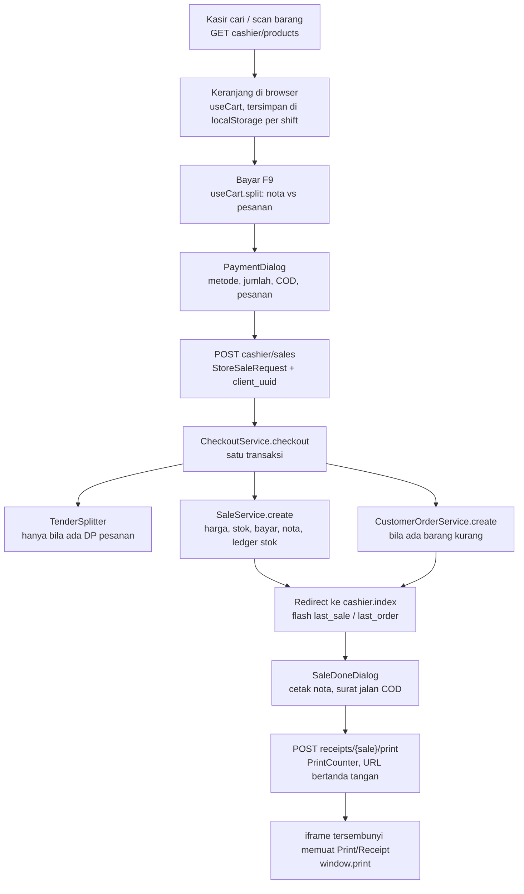
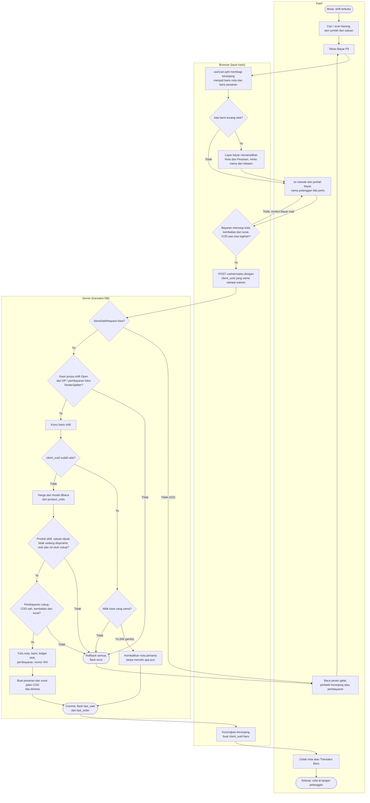
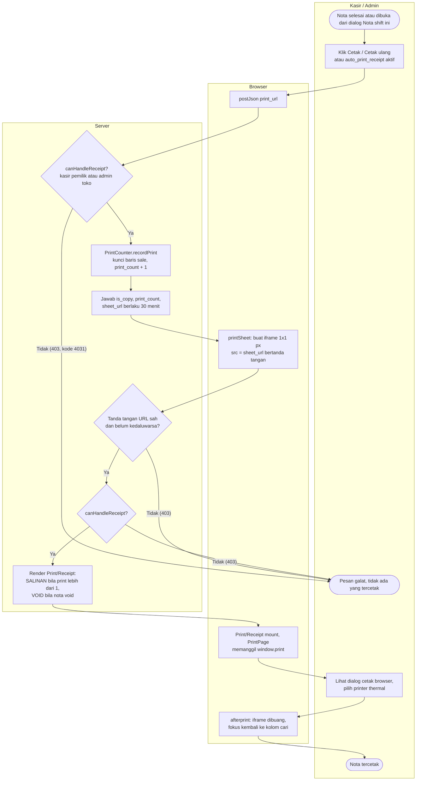
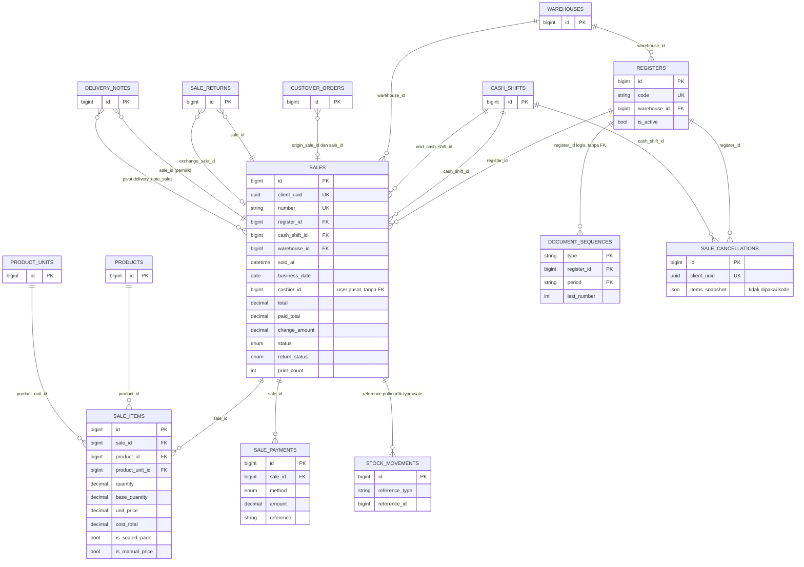
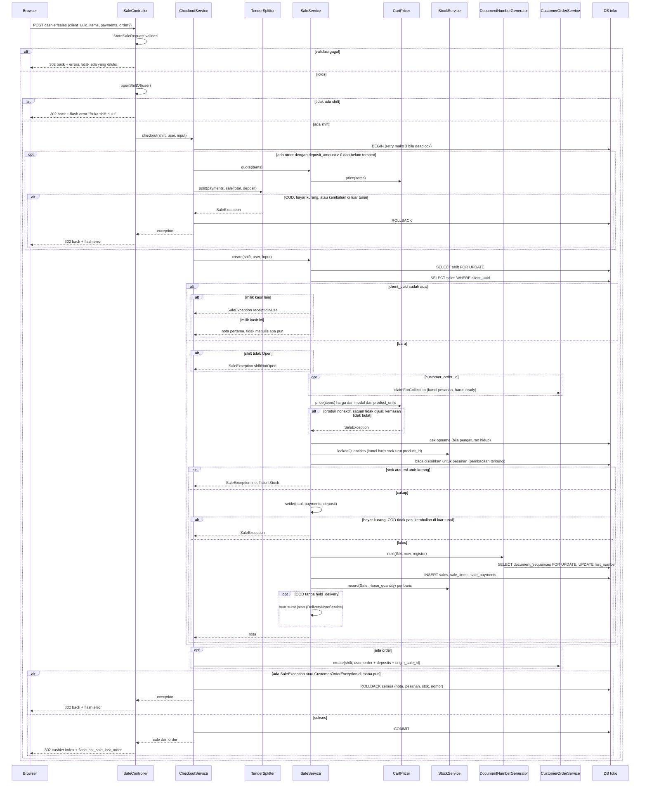

# Penjualan Kasir (Checkout, Nota, Pembayaran) — Dokumentasi Teknis

> **Modul:** Penjualan kasir: layar kasir, katalog kasir, penetapan harga keranjang, pembayaran, pembuatan nota (`sales`), penomoran, cetak nota, riwayat nota
> **Stack:** Laravel 13 (PHP 8.3), Inertia 3, Vue 3, Quasar 2, stancl/tenancy (by path)
> **Audiens:** Engineer yang memelihara atau memperluas fitur ini
> **Database:** per toko (semua tabel modul ini ada di DB toko, bukan DB pusat)
> **Terakhir diperbarui:** 2026-11-17

## 1. Ringkasan

Kasir (atau Admin Toko yang memegang shift) membuka layar `/t/{tenant}/cashier`, mencari barang lewat nama, SKU, atau scan barcode (barcode = SKU), memasukkannya ke keranjang, lalu menekan **Bayar (F9)**. Browser membagi keranjang menjadi bagian yang stoknya ada (jadi **nota penjualan**) dan bagian yang kurang (jadi **pesanan pelanggan / PO**), menampilkan layar bayar, dan mengirim satu `POST` dengan `client_uuid`. Server, dalam satu transaksi database, mengunci shift, menghitung ulang harga dan modal dari `product_units`, memeriksa stok dan kemasan utuh di bawah kunci baris stok, memeriksa pembayaran, lalu menulis nota, baris nota, pembayaran, mutasi stok (ledger), dan nomor nota `INV/{prefiks toko}/{kode register}/{YYMM}/{urut}`. Bila keranjang berisi barang kurang, pesanan dibuat dalam transaksi yang sama (`CheckoutService`). Nota dicetak dari bingkai tersembunyi: setiap cetak dihitung di server (`print_count`), cetakan ke-2 dan seterusnya bertanda SALINAN. Admin melihat riwayat nota seluruh toko; kasir hanya melihat nota shift berjalan miliknya.

Masalah yang diselesaikan: kasir yang cepat (keyboard, scan, keranjang tahan), harga dan modal yang tidak bisa dipalsukan dari layar, penjualan ganda akibat klik dua kali (`client_uuid`), stok yang tidak boleh minus meski dua register menjual barang yang sama, dan nota yang konsisten dengan kas laci (kembalian hanya dari tunai).

Modul tetangga yang **tidak** dijelaskan di sini: shift dan tutup hari, retur dan penukaran, COD dan void, pesanan pelanggan, surat jalan, stok opname. Titik sambungnya ada di bagian 7.12.

**Alur tingkat tinggi**



**BPMN 1: dari memilih barang sampai nota (termasuk jalur gagal)**



**BPMN 2: cetak nota (asli dan SALINAN)**



---

## 2. Skema Database

Semua tabel ada di **DB toko** (migrasi di `database/migrations/tenant`). Kolom `cashier_id`, `voided_by`, dan sejenisnya adalah `unsignedBigInteger` **tanpa foreign key**, karena tabel `users` ada di DB pusat dan MySQL tidak bisa membuat FK lintas database. Itu sebabnya nama kasir juga disalin ke `cashier_name`: nota harus tetap terbaca walau user diganti nama atau dinonaktifkan.

### `sales`

Nota penjualan. Nota tidak pernah dihapus; kesalahan dikoreksi dengan void atau retur.

| Kolom | Tipe | Null | Catatan |
|---|---|---|---|
| `id` | bigint PK | | |
| `client_uuid` | uuid | tidak | **UNIQUE**. Kunci idempoten dari browser |
| `number` | string(255) | tidak | **UNIQUE**. Mis. `INV/MU/K1/2611/0001` |
| `register_id` | FK `registers` | tidak | restrict |
| `cash_shift_id` | FK `cash_shifts` | tidak | restrict. Shift yang menerima uang nota ini |
| `warehouse_id` | FK `warehouses` | tidak | disalin dari `registers.warehouse_id` saat jual |
| `sold_at` | datetime | tidak | `now()` saat nota dibuat |
| `business_date` | date | tidak | tanggal bisnis **shift**, bukan kalender (shift bisa melewati tengah malam) |
| `cashier_id` | unsignedBigInteger | tidak | user pusat, tanpa FK |
| `cashier_name` | string | tidak | snapshot nama |
| `customer_name` | string | ya | teks bebas untuk dicetak; wajib hanya bila ada pesanan atau COD (diatur layar bayar, bukan server) |
| `subtotal` | decimal(15,2) | tidak | selalu sama dengan `total` (bagian 11, butir 3) |
| `discount_total` | decimal(15,2) | tidak | default 0, tidak pernah ditulis kode |
| `total` | decimal(15,2) | tidak | jumlah subtotal baris, tanpa pembulatan |
| `paid_total` | decimal(15,2) | tidak | jumlah semua pembayaran **termasuk** uang muka pesanan yang diambil dan tunai sebelum kembalian |
| `change_amount` | decimal(15,2) | tidak | default 0. `paid_total - total` |
| `status` | enum `completed`,`voided` | tidak | default `completed`; cast `SaleStatus` |
| `return_status` | enum `none`,`partial`,`full` | tidak | default `none`; cast `SaleReturnProgress`; ditulis modul retur |
| `void_reason` | string | ya | diisi modul void |
| `voided_by` | unsignedBigInteger | ya | tanpa FK |
| `voided_by_name` | string | ya | migrasi `2026_11_03_100000` |
| `voided_at` | datetime | ya | indeks |
| `void_cash_shift_id` | FK `cash_shifts` | ya | shift yang mengeluarkan DP tunai saat void |
| `void_cash_refund` | decimal(15,2) | tidak | default 0 |
| `void_refund_account` | string | ya | rekening pengembalian DP non-tunai |
| `void_business_date` | date | ya | indeks; hari bisnis void (migrasi `2026_11_10_110000`) |
| `print_count` | unsignedInteger | tidak | default 0. Jumlah cetak yang sudah dihitung |
| `legacy_number` | string | ya | **tidak pernah dibaca atau ditulis aplikasi** |
| `legacy_unpaid_amount` | decimal(15,2) | tidak | default 0. Sama, belum dipakai (rencana migrasi data lama) |
| `is_price_estimated` | boolean | tidak | default false. Sama, belum dipakai |
| `created_at`, `updated_at` | timestamp | ya | |

Indeks: `(business_date, status)`, `(cashier_id, cashier_name)` (untuk filter dan daftar kasir di riwayat), `voided_at`, `void_business_date`.

Mengapa `void_*` semuanya nullable: kolom itu hanya berarti setelah nota di-void. `business_date` dan `void_business_date` sengaja dipisah karena sebuah void dibukukan pada hari shift pembatal, bukan hari nota dijual (alasan lengkap di komentar migrasi).

### `sale_items`

Satu baris nota. Nama, satuan, konversi, harga, dan modal **disalin saat jual** sehingga ubah harga massal atau ganti nama barang tidak mengubah nota lama.

| Kolom | Tipe | Null | Catatan |
|---|---|---|---|
| `id` | bigint PK | | |
| `sale_id` | FK `sales` | tidak | **cascade on delete** (nota sendiri tidak pernah dihapus) |
| `product_id` | FK `products` | tidak | restrict |
| `product_unit_id` | FK `product_units` | tidak | restrict |
| `product_name` | string | tidak | snapshot |
| `unit_name` | string | tidak | snapshot `product_units.unit_code` |
| `quantity` | decimal(15,3) | tidak | dalam satuan baris |
| `conversion_snapshot` | decimal(15,3) | tidak | faktor konversi saat jual |
| `is_sealed_pack` | boolean | tidak | default false. Dijual dalam satuan kemasan utuh (rol); menentukan apakah void/retur mengembalikan rol utuh |
| `base_quantity` | decimal(15,3) | tidak | `quantity x conversion`; ini yang keluar dari stok |
| `unit_price` | decimal(15,2) | tidak | harga satuan saat jual |
| `cost_total` | decimal(15,2) | tidak | default 0. `quantity x product_units.cost_price` |
| `is_cost_estimated` | boolean | tidak | default false. Selalu `false` dari kode |
| `is_manual_price` | boolean | tidak | default false. Lihat catatan di bawah |
| `subtotal` | decimal(15,2) | tidak | `quantity x unit_price` dibulatkan half-up 2 desimal |
| `created_at`, `updated_at` | timestamp | ya | |

Catatan `is_manual_price`: nilainya `true` bila `unit_price` yang dipakai berbeda dari `product_units.selling_price` saat itu (`CartPricer`). Tidak ada input harga manual di layar kasir; satu-satunya jalur yang membuat harga berbeda adalah nota pengambilan pesanan, yang memakai harga yang disepakati saat pesanan dibuat (modul pesanan pelanggan). Jadi kolom ini praktis berarti "harga terkunci dari pesanan", bukan "kasir mengubah harga".

### `sale_payments`

Satu baris pembayaran; satu nota boleh dibayar beberapa metode.

| Kolom | Tipe | Null | Catatan |
|---|---|---|---|
| `id` | bigint PK | | |
| `sale_id` | FK `sales` | tidak | cascade on delete |
| `method` | enum `cash`,`transfer`,`qris`,`edc`,`return_credit`,`cod`,`order_deposit` | tidak | enum dilebarkan lewat `ALTER TABLE ... MODIFY` di dua migrasi (`2026_11_03_100000` menambah `cod`, `2026_11_05_130000` menambah `order_deposit`); cast `PaymentMethod` |
| `amount` | decimal(15,2) | tidak | **yang diserahkan pelanggan**, jadi untuk tunai sudah termasuk kembalian |
| `reference` | string | ya | nomor referensi; tidak diisi untuk tunai dan COD |
| `created_at`, `updated_at` | timestamp | ya | |

Hanya `cash`, `transfer`, `qris`, `edc`, `cod` yang boleh datang dari layar kasir (`PaymentMethod::forSale()`). `return_credit` dibuat sistem saat penukaran (retur), `order_deposit` dibuat sistem saat pesanan diambil.

### `sale_cancellations`

Dirancang untuk catatan "batal sebelum bayar" (item, total, user, alasan). Kolom: `client_uuid` (unique), `register_id` FK, `cash_shift_id` FK, `cashier_id`, `cashier_name`, `cancelled_at`, `item_count`, `total`, `reason` (nullable), `items_snapshot` (json), timestamps. **Tabel ini tidak punya model dan tidak ditulis di mana pun** (Grep ke `app/`, `routes/`, `resources/js`): tombol Batal (F8) hanya mengosongkan keranjang di browser. `docs/analisis-sistem.md` bagian 7.5 mencatatnya sebagai "belum dibangun".

### `registers`

| Kolom | Tipe | Null | Catatan |
|---|---|---|---|
| `id` | bigint PK | | |
| `code` | string(20) | tidak | **UNIQUE**. Ikut ke nomor nota (mis. `K1`) |
| `name` | string | tidak | |
| `warehouse_id` | FK `warehouses` | tidak | gudang tempat register ini menjual |
| `last_sale_sequence` | unsignedInteger | tidak | default 0. **Tidak dipakai**: sisa desain offline (R3 dibuang); nomor sebenarnya ada di `document_sequences`. Hanya muncul di migrasi, factory, dan skrip `database/legacy-sql` |
| `is_active` | boolean | tidak | default true |
| `created_at`, `updated_at` | timestamp | ya | |

`fixed_opening_cash` pernah ada dan dihapus oleh `2026_11_03_140000` (modal laci sekarang ikut `cash_shifts.drawer_left_cash`). Satu-satunya register yang dibuat aplikasi adalah `K1` oleh `StoreDatabaseSeeder`; **tidak ada layar kelola register**, tambahan dibuat manual lewat DB toko.

### `document_sequences`

Penghitung nomor dokumen. Tanpa kolom `id` dan tanpa timestamp.

| Kolom | Tipe | Null | Catatan |
|---|---|---|---|
| `type` | string(30) | tidak | PK bagian 1. `INV` untuk nota; dokumen lain memakai tipe sendiri |
| `register_id` | unsignedBigInteger | tidak | PK bagian 2, default **0** bila dokumen tidak diberi nomor per register. Bukan FK |
| `period` | string(4) | tidak | PK bagian 3. `ym`, mis. `2611` |
| `last_number` | unsignedInteger | tidak | default 0 |

Primary key komposit `(type, register_id, period)`. `register_id` memakai `0` (bukan NULL) supaya bisa menjadi bagian primary key dan supaya `insertOrIgnore` dapat mendeteksi duplikat.

### `settings` (hanya kunci yang dibaca modul ini)

`id`, `key` string(64) unique, `value` text nullable, timestamps. Model `StoreSetting` (Auditable). Tabel dibuat ulang oleh `2026_11_03_120000` agar audit trail bisa menunjuk barisnya lewat id. Kunci yang relevan dijelaskan di bagian 5.

### Diagram relasi



---

## 3. Model / Entity

| Model | Tabel | Relasi, cast, trait penting |
|---|---|---|
| `App\Models\Sale` | `sales` | `items()` HasMany, `payments()` HasMany, `deliveryNotes()` BelongsToMany via `delivery_note_sales`, `register()`, `cashShift()`. Cast: `status` -> `SaleStatus`, `return_status` -> `SaleReturnProgress`, tanggal, dan semua uang `decimal:2`. `Auditable` dengan `$auditEvents = ['updated']`: **pembuatan nota tidak diaudit, hanya perubahan** (mis. void dan `return_status`). Helper: `isCod()`, `codAmount()`, `cashDeposit()` (tunai dikurangi kembalian), `nonCashDeposit()`; semuanya butuh `payments` sudah dimuat. Tidak ada relasi ke `User` karena user ada di DB pusat |
| `App\Models\SaleItem` | `sale_items` | `sale()`, `productUnit()`. `wholePacksIn()` menghitung rol utuh yang kembali saat void/retur, hanya bila satuan baris masih satuan kemasan barang dengan konversi yang sama. Tidak Auditable |
| `App\Models\SalePayment` | `sale_payments` | `sale()`. Cast `method` -> `PaymentMethod`. Tidak Auditable |
| `App\Models\Register` | `registers` | `warehouse()`. `Auditable` |
| `App\Models\StoreSetting` | `settings` | `Auditable`; dibaca lewat `StoreSettingService` |

Enum terkait: `SaleStatus` (`completed`, `voided`, label Indonesia `Selesai`/`Void`), `PaymentMethod` (dengan `forCashier()`, `forSale()`, `saleOptions()`), `SaleReturnProgress`, `StockMovementType::Sale`, `StockReferenceType::Sale`.

Tabel `document_sequences` diakses lewat `DB::table()` langsung (tanpa model), supaya `lockForUpdate` dan `insertOrIgnore` terlihat jelas di satu tempat.

---

## 4. Hak Akses

Semua rute modul ini ada di `routes/tenant.php`, grup `t/{tenant}` dengan middleware `web`, `InitializeTenancyByPath`, `auth`, `store.access`, `shift.remember`. `store.access` (`EnsureUserCanAccessStore`) mensyaratkan user aktif, toko `active`, dan user adalah Super Admin atau tertaut di `store_users`; perannya disimpan di atribut request `store_role`.

| Area | Aturan |
|---|---|
| Prefiks `cashier/*` (layar, katalog, penjualan, nota shift, cetak) | **Semua pengguna toko** (Kasir, Admin Toko, Super Admin). Tidak ada `store.admin`. Hampir semuanya menuntut shift **milik pemanggil** (`ShiftService::openShiftOf($user)`: `cashier_id = user` dan status `open` atau `pending_review`) |
| Menjual (`sales.store`) | Shift milik pemanggil harus ada, lalu `SaleService` mensyaratkan statusnya tepat `open` (shift `pending_review` ditolak: "Buka shift dulu sebelum berjualan") |
| Cetak dan sheet nota | `User::canHandleReceipt($sale, $store)`: `sale.cashier_id == user.id` **atau** `isAdminIn($store)` (Super Admin atau Admin Toko) |
| Riwayat nota (`sales`, `sales/{sale}`) | Grup `store.admin` (`EnsureUserIsStoreAdmin`): hanya Super Admin dan Admin Toko; kasir mendapat 403, termasuk untuk nota miliknya sendiri |
| Sheet nota | Middleware `signed` (lihat bagian 7.10) |

Pelindung tambahan: `RememberOpenShift` (`shift.remember`) hanya mencatat di sesi apakah user punya shift terbuka di toko ini; tidak memblokir apa pun.

---

## 5. Konfigurasi

Tidak ada kunci `config/*.php` atau env khusus modul ini (Grep ke `config/` untuk `receipt|cashier|sale|print` tidak menemukan apa pun selain `sanctum`, yang tidak terkait). Perilaku diatur oleh **pengaturan toko** (tabel `settings`, dikelola halaman Pengaturan Toko, modul lain) dan oleh konstanta di kode.

**Pengaturan toko yang dibaca modul ini** (`StoreSettingService`, nilai dibaca sekali per instance):

| Kunci `settings.key` | Default | Dibaca oleh | Efek |
|---|---|---|---|
| `receipt_name`, `receipt_address`, `receipt_phone` | kosong -> pakai `stores.name/address/phone` | `letterhead()` -> `ShiftReceiptController::sheet` | kepala nota |
| `receipt_footer` | `StoreSettingService::DEFAULT_RECEIPT_FOOTER` (catatan tidak dapat ditukar dan "Terimakasih Telah Berbelanja") | `receiptFooter()` | kaki nota; teks kosong kembali ke default |
| `paper_width` | `80`; `58`, `76`, atau `80` (`PAPER_WIDTHS`) | `paperWidth()` | lebar kertas thermal pada sheet |
| `auto_print_receipt` | `'0'` (mati) | `isReceiptPrintedAutomatically()` -> prop `is_receipt_printed_automatically` | `SaleDoneDialog` mencetak sendiri sekali per transaksi |
| `lock_sales_during_opname` | `'0'` | `isSalesLockedDuringOpname()` | `SaleService::requireNoOpnameLock` dan `CashierCatalogService` (`is_being_counted`) |

**Konstanta di kode**

| Konstanta | Nilai | Lokasi | Arti |
|---|---|---|---|
| `RECEIPT_TYPE` | `'INV'` | `SaleService` | tipe nomor nota |
| `DEADLOCK_ATTEMPTS` | 3 | `StockService` | percobaan ulang transaksi yang kalah deadlock; dipakai `SaleService` dan `CheckoutService` |
| `RESULT_LIMIT` | 20 | `CashierCatalogService` | hasil pencarian barang |
| `BEST_SELLER_LIMIT` / `BEST_SELLER_CANDIDATES` / `BEST_SELLER_DAYS` | 20 / 60 / 30 | `CashierCatalogService` | barang sering dijual (cadangan akses cepat): kandidat 60 supaya masih penuh setelah yang disisihkan atau diopname gugur |
| `RESULT_LIMIT` | 50 | `ShiftReceiptController` | nota shift di dialog kasir |
| `PER_PAGE` | 25 | `SaleHistoryController` | riwayat nota admin |
| masa berlaku URL sheet | 30 menit | `AnswersPrints::recordPrintAnswer` | `URL::temporarySignedRoute` |
| `MAX_QUANTITY` / `MAX_AMOUNT` | 999999 / 999999999999 | `StoreSaleRequest` | batas jumlah dan nominal |
| `SEARCH_DELAY_MS` | 200 (kasir), 250 (dialog nota) | `Cashier/Index.vue`, `ReceiptHistoryDialog.vue` | debounce pencarian |
| `BADGE_REFRESH_MS` / `REVIEW_REFRESH_MS` | 60000 / 15000 | `Cashier/Index.vue` | polling lencana pesanan dan status review shift |
| `AMOUNT_STEP` | 50000 | `PaymentDialog.vue` | langkah panah pada kolom jumlah |

Tidak ada job, antrean, atau scheduler untuk modul ini (`routes/console.php` tidak memuat jadwal), jadi bagian "Job/Jadwal" dilewati.

---

## 6. Rute / API

Semua di bawah `t/{tenant}/` dan nama berawalan `tenant.`. Middleware dasar: `web`, `InitializeTenancyByPath`, `auth`, `store.access`, `shift.remember` (disingkat **dasar**).

| Method | Path | Action | Nama rute | Middleware tambahan |
|---|---|---|---|---|
| GET | `cashier` | `CashierController@index` | `tenant.cashier.index` | dasar |
| GET | `cashier/products` | `CashierProductController` (invokable) | `tenant.cashier.products` | dasar |
| POST | `cashier/sales` | `SaleController@store` | `tenant.cashier.sales.store` | dasar |
| GET | `cashier/receipts` | `ShiftReceiptController@index` | `tenant.cashier.receipts` | dasar |
| POST | `cashier/receipts/{sale}/print` | `ShiftReceiptController@print` | `tenant.cashier.receipts.print` | dasar |
| GET | `cashier/receipts/{sale}/sheet` | `ShiftReceiptController@sheet` | `tenant.cashier.receipts.sheet` | dasar + `signed` |
| GET | `sales` | `SaleHistoryController@index` | `tenant.sales.index` | dasar + `store.admin` |
| GET | `sales/{sale}` | `SaleHistoryController@show` | `tenant.sales.show` | dasar + `store.admin` |
| POST | `sales/{sale}/voids` | `SaleHistoryController@void` | `tenant.sales.void` | dasar + `store.admin` (milik modul void, hanya disebut) |

Rute `cashier/receipts/{sale}/delivery`, `.../delivery-notes`, `cashier/receipts/{sale}/return(s)`, `cashier/cod/*`, `cashier/orders/*` adalah milik modul lain.

Catatan bentuk respons: **`POST cashier/sales` bukan endpoint JSON**. Ia dipanggil lewat Inertia (`router.post`) dan menjawab dengan redirect. Hanya `products`, `receipts`, dan `receipts/{sale}/print` yang menjawab JSON. Semua contoh di bawah **ilustratif**, disusun dari kode (resource dan test), **bukan hasil tangkapan** dari sistem berjalan.

### `GET cashier/products?q=kuas`

Sukses (200). Bentuk dari `CashierCatalogService::catalogItems` dan aserasi `CashierProductLookupTest`; nilai ilustratif:

```json
{
  "data": [
    {
      "id": 12,
      "sku": "MU0496",
      "name": "Kuas Cat",
      "base_unit": "PCS",
      "stock": "40.000",
      "reserved": "0.000",
      "intact_packs": null,
      "is_being_counted": false,
      "units": [
        { "id": 31, "code": "PCS", "conversion_factor": "1.000", "price": "10000.00", "is_sealed_pack": false, "is_default_sale": true },
        { "id": 32, "code": "DUS", "conversion_factor": "12.000", "price": "110000.00", "is_sealed_pack": false, "is_default_sale": false }
      ]
    }
  ]
}
```

Dengan `?units[]=31&units[]=32` rute yang sama menjawab **keadaan terkini unit yang sudah ada di keranjang** (`forUnits`), dipakai `refreshCart()`. Istilah kosong (`q` blank) menjawab `{"data": []}`.

Galat tanpa shift (409, bentuk dari `AnswersJsonErrors`/test; kode `ApiErrorCode::ShiftNotOpen` = 4091):

```json
{
  "code": 4091,
  "message": "Buka shift dulu sebelum mencari barang. Bila shift Anda sudah dihitung, tunggu keputusan Admin.",
  "more_info": "Pencarian barang kasir memakai gudang dari shift yang sedang terbuka."
}
```

### `POST cashier/sales` (Inertia, redirect)

Body ilustratif: satu nota tunai dengan satu barang kurang yang dijadikan pesanan, uang muka Rp 200.000, dibayar satu tender tunai Rp 1.000.000.

```json
{
  "client_uuid": "0b7e5a52-3c1d-4d0e-9f11-6a0f7f3d9c10",
  "customer_name": "Budi",
  "items": [{ "product_unit_id": 31, "quantity": 3 }],
  "payments": [{ "method": "cash", "amount": 1000000, "reference": null }],
  "order": {
    "client_uuid": "5c1c2a2e-3d6a-4b1f-8f2f-0a1b2c3d4e5f",
    "customer_name": "Budi",
    "customer_phone": "0812345678",
    "customer_address": null,
    "items": [{ "product_unit_id": 40, "quantity": 2 }],
    "deposit_amount": 200000
  }
}
```

Sukses: `302` ke `tenant.cashier.index` dengan flash `last_sale` (bentuk `SaleReceiptResource`) dan `last_order` (bentuk `CustomerOrderResource`, modul pesanan). `last_sale` ilustratif:

```json
{
  "id": 981,
  "number": "INV/MU/K1/2611/0125",
  "sold_at": "2026-11-17T09:41:07+07:00",
  "cashier_name": "Sari",
  "customer_name": "Budi",
  "total": "30000.00",
  "paid_total": "800000.00",
  "change_amount": "770000.00",
  "items": [{ "name": "Kuas Cat", "unit": "PCS", "quantity": "3.000", "unit_price": "10000.00", "subtotal": "30000.00" }],
  "payments": [{ "method": "Tunai", "amount": "30000.00", "reference": null }, { "method": "Tunai", "amount": "770000.00", "reference": null }],
  "is_cod": false,
  "cod_amount": "0.00",
  "delivery_notes": [],
  "print_url": "https://.../t/mitra_utama/cashier/receipts/981/print",
  "delivery_url": "https://.../receipts/981/delivery",
  "delivery_note_store_url": "https://.../receipts/981/delivery-notes"
}
```

(Contoh ini sengaja memperlihatkan perilaku `TenderSplitter`: bagian 7.5 menjelaskan mengapa `paid_total` jauh lebih besar dari `total` dan ada dua baris tunai. `last_order` memuat DP Rp 200.000 sebagai pembayaran pesanan, bukan di `payments` nota.)

Galat bisnis (stok kurang, bayar kurang, dll.): `302` kembali (`back()`) dengan flash `error` berisi satu kalimat Indonesia dari `SaleException`/`CustomerOrderException`, tidak ada `code` dan tidak ada JSON. Frontend menampilkannya lewat `useFlashMessages` (event `success` Inertia); handler `onError` di `Cashier/Index.vue` hanya menangani galat **validasi** (bag `errors`). Contoh flash: `"Stok Kuas Cat tidak cukup, tersisa 2 PCS."`.

Galat validasi (`StoreSaleRequest`): redirect kembali dengan bag `errors`, mis. `items` -> `"Keranjang masih kosong."`.

### `GET cashier/receipts?q=INV/...`

Mengembalikan `{"data": [...]}` berisi paling banyak 50 nota shift berjalan, terbaru dulu, tiap elemen = `SaleDetailResource` ditambah `show_url` (hanya admin, selain itu `null`), `delivery_url`, `delivery_note_store_url`, `print_url`, dan `return_url`/`return_store_url` bertanda tangan (modul retur). Tanpa shift: 409 dengan kode 4091.

### `POST cashier/receipts/{sale}/print`

Sukses (200), bentuk dari `AnswersPrints` dan `ShiftReceiptTest`; nilai ilustratif:

```json
{
  "data": {
    "is_copy": true,
    "print_count": 2,
    "sheet_url": "https://.../t/mitra_utama/cashier/receipts/981/sheet?print=2&expires=1763347200&signature=..."
  }
}
```

Bukan pemilik dan bukan admin (403, kode `ApiErrorCode::ReceiptNotYours` = 4031):

```json
{
  "code": 4031,
  "message": "Nota ini bukan nota Anda, jadi tidak bisa dicetak ulang.",
  "more_info": "Kasir hanya bisa mencetak nota yang dibuatnya sendiri. Minta Admin kalau perlu mencetak nota orang lain."
}
```

### `GET cashier/receipts/{sale}/sheet?print=N&signature=...`

Halaman Inertia `Tenant/Print/Receipt` dengan prop `receipt` berisi persis kunci: `number, sold_at, cashier_name, customer_name, status, total, change_amount, items, payments, order, is_copy, store, footer, paper_width` (dikunci oleh `ShiftReceiptTest::test_the_sheet_holds_what_the_paper_shows_and_nothing_more`, sehingga alasan void dan rekening refund tidak ikut). Tanpa tanda tangan atau dengan `print` diubah: 403.

---

## 7. Komponen Backend

### 7.1 `CashierController::index`

Satu-satunya endpoint halaman layar kasir. Props:

- `shift` (resource) dan `summary` (ringkasan shift untuk dialog Tutup Shift) dihitung bila ada shift dan statusnya bukan `pending_review`.
- `registers`: daftar register aktif untuk membuka shift, dengan `busy_with`/`busy_note` bila register dipegang shift `open` atau `pending_review`.
- `payment_methods`: `PaymentMethod::saleOptions()` (tunai, transfer, QRIS, EDC, COD).
- `last_sale`, `last_order`, `closed_shift`: dibaca dengan `session()->pull(...)` **di dalam closure**. Inertia hanya mengeksekusi closure bila prop diminta, jadi `router.reload({ only: ['order_counts', ...] })` (polling lencana tiap 60 detik) tidak "memakan" nota yang menunggu ditampilkan. Ini dikunci `CashierSaleTest::test_a_background_refresh_of_the_badges_does_not_eat_the_receipt_waiting_to_be_shown`.
- `quick_access`: `{is_pinned, items}` dari `CashierCatalogService::quickAccess` untuk gudang register (lihat 7.2).
- `is_receipt_printed_automatically`, `order_counts`, `pending_return_count`, `can_leave_to_dashboard`, dan `urls` (semua tujuan `route()` yang dipakai layar).

### 7.2 `CashierProductController` dan `CashierCatalogService`

Pencarian dibatasi gudang shift terbuka pemanggil. Jika `?units[]` ada, jawaban = keadaan terkini unit-unit itu (`forUnits`); selain itu pencarian teks (`search`).

- **`search`**: produk `is_active`, hanya unit `is_sellable`, cocok `Product::scopeSearch` (nama atau SKU, `%` dan `_` yang diketik diperlakukan sebagai huruf biasa). Urutan: yang **stoknya > 0 dulu** (subquery `IN_STOCK_FIRST_SQL`), baru nama; batas 20. Alasannya: istilah luas seperti "cat" tidak boleh dibuka oleh rak kosong, sementara istilah spesifik yang semuanya habis tetap menampilkan hasilnya (agar bisa dijadikan pesanan). Produk tanpa unit yang dijual disaring.
- **`quickAccess`**: tile layar kasir yang kosong. Bila toko menandai barang di Daftar Barang (`products.quick_access_position` tidak null; per toko, bukan per gudang), yang tampil adalah barang itu, `is_active` dan punya unit yang dijual, urut `quick_access_position` lalu `id`, paling banyak `Product::QUICK_ACCESS_LIMIT` (20), `is_pinned = true`. Barang stok habis tetap tampil (supaya tile tidak berpindah mengikuti stok; kekurangannya jadi pesanan) dan barang yang sedang diopname tampil tapi tidak bisa ditambahkan. Bila tidak ada satu pun yang bisa dijual, jatuh ke `bestSellers` dengan `is_pinned = false`. Menandai dan melepas lewat `PUT products/{product}/quick-access` (izin `products.manage`, `ProductService::setQuickAccess`): barang baru ditaruh paling akhir, meminta keadaan yang sudah berlaku tidak mengubah apa-apa, `version` barang tidak bertambah, dan penuh (20) ditolak dengan pesan.
- **`bestSellers`** (privat, cadangan `quickAccess`): join `sale_items` -> `sales` (status `completed`, gudang sama, 30 hari terakhir) -> `stocks` (quantity > 0), urut `count(*)` baris nota, 60 kandidat; hasil akhir membuang barang yang seluruh stoknya disisihkan untuk pesanan atau sedang diopname, lalu dipotong 20. Retur dan void tidak dikurangkan dari peringkat (void tersaring karena status; retur tidak).
- **`catalogItems`**: `stock` yang ditampilkan = stok gudang **dikurangi** yang disisihkan untuk pesanan siap-ambil (`CustomerOrderItem::reservedQuantities`), minimal 0; `intact_packs` hanya untuk produk yang punya satuan kemasan utuh (null untuk lainnya), dipotong dengan jumlah yang muat (`stok x faktor`) supaya sisa eceran yang ditampilkan layar tidak pernah negatif; `is_being_counted` hanya bila pengaturan `lock_sales_during_opname` hidup.

Katalog ini **tidak mengunci** apa pun: ia hanya petunjuk untuk layar. Kebenaran stok ditentukan ulang `SaleService` di bawah kunci.

### 7.3 `StoreSaleRequest` dan `SaleController::store`

`SaleController::store` sangat tipis: ambil shift terbuka milik user, panggil `CheckoutService::checkout($shift, $user, $request->validated())`, tangkap `SaleException|CustomerOrderException` menjadi `back()->with('error', pesan)`, atau redirect ke layar kasir dengan flash `last_sale`/`last_order`. Aturan validasi di bagian 8.

Dua hal yang disengaja:

1. Shift dicari **sebelum** service dipanggil. Bila `null`, jawabannya `SaleException::shiftNotOpen()` dan service tidak pernah tersentuh (konsekuensi untuk idempotensi: bagian 11, butir 1).
2. `$request->validated()` dilewatkan utuh, termasuk `order.*`. Harga tidak ada di body mana pun; hanya `product_unit_id` dan `quantity` per baris yang dipakai.

### 7.4 `CheckoutService::checkout`

Satu tekan "Bayar" bisa menghasilkan: hanya nota, hanya pesanan, atau keduanya. Semuanya dalam satu `DB::transaction(..., StockService::DEADLOCK_ATTEMPTS)` supaya pelanggan tidak pulang membawa nota separuh keranjang tanpa pesanan sisanya.

Langkah:

1. `isSaleWanted` = ada `items` **atau** ada `customer_order_id` (pengambilan pesanan).
2. `hold_delivery` tanpa `order` ditolak (`SaleException::deliveryHoldNeedsOrder`).
3. Bila ada `order` dengan `deposit_amount > 0` **dan** ini bukan kiriman ulang (`isAlreadyRecorded` salah): hitung total nota lewat `SaleService::quote` (menetapkan harga seperti nota sungguhan, tanpa menjual), lalu `TenderSplitter::split` membagi `payments` menjadi `sale` dan `deposit`. `checkoutInput['payments']` diganti dengan bagian `sale`.
4. `SaleService::create` bila `isSaleWanted`.
5. `CustomerOrderService::create` bila ada `order`, dengan `deposits` (bagian uang muka) dan `origin_sale_id` = id nota tadi.

`isAlreadyRecorded` ada karena satu alasan: pada kiriman ulang (`client_uuid` sama) nota dan pesanan sudah ada dan akan dikembalikan apa adanya. Menghitung ulang tender dengan harga sekarang akan menolak keranjang yang produknya dimatikan setelah transaksi pertama, padahal transaksinya sudah sukses. Dikunci `CustomerOrderTest::test_submitting_a_receipt_with_an_order_and_deposit_twice_returns_the_first_ones_even_after_a_product_is_switched_off`.

### 7.5 `TenderSplitter`

Menerima "satu uang yang diterima" (daftar `payments`) untuk nota **dan** uang muka pesanan sekaligus, lalu membaginya. Aturan:

- COD ditolak bila ada DP (`codWithOrderDeposit`): DP adalah uang yang sudah diterima sekarang, tidak bisa menumpang pada COD.
- `paidTotal < saleTotal + deposit` -> `paymentTooLow` (pesan menyebut total yang dihitung server, karena harga di layar mungkin sudah bergeser).
- Kembalian = `paidTotal - (saleTotal + deposit)`; harus ≤ jumlah tunai, kalau tidak `changeExceedsCash`.
- `takeChangeOutOfCash`: kembalian diambil dari baris tunai, **dari yang terakhir ke yang pertama**.
- `allocate`: nota ditutup dulu menurut urutan baris pembayaran, sisanya jadi DP (satu baris bisa terbelah ke dua dokumen; metode dan referensi ikut).
- Bila ada kembalian dan ada nota (`saleTotal > 0`), satu baris tunai senilai kembalian **ditambahkan ke pembayaran nota**.

Contoh hitung (diturunkan dari kode, bukan tangkapan; angka sama dengan contoh JSON di bagian 6): nota Rp 30.000, DP Rp 200.000, satu pembayaran tunai Rp 1.000.000. Yang jatuh tempo Rp 230.000, jadi kembalian Rp 770.000 dan tunai yang tersimpan Rp 230.000. Alokasi: nota mendapat tunai 30.000, DP mendapat tunai 200.000, lalu baris tunai senilai kembalian (770.000) ditambahkan ke pembayaran nota. Pembayaran nota menjadi `30.000 + 770.000 = 800.000`, sehingga `SaleService::settle` menemukan `paid_total = 800.000`, `change = 770.000`, dan tunai diterima (800.000) cukup untuk kembalian. Laci akhirnya memegang `800.000 - 770.000 = 30.000` dari nota ditambah `200.000` dari DP.

Dengan kata lain kembalian **tetap dicatat di nota** sebagai kelebihan tunai yang diserahkan, supaya nota terbaca seperti biasa (tunai diterima, kembalian) dan laci hanya memegang tunai yang benar-benar tersisa. Tanpa nota (seluruh keranjang adalah pesanan) kembalian tidak dicatat di mana pun, hanya DP yang dibukukan.

### 7.6 `SaleService::create`

Satu `DB::transaction` dengan percobaan ulang `DEADLOCK_ATTEMPTS`. Urutan sengaja diatur:

1. **Kunci shift** (`CashShift ... lockForUpdate`). Ini menyerialkan semua penjualan satu register (satu register = satu shift terbuka = satu kasir pada satu saat), dan juga melawan penutupan shift yang berjalan bersamaan.
2. **Cek idempoten** di bawah kunci itu: bila `sales.client_uuid` sudah ada, kembalikan nota itu (`receiptOfResubmit`), **sebelum** memeriksa status shift. Karena itu kiriman ulang setelah shift ditutup tetap mengembalikan nota pertama bila service dipanggil langsung (`CashierSaleTest::test_sending_the_same_receipt_again_after_the_shift_closed_still_returns_the_first_receipt`). Bila `cashier_id` nota itu bukan pemanggil -> `receiptIdInUse`, sehingga nota tidak bisa dibaca orang lain dengan menebak uuid.
3. Status shift harus `open`.
4. **Pengambilan pesanan** (`customer_order_id`): `CustomerOrderService::claimForCollection` mengunci pesanan dan mensyaratkan status `ready`; gudang pesanan harus sama dengan gudang register; baris dan harga dari pesanan (`collectionLines`) menggantikan `items` dari klien.
5. `CartPricer::price` (7.7).
6. `requireNoOpnameLock`: bila pengaturan hidup, barang yang sedang dihitung opname di gudang itu menolak penjualan. Pembacaan ini **tidak** dikunci terhadap mulai-opname (diketahui, `docs/hasil-review-kode.md` baris 24, dan terkonfirmasi di kode: pembacaan biasa).
7. `requireStock`: kunci baris stok semua produk dalam urutan `product_id` (urutan tetap supaya dua penjualan tidak saling tunggu), baru baca jumlah yang disisihkan pesanan siap-ambil dengan **pembacaan terkunci** (`isReadForDecision: true`). Jumlah satu produk dijumlahkan lintas baris walau satuannya berbeda (3 PCS + 1 DUS dihitung dalam satuan dasar). Yang tersedia = stok terkunci dikurangi disisihkan (minimal 0), kecuali bagian pesanan yang sedang diambil. Kurang -> `insufficientStock` dengan sisa yang tersedia.
8. `planPackChanges`: untuk produk dengan satuan kemasan utuh (rol), `SealedPackStock` memproses baris menurut urutan keranjang: satuan kemasan mengambil rol utuh, satuan lebih kecil mengambil eceran dulu lalu membuka rol bila eceran habis. Mengembalikan perubahan rol per indeks baris, atau melempar `insufficientSealedPacks` / `insufficientStock`.
9. `settle` (publik, juga dipakai modul retur): menjumlahkan pembayaran (ditambah uang muka pesanan yang sudah dibayar), lalu memeriksa urut: COD maksimal satu baris; `paidTotal < total` -> `paymentTooLow` (atau `codMustBeTheRest` bila ada COD); bila ada COD, jumlah harus **pas** sama dengan total (`codMustBeTheRest`, tidak ada kembalian pada COD); kembalian ≤ tunai diterima (`changeExceedsCash`). Mengembalikan `[paid_total, change]` skala 2.
10. `recordReceipt`: membuat `sales` dengan `number` dari `DocumentNumberGenerator::next('INV', now(), $register)`, `business_date` = tanggal bisnis shift, `warehouse_id` dari register, `customer_name` di-trim, `subtotal = total`.
11. `recordLines`: untuk tiap baris, `sale_items` dibuat dan `StockService::record(... StockMovementType::Sale, '-'.base_quantity, $sale, $cashier->id, packChange:)` menulis ledger.
12. `recordPayments`: baris pembayaran (metode, jumlah, referensi di-trim) plus, bila nota mengambil pesanan yang punya DP, satu baris `order_deposit` senilai DP.
13. `completeWith`: pesanan yang diambil menjadi `completed` dan menunjuk nota ini (`sale_id`).
14. `recordDeliveryNoteOfCod`: bila ada pembayaran COD dan bukan `hold_delivery`, surat jalan untuk isi nota dibuat dalam transaksi yang sama lewat `DeliveryNoteService::create` (nama dan alamat penerima wajib, kalau tidak `deliveryNoteRequired`). Pengecualian `hold_delivery`: COD yang dibuat bersama pesanan, barangnya ditahan di toko dan dikirim bersama pesanan.

Semua `SaleException` dilempar di dalam transaksi, jadi nota, baris, ledger stok, pembayaran, bahkan nomor dokumen ikut rollback (nomor tidak terbuang; lihat 7.8).



### 7.7 `CartPricer`

Dipakai nota dan pesanan supaya keduanya menghitung harga sama. Satu query memuat semua `ProductUnit` (`with(product.productUnits, unit)`). Per baris:

- unit atau produk tidak ketemu -> `lineNotFound` ("muat ulang halaman lalu masukkan barangnya lagi");
- produk `trashed()` atau tidak aktif -> `productUnavailable`; unit bukan `is_sellable` -> `notSellable`;
- satuan kemasan utuh dengan jumlah pecahan -> `sealedPackNotWhole`;
- `unit_price` = `cartLine['unit_price']` bila **server** yang menyertakannya (pengambilan pesanan), kalau tidak `selling_price`, dibulatkan half-up 2 desimal; `base_quantity` = `quantity x conversion_factor` skala 3; `subtotal` skala 2; `cost_total` = `quantity x cost_price`;
- `is_manual_price` = harga terpakai berbeda dari `selling_price` sekarang; `is_cost_estimated` selalu `false`.

Semua aritmetika memakai `Brick\Math\BigDecimal` (tanpa float) di sisi server. `totalOf` menjumlah subtotal.

### 7.8 `DocumentNumberGenerator`

`next(string $type, CarbonInterface $date, ?Register $register)` menghasilkan `TIPE/{receipt_prefix}/{kode register}/{ymm}/{0001}` (bagian yang kosong, mis. register untuk dokumen non-register, dibuang oleh `array_filter`). Cara kerja:

1. Kunci `(type, register_id atau 0, period)` dengan `SELECT ... FOR UPDATE`.
2. Bila belum ada baris: `insertOrIgnore` dengan `last_number = 0`, lalu kunci ulang. `insertOrIgnore` (bukan `insert`) agar dua transaksi yang menciptakan baris pertama pada saat bersamaan tidak saling menjatuhkan.
3. `last_number + 1` ditulis, nomor diformat `%04d`.

Wajib dipanggil di dalam transaksi pemanggil: nomor yang transaksinya di-rollback **dipakai lagi** (dikunci `DocumentNumberGeneratorTest::test_a_number_that_was_rolled_back_is_handed_out_again`), sehingga nomor nota tidak berlubang akibat gagal bayar. Komentar kelas "nomor tidak pernah dipakai ulang walau dokumen dibatalkan" berarti dokumen yang **sudah tersimpan** lalu di-void atau dibatalkan; nomor yang tidak pernah di-commit memang dipakai ulang.

Karena sequence per register, dua register tidak berebut kunci baris yang sama; karena satu register hanya punya satu shift terbuka dan shift sudah terkunci, kunci sequence praktis tidak pernah berebut untuk nota. Periode (`ym`) dihitung dari `now()`, bukan dari `business_date` (lihat bagian 11, butir 9).

### 7.9 Ledger stok (`StockService`)

Milik modul stok; di sini hanya cara nota memakainya. `SaleService::recordLines` memanggil `record($productId, $warehouseId, StockMovementType::Sale, '-'.$baseQuantity, $sale, $cashier->id, packChange: ...)`. `record` menambah kuantitas (negatif), menulis `stocks.intact_packs += packChange`, dan membuat satu baris `stock_movements` bertipe `sale` dengan `reference_type = 'sale'` dan `reference_id = sale.id` (dipetakan `StockReferenceType`). Kolom `intact_packs` unsigned: perubahan yang membuatnya negatif gagal di tingkat DB sebagai lapisan pengaman terakhir di belakang `SealedPackStock`.

### 7.10 Cetak nota: `PrintCounter`, `AnswersPrints`, `ShiftReceiptController`, `PrintableSaleResource`

Mencetak dipecah menjadi dua permintaan dengan sengaja:

1. `POST receipts/{sale}/print`: `canHandleReceipt` diperiksa; `PrintCounter::recordPrint` membuka transaksi, mengunci baris `sales`, `increment('print_count')`, dan mengembalikan angka cetakan ke-berapa ini. Jawaban memuat `is_copy` (`> 1`), `print_count`, dan `sheet_url` = `URL::temporarySignedRoute('tenant.cashier.receipts.sheet', +30 menit, [tenant, sale, print])`.
2. `GET receipts/{sale}/sheet?print=N`: middleware `signed` memvalidasi tanda tangan; `canHandleReceipt` diperiksa lagi; `printNumberOf` membaca `print` (dikunci oleh tanda tangan sehingga tidak bisa diubah); `PrintableSaleResource` menyusun hanya yang tampil di kertas: nomor, waktu, kasir, pelanggan, status, total, kembalian, baris, pembayaran, `order` (pesanan yang dibuat di checkout yang sama dan belum dibatalkan, dicetak di kertas yang sama), `is_copy = print > 1`, kepala toko, kaki, lebar kertas.

Alasan pemisahan: nomor cetakan harus dihitung di server dan sheet harus tahu **cetakan yang mana** ia dibuka (SALINAN untuk cetakan itu saja), serta sheet tidak boleh dibuka dan dicetak tanpa terhitung lebih dulu (tidak ada URL sheet tanpa tanda tangan). Mengunci baris + `increment` atomik membuat dua register yang mencetak bersamaan sama-sama terhitung.

Perilaku kertas: baris COD diberi nama "Kekurangan (COD)"; bila ada pesanan, baris pembayaran nota dan DP digabung per metode agar kertasnya menjumlah (`pembayaran - kembalian = total + DP`); nota `voided` tetap bisa dicetak dan bertanda VOID (`ReceiptSheet.vue`: `VOID` menang atas `SALINAN`).

Sisi browser: `printSheet(prepareSheetUrl)` memanggil fungsi penyiap (POST print), membuang iframe cetak sebelumnya, membuat `<iframe>` 1x1 px (bukan 0x0 dan bukan `display: none`, karena Chromium mencetak frame seperti itu kosong) dengan `src = sheet_url`, lalu membuangnya saat `afterprint`. Halaman `Print/Receipt` memanggil `window.print()` sendiri saat `mounted` (`PrintPage.vue`). Event `sheet-printed` mengembalikan fokus ke kolom cari. Alasan iframe, bukan jendela baru: setelah pindah tab, Chromium Windows membuat tab pertama "tuli" terhadap ketikan sampai Alt ditekan (komentar `printSheet.js`).

### 7.11 `SaleHistoryService`, `SaleHistoryController`, resource

- `paginate(filters, 25)`: filter `cashier_id`, `from`/`to` pada `business_date`, `status` (nilai tak dikenal diabaikan lewat `SaleStatus::tryFrom`), `search` (LIKE pada `number` atau `customer_name`); `with('payments')->withCount('items')`, urut `sold_at desc, id desc`. Tanggal bawaan = hari ini bila parameter tidak dikirim; kosong yang dikirim = semua tanggal.
- `totals`: jumlah dan total hanya nota `completed`; nota void tampil di daftar tapi tidak dihitung.
- `ofShift(shift, search, 50)`: nota satu shift untuk dialog kasir (`with items, payments, register`), tanpa paginasi.
- `cashiers()`: `distinct cashier_id, cashier_name` dari seluruh `sales` (dilayani indeks `(cashier_id, cashier_name)`).
- Resource: `SaleHistoryRowResource` (baris daftar), `SaleDetailResource` (detail penuh; `itemsOf`/`paymentsOf` dipakai bersama oleh semua tampilan nota), `SaleReceiptResource` (nota yang baru jadi, dengan tautan cetak dan surat jalan), `PrintableSaleResource` (kertas).
- `SaleHistoryController::show` memuat `items, payments, register, deliveryNotes`, mengirim `void_blocker` (alasan COD tak bisa di-void, dari `SaleVoidService`) dan tautan retur/surat jalan/void. Void, retur, surat jalan adalah modul lain.

### 7.12 Titik sambung ke modul lain

| Modul | Sambungan |
|---|---|
| Shift / tutup hari | `ShiftService::openShiftOf` menentukan siapa boleh menjual. `sales.cash_shift_id` dan `business_date` menjadi dasar ringkasan shift dan tutup hari. Tutup hari **tidak** dicek di `SaleService`; yang menjaga adalah `ShiftService::open` (tidak bisa membuka shift pada hari tertutup) dan checklist `DailyClosingService` (hari tidak bisa ditutup selama ada shift `open`). Shift `pending_review` bisa mencari barang tetapi tidak bisa menjual |
| Retur / penukaran | `SaleReturnService` memanggil `SaleService::quote`, `settle`, dan `create` untuk nota pengganti (`sellReplacement`), dengan pembayaran `return_credit`. `sales.return_status` ditulis modul retur |
| COD / void | `SaleService::recordDeliveryNoteOfCod` membuat surat jalan; `Sale::isCod/codAmount/cashDeposit/nonCashDeposit` dipakai `SaleVoidService`; `sales.void_*` ditulis modul void |
| Pesanan pelanggan | `CheckoutService` memanggil `CustomerOrderService::create`; `SaleService` memanggil `claimForCollection`, `collectionLines`, `completeWith`; `CustomerOrderItem::reservedQuantities/reservedPacks` mengurangi stok yang bisa dijual |
| Surat jalan | `DeliveryNoteService::create` dan `deliverableLines`; pivot `delivery_note_sales` |
| Stok / opname | `StockService` (kunci dan ledger), `StockOpnameService::productIdsBeingCounted` |
| Pengaturan toko | `StoreSettingService` (kepala nota, kertas, cetak otomatis, kunci opname) |

---

## 8. Aturan Validasi

`StoreSaleRequest` (`authorize()` selalu `true`; otorisasi dilakukan middleware dan service). Kegagalan = redirect kembali dengan bag `errors`; **tidak ada yang ditulis**.

| Field | Aturan | Masuk ke | Pesan galat |
|---|---|---|---|
| `client_uuid` | `required`, `uuid` | `sales.client_uuid` | pesan standar Laravel |
| `customer_name` | `nullable`, `string`, `max:255` | `sales.customer_name` (di-trim) | standar |
| `customer_order_id` | `nullable`, `integer`, `prohibits:items,order`, `exists:customer_orders,id` | pengambilan pesanan | "Pengambilan pesanan tidak bisa digabung dengan barang lain." |
| `items` | `nullable`, `array`, `required_without_all:order,customer_order_id` | `sale_items` | "Keranjang masih kosong." |
| `items.*.product_unit_id` | `required`, `integer`, `exists:product_units,id` | `sale_items.product_unit_id` | standar |
| `items.*.quantity` | `required`, `numeric`, `gt:0`, `max:999999`, `decimal:0,3` | `sale_items.quantity` | "Jumlah barang harus lebih dari 0." / "Jumlah barang maksimal 3 angka desimal." |
| `payments` | `nullable`, `array`, `required_with:items,order.deposit_amount` | `sale_payments` | "Isi pembayaran." |
| `payments.*.method` | `required`, `in:` `PaymentMethod::forSale()` (`cash`,`transfer`,`qris`,`edc`,`cod`) | `sale_payments.method` | "Metode pembayaran tidak valid." |
| `payments.*.amount` | `required`, `numeric`, `gt:0`, `max:999999999999`, `decimal:0,2` | `sale_payments.amount` | "Jumlah pembayaran harus lebih dari 0." / "...maksimal 2 angka desimal." |
| `payments.*.reference` | `nullable`, `string`, `max:255` | `sale_payments.reference` | standar |
| `hold_delivery` | `nullable`, `boolean`, **dilarang** bila `order` kosong | pengiriman COD ditahan | (aturan `prohibited`) |
| `delivery_note.recipient_name`, `.recipient_address` | `required` bila ada baris COD dan bukan `hold_delivery`; `string`, `max:255` / `max:1000` | surat jalan | "Nama penerima wajib diisi untuk nota COD." / "Alamat pengantaran wajib diisi untuk nota COD." |
| `delivery_note.recipient_phone`, `.notes`, `.include_linked_sale_items` | `nullable`, `string` `max:255` / `max:1000`, `boolean` | surat jalan | standar |
| `order` | `nullable`, `array` | `CustomerOrderService` | |
| `order.client_uuid`, `.customer_name`, `.customer_phone` | `required_with:order`, `uuid` / `string` `max:255` | pesanan | "Nama pelanggan wajib diisi untuk pesanan." / "Nomor telepon pelanggan wajib diisi untuk pesanan." |
| `order.customer_address`, `.source_note` | `nullable`, `string`, `max:1000` / `max:255` | pesanan | standar |
| `order.expected_date` | `nullable`, `date`, `after_or_equal:today` | pesanan | "Perkiraan barang datang tidak boleh sebelum hari ini." |
| `order.items` | `required_with:order`, `array`, `min:1` | pesanan | "Pesanan belum berisi barang." |
| `order.items.*.product_unit_id` / `.quantity` | seperti `items.*` | pesanan | "Jumlah barang pesanan harus lebih dari 0." dst. |
| `order.deposit_amount` | `nullable`, `numeric`, `gt:0`, `max`, `decimal:0,2` | uang muka | "Uang muka harus lebih dari 0." / "...maksimal 2 angka desimal." |

Pemeriksaan bisnis di service (semua melempar `SaleException`, pesannya aman dibaca kasir, dikirim sebagai flash `error`; semua rollback total, "semua-atau-tidak"):

| Pemeriksaan | Pesan (ringkas) | Sumber |
|---|---|---|
| shift tidak `open` | "Buka shift dulu sebelum berjualan. ..." | `SaleException::shiftNotOpen` |
| uuid dipakai kasir lain | "Kode transaksi ini sudah dipakai transaksi lain. ..." | `receiptIdInUse` |
| baris tak ditemukan | "Ada barang di keranjang yang tidak ditemukan lagi. ..." | `lineNotFound` |
| produk nonaktif / dihapus | "{nama} sudah tidak aktif atau dihapus. Hapus dari keranjang." | `productUnavailable` |
| satuan tidak dijual | "{nama} tidak bisa dijual dengan satuan itu. ..." | `notSellable` |
| kemasan utuh pecahan | "... dijual per {satuan} utuh, jumlahnya harus bilangan bulat. ..." | `sealedPackNotWhole` |
| sedang diopname | "{nama} sedang dihitung di stok opname dan belum bisa dijual. ..." | `productIsBeingCounted` |
| stok kurang | "Stok {nama} tidak cukup, tersisa {jumlah}." | `insufficientStock` |
| rol utuh kurang | "{nama}: {satuan} utuh tidak cukup, tersisa N {satuan} utuh. ..." | `insufficientSealedPacks` |
| bayar kurang | "Pembayaran kurang dari total belanja Rp ... Harga di layar mungkin sudah berubah ..." | `paymentTooLow` |
| COD lebih dari satu | "COD hanya boleh satu baris pembayaran." | `codMoreThanOnce` |
| COD tidak pas | "Jumlah COD harus sisa tagihan setelah pembayaran lain, ..." | `codMustBeTheRest` |
| COD + DP | "COD tidak bisa digabung dengan uang muka pesanan. ..." | `codWithOrderDeposit` |
| kembalian bukan dari tunai | "Kembalian hanya bisa diberikan dari pembayaran tunai." | `changeExceedsCash` |
| COD tanpa penerima/alamat | "Nota COD harus punya surat jalan. ..." | `deliveryNoteRequired` |
| tahan kirim tanpa pesanan | "Pengantaran hanya bisa ditahan untuk nota yang dibuat bersama pesanan. ..." | `deliveryHoldNeedsOrder` |
| pesanan di gudang lain | "Barang pesanan ini ada di gudang lain. ..." | `orderIsInAnotherWarehouse` |

Pesan dari `CustomerOrderException` yang muncul di tengah pengambilan pesanan dibungkus menjadi `SaleException` (`previous:` menyimpan aslinya).

---

## 9. Guard Kepemilikan & Status

Server menurunkan ulang semua hal dari database; status dari klien tidak dipercaya.

| Endpoint | Yang diperiksa ulang di server | Yang diblokir |
|---|---|---|
| `POST cashier/sales` | shift = baris `cash_shifts` milik `user.id` berstatus `open`/`pending_review` (lalu dikunci dan dicek `open`); register, gudang, dan tanggal bisnis diambil dari shift/register di DB, bukan dari body; harga, modal, konversi dari `product_units`; produk `is_active` dan tidak soft-deleted; `is_sellable`; stok dan rol utuh di bawah kunci baris stok; pesanan yang diambil harus `ready` (dikunci) dan segudang; `client_uuid` yang sudah ada harus milik `cashier_id` yang sama | menjual tanpa shift atau dengan shift menunggu review; klien menentukan harga; stok minus; menjual barang yang sedang diopname (bila pengaturan hidup); membaca nota orang lain lewat uuid; mengambil pesanan yang belum siap atau sudah selesai |
| `GET cashier/products` | `openShiftOf(user)`; gudang dari shift itu | pencarian tanpa shift (409, kode 4091); gudang lain |
| `GET cashier/receipts` | `openShiftOf(user)`; hanya nota `cash_shift_id` shift itu | melihat nota shift lain atau nota lama; tanpa shift 409 |
| `POST receipts/{sale}/print` | `canHandleReceipt` (`cashier_id == user.id` atau admin toko); `lockForUpdate` + increment | kasir mencetak nota orang lain (403, kode 4031) |
| `GET receipts/{sale}/sheet` | tanda tangan URL + kedaluwarsa (middleware `signed`); `canHandleReceipt` lagi; `print` terikat tanda tangan | membuka sheet tanpa terhitung dulu; mengubah `print` (SALINAN palsu atau asli palsu); membuka sheet nota orang lain |
| `GET sales`, `GET sales/{sale}` | peran lewat `store.admin` | kasir (403), termasuk untuk nota sendiri |

Yang **tidak** diblokir (disengaja atau diterima): nota `voided` tetap boleh dicetak (bertanda VOID); URL sheet yang sah boleh dibuka berulang dalam 30 menit tanpa menambah hitungan (lihat bagian 11, butir 6); `SaleService` tidak memeriksa "hari sudah ditutup" sendiri (dijaga oleh aturan shift, bagian 7.12).

---

## 10. Frontend

Bagian Job/Jadwal, Mode Uji/Mock, dan i18n dari kerangka standar tidak berlaku untuk modul ini (tidak ada job, tidak ada mock, UI berbahasa Indonesia tanpa pola khusus), sehingga bagian ini berisi ringkasan frontend yang menjadi bagian penting modul.

### 10.1 Halaman dan komponen

| Berkas | Peran |
|---|---|
| `Pages/Tenant/Cashier/Index.vue` (~1000 baris) | Seluruh layar kasir: pencarian dan navigasi keyboard, keranjang, tombol bar atas, pemicu semua dialog, pengiriman `router.post(urls.sales, ...)`, polling lencana (60 detik) dan status review (15 detik) |
| `Components/Cashier/PaymentDialog.vue` | Layar bayar: baris pembayaran (beberapa metode), COD, nama pelanggan, bagian pesanan (`OrderFields`), kembalian, penahan pengiriman. Mengeluarkan event `confirm` berisi `customer_name, payments, delivery_note, order, hold_delivery` |
| `Components/Cashier/SaleDoneDialog.vue` | Dialog setelah bayar: cetak nota (atau nota pesanan), surat jalan COD; cetak otomatis; satu-satunya jalan keluar adalah mencetak lalu "Transaksi Baru" |
| `Components/Cashier/ReceiptHistoryDialog.vue` | "Nota shift ini": cari, buka isi, cetak ulang, surat jalan, retur; tombol Void sengaja `disable` (void COD lewat tombol COD) |
| `Components/Cashier/HeldCartsDialog.vue` | Daftar keranjang ditahan (panah, Enter, Delete) |
| `Components/ReceiptSheet.vue`, `PrintPage.vue`, `Pages/Tenant/Print/Receipt.vue` | Kertas nota dan halaman cetak (memanggil `window.print()` saat mount) |
| `Pages/Tenant/Sales/Index.vue`, `Show.vue` | Riwayat nota dan detail (admin) |
| `Composables/useCart.js` | Keranjang, pembagian nota/pesanan, deteksi stok kurang |
| `Composables/useHeldCarts.js` | Tahan dan panggil keranjang |
| `Composables/printSheet.js`, `postJson.js` | Cetak lewat iframe; POST JSON dengan XSRF-TOKEN dari cookie |
| `Composables/useMoneyFormat.js` | `formatRupiah`, `formatFigure` |

### 10.2 `useCart`

- Setiap baris = satu produk dalam satu satuan (`{key, product, unitId, quantity}`); `product` adalah salinan hasil pencarian (harga, konversi, stok). Total layar hanya tampilan: server menghitung ulang.
- Keranjang disimpan di `localStorage['mitra.cart.{shiftId}']` (watch dalam). Gagal menyimpan (storage diblokir) tidak mematikan keranjang.
- `refresh(fetchItemsFor)` dipanggil `refreshCart()` saat halaman dimuat dan saat keranjang tahan dipanggil: mengambil `GET products?units[]=...`, menimpa `product` dengan data baru, membuang baris yang barangnya sudah tidak ada, dan melaporkan baris yang harganya berubah (toast "Harga berubah: ..."). Peringatan harga muncul **saat dimuat ulang**, bukan sesaat sebelum bayar.
- `split` membagi tiap baris antara "stok ada" dan "kurang" **dengan algoritme yang sama dengan server** (`inStockQuantityOf` meniru `SealedPackStock`): produk satu rak dipakai menurut urutan keranjang; satuan kemasan utuh mengambil rol utuh, satuan kecil mengambil eceran dulu lalu membuka rol. Hasilnya `saleLines`, `orderLines`, `saleTotal`, `orderTotal`. Server tetap memeriksa ulang bagian nota terhadap stok sebenarnya.
- `hasOverStock` menandai baris yang melampaui stok atau rol utuh (label "Kekurangannya jadi pesanan") dan mengubah teks tombol menjadi "Bayar & Pesan".
- `newUuid()` membuat UUID v4 dari `crypto.getRandomValues` (bukan `crypto.randomUUID`, yang hanya ada di origin aman; toko boleh berjalan di http biasa).

### 10.3 Idempotensi di klien

`Cashier/Index.vue` memegang `saleUuid` dan `orderUuid` sebagai variabel biasa. Keduanya **hanya diganti setelah sukses** (`onSuccess` dengan `last_sale` atau `last_order` terisi). Gagal (galat bisnis, koneksi putus, klik ganda) mengirim uuid yang sama lagi, sehingga server mengembalikan nota pertama bila nota itu sudah terlanjur dibuat. Tombol bayar juga `loading` selama `isPaying`.

### 10.4 Pintasan keyboard dan akses cepat

Pintasan aktif hanya bila `isTillWorking` (ada shift dan tidak menunggu review) dan tidak ada dialog terbuka:

| Tombol | Aksi |
|---|---|
| F9 atau End | buka layar bayar (End hanya dari kolom cari yang kosong atau di luar kolom isian, karena di kolom teks End memindah kursor) |
| F8 | kosongkan keranjang (dengan konfirmasi) |
| F4 | tahan keranjang yang terisi; bila keranjang kosong, buka daftar keranjang ditahan untuk dipanggil (`resumeHeldCart` menahan dulu keranjang yang sedang terisi bila ada, supaya tidak ada yang hilang, lalu memuat harga dan stok terbaru lewat `refreshCart`) |
| F7 | buka dialog Pesanan |
| F2 | fokus ke pencarian |
| Alt+1 sampai Alt+9 | tambah tile akses cepat ke-n (satuan bawaan `is_default_sale`) |
| awalan `12*` di kolom cari | jumlah yang ditambahkan oleh barang berikutnya (scan, Enter, klik satuan, tile); desimal boleh (`0,5*`); hanya tanda `*` (`splitQuantityPrefix`) |
| di kolom cari: panah atas/bawah, kiri/kanan, Enter | sorot hasil, pilih satuan, tambah; Enter pada SKU persis atau satu hasil menambah langsung dalam satuan bawaan |
| kolom cari kosong: Tab | langsung ke jumlah baris yang baru ditambah (atau yang terakhir dikerjakan, `isSelectedLineInCart`); bila belum ada, mulai menyusuri baris dari yang pertama. Tab tidak pernah keluar ke tombol di sekitarnya |
| kolom cari kosong: Shift+Tab, panah atas/bawah | menyusuri baris keranjang (mulai dari baris terpilih, atau terakhir / pertama bila belum ada); Tab / Shift+Tab pindah baris, lewat ujung kembali ke kolom cari |
| baris disorot: Enter | masuk ke jumlah; di jumlah Tab ke satuan, Tab lagi kembali ke baris; Esc kembali ke baris; Enter selesai dan kembali ke kolom cari |
| di satuan: kiri/kanan, atas/bawah | ganti satuan langsung, atau buka daftar satuan (Enter memilih lalu kembali ke kolom cari) |
| kolom cari kosong: panah atas/bawah, `+`/`-`, kiri/kanan, Delete, Esc | panah atas/bawah memilih baris keranjang; `+`/`-` (jumlah, minimal 1), kiri/kanan (satuan), dan Delete (hapus baris) hanya bekerja pada baris yang sedang disorot (`isBrowsingLines`); Esc melepas sorotan. Baris yang baru ditambah lewat scan tidak diberi garis tepi, tetapi Tab masuk ke baris itu lebih dulu |

Legenda pintasan ada di kiri bawah layar (`SHORTCUT_GROUPS` di `Cashier/Index.vue`; ikut diperbarui bila tombol berubah).

Tile muncul bila kolom cari kosong dan `quick_access.items` tidak kosong; judulnya "Akses cepat" bila `is_pinned`, selain itu "Barang sering dijual". Barang yang sedang diopname (`is_being_counted`) tidak bisa ditambahkan; barang stok habis **boleh** (jadi pesanan).

Keranjang ditahan disimpan di `localStorage['mitra.held-carts.{shiftId}']` (`useHeldCarts`): `hold` menyalin dalam-dalam baris keranjang, `take` mengeluarkan dan mengembalikan barisnya, `discard` membuang. Hanya ada di browser itu: hilang bila storage dibersihkan dan tidak terlihat dari perangkat lain.

---

## 11. Keterbatasan / Utang Teknis

Butir diurutkan menurut dampak; tiap butir berpijak pada berkas dan baris yang disebut.

1. **Idempotensi di jalur HTTP hilang begitu shift tidak lagi terbuka.** `SaleController::store` (baris 24 sampai 28) menolak dengan "Buka shift dulu" sebelum `SaleService` sempat mengembalikan nota pertama; pemeriksaan idempoten di service (`SaleService.php:62-66`) berada sebelum cek status shift justru agar kiriman ulang pasca-tutup shift tetap aman, tetapi itu hanya terbukti pada panggilan service langsung (`CashierSaleTest.php:257`), bukan lewat controller. Dampak nyata: bila jaringan putus tepat setelah nota tersimpan dan kasir menutup shift sebelum mengirim ulang, ia mendapat pesan galat padahal nota sudah ada (nota tidak hilang, tetapi tampilannya menyesatkan).
2. **`client_uuid` yang sama dengan muatan berbeda mengembalikan nota pertama diam-diam** (`SaleService::create`, baris 62 sampai 66): tidak ada perbandingan isi. Aman untuk klik ganda; tidak mendeteksi bug klien yang memakai ulang uuid.
3. **Kolom dan tabel yang dirancang tetapi tidak dipakai** (diverifikasi dengan Grep ke `app/`, `routes/`, `resources/js`, `config/`, `database/`): `sales.discount_total` (selalu 0, hanya ditampilkan bila > 0), `sales.legacy_number`, `sales.legacy_unpaid_amount`, `sales.is_price_estimated` (menunggu migrasi data lama, belum ada penulisnya di repo), `sale_items.is_cost_estimated` (selalu `false`), `registers.last_sale_sequence` (sisa desain offline), seluruh tabel `sale_cancellations`. `sales.subtotal` selalu sama dengan `total`.
4. **`is_manual_price` tidak berarti "harga diubah kasir".** `docs/analisis-sistem.md` (butir 10 bagian 7.5, baris 1827) membayangkan harga manual per peran dengan audit; kode tidak punya input harga manual. Kolom hanya `true` untuk baris yang harganya dikunci dari pesanan (`CartPricer.php:84`). Bagian 7.5 dokumen yang sama (baris 1853) benar mencatat "harga manual belum dibangun".
5. **Admin tidak bisa mencetak ulang nota lama lewat UI.** Rute cetak ada di grup `cashier/*` dan dialog "Nota shift ini" hanya memuat nota shift berjalan milik pemanggil; halaman `Sales/Show.vue` dan `Sales/Index.vue` tidak punya tombol cetak (Grep `print|Cetak` kosong), padahal `canHandleReceipt` mengizinkan admin mencetak nota mana pun.
6. **Hitungan cetak bertambah saat POST, bukan saat kertas benar-benar keluar**, dan **URL sheet bisa dibuka berulang** selama 30 menit tanpa menambah hitungan: `ShiftReceiptTest.php:153-155` menunjukkan URL cetakan pertama tetap `is_copy = false` setelah cetakan kedua terjadi. Batal di dialog cetak browser tetap menghabiskan "asli", dan siapa pun yang memegang URL (dan lolos `canHandleReceipt`) dapat mencetak tampilan "asli" lagi. Konsekuensi dari desain dua-langkah yang disengaja, tetapi layak diketahui bila SALINAN dipakai sebagai kontrol anti-penyalahgunaan.
7. **Dialog nota shift dibatasi 50 nota tanpa paginasi** (`ShiftReceiptController::RESULT_LIMIT`). Kasir yang tidak punya akses ke riwayat admin hanya bisa menemukan nota yang lebih lama dalam shift panjang lewat pencarian nomor atau pelanggan. Juga, `delivery_notes` pada elemen daftar ini selalu `[]` karena `SaleHistoryService::ofShift` memuat hanya `items, payments, register` (`SaleHistoryService.php:66`) sementara `SaleDetailResource` (`:41-48`) hanya mengisinya bila relasi dimuat.
8. **Pencarian riwayat dan dialog nota tidak meng-escape `%` dan `_`** (`SaleHistoryService.php:63-66` dan `:100-102`, `like "%{$term}%"`), berbeda dengan `Product::scopeSearch` yang meng-escape. Dampaknya kecil (hanya menjadi wildcard) tetapi tidak konsisten; nomor nota mengandung `/` bukan `_`.
9. **Nomor nota memakai `now()`, bukan `business_date`** (`SaleService.php:228` memanggil `next('INV', now(), $register)`). Shift yang dibuka tanggal 31 dan menjual setelah tengah malam mendapat nomor bulan baru (`...2612/0001`) tetapi `business_date` bulan lama.
10. **Opname tidak terkunci terhadap penjualan yang sedang berjalan** (`SaleService::requireNoOpnameLock`, `SaleService.php:292-304`, pembacaan biasa; sudah tercatat di `docs/hasil-review-kode.md` baris 24). Stok tetap aman karena posting opname membaca stok langsung di bawah kunci.
11. **`StockService::record` dipanggil per baris tanpa `lockedQuantity`** (`SaleService.php:254-262`, `StockService.php:160`), sehingga setiap baris melakukan pembacaan terkunci tambahan atas baris stok yang sudah terkunci. Tidak salah, hanya N query ekstra pada keranjang besar.
12. **Penetapan harga ganda di checkout dengan DP**: `CheckoutService` memanggil `quote` (`CheckoutService.php:57`) lalu `SaleService::create` menghitung harga lagi. Tidak ada kunci pada harga di antaranya; bila harga bergeser di antara keduanya, selisihnya muncul sebagai `paymentTooLow` atau kembalian yang berbeda dari yang dilihat kasir. Jendelanya sangat sempit (satu transaksi).
13. **Audit hanya untuk perubahan**: `Sale` memakai `Auditable` dengan `$auditEvents = ['updated']` (`Sale.php:29`); `SaleItem` dan `SalePayment` tidak diaudit. Pembuatan nota tidak muncul di audit trail (barisnya sendiri dan ledger stok yang menjadi catatannya). Pembayaran tidak dapat diubah sesudah dibuat oleh kode mana pun, tetapi tidak ada jejak audit bila diubah lewat SQL.
14. **Keranjang dan keranjang tahan di `localStorage` tidak pernah dibersihkan** (Grep `removeItem` kosong; kunci `mitra.cart.{shiftId}` dan `mitra.held-carts.{shiftId}`, `useCart.js:33`, `useHeldCarts.js:11`). Entri shift lama menumpuk, dan tiap baris menyimpan salinan penuh produk beserta satuannya. `docs/analisis-sistem.md` baris 1834 menyebut keranjang pulih dari IndexedDB; kode memakai `localStorage`. Belum diverifikasi: apakah komponen `Cashier/Index.vue` dipasang ulang saat shift baru dibuka (bila tidak, `useHeldCarts` tidak membaca ulang kunci shift baru dan keranjang tahan shift lama bisa terlihat).
15. **Perbedaan dengan `docs/analisis-sistem.md`**:
    - Baris 1853 masih menulis "Belum dibangun: tahan (F4)", padahal F4 sudah dibangun (dijelaskan di baris 1846 dan ada di kode).
    - Baris 1820 menyebut opsi stok minus yang diizinkan; kode selalu memblokir nota dan mengalihkan kekurangan ke pesanan.
    - Baris 1823 menyebut HPP FIFO; R1 memakai `cost_price` satuan (`CartPricer`), sesuai baris 1839.
    - Baris 1834 menyebut "harga berubah saat di keranjang, peringatan sebelum bayar"; kode memperingatkan saat keranjang dimuat ulang (`refreshCart`), bukan sebelum tombol bayar. Server tetap menolak (`paymentTooLow`) bila bayar kurang dari total server.
16. **Tidak ada layar kelola register**; `K1` datang dari `StoreDatabaseSeeder`, tambahan dibuat manual di DB toko (sesuai baris 1843). Kode register mengikuti ke nomor nota, jadi mengganti `registers.code` mengubah nomor nota berikutnya tanpa menyentuh yang lama.
17. **Kosmetik**: PHPDoc `CashierProductController` memuat literal `\n` (baris 15) di tengah komentar.
18. **Tes**: `TenderSplitter` dan `CheckoutService` tidak punya tes unit sendiri; keduanya diuji lewat HTTP di `CustomerOrderTest` (mis. `test_a_tender_of_several_cash_payments_takes_the_change_out_of_the_last_one`). Tidak ada tes frontend (`useCart.split`, `PaymentDialog`), jadi kesamaan algoritme pembagian stok klien dan server hanya dijaga oleh kehati-hatian.

---

## 12. Indeks File

| Concern | Path |
|---|---|
| Migrasi (tenant) | `database/migrations/tenant/2026_10_27_152505_create_registers_and_cash_shifts_tables.php`, `2026_10_27_152507_create_sales_tables.php`, `2026_10_27_152515_create_settings_and_document_sequences_tables.php`, `2026_11_02_140100_add_cashier_index_to_sales_table.php`, `2026_11_03_100000_add_cod_and_void_details.php`, `2026_11_03_120000_recreate_settings_table_with_an_id.php`, `2026_11_03_140000_track_the_drawer_cash_on_each_shift.php`, `2026_11_05_120000_add_sealed_packs_to_stock.php`, `2026_11_05_130000_create_customer_orders_tables.php` (melebarkan enum `method`), `2026_11_10_110000_add_void_business_date_to_sales_table.php` |
| Seeder / factory | `database/seeders/StoreDatabaseSeeder.php` (register `K1`), `database/factories/SaleFactory.php`, `SaleItemFactory.php`, `SalePaymentFactory.php`, `RegisterFactory.php` |
| Model | `app/Models/Sale.php`, `SaleItem.php`, `SalePayment.php`, `Register.php`, `StoreSetting.php` |
| Enum | `app/Enums/SaleStatus.php`, `PaymentMethod.php`, `SaleReturnProgress.php`, `StockMovementType.php`, `StockReferenceType.php`, `ApiErrorCode.php` |
| Exception | `app/Exceptions/SaleException.php` |
| Service | `app/Services/CheckoutService.php`, `SaleService.php`, `CartPricer.php`, `TenderSplitter.php`, `SealedPackStock.php`, `DocumentNumberGenerator.php`, `CashierCatalogService.php`, `PrintCounter.php`, `SaleHistoryService.php`, `StoreSettingService.php`, `StockService.php` |
| Controller | `app/Http/Controllers/Tenant/CashierController.php`, `CashierProductController.php`, `SaleController.php`, `ShiftReceiptController.php`, `SaleHistoryController.php`; trait `Concerns/AnswersPrints.php`, `Concerns/AnswersJsonErrors.php` |
| Request | `app/Http/Requests/Tenant/StoreSaleRequest.php` |
| Resource | `app/Http/Resources/SaleReceiptResource.php`, `SaleDetailResource.php`, `PrintableSaleResource.php`, `SaleHistoryRowResource.php` |
| Middleware | `app/Http/Middleware/EnsureUserCanAccessStore.php`, `EnsureUserIsStoreAdmin.php`, `RememberOpenShift.php`; `User::canHandleReceipt` di `app/Models/User.php` |
| Rute | `routes/tenant.php` (grup `cashier`, `store.admin` untuk `sales`) |
| Halaman Vue | `resources/js/Pages/Tenant/Cashier/Index.vue`, `Pages/Tenant/Print/Receipt.vue`, `Pages/Tenant/Sales/Index.vue`, `Pages/Tenant/Sales/Show.vue` |
| Komponen Vue | `resources/js/Components/Cashier/PaymentDialog.vue`, `SaleDoneDialog.vue`, `ReceiptHistoryDialog.vue`, `HeldCartsDialog.vue`, `OrderFields.vue`; `Components/ReceiptSheet.vue`, `PrintPage.vue` |
| Composable | `resources/js/Composables/useCart.js`, `useHeldCarts.js`, `printSheet.js`, `postJson.js`, `useMoneyFormat.js`, `useFlashMessages.js` |
| Test | `tests/Feature/Tenancy/CashierSaleTest.php`, `CashierProductLookupTest.php`, `CashierQuickAccessTest.php`, `DocumentNumberGeneratorTest.php`, `ShiftReceiptTest.php`, `SaleHistoryTest.php`, `SealedPackStockTest.php`, `CustomerOrderTest.php` (checkout dengan DP, tender, idempotensi), fixture `tests/Concerns/BuildsCashierFixtures.php` |
| Dokumen kebutuhan | `docs/analisis-sistem.md` (bagian 7.5 Penjualan), `docs/hasil-review-kode.md` |
