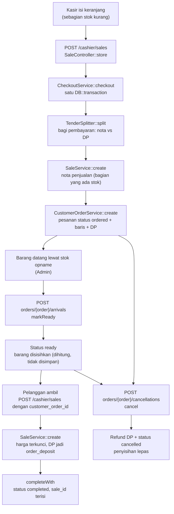
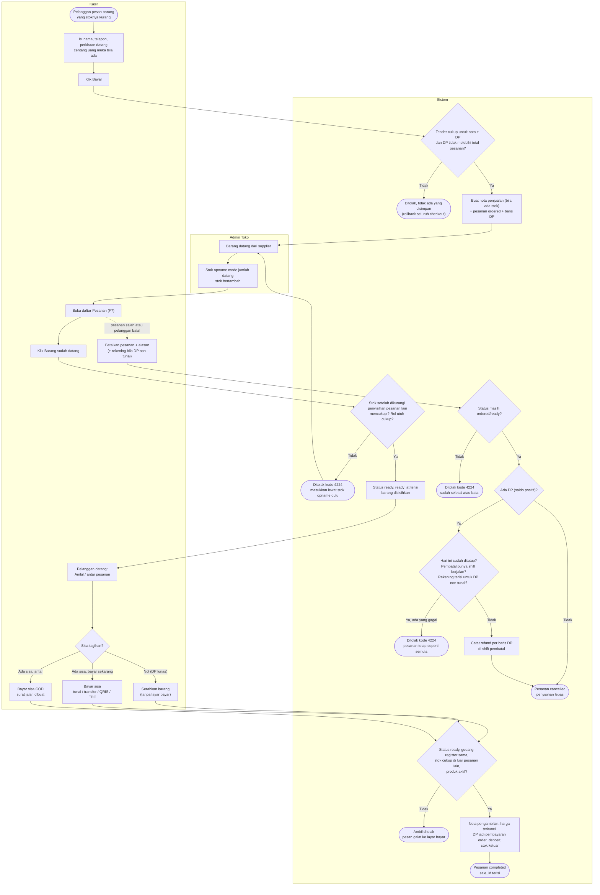
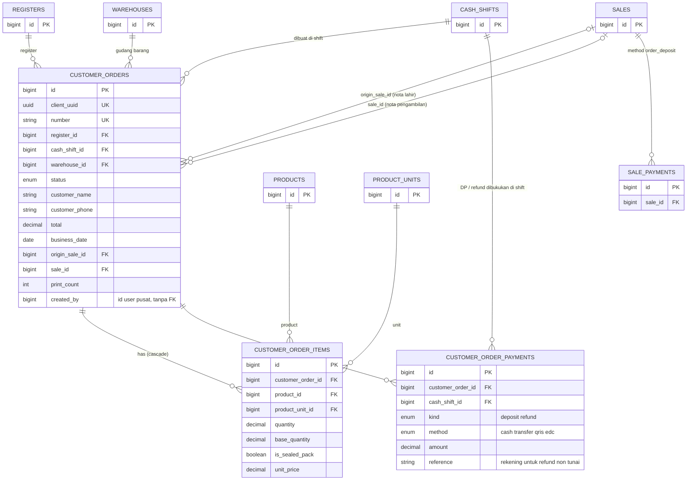
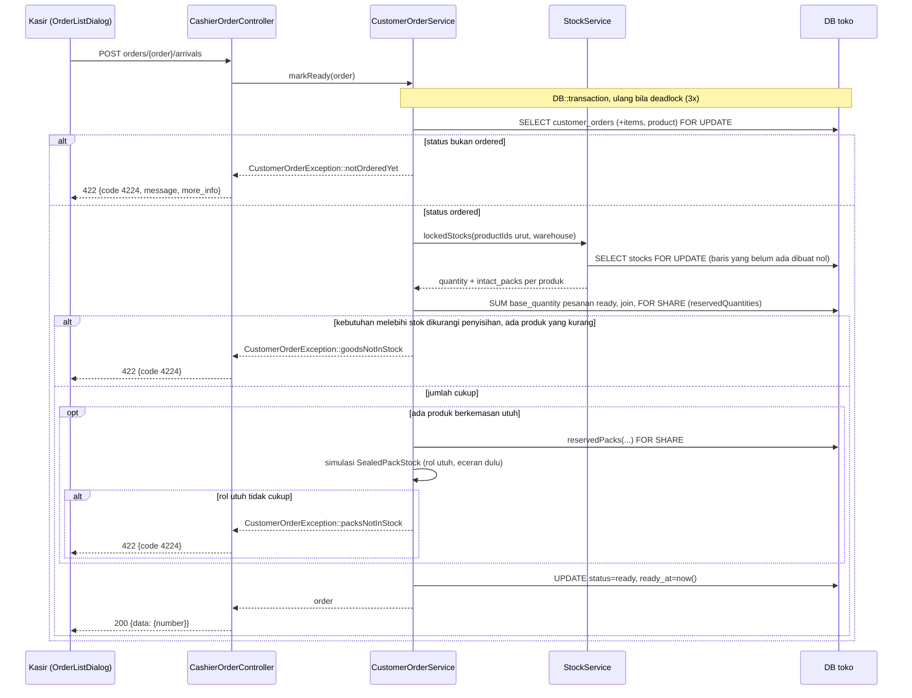
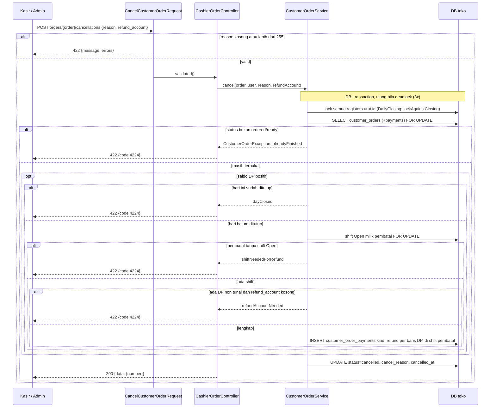

# Pesanan Pelanggan (PO) — Dokumentasi Teknis

> **Modul:** Pesanan pelanggan / PO, uang muka (DP), penyisihan stok, dan pengambilan pesanan di layar kasir
> **Stack:** Laravel 13 (PHP 8.3), Inertia 3, Vue 3, Quasar 2, stancl/tenancy
> **Database:** per toko (tabel `customer_orders*` ada di DB toko, bukan DB pusat)
> **Audiens:** Engineer yang memelihara atau memperluas fitur ini
> **Terakhir diperbarui:** 2026-11-17
> **Dokumen terkait:** [cod-dan-void-docs.md](cod-dan-void-docs.md) (COD, void, tanda "sudah diantar"), modul Surat Jalan (`DeliveryNoteService`, dikerjakan di dokumen lain), [analisis-sistem.md](analisis-sistem.md) bagian 7.5 dan D36 (aturan bisnis)

## 1. Ringkasan

Pesanan pelanggan adalah barang yang dijanjikan toko tetapi belum ada di rak. Kasir memasukkan semua barang ke keranjang; saat **Bayar**, server membagi keranjang menjadi bagian yang stoknya cukup (jadi nota penjualan biasa) dan bagian yang kurang (jadi pesanan, nomor `PS/...`). Pelanggan boleh menaruh uang muka (DP) dari kelebihan bayarnya. Pesanan **bukan penjualan**: tidak menggerakkan stok dan bukan pendapatan. Uang DP-nya nyata (masuk laci atau rekening), jadi dicatat terpisah di `customer_order_payments` dan ikut dihitung di kas shift. Ketika barang datang (dimasukkan lewat stok opname oleh Admin), kasir menekan **Barang sudah datang**; pesanan berstatus `ready` dan jumlahnya **disisihkan** dari stok yang boleh dijual orang lain. Saat pelanggan datang, **Ambil pesanan** membuat nota penjualan biasa dengan harga yang terkunci dari saat pesanan dibuat, DP masuk sebagai pembayaran `order_deposit`, dan pesanan menjadi `completed`. Pesanan yang belum selesai bisa dibatalkan; DP dikembalikan dari laci shift pembatal (tunai) atau ke rekening yang diisi (non tunai).

Alasan desain yang paling menentukan: **penyisihan stok tidak disimpan**. Tidak ada kolom `reserved` dan tidak ada mutasi ledger; "yang disisihkan" selalu dihitung ulang sebagai jumlah baris pesanan berstatus `ready` per produk dan gudang (`CustomerOrderItem::reservedQuantities`). Akibatnya membatalkan atau menyelesaikan pesanan melepaskan penyisihan hanya dengan mengubah status, dan tidak ada angka yang bisa melenceng dari kenyataan. Harganya: setiap keputusan stok (penjualan, `markReady`, katalog kasir) harus ingat mengurangi angka itu, dan pembacaan angka itu di jalur keputusan harus memakai bacaan terkunci (lihat 7.3).

### 1.1 Alur tingkat tinggi



### 1.2 BPMN: pesanan dari dibuat sampai selesai atau batal



---

## 2. Skema Database

Semua tabel di bawah ada di **DB toko** (migrasi di `database/migrations/tenant`). Pesanan dibuat oleh migrasi `2026_11_05_130000_create_customer_orders_tables.php`; dua kolom ditambah kemudian (`customer_address`, `is_sealed_pack`).

### `customer_orders`

| Kolom | Tipe | Null | Catatan |
|---|---|---|---|
| `id` | bigint, PK | | |
| `client_uuid` | uuid | tidak | **unique**. Kunci idempotensi submit ganda; berbeda dari `client_uuid` nota walau dikirim dalam satu checkout (`order.client_uuid`) |
| `number` | string | tidak | **unique**. Format `PS/{receipt_prefix}/{yymm}/{0001}` dari `DocumentNumberGenerator::next('PS', now())`, tanpa kode register (berbeda dari nota `INV`) |
| `register_id` | bigint, FK `registers` | tidak | Restrict. Register tempat pesanan dibuat |
| `cash_shift_id` | bigint, FK `cash_shifts` | tidak | Restrict. Shift pembuat pesanan; DP awal ikut shift ini |
| `warehouse_id` | bigint, FK `warehouses` | tidak | Restrict. Diambil dari `register.warehouse_id`; barang pesanan "tinggal" di gudang ini |
| `status` | enum `ordered, ready, completed, cancelled` | tidak | Default `ordered` |
| `customer_name` | string | tidak | Wajib untuk pesanan (beda dengan `sales.customer_name` yang nullable) |
| `customer_phone` | string | tidak | Wajib; dasar menghubungi pelanggan saat barang datang |
| `customer_address` | text | ya | Ditambah migrasi `2026_11_06_100000`. Alamat antar; mengisi surat jalan saat pesanan diambil sebagai COD. Nullable karena banyak pesanan diambil sendiri |
| `source_note` | string | ya | Teks bebas "dibeli dari" |
| `expected_date` | date | ya | Perkiraan barang datang; hanya untuk mengurutkan daftar |
| `total` | decimal(15,2) | tidak | Dihitung server dari `CartPricer`, bukan dari klien |
| `ordered_at` | dateTime | tidak | |
| `business_date` | date | tidak | Disalin dari `cash_shift.business_date` |
| `ready_at` | dateTime | ya | Diisi `markReady`. Null selama `ordered` |
| `origin_sale_id` | bigint, FK `sales` | ya | Restrict. Nota penjualan yang dibuat satu transaksi dengan pesanan (bagian yang ada stok). Null bila seluruh keranjang jadi pesanan |
| `sale_id` | bigint, FK `sales` | ya | Restrict. Nota pengambilan; terisi saat `completed` |
| `cancel_reason` | string | ya | Diisi `cancel` |
| `cancelled_at` | dateTime | ya | |
| `print_count` | unsigned int | tidak | Default 0. Dinaikkan `PrintCounter::recordPrint` (hanya cetak mandiri, lihat 7.7) |
| `created_by` | unsigned bigint | tidak | **Tanpa FK**: id user di DB pusat, tidak bisa direferensikan lintas database |
| `created_by_name` | string | tidak | Snapshot nama agar nota tetap terbaca bila user diganti |
| `created_at`, `updated_at` | timestamp | ya | |

Indeks: `unique(client_uuid)`, `unique(number)`, `index(status, warehouse_id)` (dipakai daftar pesanan dan penyisihan).

`origin_sale_id` dan `sale_id` sama-sama menunjuk `sales` tetapi artinya berlawanan: `origin_sale_id` adalah nota *lahirnya* pesanan, `sale_id` nota *matinya* pesanan. Keduanya nullable karena pesanan lahir tanpa nota (stok nol semua) dan mati tanpa nota (dibatalkan).

### `customer_order_items`

| Kolom | Tipe | Null | Catatan |
|---|---|---|---|
| `id` | bigint, PK | | |
| `customer_order_id` | bigint, FK | tidak | `cascadeOnDelete` |
| `product_id` | bigint, FK `products` | tidak | Restrict |
| `product_unit_id` | bigint, FK `product_units` | tidak | Restrict |
| `product_name` | string | tidak | Snapshot |
| `unit_name` | string | tidak | Snapshot (`unit_code`) |
| `quantity` | decimal(15,3) | tidak | Dalam satuan baris |
| `conversion_snapshot` | decimal(15,3) | tidak | Konversi ke satuan dasar saat dibuat |
| `is_sealed_pack` | boolean | tidak | Default false. Ditambah `2026_11_16_100000`: apakah baris meminta rol/kemasan utuh. Baris lama diisi dari flag satuan *sekarang* (migrasi backfill), jadi untuk pesanan lama itu tebakan terbaik |
| `base_quantity` | decimal(15,3) | tidak | `quantity x conversion`; ini yang dijumlahkan untuk penyisihan |
| `unit_price` | decimal(15,2) | tidak | Harga yang disepakati; **dikunci** sampai pengambilan |
| `subtotal` | decimal(15,2) | tidak | |
| `created_at`, `updated_at` | timestamp | ya | |

### `customer_order_payments`

Satu baris per uang yang masuk (`deposit`) atau keluar (`refund`) untuk pesanan, di shift tempat itu terjadi.

| Kolom | Tipe | Null | Catatan |
|---|---|---|---|
| `id` | bigint, PK | | |
| `customer_order_id` | bigint, FK | tidak | `cascadeOnDelete` |
| `cash_shift_id` | bigint, FK `cash_shifts` | tidak | Restrict. Untuk `deposit` shift pembuat pesanan; untuk `refund` shift **pembatal** (bisa shift lain/hari lain) |
| `kind` | enum `deposit, refund` | tidak | `OrderPaymentKind` |
| `method` | enum `cash, transfer, qris, edc` | tidak | Sengaja tanpa `cod`, `return_credit`, `order_deposit`: enum DB adalah pagar terakhir, pagar utamanya `TenderSplitter` (menolak COD) dan `StoreSaleRequest` |
| `amount` | decimal(15,2) | tidak | |
| `reference` | string | ya | Nomor referensi pembayaran; untuk `refund` non tunai berisi **rekening penerima** pengembalian. Nullable karena tunai tidak punya referensi |
| `paid_at` | dateTime | tidak | |
| `created_at`, `updated_at` | timestamp | ya | |

Indeks: `index(cash_shift_id, kind, method)` (dipakai ringkasan shift dan tutup hari).

### Perubahan pada tabel milik modul lain

Migrasi yang sama menyentuh dua tabel nota/kas (skema lengkapnya ada di dokumen modul masing-masing):

| Tabel | Perubahan |
|---|---|
| `sale_payments` | `method` ENUM diperluas dengan `order_deposit` (lewat `ALTER TABLE ... MODIFY`, MySQL-spesifik). Baris ini dibuat otomatis oleh `SaleService::recordPayments` pada nota pengambilan, bukan uang baru |
| `daily_closings` | Ditambah `order_deposits_received` dan `order_deposits_refunded`, decimal(15,2) default 0, setelah `sales_cod` |

### Diagram relasi



---

## 3. Model / Entity

| Model | Tabel | Relasi, cast, trait penting |
|---|---|---|
| `App\Models\CustomerOrder` | `customer_orders` | `items()` HasMany, `payments()` HasMany, `originSale()` dan `sale()` BelongsTo `Sale`, `register()` BelongsTo. Cast `status` -> `OrderStatus`, tanggal -> `date`/`datetime`, `total` -> `decimal:2`. **Auditable** (semua event). `depositBalance(): BigDecimal` = jumlah `deposit` dikurangi jumlah `refund`, **butuh relasi `payments` sudah dimuat**. `print_count` tidak ada di `#[Fillable]` (dinaikkan lewat `increment`) |
| `App\Models\CustomerOrderItem` | `customer_order_items` | `customerOrder()`, `product()`. Cast desimal dan `is_sealed_pack` boolean. **Tidak Auditable**. Memuat tiga method statis penyisihan: `reservedQuantities()`, `reservedPacks()`, dan `readyItemsQuery()` privat |
| `App\Models\CustomerOrderPayment` | `customer_order_payments` | `customerOrder()`. Cast `kind` -> `OrderPaymentKind`, `method` -> `PaymentMethod`. **Auditable**. Tidak punya relasi ke `CashShift` (kolomnya ada, relasinya tidak didefinisikan; query memakai kolom langsung) |
| `App\Enums\OrderStatus` | | `Ordered`, `Ready`, `Completed`, `Cancelled`; `label()` Indonesia (Dipesan, Siap diambil, Selesai, Dibatalkan); `unfinished()` dan `isUnfinished()` = `Ordered` atau `Ready` |
| `App\Enums\OrderPaymentKind` | | `Deposit`, `Refund` |
| `App\Enums\PaymentMethod` | | Dipakai bersama modul nota. `OrderDeposit` ada di enum tetapi **tidak** ada di `forSale()` maupun `forCashier()`, jadi tidak pernah ditawarkan di layar bayar dan ditolak oleh `StoreSaleRequest` |
| `App\Exceptions\CustomerOrderException` | | Satu kelas dengan named constructor per alasan (lihat 9). Pesannya aman ditampilkan ke kasir |

Model pesanan tidak memakai trait `CentralConnection` (itu hanya untuk model di DB pusat); semuanya mengikuti koneksi default yang berpindah ke DB toko selama tenancy aktif.

---

## 4. Hak Akses

Semua rute pesanan ada di grup `t/{tenant}/cashier/...` dengan middleware `web`, `InitializeTenancyByPath`, `auth`, `store.access`, `shift.remember`. **Tidak ada `store.admin`**: setiap pengguna aktif yang terhubung ke toko (Kasir, Admin Toko, Super Admin) boleh melihat daftar pesanan, menandai barang datang, membatalkan, dan mencetak. Ini disengaja (komentar `CashierOrderController`: "Any cashier of the store may do these, like voiding a COD sale").

| Aksi | Siapa | Catatan |
|---|---|---|
| Membuat pesanan | Pengguna toko dengan **shift Open** | Lewat `SaleController::store`; shift `pending_review` ditolak (`shiftNotOpen`) |
| Daftar pesanan, cetak pesanan | Semua pengguna toko | **Tidak ada pengecekan kepemilikan** pada `print`: kasir mana pun bisa menaikkan `print_count` pesanan siapa pun. Bandingkan `ShiftReceiptController::print` yang menolak nota orang lain (kode 4031) |
| Barang sudah datang | Semua pengguna toko | Tidak mensyaratkan shift (tidak ada uang yang bergerak) |
| Membatalkan | Semua pengguna toko | Bila ada DP, pembatal wajib punya shift **Open**; kasir lain atau admin tanpa shift tidak bisa mengembalikan DP tunai dari laci yang bukan miliknya |
| Mengambil pesanan | Pengguna toko dengan shift Open, register bergudang sama | Gudang pesanan harus sama dengan gudang register |
| Stok opname (barang datang) | `store.admin` | Di luar modul ini; satu-satunya jalur menambah stok di R1 |

Alamat lembar cetak (`orders.sheet`) memakai middleware `signed`: tautan dibuat `URL::temporarySignedRoute` berlaku **30 menit**, memuat nomor cetak (`print`) di dalam tanda tangan sehingga angka itu tidak bisa diubah (tes: membuka tautan tanpa tanda tangan menghasilkan 403).

---

## 5. Konfigurasi

Tidak ada kunci di `config/`, `.env`, maupun `routes/console.php` yang khusus untuk modul ini (Grep atas `config/` tidak menemukan referensi pesanan). Yang ada hanya konstanta kode dan pengaturan toko:

| Nama | Nilai | Lokasi | Dibaca oleh |
|---|---|---|---|
| `LIST_LIMIT` | 50 | `CashierOrderController` | Batas pesanan di daftar kasir |
| `ORDER_TYPE` | `'PS'` | `CustomerOrderService` | Awalan nomor pesanan |
| `StockService::DEADLOCK_ATTEMPTS` | 3 | `StockService` | `markReady`, `cancel`, dan `CheckoutService::checkout` memanggil `DB::transaction(..., 3)` |
| `BADGE_REFRESH_MS` | 60000 | `resources/js/Pages/Tenant/Cashier/Index.vue:643` | Poll lencana `order_counts` tiap 60 detik |
| Batas kata kunci pencarian | 100 karakter | `CashierOrderController::index` (`limit(100, '')`) | |
| Debounce pencarian | 300 ms | `OrderListDialog.vue` | |
| TTL tautan cetak | 30 menit | `AnswersPrints::recordPrintAnswer` | |
| Pengaturan toko `auto_print_receipt` | bawaan mati | tabel `settings` via `StoreSettingService` | Bila hidup, nota (atau Nota Pesanan bila tidak ada nota penjualan) terbuka untuk dicetak otomatis di `SaleDoneDialog.vue` |
| Pengaturan toko `paper_width`, `receipt_name/address/phone`, `receipt_footer` | | `StoreSettingService` | Kop dan lebar kertas Nota Pesanan |
| Pengaturan toko `lock_sales_during_opname` | bawaan mati | `StoreSettingService::isSalesLockedDuringOpname` | **Mempengaruhi pengambilan**: karena pengambilan adalah `SaleService::create`, produk yang sedang dihitung opname membuat pengambilan ditolak (`requireNoOpnameLock`). `markReady` tidak memeriksanya |

---

## 6. Rute / API

Prefiks `/t/{tenant}/cashier`, nama rute berawalan `tenant.cashier.`, middleware grup seperti pada bagian 4.

| Method | Path | Action | Nama rute | Middleware tambahan |
|---|---|---|---|---|
| POST | `/sales` | `SaleController@store` | `sales.store` | Membuat nota + pesanan, atau mengambil pesanan (`customer_order_id`) |
| GET | `/orders` | `CashierOrderController@index` | `orders.index` | JSON |
| POST | `/orders/{order}/arrivals` | `CashierOrderController@ready` | `orders.ready` | JSON |
| POST | `/orders/{order}/cancellations` | `CashierOrderController@cancel` | `orders.cancel` | JSON, validasi `CancelCustomerOrderRequest` |
| POST | `/orders/{order}/print` | `CashierOrderController@print` | `orders.print` | JSON; menghitung cetak |
| GET | `/orders/{order}/sheet` | `CashierOrderController@sheet` | `orders.sheet` | `signed`; halaman Inertia `Tenant/Print/Order` |

Pola respons: `SaleController::store` adalah form Inertia (redirect + flash `last_sale`/`last_order`, galat bisnis lewat flash `error`), sedangkan lima rute `orders/*` adalah JSON dengan galat berbentuk `{code, message, more_info}` (trait `AnswersJsonErrors`) dan kode **4224** (`ApiErrorCode::OrderRefused`), status HTTP 422. Validasi form yang gagal (mis. `reason` kosong) memakai bentuk standar Laravel `{message, errors}`, juga 422; `postJson()` di frontend membaca keduanya (`errors` dulu, lalu `message`).

Semua contoh berikut **ilustratif** (disusun dari bentuk resource dan tes), bukan tangkapan nyata.

**`POST /t/mitra_utama/cashier/sales`: keranjang kawat 100 m + cat 2 kaleng, stok kawat 50 m, bayar tunai 800.000 untuk nota + DP 200.000** (JSON yang dikirim `router.post`; harga tidak dikirim, server membaca dari DB):

```json
{
  "client_uuid": "7b0f6c1e-2c3f-4a8e-9a39-0f1a1e5d7c10",
  "customer_name": "Pak Budi",
  "items": [{ "product_unit_id": 11, "quantity": "50" }],
  "payments": [{ "method": "cash", "amount": 800000 }],
  "order": {
    "client_uuid": "b1d3b0b5-4a6f-4c36-8d1e-6a5e0d6b1c22",
    "customer_name": "Pak Budi",
    "customer_phone": "081234567890",
    "customer_address": null,
    "source_note": null,
    "expected_date": "2026-11-20",
    "items": [
      { "product_unit_id": 11, "quantity": "50" },
      { "product_unit_id": 27, "quantity": "2" }
    ],
    "deposit_amount": 200000
  }
}
```

Sukses: redirect ke `tenant.cashier.index` dengan flash `last_sale` dan `last_order` (`CustomerOrderResource`). Galat bisnis (mis. `paymentTooLow`): redirect balik dengan flash `error` berisi pesan Indonesia.

**`GET /orders`:**

```json
{
  "data": [
    {
      "id": 12,
      "number": "PS/MU/2611/0003",
      "status": "ordered",
      "status_label": "Dipesan",
      "customer_name": "Pak Budi",
      "customer_phone": "081234567890",
      "total": "400000.00",
      "deposit": "200000.00",
      "remaining": "200000.00",
      "deposit_methods": ["Tunai"],
      "has_cash_deposit": true,
      "has_non_cash_deposit": false,
      "origin_sale_number": "INV/MU/K1/2611/0042",
      "can_mark_ready": true,
      "can_collect": false,
      "can_cancel": true,
      "ready_url": "/t/mitra_utama/cashier/orders/12/arrivals",
      "cancel_url": "/t/mitra_utama/cashier/orders/12/cancellations",
      "print_url": "/t/mitra_utama/cashier/orders/12/print",
      "stock_check": { "is_covered": false, "shortages": [{ "name": "Cat", "text": "3 PCS" }] },
      "origin_sale_undelivered": [],
      "origin_sale_cod_amount": "0.00",
      "items": [{ "name": "Cat", "unit": "PCS", "quantity": "2.000", "unit_price": "10000.00", "subtotal": "20000.00" }]
    }
  ],
  "meta": { "total": 1, "counts": { "open": 1, "ready": 0, "arrived": 0 } }
}
```

(Kunci `ordered_at`, `expected_date`, `customer_address`, `source_note`, `created_by_name` juga ada; dipotong agar ringkas. URL pada respons nyata adalah URL absolut dari `route()`.)

**`POST /orders/12/arrivals`** sukses:

```json
{ "data": { "number": "PS/MU/2611/0003" } }
```

Ditolak karena stok belum cukup (422):

```json
{
  "code": 4224,
  "message": "Stok Cat belum cukup untuk pesanan ini, tersedia 0 PCS. Masukkan barang yang datang lewat stok opname dulu.",
  "more_info": "Muat ulang daftar pesanan untuk melihat keadaan yang terbaru, lalu coba lagi."
}
```

**`POST /orders/12/cancellations`** body `{"reason": "Pelanggan batal", "refund_account": null}`. Sukses seperti `arrivals`. Ditolak bila DP non tunai tanpa rekening (422, bentuk sama dengan di atas, `message`: "Uang muka dibayar non tunai. Isi rekening penerima pengembaliannya."). `reason` kosong menghasilkan bentuk validasi Laravel:

```json
{ "message": "Isi alasan pembatalan.", "errors": { "reason": ["Isi alasan pembatalan."] } }
```

**`POST /orders/12/print`** sukses:

```json
{
  "data": {
    "is_copy": false,
    "print_count": 1,
    "sheet_url": "https://.../t/mitra_utama/cashier/orders/12/sheet?print=1&expires=...&signature=..."
  }
}
```

---

## 7. Komponen Backend

### 7.1 `CheckoutService` (`app/Services/CheckoutService.php`)

Satu "Bayar" bisa menghasilkan nota, pesanan, atau keduanya, **dalam satu `DB::transaction` dengan retry deadlock** (`StockService::DEADLOCK_ATTEMPTS`). Alasan satu transaksi: pelanggan tidak boleh pulang membawa nota separuh keranjang tanpa pesanan untuk sisanya.

Langkah dan cabangnya:

1. `isSaleWanted` benar bila ada `items` atau `customer_order_id`. Dengan begitu pengambilan pesanan (tanpa `items`) tetap lewat jalur nota.
2. `hold_delivery` tanpa `order` ditolak (`SaleException::deliveryHoldNeedsOrder`). Request juga menolaknya (`prohibitedIf`); service mengulang pengecekan karena bisa dipanggil tanpa request.
3. Bila ada `order` dan `deposit_amount` > 0 **dan checkout ini belum pernah tercatat**: `sales->quote()` menghitung total nota (nol bila tanpa nota), lalu `TenderSplitter::split` membagi pembayaran menjadi `sale` dan `deposit`. `payments` nota diganti dengan bagian `sale`.
4. `SaleService::create` (bila `isSaleWanted`), lalu `CustomerOrderService::create` dengan `deposits` dari splitter dan `origin_sale_id` = id nota tadi.

`isAlreadyRecorded` ada karena submit ganda: nota dan pesanan dibuat satu transaksi sehingga ada bersama-sama. Bila keduanya sudah ada, tender tidak dibagi/dihitung ulang, supaya submit ulang tidak gagal hanya karena harga atau status produk berubah sejak submit pertama (ada tesnya: produk dinonaktifkan di antara dua submit).

### 7.2 `TenderSplitter` (`app/Services/TenderSplitter.php`)

Membagi uang yang diserahkan pelanggan antara nota dan DP. Aturan sebenarnya, urut seperti di kode:

1. Pembayaran **COD ditolak** (`codWithOrderDeposit`): COD bukan uang diterima, tidak mungkin jadi DP.
2. Total dibayar harus >= nota + DP (`paymentTooLow`).
3. Kembalian = dibayar - (nota + DP), dan **hanya boleh keluar dari baris tunai** (`changeExceedsCash`). Kembalian diambil dari baris tunai **terakhir** lebih dulu.
4. Alokasi: tiap baris (urutan input) menutup nota dulu, sisanya baru DP. Kembalian dikembalikan ke nota sebagai satu baris tunai ekstra ("kelebihan tunai yang diberikan"), supaya nota tetap terbaca seperti biasa (tunai diterima, kembalian), sedangkan laci hanya menyimpan tunai yang benar-benar tertinggal. Bila tidak ada nota (seluruh keranjang pesanan), tidak ada baris kembalian: yang dibukukan hanya DP.

Contoh (dihitung dari kode): nota 600.000, DP 200.000, pelanggan menyerahkan tunai 1.000.000. Kembalian 200.000. Bagian tersimpan 800.000: nota mendapat `cash 600.000` plus baris kembalian `cash 200.000` (jadi `paid_total` 800.000, `change_amount` 200.000, tunai bersih dari nota 600.000), DP mendapat `cash 200.000`. Total tunai masuk laci 800.000, sesuai yang tertinggal di tangan kasir.

### 7.3 `CustomerOrderService` (`app/Services/CustomerOrderService.php`)

**`create(CashShift, User, array)`**: satu transaksi. Mengunci baris shift (`lockForUpdate`, juga memuat `register`), lalu **memeriksa `client_uuid` di bawah kunci itu** sehingga dua submit sama tidak bisa sama-sama lolos. Cabang:

- `client_uuid` sudah ada: bila `created_by` sama dengan kasir, kembalikan pesanan lama (idempoten); bila milik orang lain, `orderIdInUse` agar uuid tidak bisa dipakai untuk membaca pesanan orang.
- Shift bukan `Open` -> `shiftNotOpen`.
- `CartPricer::price` membaca harga dari `product_units` (bukan klien), menolak produk non aktif/terhapus, satuan tidak `is_sellable`, rol tidak bulat.
- DP > total pesanan -> `depositMoreThanTotal` (seluruh transaksi checkout, termasuk nota, ikut rollback).
- Menulis `customer_orders` (nomor dari `DocumentNumberGenerator`, harus di dalam transaksi supaya rollback tidak melompati nomor), baris, dan satu `customer_order_payments` per baris `deposits`.

Pesanan **tidak mengecek stok sama sekali** saat dibuat; menentukan bagian mana yang jadi pesanan adalah tugas layar kasir (`useCart`), server hanya menerima item yang dikirim sebagai pesanan. Konsekuensinya lihat butir 1 di bagian 12.

**`markReady(CustomerOrder)`** dan **`requireGoodsInStock`**: lihat diagram urutan 7.4. Intinya urutan penguncian: baris pesanan -> baris stok (urut `product_id`, sama dengan urutan penjualan) -> baru bacaan penyisihan dengan `sharedLock()`. Bacaan penyisihan *harus* sesudah kunci stok: dua pesanan yang ditandai bersamaan (atau pesanan dan penjualan) saling menunggu di baris stok, dan yang kedua baru membaca penyisihan setelah yang pertama commit, sehingga barang yang sama tidak disisihkan dua kali. `readyItemsQuery` memakai `join` ke `customer_orders` dan bukan `whereHas`, karena bacaan terkunci mengunci baris semua tabel pada statement-nya sendiri, sedangkan subquery bersarang dibaca dari snapshot lama dan bisa masih melihat pesanan sebagai belum `ready`.

Aturan kemasan utuh (`requireWholePacksInStock`): untuk produk yang punya satuan kemasan (`sealedPackUnit()`, mis. rol kawat), stok dalam satuan dasar yang cukup belum berarti rol utuhnya cukup. Baris pesanan "diletakkan di rak" memakai `SealedPackStock` seperti penjualan akan mengambilnya (rol utuh diambil utuh, satuan lebih kecil dari eceran dulu), setelah dikurangi rol yang sudah disisihkan pesanan lain (`reservedPacks`). Gagal -> `packsNotInStock`.

**`openOrdersFor($search, $limit)`** menyusun daftar kasir: ambil `id,status` **semua** pesanan terbuka yang cocok (urut `expected_date` null terakhir, lalu tanggal terdekat, lalu `id` turun), beri peringkat (`ready`=0, tercukupi stok=1, lainnya=2), potong `$limit`, baru muat baris/pembayaran/nota asal untuk halaman itu saja. `total` adalah jumlah semua yang cocok; `counts` selalu jumlah seluruh pesanan terbuka (tidak ikut pencarian) dan dihitung dari `coverage` yang sama dengan daftar supaya lencana tidak pernah menghitung pesanan yang tidak ada di daftar.

**`stockCoverageOf`** (cek kecukupan stok, hanya petunjuk): per gudang, pesanan `ordered` diurut `id` naik (paling lama dilayani dulu). Stok tersedia per produk = stok - disisihkan pesanan `ready` (minimal 0). Tiap pesanan yang **seluruh** barisnya tercukupi mengurangi `available` sebelum pesanan berikutnya dicek, jadi dua pesanan yang meminta barang sama tidak sama-sama dinyatakan cukup. Pesanan yang tidak tercukupi tidak mengurangi apa pun. Tidak ada kunci dan tidak mengubah apa pun; hanya `markReady` yang memutuskan. Perhitungannya hanya satuan dasar, tidak tahu rol utuh (lihat butir 2 di bagian 12).

**`badgeCounts()`** = `openCounts(stockCoverageOfWaitingOrders())`: `open` (ordered+ready), `ready`, `arrived` (ordered yang tercukupi). Dipakai `CashierController::index` sebagai prop `order_counts` dan di-poll tiap 60 detik.

**`claimForCollection(int $orderId)`** (dipanggil `SaleService` di dalam transaksi nota): kunci pesanan (`with items, payments`), wajib `ready` (`notReadyToCollect`). **`collectionLines`** mengubah baris pesanan menjadi keranjang nota dengan `unit_price` pesanan, itulah mekanisme **harga terkunci**: `CartPricer` memakai `unit_price` baris bila ada, dan menandai `is_manual_price` pada baris nota bila beda dengan harga jual sekarang. **`completeWith(order, sale)`** menulis `status=completed` dan `sale_id`.

Konsekuensi di `SaleService::create` bagi pesanan yang diambil (lihat docblock kelas dan `collectedOrderOf`): gudang pesanan harus sama dengan gudang register (`orderIsInAnotherWarehouse`); stok dicek dengan **pengecualian** `reservedQuantities(..., $collectedOrderId)` agar pesanan ini boleh mengambil jatahnya sendiri; `settle()` memakai `depositBalance()` sebagai `alreadyPaid`; `recordPayments` menambah baris `order_deposit` sebesar saldo DP; pengambilan tidak bisa sebagian atau digabung barang lain (`prohibits:items,order` di request).

**`cancel(order, canceller, reason, refundAccount)`**: lihat diagram urutan 7.5 dan bagian 9. Dibungkus retry deadlock karena urutan kuncinya berlawanan dengan pengambilan (batal: pesanan lalu shift; pengambilan: shift lalu pesanan). Yang kalah deadlock diulang. Penyisihan "dilepas" hanya dengan mengubah status (tidak ada mutasi stok yang dibalik).

**`refundDeposit`** (privat): menolak bila `DailyClosing::isClosedOn(today())`, lalu butuh shift Open milik pembatal (`runningShiftOf`: shift dikunci supaya tidak ditutup di tengah pembukuan refund), lalu rekening untuk DP non tunai. Satu baris `refund` dibuat **per baris DP** (metode sama, jumlah sama), bukan satu baris total, supaya tiap metode terbalik ke tempat asalnya. `reference` baris refund non tunai = rekening yang diisi.

### 7.4 Diagram urutan: `markReady`



### 7.5 Diagram urutan: `cancel`



Dalam kedua kasus ditolak di tengah transaksi, **tidak ada yang tersimpan**: semua `throw` terjadi sebelum `UPDATE` status, dan refund yang sudah di-`INSERT` ikut di-rollback oleh transaksi.

### 7.6 `CashierOrderController` (`app/Http/Controllers/Tenant/CashierOrderController.php`)

Tipis. `index` menambahkan tiga kunci di atas `CustomerOrderResource`: `stock_check` (dari `coverage`, null untuk pesanan `ready`), `origin_sale_undelivered` (`DeliveryNoteService::undeliveredLinesOf` atas nota asal pesanan-pesanan satu halaman, satu kali query), dan `origin_sale_cod_amount` (sisa COD nota asal, dipakai layar bayar untuk menyebut "total ditagih di pintu"). `ready` dan `cancel` menangkap `CustomerOrderException` menjadi 422 kode 4224. Satu-satunya yang tidak ditangkap adalah galat tak terduga (500). `print` dan `sheet` memakai trait `AnswersPrints`.

### 7.7 Cetak: Nota Pesanan dan lembar gabungan

Ada **dua** bentuk kertas, dan mudah salah paham siapa yang menghitung cetakannya:

- **Nota Pesanan mandiri** (`OrderSheet.vue`, halaman `Tenant/Print/Order`): dicetak dari daftar Pesanan atau dari dialog selesai bila tidak ada nota penjualan. `print` -> `PrintCounter::recordPrint` (transaksi + `lockForUpdate` + `increment('print_count')`, jadi dua register yang mencetak bersamaan sama-sama terhitung) -> mengembalikan `print_count`, `is_copy` (= cetakan ke-2 dan seterusnya), dan `sheet_url` bertanda tangan. Lembar membaca `is_copy` dari parameter `print` di URL (`printNumberOf`), jadi bertanda **SALINAN** untuk cetakan itu saja dan tidak berubah oleh cetakan berikutnya. Status `cancelled` menampilkan **DIBATALKAN** menggantikan SALINAN.
- **Lembar gabungan nota + pesanan** (`ReceiptSheet.vue`): nota penjualan dan pesanan yang lahir bersamanya tetap dua catatan (stok dan kasnya berbeda) tetapi dicetak di satu kertas. `ShiftReceiptController::sheet` memuat pesanan lewat `orderMadeWith($sale)` (`origin_sale_id = sale.id` dan `status != cancelled`) dan `PrintableSaleResource` menggabungkan baris pembayaran nota dengan baris DP per metode agar kertas menjumlah (`total dibayar` = total nota + DP). **`print_count` yang bertambah di sini adalah milik nota, bukan milik pesanan**; kolom `customer_orders.print_count` hanya mencatat cetak mandiri. Pesanan yang sudah dibatalkan hilang dari cetak ulang nota; pesanan `completed` dicetak sebagai "Sudah diambil".

### 7.8 `CustomerOrderResource` dan `CashierCatalogService`

`CustomerOrderResource` mengharuskan `items` dan `payments` sudah dimuat (dan `originSale` bila ingin `origin_sale_number`). Ia menurunkan `deposit` (saldo DP), `remaining` (= `total - deposit`), `has_cash_deposit`/`has_non_cash_deposit` (hanya bila saldo positif), tiga flag `can_*` dari status, dan tiga URL aksi. Karena `can_*` dan `remaining` diturunkan di server, layar tidak mengulang aturan status.

`CashierCatalogService::catalogItems` mengurangi stok katalog dengan `reservedQuantities` (dan `reservedPacks` untuk rol utuh), minimal 0, sehingga barang yang seluruhnya disisihkan tampil habis di layar kasir dan tidak masuk "barang sering dijual". `reserved` juga dikirim ke layar agar bisa menandai "disisihkan". Katalog **tidak** memakai bacaan terkunci (bacaan polos): ia hanya petunjuk, keputusan ada di `SaleService::requireStock`.

### 7.9 Frontend

| Komponen | Peran |
|---|---|
| `resources/js/Components/Cashier/OrderListDialog.vue` | Daftar Pesanan (tiga tab: Siap diambil, Perlu ditandai datang, Menunggu barang; pencarian mencari di semua tab). Memuat `GET orders?q=` dengan penjaga "permintaan terbaru menang" (`lastRequestNumber`) agar jawaban pencarian lama yang telat tidak menimpa daftar. Tombol utama satu per status; cetak dan batal di menu titik tiga. Pesanan yang `remaining` = 0 dan `deposit` > 0 diberi LUNAS dan pengambilannya hanya konfirmasi (`collect-paid`) tanpa layar bayar. Tombol Barang sudah datang dinonaktifkan di UI bila `stock_check.is_covered` salah; **server tetap memutuskan** |
| `Components/Cashier/PaymentDialog.vue`, `OrderFields.vue` | Form pesanan di layar bayar: telepon wajib, alamat opsional, kotak "Pelanggan bayar pesanan sekarang (uang muka)". DP = kelebihan bayar di atas nota, maksimum total pesanan (dihitung di klien, **diverifikasi ulang** di server oleh `TenderSplitter` dan `depositMoreThanTotal`). Saat mengambil pesanan, `collectingOrder` membuat dialog menagih `remaining` |
| `Pages/Tenant/Cashier/Index.vue` | `checkoutBody` menyusun `customer_order_id` (pengambilan) atau `items` + `order`; `collectPaidOrder` mengirim `payments: []` untuk pesanan lunas; lencana `order_counts` di-poll tiap 60 detik lewat `router.reload({ only: [...] })` |
| `Components/Cashier/SaleDoneDialog.vue` | Tombol cetak berubah: Cetak Nota + Pesanan (satu kertas), Cetak Nota, atau Cetak Nota Pesanan; dialog baru tertutup setelah dokumen tercetak |
| `Components/OrderSheet.vue`, `Pages/Tenant/Print/Order.vue` | Kertas Nota Pesanan (barcode Code 39 nomor pesanan agar pengambilan cukup di-scan) |
| `Components/ReceiptSheet.vue` | Bagian "PESANAN PS/..." di bawah total nota |
| `Composables/postJson.js`, `printSheet.js` | POST JSON dengan token XSRF dari cookie; cetak lewat `iframe` tersembunyi |

---

## 8. Aturan Validasi

Pembuatan pesanan divalidasi oleh `StoreSaleRequest` (sama dengan nota). Bagian `order.*`:

| Field | Aturan | Masuk ke | Pesan galat |
|---|---|---|---|
| `order` | `nullable, array` | Memicu pembuatan pesanan | |
| `order.client_uuid` | `required_with:order, uuid` | `customer_orders.client_uuid` | Pesan standar `lang/id/validation.php` |
| `order.customer_name` | `required_with:order, string, max:255` | `customer_name` | "Nama pelanggan wajib diisi untuk pesanan." |
| `order.customer_phone` | `required_with:order, string, max:255` | `customer_phone` | "Nomor telepon pelanggan wajib diisi untuk pesanan." |
| `order.customer_address` | `nullable, string, max:1000` | `customer_address` | standar |
| `order.source_note` | `nullable, string, max:255` | `source_note` | standar |
| `order.expected_date` | `nullable, date, after_or_equal:today` | `expected_date` | "Perkiraan barang datang tidak boleh sebelum hari ini." |
| `order.items` | `required_with:order, array, min:1` | baris pesanan | "Pesanan belum berisi barang." |
| `order.items.*.product_unit_id` | `required, integer, exists:product_units,id` | `product_unit_id` | standar |
| `order.items.*.quantity` | `required, numeric, gt:0, max:999999, decimal:0,3` | `quantity` | "Jumlah barang pesanan harus lebih dari 0." / "...maksimal 3 angka desimal." |
| `order.deposit_amount` | `nullable, numeric, gt:0, max:999999999999, decimal:0,2` | dibagi `TenderSplitter` menjadi baris `customer_order_payments` | "Uang muka harus lebih dari 0." / "Uang muka maksimal 2 angka desimal." |
| `payments` | `nullable, array, required_with:items,order.deposit_amount` | tender nota + DP | "Isi pembayaran." |
| `customer_order_id` | `nullable, integer, prohibits:items,order, exists:customer_orders,id` | pengambilan | "Pengambilan pesanan tidak bisa digabung dengan barang lain." |
| `hold_delivery` | `nullable, boolean, prohibited bila order kosong` | lihat dokumen COD | |

Harga **tidak pernah** diterima dari klien: `validated()` hanya membawa `product_unit_id` dan `quantity` per baris. `unit_price` pada `CartLine` hanya diisi server dari baris pesanan saat pengambilan.

`CancelCustomerOrderRequest`:

| Field | Aturan | Masuk ke | Pesan |
|---|---|---|---|
| `reason` | `required, string, max:255` | `cancel_reason` | "Isi alasan pembatalan." |
| `refund_account` | `nullable, string, max:255` | `customer_order_payments.reference` baris `refund` non tunai | Diperiksa **di service** (butuh tahu apakah ada DP non tunai), bukan di request |

`authorize()` kedua request selalu `true`; otorisasi ada di middleware rute.

**Perilaku gagal: semua-atau-tidak.** Pembuatan pesanan ada di transaksi checkout bersama nota, jadi kegagalan validasi bisnis di bagian mana pun (tender kurang, DP melebihi total, produk non aktif) membatalkan nota dan pesanan sekaligus. Tidak ada keadaan setengah jadi.

---

## 9. Guard Kepemilikan & Status

Semua aksi mengubah state dan memeriksa ulang **di server dari data DB**, tidak mempercayai status/flag `can_*` di klien (flag itu hanya untuk menyembunyikan tombol).

| Endpoint | Diperiksa ulang | Diblokir |
|---|---|---|
| `POST /sales` (buat pesanan) | `cash_shifts.status` di bawah `lockForUpdate`; `customer_orders.client_uuid` (idempotensi + pemilik uuid lewat `created_by`); harga dan produk aktif dari DB | Shift bukan Open; uuid milik kasir lain (`orderIdInUse`); DP > total |
| `POST /sales` (ambil pesanan) | `customer_orders.status` di bawah `lockForUpdate` (`claimForCollection`); `warehouse_id` pesanan vs register; stok di luar penyisihan pesanan lain | Status bukan `ready`; gudang lain; stok kurang; produk non aktif; produk sedang diopname (bila pengaturan menyala) |
| `POST orders/{order}/arrivals` | `status` pesanan di bawah kunci; stok dan penyisihan dengan bacaan terkunci | Status bukan `ordered`; stok kurang; rol utuh kurang |
| `POST orders/{order}/cancellations` | `status` terbuka; `daily_closings` hari ini; shift Open pembatal; rekening untuk DP non tunai | Sudah `completed`/`cancelled`; hari ditutup (hanya bila ada DP); pembatal tanpa shift (hanya bila ada DP); rekening kosong (hanya bila ada DP non tunai) |
| `POST orders/{order}/print` | Hanya keberadaan pesanan (route model binding) | Tidak ada pengecekan status maupun pemilik |
| `GET orders/{order}/sheet` | Tanda tangan URL + kedaluwarsa | Tautan tak bertanda tangan atau kedaluwarsa (403) |

Tabel pesan galat (`CustomerOrderException`), dalam urutan pemeriksaannya per operasi, semuanya dijawab 422 kode 4224 pada rute JSON:

| Method | Dilempar saat |
|---|---|
| `shiftNotOpen` | Pesanan dibuat di shift bukan Open (flash `error`, bukan JSON) |
| `orderIdInUse` | `client_uuid` milik pembuat lain |
| `depositMoreThanTotal` | DP > total |
| `notOrderedYet` | `markReady` pada status selain `ordered` |
| `goodsNotInStock`, `packsNotInStock` | `markReady` stok atau rol utuh kurang |
| `notReadyToCollect` | Pengambilan pada status selain `ready` (dibungkus `SaleException` oleh `collectedOrderOf`, jadi sampai ke kasir lewat flash `error`) |
| `alreadyFinished` | `cancel` pada pesanan `completed`/`cancelled` |
| `dayClosed`, `shiftNeededForRefund`, `refundAccountNeeded` | `refundDeposit` |

---

## 10. Dampak ke Kas Shift dan Tutup Hari

- **Tunai seharusnya shift**: `ShiftService::summarize` menambah `order_deposit_cash` = DP tunai (`kind=deposit`) dikurangi refund tunai (`kind=refund`) yang dibukukan di `cash_shift_id` shift itu: `expected_cash = modal awal + tunai nota + DP tunai bersih - refund retur - refund void - pengeluaran laci`. DP non tunai tidak menyentuh laci.
- **Tidak dihitung dua kali**: pembayaran `order_deposit` di nota pengambilan **tidak** masuk `payments` ringkasan shift (`forCashier()` tidak memuatnya), karena uangnya sudah dihitung saat DP diterima, seperti `return_credit`.
- **Refund dibukukan di shift pembatal**, bukan shift yang menerima DP (tes `test_the_refund_is_booked_in_the_shift_of_the_one_who_cancels`: shift lama menunjukkan `order_deposit_cash` `40000.00`, shift pembatal `-40000.00`). Inilah alasan pembatal harus punya shift Open.
- **Tutup hari**: `DailyClosingService::orderDepositFigures` menjumlahkan `customer_order_payments` untuk semua `cash_shift_id` shift pada `business_date` hari itu, dipisah per `kind` dan **semua metode**, ke `order_deposits_received` dan `order_deposits_refunded`. Angka ini terpisah dari `total_sales`. DP bukan penjualan; penjualannya baru tercatat ketika nota pengambilan dibuat.
- Pesanan terbuka **tidak** menghalangi tutup hari: `checklist()` hanya memeriksa shift terbuka, selisih belum diputuskan, retur pending, dan (sebagai pengingat) surat jalan belum selesai.

---

## 11. Konvensi i18n

UI dan pesan galat berbahasa Indonesia, ditulis literal di kelas (`OrderStatus::label()`, `CustomerOrderException`) dan di komponen Vue, bukan lewat berkas terjemahan; hanya pesan validasi standar yang berasal dari `lang/id/validation.php` (locale bawaan `id`, `config/app.php`). Pesan galat server dibaca apa adanya oleh frontend (`postJson` melempar `Error(message)` dan dialog menampilkannya), jadi **mengubah redaksi pesan = mengubah UI**.

---

## 12. Keterbatasan / Utang Teknis

Berpijak pada kode; butir yang juga tercatat di `docs/hasil-review-kode.md` bagian 10-11 diberi tanda (R).

1. **Pesanan tidak divalidasi terhadap stok saat dibuat.** Pembagian nota/pesanan sepenuhnya dilakukan klien (`useCart`); `CustomerOrderService::create` menerima item apa pun sebagai pesanan, termasuk barang yang stoknya sebenarnya ada. Tidak berbahaya bagi stok (pesanan tidak menggerakkan stok) tetapi klien yang salah hitung menghasilkan pesanan untuk barang yang tersedia.
2. **Petunjuk "stok sudah cukup" tidak tahu rol utuh (R).** `coverageOfOrder` (`CustomerOrderService.php:221-243`) hanya menjumlahkan `base_quantity`, padahal `markReady` juga memeriksa rol utuh (`requireWholePacksInStock`, baris 429). Pesanan bisa tampil di tab "Perlu ditandai datang" dengan tombol aktif tetapi ditolak server dengan `packsNotInStock`.
3. **Daftar dan lencana tidak disaring per gudang.** `openOrdersFor` (`CustomerOrderService.php:135-144`) dan `openCounts` mengambil pesanan terbuka dari **semua gudang**, sementara pengambilan hanya boleh di gudang pesanan (`SaleService.php:120`). Kasir gudang B bisa melihat dan mencoba mengambil pesanan gudang A, lalu ditolak "Barang pesanan ini ada di gudang lain". `stockCoverageOf` sudah memisahkan per gudang, daftarnya belum.
4. **Biaya daftar/lencana tumbuh sebanding jumlah pesanan terbuka.** `openOrdersFor` memuat id semua pesanan terbuka cocok (baris 135-144) dan `stockCoverageOfWaitingOrders` memuat semua pesanan `ordered` beserta barisnya (baris 186), dan `badgeCounts()` dipanggil dari poll 60 detik **tiap register** (`Index.vue:683-687`) serta tiap kunjungan penuh halaman kasir. Aman untuk puluhan pesanan, perlu ditinjau bila ratusan menumpuk.
5. **Pesanan `ready` tidak bisa dimundurkan.** Tidak ada jalur `ready -> ordered`. Bila stok kemudian turun di bawah jumlah yang disisihkan (opname minus, barang rusak), pesanan tetap `ready` dan baru gagal-aman saat pengambilan (R, ditandai di luar cakupan di review).
6. **Pencarian memakai `LIKE` tanpa melepas wildcard.** `CustomerOrderService.php:137-140` menyisipkan `%{$search}%` langsung; `%` dan `_` yang diketik pengguna berlaku sebagai wildcard. Tidak ada risiko injeksi (parameter terikat), hanya hasil pencarian yang tak terduga.
7. **Kolom yang ditulis tetapi tidak pernah dibaca aplikasi.** Setelah Grep atas `app/`, `resources/js/`, `routes/`, `config/`: `customer_orders.ready_at`, `cancel_reason`, dan `cancelled_at` hanya ditulis (`CustomerOrderService.php:115, 332-333`) dan tidak muncul di resource, halaman, maupun cetak; satu-satunya jejaknya ada di tabel `audits` (model Auditable). `order_deposits_received/refunded` di `daily_closings` ikut terkirim ke halaman (lewat `DailyClosing::MONEY_FIELDS` di `DailyClosingResource`) tetapi tidak dirender di `DailyClosings/Show.vue` maupun `DailyReportSheet.vue`; pembacanya hanya tes.
8. **Tidak ada ringkasan DP yang masih menggantung.** DP pesanan terbuka adalah uang pelanggan yang dipegang toko, tetapi tidak ada angka "saldo DP pesanan terbuka" di tutup hari, laporan, atau dashboard; satu-satunya sumbernya `depositBalance()` per pesanan.
9. **Pesanan tidak bisa diubah, diambil sebagian, atau di-hangus-kan.** Ganti baris = batalkan lalu buat ulang; tidak ada kolom/aturan untuk pengambilan parsial atau DP hangus (sesuai "Belum" di `analisis-sistem.md` 7.5).
10. **Cek hari ditutup memakai tanggal kalender, bukan tanggal bisnis.** `refundDeposit` (`CustomerOrderService.php:470`) memeriksa `DailyClosing::isClosedOn(today())` sementara refund dibukukan di `business_date` shift pembatal; untuk shift yang melewati tengah malam kedua tanggal bisa berbeda. Tidak ditemukan tes untuk kasus ini.
11. **`CheckoutService` menghitung harga dua kali.** `sales->quote()` (baris 57) menentukan total nota untuk pembagian tender, lalu `SaleService::create` menghitung ulang tanpa kunci di antaranya; bila harga berubah di sela dua langkah itu, hasilnya penolakan `paymentTooLow`/`codMustBeTheRest` yang membingungkan, bukan data salah (kedua langkah satu transaksi dan `settle()` tetap memvalidasi).
12. **Pembacaan "disisihkan" bergantung pada disiplin pemanggil.** Setiap keputusan stok baru harus memanggil `reservedQuantities(..., isReadForDecision: true)` *sesudah* mengunci baris stok. Jalur lain yang menurunkan stok (mis. mutasi opname/rusak) tidak mengenal penyisihan sama sekali. Ini konsekuensi sadar dari desain "dihitung, tidak disimpan".
13. **Pengujian konkurensi hanya lewat urutan query (R).** Dua `markReady` bersamaan, atau `markReady` dengan penjualan, dibuktikan lewat urutan kunci di tes (`test_the_goods_set_aside_are_read_with_a_locking_read_after_the_stock_rows_are_locked`), bukan dua proses sungguhan (sengaja, tes dua proses rawan flaky). Tidak ada factory `CustomerOrder`; fixture ada di `CustomerOrderTest`.
14. **Dua aturan `@page` di Nota Pesanan.** `analisis-sistem.md` menyebut Nota Pesanan "80 mm". `OrderSheet.vue` masih memuat `@page { size: 80mm auto }` statis di blok `<style>`-nya, padahal komponen `ThermalPageSize` (dipasang di templatenya) sudah menulis `@page` dari `paper_width` pengaturan toko (58 atau 80 mm). Mana yang menang di browser tidak diverifikasi; aturan statis itu sebaiknya dibuang agar satu sumber kebenaran. Selain itu, aturan di `analisis-sistem.md` 7.5 dan D36 sesuai dengan kode yang dibaca.

---

## 13. Indeks File

| Concern | Path |
|---|---|
| Migrasi | `database/migrations/tenant/2026_11_05_130000_create_customer_orders_tables.php`, `2026_11_06_100000_add_customer_address_to_customer_orders.php`, `2026_11_16_100000_add_is_sealed_pack_to_customer_order_items.php` |
| Model | `app/Models/CustomerOrder.php`, `CustomerOrderItem.php`, `CustomerOrderPayment.php` |
| Enum | `app/Enums/OrderStatus.php`, `OrderPaymentKind.php`, `PaymentMethod.php`, `ApiErrorCode.php` |
| Service | `app/Services/CustomerOrderService.php`, `CheckoutService.php`, `TenderSplitter.php`, `SaleService.php` (jalur pengambilan), `PrintCounter.php`, `CashierCatalogService.php`, `ShiftService.php`, `DailyClosingService.php` |
| Controller | `app/Http/Controllers/Tenant/CashierOrderController.php`, `SaleController.php`, `ShiftReceiptController.php` (`orderMadeWith`), `CashierController.php` (prop `order_counts`) |
| Trait controller | `app/Http/Controllers/Concerns/AnswersJsonErrors.php`, `AnswersPrints.php` |
| Request | `app/Http/Requests/Tenant/StoreSaleRequest.php`, `CancelCustomerOrderRequest.php` |
| Resource | `app/Http/Resources/CustomerOrderResource.php`, `PrintableSaleResource.php` |
| Exception | `app/Exceptions/CustomerOrderException.php`, `SaleException.php` |
| Rute | `routes/tenant.php` (grup `cashier`, baris 52-80) |
| Halaman Vue | `resources/js/Pages/Tenant/Cashier/Index.vue`, `Pages/Tenant/Print/Order.vue` |
| Komponen Vue | `resources/js/Components/Cashier/OrderListDialog.vue`, `PaymentDialog.vue`, `OrderFields.vue`, `SaleDoneDialog.vue`, `Components/OrderSheet.vue`, `ReceiptSheet.vue` |
| Composable | `resources/js/Composables/postJson.js`, `printSheet.js`, `useCart.js` |
| Test | `tests/Feature/Tenancy/CustomerOrderTest.php` (utama, termasuk surat jalan gabungan), `SealedPackStockTest.php`, `ShiftReportTest.php`, `SalesReportTest.php` |
