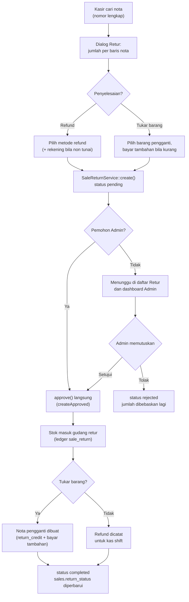
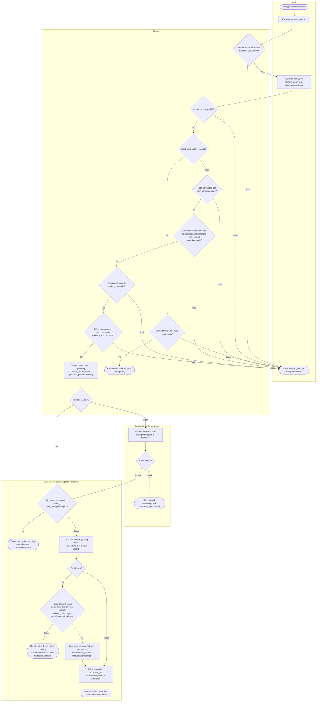
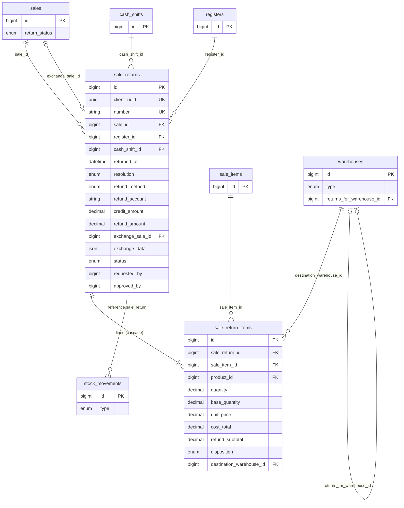
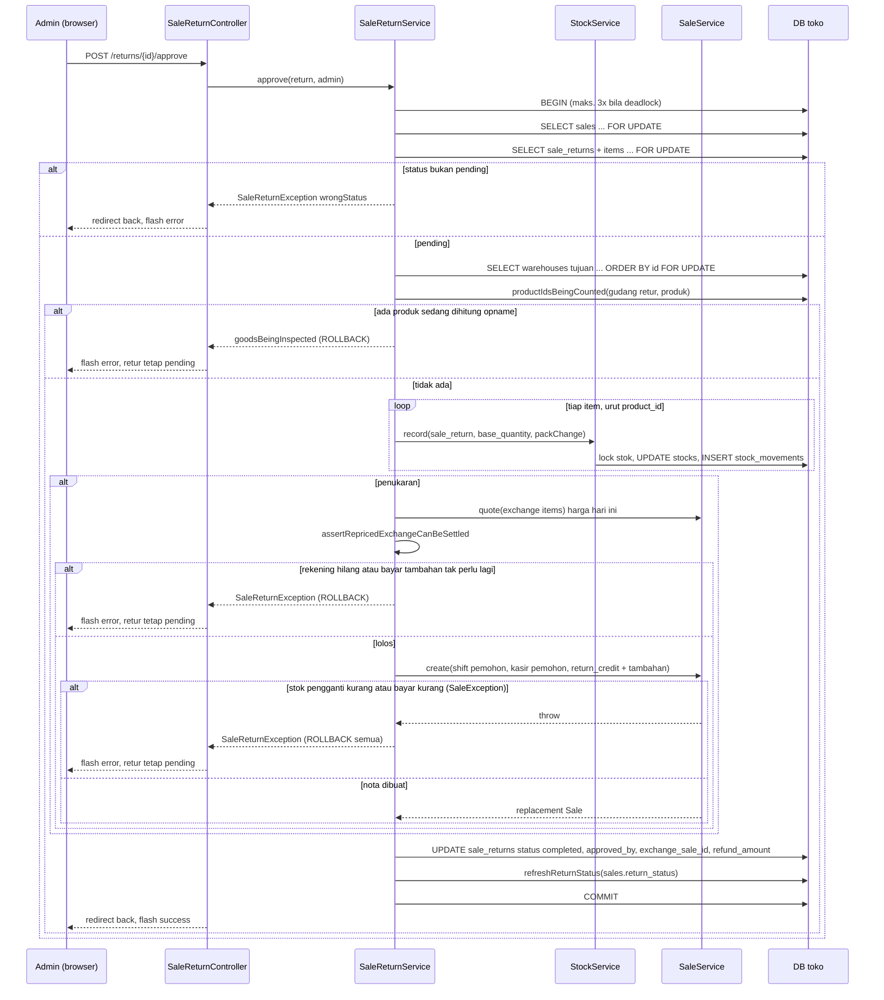

# Retur dan Penukaran — Dokumentasi Teknis

> **Modul:** Retur nota (refund) dan penukaran barang, termasuk persetujuan Admin, gudang retur, dan dampaknya ke kas shift
> **Stack:** Laravel 13 (PHP 8.3), Inertia 3, Vue 3, Quasar 2, stancl/tenancy
> **Audiens:** Engineer yang memelihara atau memperluas fitur ini
> **Database:** per toko (semua tabel modul ini ada di DB toko, bukan DB pusat)
> **Terakhir diperbarui:** 2026-11-17

## 1. Ringkasan

Pelanggan membawa nota lama dan mengembalikan sebagian atau seluruh barangnya. Kasir mencari nota lewat **nomor nota lengkap** di layar kasir, mengisi jumlah per baris nota, lalu memilih penyelesaian: **refund** (uang kembali lewat tunai, transfer, QRIS, atau EDC) atau **tukar barang** (pelanggan membawa barang lain, dijual di nota baru yang dibayar dengan nilai barang yang diretur). Retur kasir tidak langsung berlaku: statusnya `pending` sampai Admin Toko atau Super Admin menyetujui atau menolak, tanpa batas hari. Retur yang dibuat Admin (dari halaman Retur atau dari layar kasir) langsung disetujui dalam satu transaksi.

Yang berubah saat retur **disetujui**, bukan saat diajukan: barang masuk ke **gudang retur** milik gudang jual nota itu (bukan ke rak jual dan bukan ke dead stock; keputusan nasib barang diambil kemudian lewat Pemeriksaan Retur di modul opname), refund tunai mengurangi tunai seharusnya di laci shift pembuat retur, dan pada penukaran dibuat nota pengganti dengan pembayaran `return_credit`. Selama `pending`, jumlah barang sudah dikunci (tidak bisa diretur dua kali), tetapi stok dan kas belum bergerak, dan shift pembuatnya tidak bisa ditutup.

Alur tingkat tinggi:



BPMN pengajuan dan keputusan (percabangan sukses, gagal, dan tolak):



## 2. Skema Database

Semua tabel di bawah ada di **DB toko** (migrasi `database/migrations/tenant`). Tidak ada tabel retur di DB pusat. `requested_by` dan `approved_by` menyimpan id user **pusat** tanpa foreign key (DB berbeda), sama seperti `created_by` di modul lain.

### `sale_returns`

Satu baris per pengajuan retur untuk satu nota. Dibuat oleh `2026_10_27_152509_create_sale_returns_tables`, lalu ditambah empat migrasi.

| Kolom | Tipe | Null | Catatan |
|---|---|---|---|
| `id` | bigint PK | | |
| `client_uuid` | uuid | ya | **unique**. Penanda anti-kirim-ganda (migrasi `2026_11_02_100000`). Nullable hanya karena retur yang dibuat sebelum kolom ini ada tidak punya penanda; service selalu mengisinya |
| `number` | string | tidak | **unique**. Format `RET/{receipt_prefix}/{yymm}/{0001}` dari `DocumentNumberGenerator` |
| `sale_id` | FK `sales` | tidak | restrict (default `constrained()`): nota tidak bisa dihapus selama ada retur |
| `register_id` | FK `registers` | tidak | Register (mesin kasir) dari shift pembuat retur; diambil dari shift, bukan dari nota |
| `cash_shift_id` | FK `cash_shifts` | tidak | Shift **pembuat** retur. Laci shift inilah yang dikurangi refund tunai, dan shift inilah yang diblokir tutupnya selama retur `pending`. Juga menentukan tanggal bisnis retur untuk tutup hari dan laporan |
| `returned_at` | datetime | tidak | Waktu pengajuan (`now()`), diindeks. Dipakai filter tanggal di daftar Admin |
| `resolution` | enum `refund`, `exchange` | tidak | |
| `refund_method` | enum `cash`, `transfer`, `qris`, `edc` | ya | Alasan nullable tidak terbaca dari kode: `SaleReturnService::create()` dan `SaveSaleReturnRequest` selalu mewajibkan nilainya, bahkan untuk penukaran. Lihat butir debt di bagian 13 |
| `refund_account` | string | ya | Rekening penerima (teks bebas: bank, nomor, atas nama) untuk uang non-tunai. Null untuk tunai atau bila tidak ada uang yang dikembalikan (migrasi `2026_10_31_140000`) |
| `credit_amount` | decimal(15,2) | tidak | Nilai barang yang diretur (jumlah `refund_subtotal`). Pada penukaran inilah "kredit" yang memotong nota pengganti |
| `refund_amount` | decimal(15,2) | tidak | default 0. Uang yang benar-benar dikembalikan ke pelanggan. Pada refund = `credit_amount`; pada penukaran = sisa kredit setelah dipakai nota pengganti. **Dihitung ulang dan ditimpa saat disetujui** bila harga pengganti berubah |
| `exchange_sale_id` | FK `sales` | ya | restrict. Nota pengganti; null sampai retur penukaran disetujui |
| `exchange_data` | json | ya | Hanya untuk penukaran, selama menunggu persetujuan (migrasi `2026_10_31_130000`). Bentuk: `{items: [{product_unit_id, name, unit, quantity, unit_price, subtotal}], replacement_total, payments: [{method, amount, reference}]}`. Nota pengganti belum ada, jadi pilihan pelanggan dan pembayaran tambahannya disimpan di sini |
| `status` | enum `pending`, `completed`, `rejected` | tidak | default `pending`, diindeks |
| `reason` | string | ya | Alasan retur dari kasir, opsional, maksimal 255 |
| `requested_by` | unsignedBigInteger | tidak | User pusat pengaju, tanpa FK |
| `approved_by` | unsignedBigInteger | ya | User pusat yang memutuskan. **Dipakai juga untuk penolak**: tidak ada kolom terpisah untuk "ditolak oleh" maupun waktu keputusan |
| `created_at`, `updated_at` | timestamp | ya | |

### `sale_return_items`

Satu baris per baris nota yang diretur (maksimal satu per `sale_item_id`, ditegakkan oleh validasi `distinct`, bukan oleh unique index).

| Kolom | Tipe | Null | Catatan |
|---|---|---|---|
| `id` | bigint PK | | |
| `sale_return_id` | FK `sale_returns` | tidak | **cascade on delete** (satu-satunya FK modul ini yang cascade) |
| `sale_item_id` | FK `sale_items` | tidak | restrict. Dasar penghitungan sisa yang bisa diretur |
| `product_id` | FK `products` | tidak | Disalin dari baris nota; kunci ledger stok |
| `product_unit_id` | FK `product_units` | tidak | |
| `quantity` | decimal(15,3) | tidak | Dalam satuan nota |
| `base_quantity` | decimal(15,3) | tidak | `quantity x conversion_snapshot` nota (pembulatan HalfUp 3 desimal). Inilah yang masuk ledger stok |
| `unit_price` | decimal(15,2) | tidak | Snapshot harga **nota asli**, bukan harga hari ini |
| `cost_total` | decimal(15,2) | tidak | default 0. Bagian modal baris nota yang ikut kembali: `sale_items.cost_total x qty diretur / qty nota`. Dibaca laporan laba (`SalesReportService`) |
| `refund_subtotal` | decimal(15,2) | tidak | `quantity x unit_price` (HalfUp 2 desimal). Pengecualian: baris nota yang subtotalnya dibulatkan ke atas (jumlah desimal di bawah `selling_price_step`, lihat `penjualan-kasir-docs.md` 7.7) dikembalikan menurut bagian dari yang dibayar pelanggan: `subtotal nota x qty diretur / qty nota` (HalfUp 2 desimal), dan retur yang mengembalikan seluruh sisa baris memberi `subtotal nota - yang sudah dikembalikan`, sehingga seluruh retur satu baris tepat sama dengan yang dibayar (`SaleReturnService::refundOf`). Layar retur menghitungnya sama di `useLineAmounts.js::refundOfLine` dari `subtotal` dan `refunded` yang dikirim `returnableLines` |
| `disposition` | enum `resellable`, `dead_stock` | ya | **Legacy.** Dulu kasir memilih nasib barang; sejak migrasi `2026_11_08_100000` kolom dibuat nullable dan retur baru selalu null (barang menunggu di gudang retur). Baris lama tetap menyimpan pilihannya |
| `destination_warehouse_id` | FK `warehouses` | tidak | Sekarang selalu gudang retur milik `sales.warehouse_id` (lihat `Warehouse::returnsFor()`) |
| `condition_note` | string | ya | **Tidak pernah ditulis maupun dibaca** (Grep `app/`, `resources/js`, `database/`: hanya muncul di migrasi dan `$fillable`) |
| `created_at`, `updated_at` | timestamp | ya | |

### Perubahan pada tabel tetangga yang dipakai modul ini

| Tabel (modul lain) | Kolom / nilai | Dipakai untuk |
|---|---|---|
| `warehouses` | `type` enum menambah `returns`; `returns_for_warehouse_id` FK ke `warehouses` (self, nullable) | Gudang retur per gudang jual. Migrasi `2026_11_08_100000` membuatnya untuk setiap gudang jual yang sudah ada (kode `RETUR` bila hanya satu gudang jual, `RETUR-{kode}` bila banyak). `down()` menolak berjalan bila stok, mutasi, opname, atau item retur masih menunjuk gudang retur |
| `sales` | `return_status` enum `none`, `partial`, `full` (default `none`) | Diperbarui `refreshReturnStatus()` dari retur **completed** saja |
| `sale_payments` | `method` termasuk `return_credit` | Pembayaran internal nota pengganti; tidak pernah dipilih kasir |
| `stock_movements` | `type = sale_return`, `reference_type = sale_return`, `reference_id` = id retur | Ledger stok; user = yang menyetujui |
| `delivery_note_items` | `quantity_returned` | Hanya penanda di modul surat jalan; **tidak** membuat retur dan tidak dibaca modul ini (Grep `SaleReturnService`: tidak ada rujukan). Barang yang kembali dari pengantaran diselesaikan lewat tombol *Buat Retur* per nota (`DeliveryNoteResource.php:88`, `Sales/Show.vue:50`). Detail di dokumentasi surat jalan |
| `document_sequences` | baris `type = RET` per bulan | Penomoran, dikunci `lockForUpdate` di dalam transaksi pembuat |



Semua tabel di diagram ada di DB toko. `sales`, `cash_shifts`, `registers`, `sale_items`, `warehouses`, `stock_movements` milik modul penjualan, shift, dan stok; di sini hanya ditampilkan sebagai kotak.

## 3. Model / Entity

| Model | Tabel | Relasi, cast, trait penting |
|---|---|---|
| `App\Models\SaleReturn` | `sale_returns` | `implements Auditable` (laravel-auditing, ke DB toko). `sale()`, `exchangeSale()`, `items()`, `cashShift()`. Cast: `status` ke `SaleReturnStatus`, `resolution` ke `ReturnResolution`, `refund_method` ke `PaymentMethod`, `exchange_data` ke `array`, `credit_amount`/`refund_amount` ke `decimal:2`. `isExchange()`. `#[Fillable]` termasuk semua kolom, sehingga `status` dan `approved_by` ditulis lewat `forceFill` di service |
| `App\Models\SaleReturnItem` | `sale_return_items` | **Tidak** Auditable. `saleReturn()`, `saleItem()`. Cast: `disposition` ke `ReturnDisposition` (nullable), kolom uang `decimal:2`, jumlah `decimal:3` |
| `App\Enums\SaleReturnStatus` | | `Pending`, `Completed`, `Rejected` + `label()` Indonesia |
| `App\Enums\ReturnResolution` | | `Exchange`, `Refund` + `options()`. Urutan `cases()`: Exchange dulu, sehingga tombol toggle di UI menampilkan Tukar sebagai pilihan pertama (dan nilai awal dialog kasir adalah `exchange`) |
| `App\Enums\ReturnDisposition` | | `Resellable`, `DeadStock`. Hanya dipakai untuk **membaca** baris legacy (`SaleReturnResource`). `options()` dan `warehouseType()` tidak dipanggil di mana pun (Grep seluruh `app/`) |
| `App\Enums\SaleReturnProgress` | | `None`, `Partial`, `Full`; cast `sales.return_status` di `Sale` |
| `App\Enums\ApprovalKind` | | `SaleReturn = 'return'`, `CashDifference`. Kunci kartu persetujuan di dashboard Admin (`StoreDashboardService::pendingReturnApprovals()`) |
| `App\Enums\WarehouseType` | | Memuat `Returns`. `Warehouse::returnsFor($sellableWarehouseId)` mencari gudang retur **aktif** yang `returns_for_warehouse_id`-nya gudang jual itu |
| `App\Exceptions\SaleReturnException` | | Semua penolakan bisnis; pesan Indonesia aman ditampilkan. `fromSale()` membungkus `SaleException` dari nota pengganti |

## 4. Hak Akses

Semua rute berada di grup `t/{tenant}` dengan middleware `web`, `InitializeTenancyByPath`, `auth`, `store.access`, `shift.remember`. Role toko: Super Admin, Admin Toko (`admin`), Kasir (`cashier`).

| Area | Middleware tambahan | Siapa | Catatan |
|---|---|---|---|
| Halaman Admin `tenant.returns.*` | `store.admin` (`EnsureUserIsStoreAdmin`: role Super Admin atau Admin Toko, selain itu 403) | Admin | Daftar, buat, setujui, tolak, detail, cetak |
| Layar kasir `tenant.cashier.returns.*`, `tenant.cashier.receipts.return`, `...returns.store` | tidak ada `store.admin` | Kasir dan Admin | `lookup` dibatasi `throttle:30,1`; `receipts/{sale}/return` dan `receipts/{sale}/returns` dibatasi middleware `signed` |
| Cetak bukti dari kasir `tenant.cashier.returns.sheet` | tidak ada | Admin, atau kasir yang `requested_by`-nya dirinya | Dicek di controller: `abort_unless($this->isAdmin($request) \|\| $saleReturn->requested_by === $request->user()->id, 403)` |

Aturan "siapa yang disetujui otomatis" ada di controller kasir (`isAdmin($request)` lewat `User::isAdminIn($store)`), bukan di service: `createApproved()` dipilih bila pemohon Admin, `create()` bila bukan. Menyetujui retur kasir **hanya** bisa lewat halaman Admin.

Tautan *signed* dibuat server (`SaleReturnService::signedLinksFor()`, berlaku 12 jam) dan hanya diberikan lewat dua jalan: pencarian nomor nota persis (`lookup`) dan daftar nota shift sendiri (`ShiftReceiptController::withLinks()`). Tujuannya agar kasir tidak bisa menelusuri nota lama dengan menebak id. Tautan ini tidak terikat ke user atau sesi; siapa pun yang sudah login ke toko dan memegang tautannya valid selama 12 jam.

## 5. Konfigurasi dan Konstanta

Modul ini **tidak memiliki kunci di `config/` maupun env** (Grep `config/` untuk `retur|return_|expense` hanya menemukan kata kunci PHP `return`). Perilakunya ditentukan oleh konstanta di kode dan oleh pengaturan toko yang dibaca modul lain:

| Konstanta / pengaturan | Nilai | Dibaca oleh |
|---|---|---|
| `SaleReturnService::NUMBER_TYPE` | `RET` | `create()` lewat `DocumentNumberGenerator::next()` |
| `SaleReturnService::GOODS_HOLDING_STATUSES` | `pending`, `completed` | Menentukan retur mana yang "memegang" barang (menghitung sisa, mencari nota yang masih bisa diretur) |
| `SaleReturnService::RETURN_LINK_HOURS` | 12 | `signedLinksFor()` |
| `SaleReturnController::LIST_PER_PAGE` / `SALE_LOOKUP_LIMIT` | 25 / 10 | Daftar retur / pencarian nota di form Admin |
| `StockService::DEADLOCK_ATTEMPTS` | 3 | Percobaan ulang transaksi `approve()` dan `createApproved()` |
| `throttle:30,1` pada `returns.lookup` | 30 per menit | Pencarian nomor nota dari kasir |
| `BADGE_REFRESH_MS` (`Cashier/Index.vue:643`) | 60000 | Polling `pending_return_count` di bar kasir |
| `StoreSettingService::letterhead()` / `paperWidth()` | pengaturan toko; lebar kertas 58, 76, atau 80 mm | `PrintableSaleReturnResource` (bukti retur) |

Tidak ada pengaturan "batas hari retur": sengaja dihapus (D18 di `docs/analisis-sistem.md`), dan memang tidak ada pengecekan tanggal di `SaleReturnService`.

## 6. Rute / API

Halaman Admin (Inertia, respons berupa redirect dengan flash `success` atau `error`, bukan JSON):

| Method | Path | Action | Nama rute | Middleware |
|---|---|---|---|---|
| GET | `/t/{tenant}/returns` | `SaleReturnController@index` | `tenant.returns.index` | `store.admin` |
| GET | `/t/{tenant}/returns/create` | `@create` | `tenant.returns.create` | `store.admin` |
| GET | `/t/{tenant}/returns/sales` | `@sales` (JSON `{data: [...]}`) | `tenant.returns.sales` | `store.admin` |
| POST | `/t/{tenant}/returns` | `@store` | `tenant.returns.store` | `store.admin` |
| GET | `/t/{tenant}/returns/{sale_return}` | `@show` | `tenant.returns.show` | `store.admin` |
| POST | `/t/{tenant}/returns/{sale_return}/approve` | `@approve` | `tenant.returns.approve` | `store.admin` |
| POST | `/t/{tenant}/returns/{sale_return}/reject` | `@reject` | `tenant.returns.reject` | `store.admin` |
| GET | `/t/{tenant}/returns/{sale_return}/sheet` | `@sheet` (halaman cetak) | `tenant.returns.sheet` | `store.admin` |

Layar kasir (JSON, kecuali `sheet`):

| Method | Path | Action | Nama rute | Middleware |
|---|---|---|---|---|
| GET | `/t/{tenant}/cashier/returns/lookup?number=` | `CashierSaleReturnController@lookup` | `tenant.cashier.returns.lookup` | `throttle:30,1` |
| GET | `/t/{tenant}/cashier/receipts/{sale}/return` | `@show` | `tenant.cashier.receipts.return` | `signed` |
| POST | `/t/{tenant}/cashier/receipts/{sale}/returns` | `@store` | `tenant.cashier.receipts.returns.store` | `signed` |
| GET | `/t/{tenant}/cashier/returns/{sale_return}/sheet` | `@sheet` | `tenant.cashier.returns.sheet` | (cek di controller) |

Kode galat JSON memakai trait `AnswersJsonErrors` dengan bentuk `{code, message, more_info}`; kode dari `ApiErrorCode`:

| Kode | HTTP | Pemakaian di modul ini |
|---|---|---|
| `4041` `ReceiptNotFound` | 404 | `lookup`: nomor tidak ditemukan persis |
| `4091` `ShiftNotOpen` | 409 | `store`: pemohon tidak punya shift sama sekali (`openShiftOf() === null`) |
| `4221` `ReturnRefused` | 422 | Semua `SaleReturnException` (nota bukan completed, jumlah melebihi sisa, rekening kosong, dst.) |

Galat validasi `FormRequest` (mis. `client_uuid` kosong) memakai bentuk bawaan Laravel `{message, errors: {field: [...]}}` dengan status 422; `postJson.js` mengambil pesan pertama dari `errors`.

Contoh berikut **ilustratif, bukan hasil tangkapan**; bentuknya mengikuti `returnSummary()` dan `SaleReturnResource`.

`GET /t/mitra_utama/cashier/returns/lookup?number=INV/MU/K1/2610/0001` sukses (200):

```json
{
  "data": {
    "number": "INV/MU/K1/2610/0001",
    "return_url": "https://.../t/mitra_utama/cashier/receipts/12/return?expires=...&signature=...",
    "return_store_url": "https://.../t/mitra_utama/cashier/receipts/12/returns?expires=...&signature=..."
  }
}
```

Nomor tidak ada (404):

```json
{
  "code": 4041,
  "message": "Nota tidak ditemukan. Ketik nomor nota selengkapnya.",
  "more_info": "Nota hanya ditemukan lewat nomor yang lengkap dan persis."
}
```

`POST .../receipts/12/returns`, permintaan penukaran (JSON):

```json
{
  "client_uuid": "0b0f6a52-6b1e-4d58-9b57-6e0c1f2a9d11",
  "resolution": "exchange",
  "refund_method": "cash",
  "refund_account": "",
  "reason": "Ukuran tidak cocok",
  "items": [{ "sale_item_id": 31, "quantity": 2 }],
  "exchange_items": [{ "product_unit_id": 8, "quantity": 1 }],
  "exchange_payments": [{ "method": "cash", "amount": 15000 }]
}
```

Sukses untuk kasir biasa (201): `status` `pending`, `refund_amount` masih hasil hitung saat diajukan, `exchange.sale_number` `null` (nota pengganti belum ada). Untuk Admin yang memakai layar kasir, `status` langsung `completed` dan `exchange.sale_number` terisi:

```json
{
  "data": {
    "id": 5,
    "number": "RET/MU/2611/0003",
    "status": "pending",
    "status_label": "Menunggu persetujuan",
    "resolution": "exchange",
    "credit_amount": "40000.00",
    "refund_amount": "0.00",
    "exchange": { "items": [ ... ], "total": "55000.00", "payments": [{ "method": "Tunai", "amount": "15000.00" }], "sale_number": null, "print_url": null },
    "items": [{ "id": 9, "name": "Kabel ...", "disposition": null, "disposition_label": "Belum masuk gudang, menunggu persetujuan", "disposition_tone": "warn" }],
    "is_pending": true,
    "sheet_url": "https://.../t/mitra_utama/cashier/returns/5/sheet"
  }
}
```

Catatan: `returnSummary()` membuang `refund_account` dari respons kasir (rekening pelanggan hanya muncul di bukti retur milik kasir pengaju dan untuk Admin).

Ditolak karena melebihi sisa (422):

```json
{
  "code": 4221,
  "message": "Kabel ... melebihi yang masih bisa diretur, sisa 1 m.",
  "more_info": "Perbaiki isian retur sesuai pesan ini, lalu coba lagi."
}
```

Tidak punya shift (409): `{"code": 4091, "message": "Buka shift dulu untuk membuat retur. Bila shift Anda sudah dihitung, tunggu keputusan Admin.", "more_info": "Retur dicatat di shift yang sedang terbuka. Buka shift di kasir."}`.

## 7. Komponen Backend

### `SaleReturnService` (`app/Services/SaleReturnService.php`)

Seluruh logika retur. Dependensi: `StockService`, `DocumentNumberGenerator`, `SaleService` (untuk `quote()`, `settle()`, `create()` nota pengganti), `StockOpnameService` (hanya `productIdsBeingCounted()`).

**Prinsip desain yang menjelaskan banyak cabang.** Dua hal ditunda sampai persetujuan (stok dan nota pengganti) tetapi satu hal dilakukan segera (penguncian jumlah). Alasannya: Admin harus bisa memastikan barang memang kembali sebelum uang atau stok bergerak, tetapi dua kasir tidak boleh mengajukan retur untuk barang yang sama dalam jeda itu. Karena itu "barang yang dipegang retur" = status `pending` ditambah `completed` (`GOODS_HOLDING_STATUSES`); menolak retur membebaskannya lagi. `sales.return_status` sebaliknya hanya menghitung retur `completed`, karena itu menyatakan barang yang benar-benar sudah kembali.

**Baca:**

- `paginateReturns()` memfilter status (nilai tak dikenal diabaikan lewat `tryFrom`), tanggal `returned_at` (inklusif untuk `to`), dan pencarian di nomor retur, nomor nota, atau nama pelanggan.
- `returnableSales()` mencari nota `completed` yang masih punya sisa. Uji "masih punya sisa" dilakukan **di dalam query** (subquery `exists` mentah ke `sale_items` dan `sale_return_items`), supaya nota yang sudah habis tidak menggeser nota yang masih bisa diretur keluar dari `limit`.
- `returnableLines()` menghasilkan per baris: `quantity`, `returned` (pending + selesai), `remaining`, `unit_price`.
- `defaultRefundMethod()`: metode bayar nominal terbesar di nota, **mengabaikan** `return_credit`; jatuh ke tunai bila kosong. Metode `cod` dan `order_deposit` bisa saja terpilih sebagai "terbesar", tetapi controller memakai `->value` itu langsung sebagai opsi awal; `refund_method` yang dikirim tetap divalidasi hanya terhadap `forCashier()` sehingga `cod` yang terpilih akan ditolak validasi bila dikirim apa adanya (lihat bagian 13).

**`create(Sale, CashShift, User $requester, array $input)`** dalam satu `DB::transaction`:

1. Mengunci baris nota (`lockForUpdate`, dengan `items`) lalu baris shift. Urutan kunci nota-lalu-retur sama dengan `approve()`, sehingga persetujuan dan pengajuan untuk nota yang sama saling antre.
2. Idempotensi: mencari `client_uuid`. Bila ada, `returnOfResubmit()` mengembalikan retur pertama, **kecuali** `requested_by` atau `sale_id`-nya berbeda: itu dianggap bukan retry dan dijawab `returnIdInUse()`, supaya uuid tidak bisa dipakai membaca retur orang lain. Pengecekan dilakukan setelah kunci nota, jadi dua kiriman serentak tidak lolos bersamaan.
3. Guard status: nota harus `Completed`, shift harus `Open` (bukan `PendingReview`; itu sebabnya pesannya memuat `ShiftException::AWAITING_REVIEW_HINT`).
4. `priceRows()`: membuang baris berjumlah 0 (kosong semua → `noItems()`), memastikan `sale_item_id` milik nota ini (`lineNotOnSale()`), membatasi jumlah ke `remaining` (`exceedsReturnable()`), mencari gudang retur milik `sales.warehouse_id` (`noReturnsWarehouse()` bila belum ada). Semua hitung uang memakai `BigDecimal`.
5. Bila `resolution = exchange`, `priceExchange()`: `SaleService::quote()` menghitung nilai pengganti dengan harga hari ini, lalu `SaleService::settle()` memastikan kredit + pembayaran tambahan menutup total (kredit dipakai dulu, pembayaran pelanggan hanya masuk bila pengganti lebih mahal dari kredit; kelebihan tunai menghasilkan kembalian). `SaleException` dibungkus `SaleReturnException::fromSale()`. Hasilnya `refund = kredit - kredit terpakai`.
6. `refundAccountOf()`: tunai tidak menyimpan rekening (nilai terkirim dibuang); non-tunai tanpa rekening ditolak **hanya bila ada uang yang harus dikembalikan** (`isRefundAccountNeeded`). Rekening yang diketik untuk non-tunai disimpan walau refund saat ini nol: pada penukaran, harga bisa turun sebelum disetujui sehingga ada uang yang harus dikembalikan.
7. Menulis `sale_returns` (`status = pending`, nomor `RET/...`) dan `sale_return_items`. **Tidak ada pergerakan stok, kas, atau nota.**

**`createApproved()`** membungkus `create()` + `approve()` dalam satu transaksi dengan percobaan ulang `DEADLOCK_ATTEMPTS`. Bila uuid sudah tercatat dan retur yang kembali sudah bukan `pending`, `approve()` dilewati (kirim ulang tidak menyetujui dua kali). Konsekuensi samping: bila Admin mengirim ulang uuid milik retur `pending` miliknya sendiri, `createApproved()` akan menyetujuinya; dengan alur UI hal itu tidak terjadi (retur Admin selalu atomik).

**`approve(SaleReturn, User $approver)`** adalah operasi paling rumit:



Rincian penting:

- `requireNoInspectionOfReturnedGoods()` ada karena Pemeriksaan Retur (opname gudang retur) menghitung stok. Barang yang masuk setelah hitungan akan terbaca sebagai selisih kurang lalu ikut dilepas tanpa dipilah. Gudang retur dikunci dulu berurutan id (urutan yang sama dengan opname) agar pemeriksaan tidak bisa mulai di antara pengecekan dan pemindahan stok. Pemeriksaan berstatus Draft tidak menahan; hanya yang sedang menghitung atau review (`StockOpnameStatus::countingValues()`).
- `packChange: $item->saleItem->wholePacksIn($item->quantity)` mengembalikan gulungan/kemasan utuh ke hitungan `intact_packs` bila baris nota dijual dalam satuan kemasan utuh yang masih berlaku; selain itu 0.
- Item diurutkan `product_id` sebelum `record()` supaya urutan kunci baris stok sama dengan penjualan dan tidak deadlock; kalah deadlock dicoba ulang sampai 3 kali.
- `sellReplacement()` membaca ulang harga lewat `quote()`. Dua keadaan yang tadinya sah dan kini salah menghentikan persetujuan (`assertRepricedExchangeCanBeSettled`): uang harus dikembalikan ke metode non-tunai yang tidak punya rekening, atau pembayaran tambahan pelanggan tidak diperlukan lagi (harga turun sampai di bawah kredit) sehingga akan "hilang". Admin tidak punya kolom untuk memperbaikinya, jadi pesannya menyuruh menolak dan meminta kasir mengajukan ulang. Bila harga naik sampai pembayaran tidak menutup, `SaleService::create()` yang menolak.
- Nota pengganti dibuat atas nama **kasir pemohon** dan di **shift pemohon** (`requested_by`, `cash_shift_id`), dengan `client_uuid` baru (`Str::uuid()`), nama pelanggan disalin dari nota asal. Karena shift pemohon masih `open` selama retur `pending` (penutupan shift diblokir), pembuatan nota tidak gagal karena shift tertutup.
- `refund_amount` dan `exchange_sale_id` di-`forceFill` di `sellReplacement()` lalu disimpan bersama `status = completed` dan `approved_by` pada satu `save()` di akhir.

**`reject()`** satu tulisan; mengunci retur dengan `lockedPending()` (status harus `pending`, selain itu `wrongStatus('ditolak', ...)`), mengisi `status = rejected` dan `approved_by`. Tidak ada alasan penolakan, tidak ada pergerakan apa pun. Jumlah barang terbebas otomatis karena `rejected` bukan status "memegang".

**Efek ke kas.** Tidak ada kolom "kas keluar" untuk retur: refund tunai dihitung dari `sale_returns` itu sendiri.

- `ShiftService::summarize()`: `cash_refunds = SUM(refund_amount)` retur `completed` dengan `refund_method = cash` di `cash_shift_id` shift itu; `expected_cash` dikurangi angka itu. `returns_total = SUM(credit_amount)` (nilai barang, bukan uang keluar).
- `DailyClosingService::returnFigures()`: `total_returns` dan `refunds_cash` dari retur `completed` pada shift-shift tanggal bisnis itu (retur mengikuti tanggal bisnis shift pembuat, **bukan** tanggal `returned_at` atau tanggal persetujuan).
- Uang tambahan dari pelanggan pada penukaran dan kembalian refund masuk lewat nota pengganti dan `sale_payments` shift pemohon seperti penjualan biasa; pembayaran `return_credit` sengaja tidak masuk rincian metode (`PaymentMethod::forCashier()` hanya empat metode uang).
- Retur `pending` memblokir `ShiftService::close()` (`ShiftException::hasPendingReturns`) dan checklist tutup hari (`DailyClosingService::checklist()`, `can_close` salah bila `pending_return_count > 0`). Inilah penjaga yang membuat shift pembuat retur dijamin masih `open` saat disetujui.
- Tanggal retur tidak dicek terhadap `DailyClosing`: pengajuan butuh shift `open`, dan hari tidak bisa ditutup selama ada shift terbuka.

**Lencana dan antrean persetujuan.** Tiga tempat menghitung `status = pending`, semuanya `count()` langsung tanpa cache: sidebar Admin (`HandleInertiaRequests::menuBadges()`, prop lazy `menu_badges.returns`), bar kasir (`CashierController::index()` prop `pending_return_count`, hanya retur shift berjalan), dan dashboard (`StoreDashboardService`: hitungan `pending.returns` dan lima kartu `ApprovalKind::SaleReturn`).

### `SaleReturnController` (Admin) dan `CashierSaleReturnController` (kasir)

Tipis. Admin: `store()` memakai shift berjalan Admin sendiri (`ShiftService::openShiftOf()`), selalu `createApproved()`; galat `SaleReturnException` kembali ke form dengan input dipertahankan (`back()->withInput()`). `approve()`/`reject()` memakai `redirectWithOutcome()`: galat dikembalikan sebagai flash `error`, bukan 4xx.

Kasir: `lookup()` hanya menemukan nomor persis dan nota `completed`; `show()` memuat konteks dialog (baris, sisa, metode refund, resolusi, retur yang sudah diajukan untuk nota itu); `store()` memilih `createApproved()` atau `create()` menurut role. `store()` mengecek shift `null` lebih dulu (409, kode 4091); shift yang berstatus `pending_review` lolos pengecekan ini dan ditolak service sebagai `shiftNotOpen()` (422, kode 4221) dengan petunjuk menunggu keputusan Admin.

### Request, Resource

- `SaveSaleReturnRequest` / `SaveCashierSaleReturnRequest`: lihat bagian 8. Varian kasir mengisi `sale_id` dari parameter rute `{sale}` di `prepareForValidation()`, sehingga badan permintaan tidak bisa menunjuk nota lain dari tautan yang ditandatangani.
- `SaleReturnResource`: satu bentuk penuh untuk halaman detail, dialog kasir, dan bukti cetak. `dispositionLabel()` menerjemahkan keadaan barang untuk retur baru (disposition null) dari **status retur**: `pending` "Belum masuk gudang, menunggu persetujuan", `rejected` "Ditolak, barang tidak masuk gudang", `completed` "Masuk gudang retur". Komentar kodenya menyebut alasannya: unit yang sudah diperiksa tidak dilacak ke retur asal, jadi retur completed tidak pernah dinyatakan "masih menunggu".
- `SaleReturnListResource` untuk baris daftar; `PrintableSaleReturnResource` = `SaleReturnResource` + letterhead dan lebar kertas.

## 8. Aturan Validasi

`SaveSaleReturnRequest` (Admin). Varian kasir memakai aturan yang sama; hanya `sale_id` diisi dari rute.

| Field | Aturan | Masuk ke | Pesan galat |
|---|---|---|---|
| `client_uuid` | `required`, `uuid` | `sale_returns.client_uuid` | "Pengajuan retur tidak punya penanda. Muat ulang layar lalu coba lagi." / "Penanda pengajuan retur tidak valid. ..." |
| `sale_id` | `required`, `integer`, `exists:sales,id` | `sale_returns.sale_id` | "Pilih nota." / "Nota tidak ditemukan." |
| `resolution` | `nullable`, enum `ReturnResolution` | `sale_returns.resolution` (bawaan **refund** di service bila kosong) | pesan enum Laravel |
| `refund_method` | `required`, `in:cash,transfer,qris,edc` | `sale_returns.refund_method` | "Pilih cara pengembalian uang." / "Cara pengembalian uang tidak dikenal." |
| `refund_account` | `nullable`, `string`, `max:255` | `sale_returns.refund_account` (aturan bisnis di service) | "Isi rekening penerima untuk pengembalian uang non tunai." (service) |
| `reason` | `nullable`, `string`, `max:255` | `sale_returns.reason` | |
| `items` | `required`, `array`, `min:1` | | "Pilih minimal satu barang yang diretur." |
| `items.*.sale_item_id` | `required`, `integer`, `distinct`, `exists:sale_items,id` | `sale_return_items.sale_item_id` | "Ada barang yang tidak ada di nota ini." (service, bila baris milik nota lain) |
| `items.*.quantity` | `required`, `numeric`, `min:0`, `max:999999`, `decimal:0,3` | `quantity`; 0 berarti baris dibuang | "Jumlah tidak boleh negatif." / "Jumlah maksimal 3 angka desimal." / "... melebihi yang masih bisa diretur, sisa X." (service) |
| `exchange_items` | `required` bila `resolution = exchange`, `array` | `exchange_data.items` | "Pilih barang pengganti." |
| `exchange_items.*.product_unit_id` | `required`, `integer`, `exists:product_units,id` | | |
| `exchange_items.*.quantity` | `required`, `numeric`, `gt:0`, `max:999999`, `decimal:0,3` | | "Jumlah barang pengganti harus lebih dari nol." |
| `exchange_payments` | `nullable`, `array` | `exchange_data.payments` (baris bernilai 0 dibuang di `extraPaymentsOf()`) | |
| `exchange_payments.*.method` | `required`, `in:cash,transfer,qris,edc` | | |
| `exchange_payments.*.amount` | `required`, `numeric`, `min:0`, `max:999999999`, `decimal:0,2` | | "Jumlah pembayaran tidak boleh negatif." |
| `exchange_payments.*.reference` | `nullable`, `string`, `max:255` | | |

Perilaku gagal: **semua atau tidak sama sekali.** Validasi `FormRequest` berjalan sebelum service; semua pemeriksaan bisnis ada di dalam satu `DB::transaction` sehingga galat apa pun (jumlah, rekening, pembayaran kurang) membatalkan seluruhnya, termasuk nomor `RET` yang tidak terpakai (nomor dibuat di dalam transaksi yang sama). `return_credit` sengaja tidak diterima sebagai metode refund atau pembayaran tambahan. Pesan galat ditulis langsung sebagai string Indonesia di request dan exception.

## 9. Guard Kepemilikan & Status

| Endpoint / operasi | Yang dicek ulang di server | Yang diblokir |
|---|---|---|
| `lookup` | Nota dicari dengan `number` persis; `status === completed` | Nomor sebagian (404 4041); nota void (422 4221) |
| `receipts/{sale}/return` (show) | Tanda tangan URL; nota `completed` | Penebakan id nota; nota void |
| `receipts/{sale}/returns` (store) | Tanda tangan; shift milik user (`openShiftOf`); lalu di service: nota dikunci dan `completed`, shift dikunci dan `open`, `client_uuid` (milik pemohon dan nota yang sama), `sale_item_id` milik nota, jumlah tidak melebihi sisa (dihitung ulang di dalam transaksi dari retur `pending` + `completed`), gudang retur ada, rekening, pembayaran penukaran | Retur untuk nota void, shift belum buka atau sedang review, jumlah berlebih, uuid orang lain |
| `returns` (store, Admin) | `store.admin`; shift berjalan Admin sendiri; sisanya sama dengan di atas lewat `createApproved()` | Admin tanpa shift: "Buka shift dulu untuk membuat retur" |
| `approve` | `store.admin`; **status dibaca dari DB di bawah kunci** (`lockedPending`): harus `pending`; opname gudang retur tidak sedang menghitung produk itu; harga dan stok pengganti dihitung ulang | Menyetujui retur yang sudah completed/rejected (dua klik, dua Admin); persetujuan saat pemeriksaan retur berjalan; penukaran yang tak bisa diselesaikan |
| `reject` | `store.admin`; status `pending` di bawah kunci | Menolak retur yang sudah diputuskan |
| `sheet` (kasir) | Admin atau `requested_by === user.id` | Kasir mencetak retur kasir lain (403) |

Catatan: tidak ada pengecekan bahwa Admin yang menyetujui berbeda dari pengaju. Admin yang mengajukan lewat layar kasir tidak melewati persetujuan sama sekali.

## 13. Keterbatasan / Utang Teknis

- **Teks pesan menyesatkan soal stok.** `SaleReturnController.php:116` ("Retur selesai. Stok sudah kembali.") dan `:140` ("Retur disetujui. Stok sudah kembali."), serta `Cashier/ReturnDialog.vue:257` ("stok kembali"), terbaca seolah barang kembali ke rak jual. Kode memasukkannya ke **gudang retur** (`SaleReturnService.php:556`); barang baru bisa dijual lagi setelah Pemeriksaan Retur diposting. Teks di `Returns/Show.vue:25` ("masuk ke gudang tujuannya") sudah benar.
- **Tidak ada pembatalan retur yang sudah disetujui.** `approve` bersifat final (dialog di `Returns/Show.vue:25` juga menyebutnya). Salah setuju hanya bisa dikoreksi lewat opname dan penyesuaian manual; belum ada alur "batalkan retur".
- **Penolakan tanpa alasan dan tanpa jejak waktu keputusan.** `reject()` (`SaleReturnService.php:315`) menimpa `approved_by` dengan penolak; tidak ada `reject_reason`, `decided_at`, maupun kolom penolak terpisah. Satu-satunya jejak adalah audit laravel-auditing pada `SaleReturn`. `SaleReturnItem` tidak Auditable. `docs/analisis-sistem.md:1898` memang mencantumkan "penolakan dengan alasan" sebagai belum dibangun.
- **Stok barang pengganti tidak dicek saat mengajukan.** `priceExchange()` memakai `SaleService::quote()` (hanya harga); cek stok baru terjadi saat disetujui dan bisa menggagalkan persetujuan. Jalan keluar satu-satunya: tolak lalu minta kasir mengajukan ulang (pesan galat menyebutnya). Ini juga dicatat di `docs/analisis-sistem.md:1898`.
- **Refund tidak dibatasi apa yang benar-benar dibayar pelanggan.** Nilai = `quantity x unit_price` baris nota. `sales.discount_total` ada di skema tetapi tidak pernah ditulis (Grep `app/`: hanya `$fillable`, cast, dan `SaleDetailResource`), jadi sekarang aman; bila diskon level nota diperkenalkan, refund akan melebihi yang dibayar. Nota COD yang belum diantar atau nota pengambilan pesanan yang dibayar `order_deposit` juga tidak dibedakan (diakui sebagai OOS di `docs/hasil-review-kode.md` bagian 11).
- **`refund_method` nullable di DB, tetapi dibaca tanpa penjaga null.** `SaleReturnResource.php:34-35`, `SaleReturnListResource.php:29`, dan `ShiftRecapResource.php:125` memanggil `->refund_method->value|label()` langsung. Selama retur dibuat lewat service nilainya selalu terisi; baris dari impor atau data lama tanpa nilai akan melempar error saat halaman dirender.
- **`defaultRefundMethod()` bisa memilih metode yang bukan uang.** `SaleReturnService::defaultRefundMethod()` hanya mengabaikan `return_credit`; `cod` atau `order_deposit` bisa menjadi nominal terbesar, padahal `refund_method` hanya menerima empat metode `forCashier()`. Dialog kasir/Admin memakai nilai ini sebagai pilihan awal, sehingga bisa tertolak validasi sampai kasir mengganti metodenya. Belum diverifikasi lewat tes.
- **Kolom dan kode mati.** `sale_return_items.condition_note` tidak pernah ditulis atau dibaca; `ReturnDisposition::options()` dan `warehouseType()` tidak dipanggil; `SaleReturnItemFactory.php:34` masih menghasilkan `disposition = Resellable` padahal retur baru bernilai null, sehingga data factory tidak meniru data produksi.
- **Lencana sidebar Admin tidak langsung diperbarui.** `menu_badges.returns` hanya dihitung ulang tiap respons Inertia; `StoreLayout.vue` tidak melakukan polling (Grep: tanpa `setInterval`/`reload`), tidak seperti bar kasir yang memperbarui `pending_return_count` tiap 60 detik (`Cashier/Index.vue:643`).
- **Tautan retur bertanda tangan tidak terikat user.** Berlaku 12 jam (`RETURN_LINK_HOURS`) dan sah untuk siapa pun yang login ke toko. `lookup` memberi akses ke nota **mana pun** milik toko (disengaja: pelanggan boleh kembali ke kasir lain) dan hanya dibatasi `throttle:30,1`.
- **Filter tanggal daftar retur memakai `returned_at`, bukan tanggal bisnis shift**, berbeda dengan tutup hari dan laporan penjualan. Diterima di `docs/hasil-review-kode.md` bagian 6.
- **Selisih dokumen dan kode.** `docs/analisis-sistem.md:1898` menyebut `client_uuid` anti-kirim-ganda "belum" ada; kode sudah punya (`sale_returns.client_uuid` unique + penanganan di `create()`). ERD `docs/analisis-sistem.md:1434-1465` belum memuat `client_uuid`, `refund_account`, `exchange_data`, dan `condition_note` bernada "stored but unused". Kode yang menang.
- **Cakupan tes.** Ada tes fitur untuk alur utama (`SaleReturnTest`, `SaleReturnExchangeTest`, `CashierSaleReturnTest`), tetapi tidak ada tes frontend; polling lencana, dialog `ReturnDialog.vue`, dan balapan persetujuan serentak dua proses tidak diuji otomatis (tes dua proses rawan flaky, sesuai catatan `CLAUDE.md`).

## 14. Indeks File

| Concern | Path |
|---|---|
| Migrasi | `database/migrations/tenant/2026_10_27_152509_create_sale_returns_tables.php`, `2026_10_31_130000_add_exchange_data_to_sale_returns_table.php`, `2026_10_31_140000_add_refund_account_to_sale_returns_table.php`, `2026_11_02_100000_add_client_uuid_to_sale_returns_table.php`, `2026_11_08_100000_add_returns_warehouses.php` |
| Migrasi tetangga | `2026_10_27_152507_create_sales_tables.php` (`return_status`, `return_credit`), `2026_10_27_152501_create_warehouse_and_stock_tables.php` |
| Model | `app/Models/SaleReturn.php`, `app/Models/SaleReturnItem.php`, `app/Models/Warehouse.php` (`returnsFor`) |
| Enum | `app/Enums/SaleReturnStatus.php`, `ReturnResolution.php`, `ReturnDisposition.php`, `SaleReturnProgress.php`, `ApprovalKind.php`, `WarehouseType.php`, `StockMovementType.php`, `StockReferenceType.php`, `PaymentMethod.php`, `ApiErrorCode.php` |
| Service | `app/Services/SaleReturnService.php`; dipanggil dari `SaleService.php`, `StockService.php`, `StockOpnameService.php` (`productIdsBeingCounted`), `DocumentNumberGenerator.php`; efek ke `ShiftService.php`, `DailyClosingService.php`, `SalesReportService.php`, `StoreDashboardService.php`, `SaleVoidService.php` (void COD ditolak bila ada retur) |
| Controller | `app/Http/Controllers/Tenant/SaleReturnController.php`, `CashierSaleReturnController.php`, `app/Http/Controllers/Concerns/AnswersJsonErrors.php` |
| Request | `app/Http/Requests/Tenant/SaveSaleReturnRequest.php`, `SaveCashierSaleReturnRequest.php`, `DateRangeRequest.php` |
| Resource | `app/Http/Resources/SaleReturnResource.php`, `SaleReturnListResource.php`, `PrintableSaleReturnResource.php` |
| Exception | `app/Exceptions/SaleReturnException.php` |
| Middleware | `app/Http/Middleware/EnsureUserIsStoreAdmin.php`, `HandleInertiaRequests.php` (`menu_badges`) |
| Rute | `routes/tenant.php` (grup `cashier` baris 66-69, grup `store.admin` / `returns` baris 104-113) |
| Halaman Vue | `resources/js/Pages/Tenant/Returns/Index.vue`, `Create.vue`, `Show.vue`; `Pages/Tenant/Print/SaleReturn.vue`; `Pages/Tenant/Cashier/Index.vue` (tombol Retur, lencana); `Pages/Tenant/Dashboard.vue` (kartu persetujuan); `Pages/Tenant/DailyClosings/Show.vue` (checklist retur pending) |
| Komponen Vue | `resources/js/Components/Cashier/ReturnDialog.vue`, `Cashier/ReturnLookupDialog.vue`, `ExchangeEditor.vue`, `SaleReturnSheet.vue`; `Layouts/StoreLayout.vue` (lencana sidebar) |
| Composable | `resources/js/Composables/useReturnStatus.js`, `postJson.js`, `printSheet.js`, `useCart.js` (`newUuid`) |
| Factory | `database/factories/SaleReturnFactory.php`, `SaleReturnItemFactory.php` |
| Test | `tests/Feature/Tenancy/SaleReturnTest.php`, `SaleReturnExchangeTest.php`, `CashierSaleReturnTest.php`, `StockOpnameReturnsCheckTest.php`, `ShiftRecapTest.php`, `DailyClosingTest.php`, `CashierShiftTest.php` |
