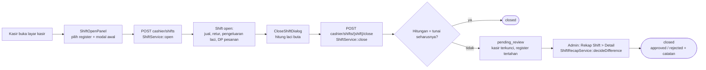
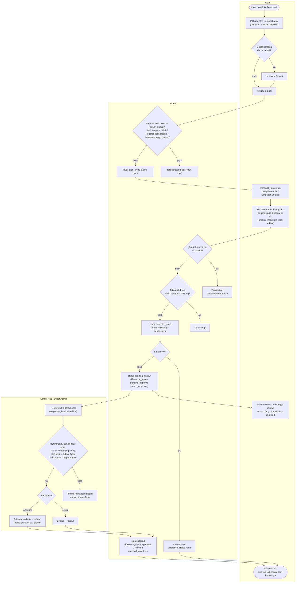
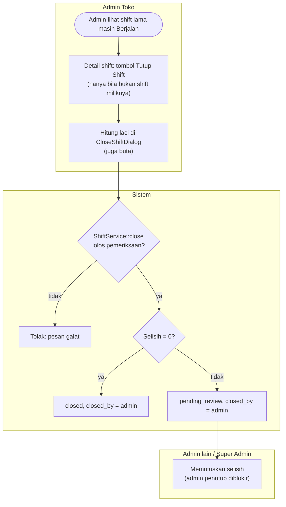
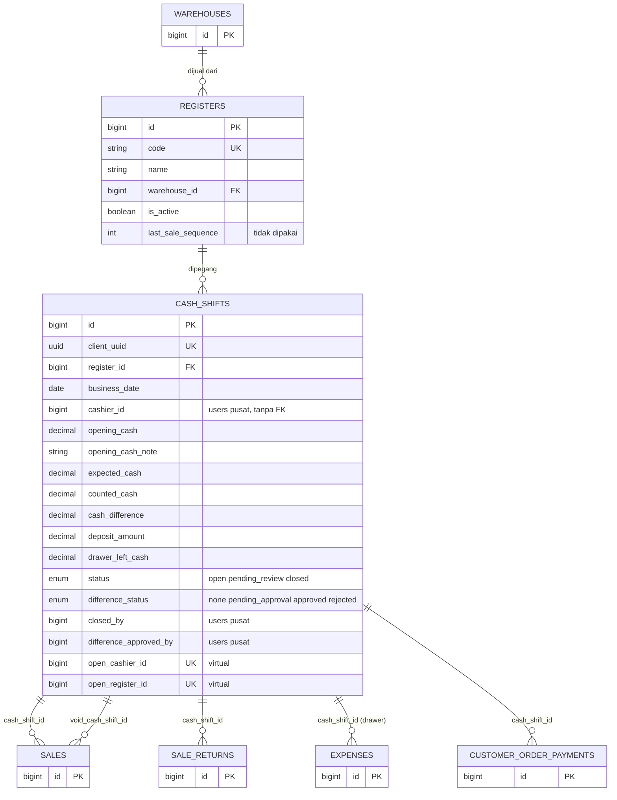
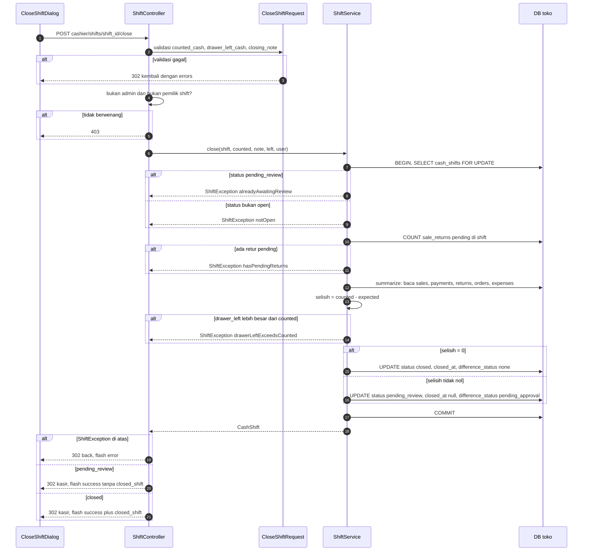

# Shift Kasir — Dokumentasi Teknis

> **Modul:** Shift kasir (`Register`, `CashShift`): buka shift, tutup shift buta, tinjauan selisih kas oleh Admin, Rekap Shift, Laporan Akhir Shift
> **Stack:** Laravel 13 (PHP 8.3), Inertia 3, Vue 3, Quasar 2, stancl/tenancy
> **Audiens:** Engineer yang memelihara atau memperluas fitur ini
> **Database:** per toko (kedua tabel ada di DB toko; `cashier_id`, `closed_by`, `difference_approved_by` menunjuk ke `users` di DB pusat tanpa foreign key)
> **Terakhir diperbarui:** 2026-11-17

## 1. Ringkasan

Setiap penjualan, retur, pengeluaran laci, dan DP pesanan pelanggan di toko harus terjadi di dalam sebuah **shift**: periode satu kasir memegang satu laci (register). Modul ini mengatur siklus hidup shift. Kasir membuka shift dengan *modal kas awal* yang otomatis diisi dari uang yang ditinggal di laci oleh shift sebelumnya di register itu. Saat menutup, kasir **menghitung laci tanpa diberi tahu angka seharusnya** (tutup buta). Server membandingkan hitungan itu dengan tunai seharusnya. Bila cocok, shift langsung `closed`. Bila tidak cocok (selisih berapa pun, tidak ada ambang toleransi), shift berhenti di `pending_review`: kasirnya terkunci di layar kasir dan registernya tertahan sampai Admin memutuskan selisih itu (setujui atau ditanggung kasir). Keputusan berjenjang: Admin Toko memutuskan shift kasir, Super Admin memutuskan shift Admin Toko, dan tidak ada yang memutuskan shift yang ia kerjakan atau ia tutup sendiri (kecuali Super Admin).

Alasan desain utama: kasir yang tahu angka seharusnya bisa "menyesuaikan" hitungannya, dan kasir yang bisa mengetik modal awal sembarang bisa menutupi kekurangan. Karena itu angka tunai seharusnya tidak pernah dikirim ke layar kasir, dan modal awal yang berbeda dari sisa laci wajib beralasan.



### BPMN — siklus shift sampai selisih diputuskan



### BPMN — Admin menutup shift yang terlupa

Shift yang dibiarkan terbuka (kasir pulang tanpa menutup) dapat ditutup Admin dari halaman detail Rekap Shift. Admin yang menghitung laci dicatat sebagai `closed_by` dan karena itu **tidak boleh memutuskan selisihnya sendiri** (kecuali Super Admin).



---

## 2. Skema Database

Kedua tabel ada di **DB toko** (migrasi `database/migrations/tenant`). Semua migrasi dijalankan lewat `tenants:migrate`.

### `registers`

Satu baris = satu mesin kasir/laci, terikat ke satu gudang jual. Tidak ada layar admin untuk mengelolanya: satu-satunya pembuat baris adalah `StoreDatabaseSeeder` (membuat register `K1`, "Kasir 1", gudang `MAIN`) dan factory untuk tes.

| Kolom | Tipe | Null | Catatan |
|---|---|---|---|
| `id` | bigint, PK | | |
| `code` | string(20) | tidak | **unique** |
| `name` | string(255) | tidak | |
| `warehouse_id` | bigint, FK | tidak | `foreignId()->constrained()` ke `warehouses` (restrict, bukan cascade) |
| `last_sale_sequence` | unsigned int | tidak | default `0`. **Tidak dibaca di mana pun** (lihat §13) |
| `is_active` | boolean | tidak | default `true`; register tidak aktif tidak ditawarkan dan ditolak saat buka shift |
| `created_at`, `updated_at` | timestamp | ya | |

Kolom `fixed_opening_cash` (modal tetap per register) **dihapus** oleh migrasi `2026_11_03_140000_track_the_drawer_cash_on_each_shift`; modal kini mengikuti sisa laci per shift.

### `cash_shifts`

Satu baris = satu shift. Kolom uang bertipe `decimal(15,2)`.

| Kolom | Tipe | Null | Catatan |
|---|---|---|---|
| `id` | bigint, PK | | Label tampilan: `Shift #0002` (`CashShift::label()`) |
| `client_uuid` | uuid | tidak | **unique**; diisi `Str::uuid()` oleh server saat buka, **tidak pernah dibaca** (bukan kunci idempotensi, lihat §13) |
| `register_id` | bigint, FK | tidak | ke `registers` (restrict) |
| `business_date` | date | tidak | tanggal buka shift; shift yang melewati tengah malam tetap memakai tanggal ini. Index |
| `cashier_id` | unsigned bigint | tidak | `users.id` di DB pusat, **tanpa FK** (beda database) |
| `cashier_name` | string(255) | tidak | disalin saat buka supaya laporan tidak bergantung pada pengguna pusat |
| `opened_at` | dateTime | tidak | |
| `opening_cash` | decimal | tidak | modal awal |
| `opening_cash_note` | string(255) | ya | alasan bila modal berbeda dari sisa laci; `null` bila sama |
| `closed_at` | dateTime | ya | **kosong selama `pending_review`**, terisi saat benar-benar tertutup (hitungan cocok, atau selisih diputuskan) |
| `closed_by` | unsigned bigint | ya | `users.id` yang **menghitung** laci (kasir, atau Admin yang menutup shift terlupa). Dasar aturan "yang menutup tidak memutuskan". Nullable karena baris lama sebelum kolom ada dibackfill dari `cashier_id` hanya untuk shift `closed` |
| `counted_at` | dateTime | ya | kapan laci dihitung (beda dari `closed_at` untuk shift yang ditahan) |
| `expected_cash` | decimal | ya | di-snapshot saat tutup; kosong selama shift berjalan |
| `counted_cash` | decimal | ya | hitungan kasir |
| `cash_difference` | decimal | ya | `counted_cash - expected_cash` |
| `deposit_amount` | decimal | ya | `counted_cash - drawer_left_cash` (uang yang disetor) |
| `drawer_left_cash` | decimal | ya | uang yang ditinggal di laci; sumber modal awal shift berikutnya. Nullable karena kosong selama shift berjalan |
| `status` | enum | tidak | `open`, `pending_review`, `closed`; default `open` (diubah dengan `ALTER TABLE ... MODIFY` mentah di migrasi `2026_11_08_110000`) |
| `difference_status` | enum | tidak | `none`, `pending_approval`, `approved`, `rejected`; default `none`. Index |
| `difference_approved_by` | unsigned bigint | ya | pemutus selisih (`users.id` pusat) |
| `difference_approved_at` | dateTime | ya | |
| `closing_note` | text | ya | catatan kasir saat tutup (opsional; tidak pernah diwajibkan agar tidak membocorkan adanya selisih) |
| `approval_note` | text | ya | catatan keputusan Admin (wajib saat memutuskan) |
| `open_cashier_id` | unsigned bigint | ya | **kolom virtual** `if(status = 'open', cashier_id, null)`, **unique** |
| `open_register_id` | unsigned bigint | ya | **kolom virtual** `if(status = 'open', register_id, null)`, **unique** |
| `created_at`, `updated_at` | timestamp | ya | |

Index lain: `(register_id, status)`, `business_date`, `difference_status`.

**Mengapa dua kolom virtual?** Aturan "satu shift terbuka per kasir" dan "satu shift terbuka per register" awalnya hanya dicek di kode di bawah kunci register, sehingga satu kasir yang membuka dua register pada detik yang sama bisa lolos. Kolom virtual hanya berisi nilai selama `status = 'open'`, dan MySQL tidak menganggap `NULL` bentrok pada unique index, jadi shift yang sudah tertutup tidak menghalangi apa pun. Akibatnya database sendiri menolak shift terbuka kedua (kode menangkap `UniqueConstraintViolationException` lalu melempar `ShiftException::alreadyOpen()`).

**Catatan penting:** kolom virtual hanya menutup status `open`. Shift `pending_review` **tidak** diisi di kolom itu; tertahannya register dan kasir oleh shift yang menunggu review dijaga **kode** (cek status di `ShiftService::open()` di bawah kunci register), bukan database. Docblock `ShiftService` mengakui hal ini ("it is the code, not the database, that stops a second shift on its register"). Alasannya tidak tertulis; dugaan saya (tidak terverifikasi) indeks unik dibuat pada migrasi `2026_11_02_140000`, sebelum status `pending_review` ditambahkan pada `2026_11_08_110000`, dan tidak diperluas sesudahnya. Konsekuensinya: kasir yang ditahan masih dikenali sebagai "memegang shift" lewat `openShiftOf()`, tetapi jaring pengaman database tidak berlaku untuknya.

Kolom `followed_up_by` dan `followed_up_at` pernah ada (tindak lanjut selisih yang ditolak) lalu **dihapus** oleh migrasi `2026_11_08_120000`: setelah keputusan "ditanggung kasir", berita acara dan penggantian uang dicatat di luar sistem.

### Tabel dari modul lain yang menunjuk ke `cash_shifts` / `registers`

| Tabel (DB toko) | Kolom | Ke |
|---|---|---|
| `sales` | `register_id`, `cash_shift_id`, `void_cash_shift_id` (nullable) | `registers`, `cash_shifts` |
| `sale_returns` | `register_id`, `cash_shift_id` | `registers`, `cash_shifts` |
| `sale_cancellations` | `register_id`, `cash_shift_id` | `registers`, `cash_shifts` |
| `expenses` | `cash_shift_id` (nullable: pengeluaran sumber lain tidak punya shift) | `cash_shifts` |
| `customer_orders` | `register_id`, `cash_shift_id` | `registers`, `cash_shifts` |
| `customer_order_payments` | `cash_shift_id` | `cash_shifts` |
| `document_sequences` | `register_id` (default `0`, tanpa FK) | nomor dokumen per register |

### Diagram relasi



---

## 3. Model / Entity

| Model | Tabel | Hal penting |
|---|---|---|
| `App\Models\Register` | `registers` | `Auditable`; relasi `warehouse()`; cast `is_active` boolean; `#[Fillable]` code/name/warehouse_id/is_active. Factory: `RegisterFactory` |
| `App\Models\CashShift` | `cash_shifts` | `Auditable` (setiap perubahan, termasuk keputusan selisih, masuk tabel `audits` toko); relasi `register()`, `sales()`; cast tanggal, decimal:2, dan enum `status` (`CashShiftStatus`) / `difference_status` (`ShiftDifferenceStatus`). `label()` untuk "Shift #0002". `cashierRole()` mencari role kasir **saat ini** di toko lewat `User::roleIn($store)` (kasir yang sudah dihapus atau kehilangan akses dianggap `Cashier`, role terendah; harus dipanggil saat tenancy aktif). `#[Fillable]` memuat `closed_by` dan `counted_at`, tetapi **tidak** memuat `difference_approved_by/at` dan `approval_note`: keputusan selisih selalu ditulis lewat `forceFill()` di `ShiftRecapService`, sehingga tidak bisa ikut masuk lewat mass assignment |
| `App\Enums\CashShiftStatus` | | `Open` ("Berjalan"), `PendingReview` ("Menunggu review"), `Closed` ("Ditutup") |
| `App\Enums\ShiftDifferenceStatus` | | `None`, `PendingApproval` ("Menunggu persetujuan"), `Approved` ("Disetujui"), `Rejected` (label "Ditanggung kasir"; nilai DB tetap `rejected`) |
| `App\Enums\UserRole` | | `reviewerLabel()` menentukan siapa yang meninjau shift milik role tertentu (Cashier → "Admin Toko", StoreAdmin → "Super Admin") |
| `App\Enums\ApprovalKind` | | `SaleReturn`, `CashDifference`: kunci kartu "Perlu tindakan" di dashboard, bukan bagian logika shift (lihat dokumen Tutup Hari & Dashboard) |

`Register` dan `CashShift` dua-duanya tidak memakai `CentralConnection`: keduanya model toko. `cashier_id` tidak punya relasi Eloquent karena menunjuk ke DB pusat.

---

## 4. Hak Akses

Semua rute toko memakai `web` → `InitializeTenancyByPath` → `auth` → `store.access` → `shift.remember`. Role di sini mengikuti `UserRole` (Super Admin / Admin Toko / Kasir).

| Aksi | Rute | Siapa | Cara ditegakkan |
|---|---|---|---|
| Lihat layar kasir, daftar register | `GET cashier` | siapa pun yang punya akses toko | `store.access` |
| Buka shift | `POST cashier/shifts` | siapa pun yang punya akses toko (Admin pun bisa jadi kasir) | tidak ada cek role; `OpenShiftRequest::authorize()` selalu `true` |
| Tutup shift | `POST cashier/shifts/{shift}/close` | **pemilik shift**, atau **Admin Toko/Super Admin** (untuk shift terlupa) | `ShiftController::close`: `abort_unless($user->isAdminIn($store) \|\| $shift->cashier_id === $user->id, 403)` |
| Cetak laporan buta | `GET cashier/shifts/{shift}/report` | hanya pemilik shift (Admin yang jadi kasir pun dapat versi buta) | `abort_unless(cashier_id === user.id, 403)`; `404` bila shift masih `open` |
| Rekap, detail, laporan lengkap | `GET shifts`, `shifts/{shift}`, `shifts/{shift}/sheet` | Admin Toko, Super Admin | grup `store.admin` (`EnsureUserIsStoreAdmin`, `403` untuk Kasir) |
| Setujui / tanggung kasir | `POST shifts/{shift}/approve`, `.../reject` | Admin yang berwenang untuk shift itu | `store.admin` **dan** `ShiftRecapService::decisionBlocker()` di dalam transaksi |
| Kunci keluar / halaman pusat saat shift dipegang | `POST logout`, grup `pusat/*` | semua pengguna yang memegang shift | middleware `shift.none-open` di `routes/web.php` |

Aturan siapa-boleh-memutuskan (`decisionBlocker`), dievaluasi berurutan, yang pertama cocok menang:

1. Super Admin: **selalu boleh** (tidak ada di atasnya; termasuk shift yang ia kerjakan atau tutup sendiri).
2. `cashier_id === user.id` → ditolak (`cannotDecideOwnShift`).
3. `closed_by === user.id` → ditolak (`cannotDecideShiftYouClosed`).
4. role kasir shift **saat ini** bukan `Cashier` (Admin Toko atau Super Admin) → ditolak, hanya Super Admin (`onlySuperAdminDecidesAnAdminShift`).
5. selain itu boleh (Admin Toko memutuskan shift kasir).

Karena role dibaca saat keputusan (bukan saat shift dibuka), kasir yang dipromosikan menjadi Admin sebelum shiftnya diputuskan akan ditinjau Super Admin. Ada tesnya (`ShiftRecapTest::test_a_cashier_who_became_an_admin_before_the_decision_is_reviewed_by_the_super_admin`).

**Mengunci pengguna di kasir.** `RememberOpenShift` (di setiap halaman toko) mencatat di session kunci `open_shift_stores` daftar kode toko tempat pengguna memegang shift (`open` atau `pending_review`). `EnsureUserHasNoOpenShift` dipakai di logout dan halaman pusat: ia memuat toko-toko itu, memverifikasi ke DB masing-masing toko, lalu menolak (redirect ke kasir dengan flash `error`, atau JSON `423` kode `4231` bila klien meminta JSON). Toko yang DB-nya tidak terjangkau dibiarkan "diingat" tetapi **tidak mengunci**, supaya satu toko rusak tidak membuat orang tidak bisa keluar. Halaman toko lain tetap terbuka (Admin bisa melihat stok saat shiftnya berjalan).

---

## 5. Konfigurasi

Modul ini tidak membaca kunci `config/` atau variabel `.env` sendiri (hasil Grep `shift|closing` di `config/` kosong). Satu-satunya pengaturan toko yang tersentuh adalah **lebar kertas cetak** (`StoreSettingService::paperWidth()`, 58 atau 80 mm, bawaan 80) dan kop surat (`letterhead()`) pada laporan akhir shift. Konstanta kode: `ShiftRecapController::PER_PAGE = 25`; polling layar terkunci `REVIEW_REFRESH_MS = 15000` di `Pages/Tenant/Cashier/Index.vue`.

---

## 6. Rute / API

Semua di bawah prefiks `t/{tenant}/`. Aplikasi memakai session + Inertia, jadi sebagian besar endpoint menjawab **redirect 302 dengan flash** (`success` / `error`), bukan JSON. JSON hanya muncul di `ShiftReceiptController` dan di penjaga `EnsureUserHasNoOpenShift`.

| Method | Path | Action | Nama rute | Middleware tambahan |
|---|---|---|---|---|
| GET | `cashier` | `CashierController@index` | `tenant.cashier.index` | |
| POST | `cashier/shifts` | `ShiftController@store` | `tenant.cashier.shifts.store` | |
| POST | `cashier/shifts/{shift}/close` | `ShiftController@close` | `tenant.cashier.shifts.close` | |
| GET | `cashier/shifts/{shift}/report` | `ShiftController@report` | `tenant.cashier.shifts.report` | |
| GET | `cashier/receipts` | `ShiftReceiptController@index` | `tenant.cashier.receipts` | |
| GET | `shifts` | `ShiftRecapController@index` | `tenant.shifts.index` | `store.admin` |
| GET | `shifts/{shift}` | `ShiftRecapController@show` | `tenant.shifts.show` | `store.admin` |
| GET | `shifts/{shift}/sheet` | `ShiftRecapController@sheet` | `tenant.shifts.sheet` | `store.admin` |
| POST | `shifts/{shift}/approve` | `ShiftRecapController@approve` | `tenant.shifts.approve` | `store.admin` |
| POST | `shifts/{shift}/reject` | `ShiftRecapController@reject` | `tenant.shifts.reject` | `store.admin` |
| POST | `logout` | `AuthenticatedSessionController@destroy` | `logout` | `auth`, `shift.none-open` |

Catatan: `{shift}` memakai route-model-binding ke DB toko (tenancy sudah aktif). Id yang tidak ada memberi `404`. Daftar `shifts` menerima query `from`, `to` (`Y-m-d`; nilai tidak valid diabaikan oleh `DateRangeRequest`, bukan galat), `status` (`open`, `pending_review`, `closed`), `difference` (`none`, `pending_approval`, `approved`, `rejected`), `search` (nama kasir, `LIKE %...%`), `page`.

### Contoh (ilustratif, bukan hasil tangkapan)

**Buka shift** (`POST /t/mitra_utama/cashier/shifts`, dikirim Inertia sebagai JSON):

```json
{ "register_id": 1, "opening_cash": 500000, "opening_cash_note": null }
```

Sukses: redirect ke `tenant.cashier.index` dengan flash `success = "Shift dibuka."`. Gagal karena modal berbeda tanpa alasan: redirect `back()` dengan flash `error`:

```text
Modal awal berbeda dari sisa laci shift sebelumnya (Rp 300.000). Isi alasannya.
```

Gagal validasi (mis. register tidak aktif): redirect kembali dengan `errors.register_id = "Register tidak valid."` (cara Inertia membawa galat validasi).

**Tutup shift** (`POST /t/mitra_utama/cashier/shifts/12/close`):

```json
{ "counted_cash": 1250000, "drawer_left_cash": 500000, "closing_note": null }
```

Hasil cocok: redirect ke kasir, flash `success = "Shift ditutup."` dan flash `closed_shift` (dipakai `ShiftClosedDialog`):

```json
{ "counted_cash": "1250000.00", "deposit_amount": "750000.00", "drawer_left_cash": "500000.00", "report_url": "https://.../t/mitra_utama/cashier/shifts/12/report" }
```

Hasil selisih: flash `success = "Hitungan tercatat. Shift belum ditutup: menunggu review Admin."` dan **tidak ada** `closed_shift` (tidak ada angka untuk ditampilkan). Bila yang menutup Admin untuk shift orang lain, redirect ke `tenant.shifts.show`.

**Daftar nota shift berjalan saat tidak punya shift** (`GET cashier/receipts`, JSON, status `409`; pesan dan kode dari `ShiftReceiptController`, `ApiErrorCode::ShiftNotOpen = 4091`):

```json
{
  "code": 4091,
  "message": "Buka shift dulu untuk melihat nota shift ini. Bila shift Anda sudah dihitung, tunggu keputusan Admin.",
  "more_info": "Daftar ini berisi nota dari shift yang sedang terbuka."
}
```

**Keluar saat masih memegang shift** (`POST logout` meminta JSON, status `423`, `ApiErrorCode::ShiftIsOpen = 4231`):

```json
{
  "code": 4231,
  "message": "Tutup shift dulu sebelum keluar atau membuka halaman pusat.",
  "more_info": "Tutup shift di kasir toko Mitra Utama."
}
```

Bila shift sudah dihitung dan menunggu review, `message` menjadi "Shift Anda sudah dihitung dan menunggu keputusan Admin. Anda bisa keluar setelah shift ditutup."

**Keputusan selisih** (`POST /t/mitra_utama/shifts/12/approve`):

```json
{ "note": "BA-2026-114, selisih wajar karena uang receh" }
```

Sukses: flash `success = "Selisih kas disetujui."`. Untuk `reject`: `"Selisih kas dicatat ditanggung kasir dan shift ditutup. Berita acara dan penggantian uangnya dicatat di luar sistem."`. Catatan kosong: `errors.note = "Isi catatan keputusan."`.

---

## 7. Komponen Backend

### `ShiftService`

Satu-satunya tempat aturan siklus shift. Dipakai juga oleh `SaleService`, `ExpenseService`, `CustomerOrderService`, dan `SaleReturnService` lewat `openShiftOf()`.

**`openShiftOf(User)`** mengembalikan shift yang masih dipegang pengguna: status `open` **atau** `pending_review`. Pemanggil yang butuh "shift yang boleh dipakai berjualan" harus memeriksa status sendiri (mis. `SaleService` menolak bila `status !== Open` di bawah kunci shift, dengan pesan yang ditambahi `ShiftException::AWAITING_REVIEW_HINT`).

**`carriedOverCash(Register)`** membaca `drawer_left_cash` dari shift **berstatus `closed`** terbaru (`latest('id')`, `drawer_left_cash` tidak null) pada register itu; `null` bila register belum pernah punya shift tertutup. Shift `pending_review` sengaja tidak dihitung: register-nya toh tidak bisa dibuka sampai diputuskan.

**`open(User, Register, ?string $openingCash, ?string $openingNote)`**, semua di dalam `DB::transaction`:

1. Kunci baris register (`lockForUpdate`). Ini juga yang membuat `DailyClosing::lockAgainstClosing()` (yang mengunci semua register) menyerialkan buka shift terhadap tutup hari, sehingga buka shift tidak perlu memanggilnya sendiri.
2. Register harus `is_active` (`noRegister`), hari ini tidak boleh sudah ditutup (`DailyClosing::isClosedOn(today())` → `dayClosed`), kasir tidak boleh sudah memegang shift (`alreadyOpen`), register tidak boleh sedang dipakai shift `open` (`registerInUse`, menyebut nama kasir) atau menunggu review (`registerAwaitingReview`).
3. Modal = `$openingCash ?? sisa laci ?? 0`. Bila ada sisa laci dan modal berbeda **dan** alasan kosong → `openingCashNeedsNote`. Server membandingkan dengan sisa laci yang ia baca sendiri, bukan nilai dari layar. Alasan hanya disimpan bila modal memang berbeda.
4. Insert. `UniqueConstraintViolationException` (kolom virtual) diubah menjadi `alreadyOpen`.

Catatan: `ShiftController::store` selalu mengirim `opening_cash` (wajib di request), jadi cabang "tanpa `$openingCash`" hanya dipakai pemanggil lain/tes.

**`summarize(CashShift)`** menghitung ringkasan lengkap (tipe `ShiftSummary`). Aturan angkanya yang gampang salah dibaca:

| Angka | Sumber |
|---|---|
| `payments[metode]` | jumlah `sale_payments.amount` untuk nota `Completed` **dan `Voided`** di shift ini, hanya metode `forCashier()` (tunai, transfer, QRIS, EDC). COD, `order_deposit`, dan `return_credit` tidak ada di sini |
| `payments[cash]` | di atas dikurangi `sales.change_amount` (kembalian), jadi tunai bersih |
| `sale_count`, `total_sales` | hanya nota `Completed` |
| `returns_total` | `credit_amount` retur `Completed` di shift ini |
| `cash_refunds` | `refund_amount` retur `Completed` dengan `refund_method = cash` |
| `void_cash_refunds` | `sales.void_cash_refund` untuk nota yang di-void **oleh shift ini** (`void_cash_shift_id`), bukan shift tempat nota dijual |
| `void_deposits` | uang yang sempat masuk dari nota shift ini yang kemudian di-void (hanya informasi; sudah ada di `payments`) |
| `order_deposit_cash` | DP pesanan pelanggan tunai (`kind = deposit`) dikurangi DP tunai yang dikembalikan (`kind = refund`) dari `customer_order_payments` shift ini |
| `drawer_expenses` | pengeluaran sumber `drawer` berstatus `recorded` di shift ini (`ExpenseService::drawerTotalOf`) |
| `cod` | `CodSaleService::totalsOfShift`: jumlah dan nilai nota COD, dibagi sudah/belum diantar. **Tidak menyentuh kas laci** |
| `expected_cash` | `opening_cash + payments[cash] + order_deposit_cash − cash_refunds − void_cash_refunds − drawer_expenses` |

Mengapa nota `Voided` ikut di `payments`: uang DP dari nota yang kemudian di-void memang pernah masuk laci shift itu. Uangnya keluar lagi sebagai `void_cash_refund` di shift yang mem-void (bisa shift lain). Jika dua sisi itu tidak dicatat di shift yang berbeda dengan benar, laci kedua shift akan selisih. COD bukan uang di laci, jadi hanya "dilaporkan terpisah". DP pesanan tunai adalah uang laci walau belum penjualan; nota pengambilan pesanan memakai `order_deposit` sebagai metode yang **tidak dihitung ulang** sebagai tunai.

**`summarizeForCashier(CashShift)`** memanggil `summarize()` lalu **membuang semuanya** kecuali `sale_count`, jumlah nota COD sudah/belum diantar, dan `opening_cash`. `opening_cash` tetap dikirim hanya sebagai nilai awal "ditinggal di laci" di dialog. Inilah mekanisme tutup buta: filter dilakukan di server, bukan disembunyikan di Vue.

**`close(CashShift, string $countedCash, ?string $note, ?string $drawerLeftCash, ?User $closedBy)`**, di dalam `DB::transaction`:

1. Muat ulang shift dengan `lockForUpdate` (juga memuat `register`). Kunci ini sama dengan yang diambil `SaleService::create`, `SaleReturnService`, `CustomerOrderService`, dan `ExpenseService` pada baris shift, sehingga transaksi yang masuk bersamaan menunggu, lalu melihat status baru dan ditolak.
2. Status `pending_review` → `alreadyAwaitingReview`; status selain `open` → `notOpen`.
3. Ada retur `pending` di shift ini → `hasPendingReturns(n)` (retur yang belum disetujui belum mengubah kas, jadi menutup shift sebelum itu akan membuat angkanya salah).
4. `expected_cash` dihitung ulang oleh `summarize()` di dalam transaksi (nilai dari klien tidak pernah dipercaya). `selisih = counted − expected`.
5. `drawer_left_cash` = nilai dikirim; bila `null`, `min(opening_cash, counted)`. Bila lebih dari `counted` → `drawerLeftExceedsCounted`.
6. `forceFill` + `save`: bila selisih nol → `status = closed`, `closed_at = now()`, `difference_status = none`; bila tidak → `status = pending_review`, `closed_at = null`, `difference_status = pending_approval`. `closed_by = $closedBy?->id ?? cashier_id`, `counted_at = now()`, plus `expected_cash`, `counted_cash`, `cash_difference`, `deposit_amount`, `closing_note`.

Catatan tidak pernah diwajibkan, karena menuntut catatan hanya bila ada selisih akan memberi tahu kasir bahwa ada selisih.



### `ShiftRecapService`

- **`paginate($filters, $perPage)`**: shift terbaru dulu (`orderByDesc('id')`) dengan `withCount`/`withSum` untuk jumlah dan total nota `Completed`. Filter tanggal memakai `business_date`; `status`/`difference` diparse `tryFrom` (nilai tidak dikenal diabaikan, bukan galat). Pencarian nama kasir memakai `LIKE` tanpa meloloskan `%` dan `_`.
- **`pendingDifferenceCount()`**: jumlah shift berstatus selisih `pending_approval` di seluruh riwayat.
- **`decisionBlocker(User, CashShift)`**: aturan wewenang (§4). Satu-satunya tempat aturan ini hidup, dipakai tombol di halaman dan keputusan itu sendiri.
- **`decideDifference(shift, admin, bool $isApproved, string $note)`** di `DB::transaction`: kunci shift, wajib `difference_status = pending_approval` (kalau tidak `differenceNotPending`, yang membuat keputusan ganda gagal), periksa `decisionBlocker` **ulang di bawah kunci**, lalu set `status = closed`, `closed_at = closed_at ?? now()`, `difference_status = approved|rejected`, `difference_approved_by/at`, `approval_note`. "Ditanggung kasir" sengaja langsung menutup shift; berita acara dan penggantian uang dicatat di luar sistem.

### Resource dan Request

- **`CashShiftResource`**: shift berjalan untuk layar kasir (`is_awaiting_review`, `reviewer_label` hanya saat `pending_review`, `close_url`, modal awal). Tidak membawa angka kas lain.
- **`CashShiftListResource`**: satu baris Rekap Shift (jumlah nota, total penjualan, `cash_difference`, status selisih, `show_url`). Perlu aggregate `sale_count`/`sales_total` dari `paginate()`.
- **`ShiftRecapResource`**: detail shift untuk Admin. Untuk shift **`open`** menyetel `is_cash_hidden = true` dan hanya mengeluarkan jumlah nota COD; semua nominal (tunai seharusnya, total, retur, pengeluaran, pembayaran) tidak ada di payload, supaya Admin tidak bisa membaca tunai seharusnya shift yang masih berjalan lalu mengetiknya sebagai hitungan sendiri. Untuk shift `pending_review`/`closed`, semua angka tampil. Juga menurunkan `can_decide`, `decision_blocked_reason` (hanya saat selisih menunggu), `can_close` (shift `open` yang bukan milik pengguna), `reviewer_label`, dan `decided_by_name` (satu query `User::find` ke DB pusat per tampilan).
- **`BlindShiftReportResource`**: laporan kertas kasir. Membawa jumlah nota, COD (hitungan saja), modal awal, **hitungan kasir**, setoran, ditinggal di laci, catatannya sendiri, kop toko, lebar kertas. Tidak ada penjualan, metode, retur, tunai seharusnya, atau selisih.
- **`OpenShiftRequest`, `CloseShiftRequest`, `DecideShiftDifferenceRequest`**: aturan di §8.
- **Laporan lengkap** (`ShiftRecapController::sheet`) memakai `recapOf()` yang sama dengan halaman detail, dikurangi kunci UI (`can_decide`, `decision_blocked_reason`, `can_close`, `is_own_shift`), ditambah `is_blind = false`, kop, dan lebar kertas. Komponen cetak yang sama (`ShiftReportSheet.vue`) merender versi buta dan lengkap lewat `is_blind`.

### Middleware

`RememberOpenShift` dan `EnsureUserHasNoOpenShift` (lihat §4). Keduanya memanggil `ShiftService::openShiftOf()`. `EnsureUserHasNoOpenShift` menjalankan `$store->run(...)` per toko yang diingat dan menangkap `QueryException` agar toko yang DB-nya mati tidak mengunci logout.

### Frontend

| Berkas | Peran |
|---|---|
| `Pages/Tenant/Cashier/Index.vue` | Layar kasir. Menampilkan `ShiftOpenPanel` bila `shift === null`; layar terkunci ("Shift menunggu review ...") bila `shift.is_awaiting_review`; tombol Tutup Shift hanya saat kasir bisa bekerja. Saat menunggu review ia memuat ulang prop `shift` dan `registers` tiap 15 detik (`startReviewWatch`), supaya begitu Admin memutuskan, layar kembali ke panel buka shift tanpa muat ulang manual |
| `Components/Cashier/ShiftOpenPanel.vue` | Pilih register (dropdown hanya bila lebih dari satu), isi modal awal (bawaan = `carried_over_cash`), kolom alasan muncul otomatis bila nilai diubah. Register yang sedang dipakai/menunggu review ditandai di label; tombol dinonaktifkan bila busy |
| `Components/Cashier/CloseShiftDialog.vue` | Dialog hitung buta: jumlah nota, jumlah COD, input tunai dihitung, input ditinggal di laci (bawaan `min(modal, hitungan)` sampai kasir mengubahnya), pratinjau setoran, catatan opsional. Dipakai ulang di `Shifts/Show.vue` untuk Admin yang menutup shift terlupa |
| `Components/Cashier/ShiftClosedDialog.vue` | Dialog "Shift ditutup" setelah hitungan cocok: tunai dihitung, setoran, sisa laci, tombol Cetak Laporan Shift (`printSheet`, bingkai tersembunyi). Tidak muncul saat shift ditahan (tidak ada flash `closed_shift`) |
| `Pages/Tenant/Shifts/Index.vue` | Rekap Shift: filter (nama, status shift, status selisih, tanggal), pita "N selisih kas menunggu keputusan Anda", tabel, pagination |
| `Pages/Tenant/Shifts/Show.vue` | Detail shift: penjualan, kas, retur dan pengeluaran laci shift itu, panel keputusan selisih (catatan wajib, dialog konfirmasi karena tidak bisa diubah), tombol Tutup Shift untuk shift terlupa, tombol Cetak |
| `Pages/Tenant/Print/ShiftReport.vue`, `Components/ShiftReportSheet.vue` | Laporan Akhir Shift thermal (58/80 mm) dengan tanda tangan "Kasir" dan "Penerima setoran". Versi buta menampilkan "Kas" hanya dari hitungan kasir |
| `Composables/printSheet.js`, `Composables/useMoneyFormat.js`, `Components/MoneyInput.vue` | Cetak lewat iframe, format rupiah, input uang |

---

## 8. Aturan Validasi

Semua pelanggaran validasi menggagalkan seluruh request (tidak ada perubahan sebagian). Pelanggaran **aturan bisnis** (`ShiftException`) bukan galat validasi: controller menangkapnya dan mengembalikan `back()->with('error', pesan)`, sehingga di layar muncul sebagai notifikasi, bukan di bawah field.

| Field | Aturan | Masuk ke | Pesan galat |
|---|---|---|---|
| `register_id` (buka) | `required`, `integer`, `exists:registers,id` dengan `is_active = true` | `cash_shifts.register_id` | "Pilih register." / "Register tidak valid." |
| `opening_cash` (buka) | `required`, `numeric`, `min:0`, `max:999999999999`, `decimal:0,2` | `cash_shifts.opening_cash` | "Isi modal kas awal." / "...harus berupa angka." / "...tidak boleh negatif." / "...maksimal 2 angka desimal." |
| `opening_cash_note` (buka) | `nullable`, `string`, `max:255` | `cash_shifts.opening_cash_note` (hanya bila modal berbeda) | (pesan bawaan) |
| `counted_cash` (tutup) | `required`, `numeric`, `min:0`, `max:999999999999`, `decimal:0,2` | `counted_cash` | "Isi jumlah tunai yang dihitung." dst. |
| `drawer_left_cash` (tutup) | `required`, `numeric`, `min:0`, `max:999999999999`, `decimal:0,2` | `drawer_left_cash` | "Isi uang yang ditinggal di laci." dst. |
| `closing_note` (tutup) | `nullable`, `string`, `max:500` | `closing_note` | (pesan bawaan) |
| `note` (keputusan) | `required`, `string`, `max:1000` | `approval_note` | "Isi catatan keputusan." |

Aturan bisnis tambahan di `ShiftService`/`ShiftRecapService` (pesan dari `ShiftException`): modal berbeda tanpa alasan, ditinggal di laci lebih dari hitungan, retur pending, register tidak aktif, hari sudah ditutup, sudah memegang shift, register dipakai/menunggu review, selisih sudah diputuskan, dan keempat pemblokir wewenang di §4.

---

## 9. Guard Kepemilikan & Status

| Endpoint | Yang dicek ulang di server | Yang diblokir |
|---|---|---|
| `POST cashier/shifts` | `registers` (aktif, dikunci), `daily_closings` (hari ini), `cash_shifts` (shift `open`/`pending_review` kasir, shift `open`/`pending_review` register), `sisa laci` dibaca dari `cash_shifts` | Register nonaktif, hari tertutup, kasir ganda, register dipakai atau menunggu review, modal berbeda tanpa alasan. Unique index kolom virtual menjadi jaring terakhir untuk balapan |
| `POST cashier/shifts/{shift}/close` | Pemilik atau admin (`isAdminIn`) dari **role di DB**; status shift dari DB di bawah `lockForUpdate`; retur `pending` di shift; `expected_cash` dihitung ulang | Kasir lain menutup shift orang (403), shift sudah ditahan atau ditutup, retur pending, ditinggal di laci melebihi hitungan. Angka seharusnya dari klien tidak ada |
| `GET cashier/shifts/{shift}/report` | `cashier_id === user.id`, status bukan `open` | Pengguna lain (403), shift berjalan (404) |
| `GET shifts/{shift}/sheet` | `store.admin`; status bukan `open` | Kasir (403), shift berjalan (404) |
| `POST shifts/{shift}/approve\|reject` | `store.admin`; `difference_status = pending_approval` di bawah kunci; `decisionBlocker` ulang di bawah kunci | Keputusan ganda, memutuskan shift sendiri atau yang ditutup sendiri, Admin Toko memutuskan shift Admin, Kasir (403) |
| Transaksi lain saat shift ditahan (`SaleService`, retur, pengeluaran, pesanan) | Status shift dibaca di bawah `lockForUpdate` | Jual/retur/pengeluaran di shift `pending_review` atau tertutup (pesan "Buka shift dulu ..." plus petunjuk menunggu keputusan Admin) |

---

## 10. Job / Jadwal

Tidak ada. Tidak ada job, listener, atau command terjadwal untuk shift (`routes/console.php` hanya berisi `inspire`; `app/Console` dan `app/Jobs` tidak ada). Artinya **tidak ada penutupan otomatis shift terlupa** dan tidak ada eskalasi bila Admin tidak kunjung memutuskan selisih (lihat §13). Satu-satunya "jadwal" adalah polling 15 detik di browser kasir yang terkunci.

---

## 13. Keterbatasan / Utang Teknis

1. **Tidak ada selisih bertingkat berdasar nominal.** Setiap selisih bukan nol (satu rupiah pun) menahan shift dan butuh keputusan Admin. Tidak ada ambang toleransi di `ShiftService::close()`. "Bertingkat" di modul ini hanya berarti **berjenjang menurut role** (Admin Toko → Super Admin). Konsisten dengan `docs/analisis-sistem.md` D9, tetapi perlu diketahui operasional: selisih receh pun menahan register.
2. **Shift yang ditahan tidak punya jalan keluar bila Admin tidak merespons.** Kasirnya tidak bisa keluar (`shift.none-open`) dan register-nya tidak bisa dibuka kasir lain. Tidak ada eskalasi, pengingat, atau pembatalan. Dashboard hanya menampilkan hitungan selisih menunggu (`StoreDashboardService`), dan menampilkan juga selisih yang hanya bisa diputuskan Super Admin (sudah dicatat di `docs/hasil-review-kode.md` bagian 7).
3. **Penjaga unik database hanya menutup `open`.** Tertahannya register oleh `pending_review` dijaga kode di bawah kunci register; dua proses yang melewati `ShiftService::open()` tidak mungkin, tetapi menyisipkan shift langsung (seeder/skrip) bisa melanggarnya.
4. **`cash_shifts.client_uuid` tidak berfungsi sebagai idempotensi.** Diisi acak oleh server di `ShiftService::open()` dan tidak pernah dibaca. Klik ganda Buka Shift tetap aman, tetapi karena `openShiftOf()` melihat shift pertama (pesan "Anda masih punya shift yang terbuka."), bukan karena UUID. Berbeda dari `sales`/`expenses` yang memakai `client_uuid` dari klien. Kolom ini bisa dibuang atau diberi arti.
5. **`registers.last_sale_sequence` tidak dibaca** (Grep di `app/`, `resources/js`, `routes/`, `config/`, `database/`: hanya migrasi dan `RegisterFactory`). Penomoran dokumen memakai tabel `document_sequences` (`register_id` default 0). Kolom sisa desain awal.
6. **Tidak ada UI atau API untuk mengelola register.** Register dibuat oleh `StoreDatabaseSeeder` (`K1`) atau SQL manual; menambah register kedua atau menonaktifkan register berarti sentuh DB. Panel buka shift sudah siap menampilkan banyak register.
7. **Kasir masih bisa menebak tunai seharusnya.** `ShiftReceiptController@index` membuka daftar nota shiftnya sendiri beserta total dan pembayaran, dan pengeluaran laci tampil di dialog pengeluaran. Tutup buta menutup angka agregat, bukan data mentahnya (dicatat di `docs/hasil-review-kode.md` bagian 7 sebagai diterima).
8. **Polling layar terkunci kemungkinan tidak aktif pada alur "login, buka shift, tutup shift tanpa muat ulang".** `Pages/Tenant/Cashier/Index.vue` memanggil `startReviewWatch()` dan memulai timer lencana hanya di `onMounted` **bila `props.shift` sudah ada saat komponen dipasang** (baris sekitar 680-688). Halaman Inertia yang sama dipakai ulang saat shift baru dibuka (tidak ada `key`), sehingga timer tidak ikut dimulai dan kasir yang ditahan perlu memuat ulang halaman untuk melihat keputusan Admin. *Belum diverifikasi di browser; didasarkan pada pembacaan kode.*
9. **Deposit pratinjau dihitung di klien.** `CloseShiftDialog.vue` menghitung setoran dengan `roundMoney` untuk tampilan; angka resmi dihitung server dengan `BigDecimal`. Keduanya seharusnya identik untuk masukan 2 desimal, tetapi ada dua implementasi.
10. **Penjelasan di kode:** docblock `ShiftRecapService` (baris 19) memuat teks literal `\n` di tengah kalimat. Kosmetik.
11. **Perbedaan dengan `docs/analisis-sistem.md`:** (a) judul 7.6 dan tabel ringkasan menyebut "2 shift per hari" tetapi butir 1 sendiri benar: jumlah shift tidak dibatasi kode. (b) Butir 7 (tutup shift diblokir bila ada nota belum tersinkron / pending sync) adalah sisa rencana offline R3 yang dibatalkan dan tidak ada di kode.
12. **Shift yang dibiarkan berjalan lewat hari** tetap membukukan penjualannya ke `business_date` hari ia dibuka. Itu disengaja (lihat dokumen Tutup Hari), tetapi hari berikutnya bisa berisi penjualan yang tercatat di hari kemarin sampai shift ditutup.

---

## 14. Indeks File

| Concern | Path |
|---|---|
| Migrasi tabel | `database/migrations/tenant/2026_10_27_152505_create_registers_and_cash_shifts_tables.php` |
| Migrasi perubahan | `.../2026_10_31_120000_add_follow_up_to_cash_shifts_table.php` (dibatalkan), `2026_11_02_140000_add_open_shift_guards_to_cash_shifts_table.php`, `2026_11_03_140000_track_the_drawer_cash_on_each_shift.php`, `2026_11_08_110000_add_pending_review_to_cash_shifts.php`, `2026_11_08_120000_drop_follow_up_from_cash_shifts_table.php`, `2026_11_10_120000_add_closed_by_and_counted_at_to_cash_shifts_table.php` |
| Model | `app/Models/CashShift.php`, `app/Models/Register.php` |
| Enum | `app/Enums/CashShiftStatus.php`, `ShiftDifferenceStatus.php`, `UserRole.php` (`reviewerLabel`), `ApprovalKind.php`, `ApiErrorCode.php` (`ShiftNotOpen`, `ShiftIsOpen`) |
| Service | `app/Services/ShiftService.php`, `app/Services/ShiftRecapService.php` (dipakai bersama: `ExpenseService`, `CodSaleService`) |
| Exception | `app/Exceptions/ShiftException.php` |
| Controller | `app/Http/Controllers/Tenant/ShiftController.php`, `ShiftRecapController.php`, `CashierController.php`, `ShiftReceiptController.php` |
| Request | `app/Http/Requests/Tenant/OpenShiftRequest.php`, `CloseShiftRequest.php`, `DecideShiftDifferenceRequest.php`, `DateRangeRequest.php` |
| Resource | `app/Http/Resources/CashShiftResource.php`, `CashShiftListResource.php`, `ShiftRecapResource.php`, `BlindShiftReportResource.php` |
| Middleware | `app/Http/Middleware/EnsureUserHasNoOpenShift.php`, `RememberOpenShift.php`, `EnsureUserIsStoreAdmin.php`; alias di `bootstrap/app.php` |
| Rute | `routes/tenant.php` (grup `cashier`, grup `store.admin` > `shifts`), `routes/web.php` (logout, `pusat`) |
| Halaman Vue | `resources/js/Pages/Tenant/Cashier/Index.vue`, `Pages/Tenant/Shifts/Index.vue`, `Shifts/Show.vue`, `Pages/Tenant/Print/ShiftReport.vue` |
| Komponen Vue | `Components/Cashier/ShiftOpenPanel.vue`, `CloseShiftDialog.vue`, `ShiftClosedDialog.vue`, `Components/ShiftReportSheet.vue`, `Components/MoneyInput.vue` |
| Composable | `Composables/printSheet.js`, `Composables/useMoneyFormat.js` |
| Seeder / Factory | `database/seeders/StoreDatabaseSeeder.php` (register `K1`), `database/factories/RegisterFactory.php`, `CashShiftFactory.php` |
| Test | `tests/Feature/Tenancy/CashierShiftTest.php`, `ShiftRecapTest.php`, `ShiftReportTest.php`, `ShiftReceiptTest.php`, `OpenShiftLockTest.php`, `StoreRouteAccessTest.php`; fixture `tests/Concerns/BuildsCashierFixtures.php` |
