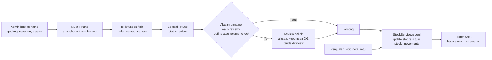
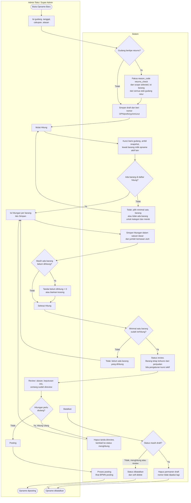
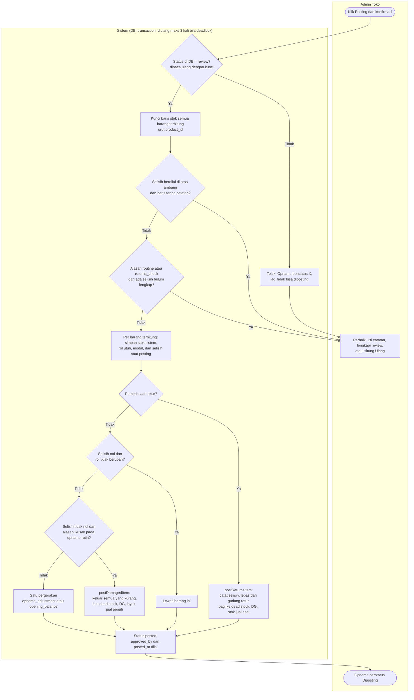
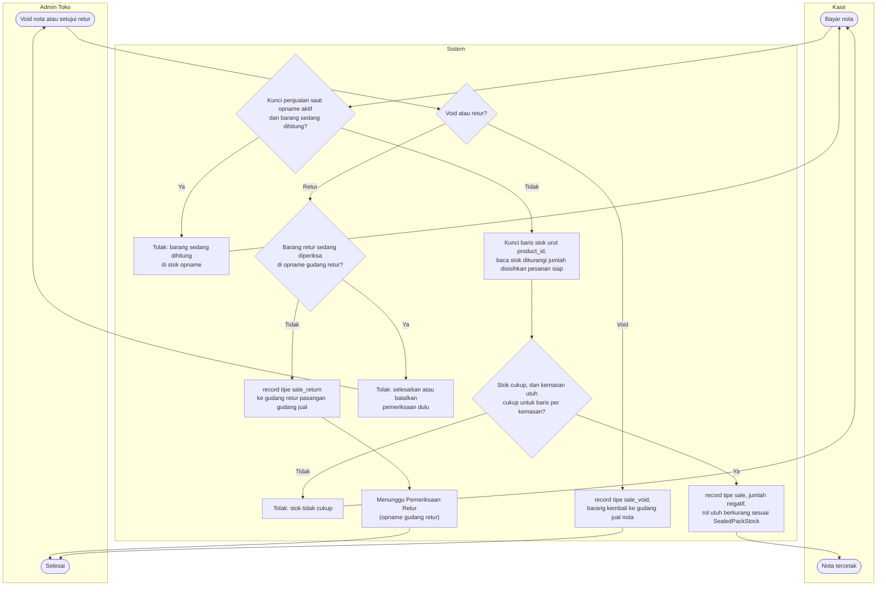
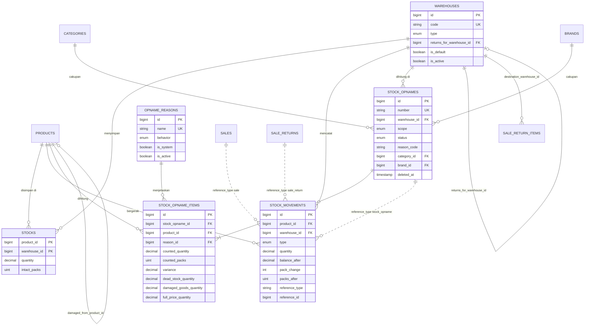
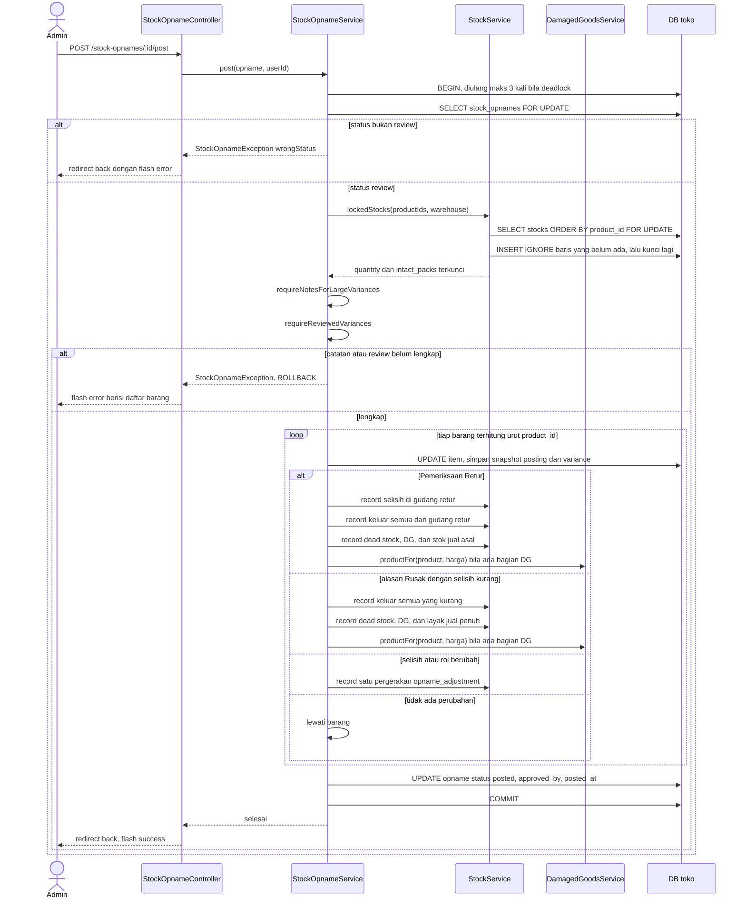

# Stok dan Stok Opname — Dokumentasi Teknis

> **Modul:** Stok (gudang, buku besar stok, kemasan utuh/gulungan), Stok Opname (termasuk barang rusak/DG dan Pemeriksaan Retur), Histori Stok
> **Stack:** Laravel 13 (PHP 8.3), Inertia 3, Vue 3, Quasar 2, stancl/tenancy
> **Audiens:** Engineer yang memelihara atau memperluas fitur ini
> **Database:** per toko (semua tabel modul ini ada di DB toko, bukan DB pusat `mitra_manager`)
> **Terakhir diperbarui:** 2026-11-17

## 1. Ringkasan

Di R1 **stok hanya berubah lewat dua jalan**: transaksi kasir (penjualan, void nota, retur) dan **stok opname** (stok awal, penambahan barang datang, koreksi hasil hitung fisik). Tidak ada dokumen pembelian/penerimaan/transfer antar-gudang (itu R2). Karena itu modul ini punya dua bagian yang tidak bisa dipisahkan: **buku besar stok** (`stocks` sebagai cache saldo, `stock_movements` sebagai catatan tiap perubahan, satu-satunya penulisnya `StockService`) dan **stok opname** (dokumen hitung fisik per gudang yang saat diposting menulis selisihnya ke buku besar). Admin Toko (atau Super Admin yang sedang berada di toko itu) membuat opname, menghitung, meninjau selisih, lalu memposting. Kasir tidak punya akses ke halaman ini; efek stok dari kerja kasir muncul di Histori Stok.

Beberapa aturan yang membuat modul ini lebih rumit dari "hitung lalu timpa saldo":

- Penjualan **tetap berjalan** selama opname (kecuali toko menyalakan *kunci penjualan saat opname*). Karena itu "stok sistem" sebuah barang adalah stok **hidup** yang dikunci saat posting, bukan angka snapshot, dan selisih dihitung terhadap angka itu.
- Selisih kurang pada Opname Rutin harus diberi alasan dan ditinjau satu per satu. Alasan **Rusak** meminta keputusan ke mana barang pergi: *dead stock*, *barang DG* (produk kembar berharga sendiri, dibuat saat posting), atau *layak jual penuh*.
- Barang retur tidak langsung masuk stok jual: menunggu di **gudang retur** milik gudang jual asalnya, lalu opname gudang itu (**Pemeriksaan Retur**) membagi semuanya ke stok jual / dead stock / DG.
- Barang yang punya satuan **kemasan utuh** (`is_sealed_pack`, contoh gulungan kabel) menyimpan satu saldo dalam satuan dasar **dan** jumlah kemasan utuh (`intact_packs`), karena gulungan yang sudah dipotong tidak bisa dijual utuh lagi.

**(a) Alur tingkat tinggi**



**(b) BPMN — siklus hidup opname**



**(c) BPMN — posting opname dan percabangannya** (semua di dalam satu transaksi DB)



**(d) BPMN — pergerakan stok akibat penjualan, void, dan retur** (hanya titik temunya dengan buku besar; logika penjualan ada di modul kasir)



---

## 2. Skema Database

Semua tabel di bagian ini ada di **DB toko** (migrasi di `database/migrations/tenant`). Nama pengguna (`created_by`, `approved_by`, `reviewed_by`, `user_id`) adalah id pengguna di DB pusat, **tanpa foreign key** karena `users` ada di database lain.

### `warehouses`

Migrasi: `2026_10_27_152501_create_warehouse_and_stock_tables.php`, diubah `2026_11_08_100000_add_returns_warehouses.php`.

| Kolom | Tipe | Null | Catatan |
|---|---|---|---|
| `id` | bigint, PK | | |
| `code` | string(20) | tidak | **unique**. Seeder: `MAIN`, `DEAD`, `RETUR` |
| `name` | string(255) | tidak | |
| `type` | enum(`sellable`,`dead_stock`,`returns`) | tidak | `returns` ditambah lewat `ALTER TABLE ... MODIFY` di migrasi 2026-11-08 |
| `returns_for_warehouse_id` | bigint, FK ke `warehouses.id` | ya | Hanya terisi untuk gudang `returns`: gudang jual yang menjadi tujuan barang setelah diperiksa. FK tanpa `onDelete`, jadi *restrict* |
| `is_default` | boolean | tidak | default `false`. **Tidak ada unique constraint**: "satu gudang default" hanya konvensi |
| `is_active` | boolean | tidak | default `true` |
| `created_at`, `updated_at` | timestamp | ya | |

Mengapa `returns_for_warehouse_id` nullable: gudang jual dan gudang dead stock tidak punya pasangan; hanya gudang retur yang menunjuk ke gudang asalnya. Migrasi 2026-11-08 membuat satu gudang retur untuk **setiap** gudang jual yang sudah ada (`RETUR` bila hanya satu gudang jual, selain itu `RETUR-{kode}`). `down()` menolak jalan bila stok, pergerakan, opname, atau item retur sudah menunjuk ke gudang retur (melempar `RuntimeException`).

### `stocks`

Migrasi: `2026_10_27_152501_...`, kolom kemasan di `2026_11_05_120000_add_sealed_packs_to_stock.php`.

| Kolom | Tipe | Null | Catatan |
|---|---|---|---|
| `product_id` | bigint, FK ke `products.id` | tidak | bagian PK komposit |
| `warehouse_id` | bigint, FK ke `warehouses.id` | tidak | bagian PK komposit |
| `quantity` | decimal(15,3) | tidak | default 0. Satuan dasar. **Cache** dari `stock_movements` |
| `intact_packs` | unsigned int | tidak | default 0. Jumlah kemasan utuh di dalam `quantity`; tetap 0 untuk barang tanpa satuan kemasan |
| `updated_at` | timestamp | ya | tidak ada `created_at` (`Stock::CREATED_AT = null`) |

PK komposit `(product_id, warehouse_id)`, tidak ada kolom `id`. Konsekuensinya model `Stock` memakai `$primaryKey = null` dan `$incrementing = false`: tulis lewat query builder (`Stock::query()->where(...)->update(...)`), bukan `$stock->save()`. Baris dibuat **malas**: tidak ada saat produk dibuat, baru terbentuk ketika `StockService` mengunci pasangan produk-gudang itu. `intact_packs` bertipe *unsigned*, sehingga pengurangan yang membuatnya negatif gagal di level MySQL (dipakai sebagai pengaman, lihat bagian 13).

### `stock_movements` (buku besar)

Migrasi: `2026_10_27_152501_...`, `2026_11_05_120000_...` (kolom kemasan), `2026_11_02_120100_add_history_indexes_to_stock_movements_table.php` (indeks).

| Kolom | Tipe | Null | Catatan |
|---|---|---|---|
| `id` | bigint, PK | | |
| `product_id` | bigint, FK | tidak | |
| `warehouse_id` | bigint, FK | tidak | |
| `moved_at` | datetime | tidak | selalu `now()` dari `StockService::record()` |
| `type` | enum(`opening_balance`,`sale`,`sale_void`,`sale_return`,`opname_adjustment`) | tidak | cermin `StockMovementType`. **Enum di level DB**: tipe baru butuh `ALTER` |
| `quantity` | decimal(15,3) | tidak | bertanda, satuan dasar, positif = stok bertambah |
| `balance_after` | decimal(15,3) | tidak | saldo `stocks.quantity` setelah baris ini |
| `pack_change` | int | tidak | default 0. Perubahan bertanda jumlah kemasan utuh |
| `packs_after` | unsigned int | tidak | default 0. Jumlah kemasan utuh setelah baris ini |
| `reference_type` | string | ya | nama pendek `stock_opname` / `sale` / `sale_return` (`StockReferenceType`), bukan nama kelas |
| `reference_id` | unsigned bigint | ya | id dokumen. **Bukan FK** (polimorfik) |
| `user_id` | unsigned bigint | ya | pengguna pusat yang memicu |
| `note` | string(255) | ya | alasan, catatan barang, dan tujuan (contoh `Rusak: tumpah (dead stock)`) |
| `created_at`, `updated_at` | timestamp | ya | |

Indeks: `(product_id, warehouse_id, moved_at)`, `(reference_type, reference_id)`, `(moved_at, id)`, `(warehouse_id, moved_at)`. Dua indeks terakhir untuk Histori Stok yang mengurutkan terbaru dulu tanpa filter barang (komentar migrasi 2026-11-02).

`reference_type`, `reference_id`, `user_id` nullable karena ada pergerakan tanpa dokumen: penyesuaian jumlah kemasan saat satuan kemasan sebuah barang diubah (`StockService::resetIntactPacks()`) tidak punya referensi maupun pengguna.

### `stock_opnames`

Migrasi: `2026_10_27_152503_create_stock_opname_tables.php`, lalu `2026_10_29_135937_add_brand_to_stock_opnames_and_drop_all_scope.php`, `2026_10_29_152834_add_soft_deletes_to_stock_opnames.php`.

| Kolom | Tipe | Null | Catatan |
|---|---|---|---|
| `id` | bigint, PK | | |
| `number` | string(255) | tidak | **unique**. Format `OPN/{receipt_prefix}/{yymm}/{urut 4 digit}` dari `DocumentNumberGenerator` |
| `warehouse_id` | bigint, FK ke `warehouses.id` | tidak | restrict |
| `opname_date` | date | tidak | tanggal yang diketik admin; juga menentukan periode nomor |
| `scope` | enum(`category`,`selected`) | tidak | `all` sudah dibuang (migrasi 2026-10-29); opname lama ber-scope `all` diubah menjadi `selected` |
| `category_id` | bigint, FK ke `categories.id` | ya | hanya terisi untuk scope `category` |
| `brand_id` | bigint, FK ke `brands.id` | ya | hanya untuk scope `category`. Scope ini berarti "kategori dan/atau merek" |
| `status` | enum(`draft`,`counting`,`review`,`posted`,`cancelled`) | tidak | default `draft` |
| `snapshot_at` | datetime | ya | terisi saat Mulai Hitung; hanya ditampilkan |
| `reason_code` | string | ya | **bukan enum DB**. Isinya nilai `StockOpnameReason`. Alasan nullable-nya tidak terbaca dari migrasi; kode menanganinya dengan `reason_code?->` di mana-mana, jadi opname tanpa alasan diperlakukan sebagai opname biasa tanpa review |
| `created_by` | unsigned bigint | tidak | id pengguna pusat |
| `approved_by` | unsigned bigint | ya | diisi pemosting saat posting (bukan langkah persetujuan terpisah) |
| `posted_at` | datetime | ya | |
| `deleted_at` | timestamp | ya | soft delete; terisi untuk opname yang dibatalkan setelah mulai |
| `created_at`, `updated_at` | timestamp | ya | |

Indeks `(status, opname_date)`. Migrasi soft delete menyalin `updated_at` ke `deleted_at` untuk opname berstatus `cancelled` yang sudah ada.

### `stock_opname_items`

Migrasi: `2026_10_27_152503_...`, `2026_11_02_120000_add_cost_price_at_posting_...`, `2026_11_05_100000_add_opname_reasons_review_and_damaged_goods.php`, `2026_11_05_120000_add_sealed_packs_to_stock.php`, `2026_11_12_100000_add_sealed_packs_to_opname_decisions.php`.

| Kolom | Tipe | Null | Catatan |
|---|---|---|---|
| `id` | bigint, PK | | |
| `stock_opname_id` | bigint, FK | tidak | `cascadeOnDelete` |
| `product_id` | bigint, FK ke `products.id` | tidak | restrict; model memakai `withTrashed()` |
| `snapshot_quantity` | decimal(15,3) | tidak | stok saat barang masuk daftar / saat Mulai Hitung. **Ditulis tetapi tidak pernah dibaca** (bagian 13) |
| `counted_quantity` | decimal(15,3) | ya | `NULL` = belum dihitung, **bukan** 0 |
| `counted_packs` | unsigned int | ya | berapa dari hitungan itu kemasan utuh; `NULL` untuk barang tanpa satuan kemasan atau yang dihitung sebelum punya satuan kemasan |
| `system_quantity_at_posting` | decimal(15,3) | ya | stok hidup terkunci saat posting; `NULL` sebelum posting |
| `system_packs_at_posting` | unsigned int | ya | idem untuk kemasan utuh; `NULL` untuk barang tanpa satuan kemasan |
| `cost_price_at_posting` | decimal(15,2) | ya | `products.cost_price` saat posting, supaya nilai selisih tidak bergeser bila modal diubah kemudian. Dibaca juga oleh laporan rugi dead stock (`SalesReportService`) |
| `variance` | decimal(15,3) | ya | diisi saat posting: hitungan - stok sistem (atau hitungan itu sendiri pada mode jumlah datang) |
| `reason_id` | bigint, FK ke `opname_reasons.id` | ya | alasan selisih per barang |
| `note` | string(255) | ya | catatan bebas (nama kolom lama `reason`, di-*rename*) |
| `reviewed_at` | datetime | ya | tanda "sudah direview" |
| `reviewed_by` | unsigned bigint | ya | id pengguna pusat |
| `dead_stock_quantity` | decimal(15,3) | ya | keputusan: bagian ke dead stock (satuan dasar) |
| `damaged_goods_quantity` | decimal(15,3) | ya | keputusan: bagian ke barang DG |
| `full_price_quantity` | decimal(15,3) | ya | keputusan: bagian layak jual penuh / kembali ke stok jual |
| `damaged_goods_price` | decimal(15,2) | ya | harga jual DG per satuan dasar |
| `dead_stock_packs`, `damaged_goods_packs`, `full_price_packs` | unsigned int | ya | berapa kemasan utuh di tiap bagian. `NULL` = admin tidak menyebut: nol untuk dead stock dan DG, sisanya yang muat untuk rak |
| `created_at`, `updated_at` | timestamp | ya | |

Unique `(stock_opname_id, product_id)`: satu barang satu baris per opname. Kolom keputusan (`*_quantity`, `*_packs`, `damaged_goods_price`) nullable karena baris yang tidak perlu keputusan (alasan biasa, opname tanpa review) tidak mengisinya, dan `saveReview()` sengaja menulis `NULL` bila alasan bukan Rusak supaya keputusan lama tidak ikut terposting.

### `opname_reasons`

Migrasi: `2026_11_05_100000_add_opname_reasons_review_and_damaged_goods.php`.

| Kolom | Tipe | Null | Catatan |
|---|---|---|---|
| `id` | bigint, PK | | |
| `name` | string(255) | tidak | **unique** |
| `behavior` | enum(`plain`,`damaged`) | tidak | default `plain`. Hanya `damaged` meminta keputusan barang rusak |
| `is_system` | boolean | tidak | default `false`. Empat bawaan: `Pembelian`, `Cek stok`, `Hilang` (plain), `Rusak` (damaged) |
| `is_active` | boolean | tidak | default `true`. Alasan tidak pernah dihapus, hanya dinonaktifkan |
| `created_at`, `updated_at` | timestamp | ya | |

Empat alasan bawaan diisi dua kali: oleh migrasi (`DB::table()->insert`) dan oleh `StoreDatabaseSeeder` (`firstOrCreate`). Halaman pengaturan alasan dikerjakan modul pengaturan; di modul ini alasan hanya dipakai lewat `reason_id`.

### Kolom tetangga yang dipakai modul ini

| Tabel.kolom | Peran di modul ini |
|---|---|
| `products.is_damaged_goods` (boolean, default false, indeks) | menandai produk kembar DG; produk DG tidak bisa dibuatkan DG lagi |
| `products.damaged_from_product_id` (FK ke `products`, nullable, `nullOnDelete`) | produk asal si kembar DG; dipakai `DamagedGoodsService::twinOf()` |
| `product_units.is_sealed_pack` (boolean, default false) | penanda satuan kemasan utuh; `Product::sealedPackUnit()` |
| `sale_items.is_sealed_pack`, `customer_order_items.is_sealed_pack` | salinan penanda saat nota/pesanan dibuat, supaya void, retur, dan penyisihan tahu apakah baris itu per kemasan |
| `sale_return_items.destination_warehouse_id` (FK ke `warehouses`) | gudang retur tujuan barang retur |
| `settings` (`key` unik, `value` teks) | menyimpan `large_variance_threshold` dan `lock_sales_during_opname` |
| `document_sequences` (PK `type, register_id, period`) | urutan nomor `OPN` per bulan |

### Diagram relasi



Garis putus-putus (`..`) adalah referensi polimorfik tanpa FK. `products`, `categories`, `brands`, `sales`, `sale_returns`, `sale_return_items` adalah tabel modul lain (hanya kotak singkat).

---

## 3. Model / Entity

| Model | Tabel | Relasi, cast, trait penting |
|---|---|---|
| `App\Models\Warehouse` | `warehouses` | `Auditable`. Cast `type` -> `WarehouseType`, `is_default`/`is_active` boolean. `returnsForWarehouse()` (BelongsTo diri sendiri). `Warehouse::returnsFor(int $sellableWarehouseId)` mencari gudang retur **aktif** pasangan; `isReturns()` |
| `App\Models\Stock` | `stocks` | Tanpa PK, tanpa `created_at`. Cast `quantity` decimal:3, `intact_packs` integer. `product()`, `warehouse()` |
| `App\Models\StockMovement` | `stock_movements` | Cast `type` -> `StockMovementType`, `moved_at` datetime, angka decimal:3/integer. `product()` memakai `withTrashed()`, `warehouse()`. Tidak `Auditable`: tabelnya sendiri adalah jejak |
| `App\Models\StockOpname` | `stock_opnames` | `Auditable`, `SoftDeletes`. Cast `scope`, `status`, `reason_code` ke enum, `opname_date` date. `items()`, `warehouse()`, `category()`, `brand()`, `creator()` (BelongsTo `User` lewat `created_by`). `varianceOf()` adalah **satu-satunya aturan selisih sisi PHP**; cermin SQL-nya `StockOpnameReport::varianceSql()` |
| `App\Models\StockOpnameItem` | `stock_opname_items` | **Tidak** `Auditable`. Cast angka decimal:3/decimal:2/integer, `reviewed_at` datetime. `stockOpname()`, `product()` (`withTrashed`), `reason()`; `isCounted()`, `isReviewed()` |
| `App\Models\OpnameReason` | `opname_reasons` | `Auditable`. Cast `behavior` -> `OpnameReasonBehavior`. Konstanta `DEFAULTS` (empat alasan bawaan) |
| `App\Models\Product` (modul barang) | `products` | Dipakai di sini: `sealedPackUnit()`, scope `withStockTotals()` (jumlah per tipe gudang: `sellable_stock`, `dead_stock`, `returns_stock`, `sellable_intact_packs`, `dead_intact_packs`, `is_below_minimum`), `damagedFrom()` |

Enum yang dipakai (semua di `app/Enums`):

| Enum | Nilai | Catatan |
|---|---|---|
| `WarehouseType` | `sellable`, `dead_stock`, `returns` | |
| `StockMovementType` | `opening_balance`, `sale`, `sale_void`, `sale_return`, `opname_adjustment` | `label()` bahasa Indonesia |
| `StockReferenceType` | `stock_opname`, `sale`, `sale_return` | `modelClass()` memetakan nama pendek ke kelas; `StockService::referenceTypeOf()` dan `StockHistoryService` memakainya |
| `StockOpnameScope` | `category`, `selected` | |
| `StockOpnameStatus` | `draft`, `counting`, `review`, `posted`, `cancelled` | `isActive()` (draft/counting/review: memegang barangnya), `isCounting()` (counting/review: barang terkunci dari penjualan), `isErasedWhenCancelled()` (hanya draft) |
| `StockOpnameReason` | `routine`, `opening_balance`, `stock_increase`, `damaged`, `lost`, `inter_store_transfer`, `correction`, `returns_check` | hanya `routine`, `opening_balance`, `stock_increase` yang `isSelectable()`; `damaged`..`correction` tinggal untuk opname lama; `returns_check` dipaksa untuk gudang retur. `isArrivalCount()` (= `stock_increase`), `requiresVarianceReview()` (`routine`, `returns_check`), `needsNoteForLargeVariance()` (bukan `opening_balance` / `stock_increase`) |
| `OpnameReasonBehavior` | `plain`, `damaged` | `needsDamageDecision()` |

---

## 4. Hak Akses

Semua rute modul ini berada di dalam grup `Route::middleware('store.admin')` di `routes/tenant.php` (baris 82 dst.), di bawah rantai middleware grup toko: `web` -> `InitializeTenancyByPath` -> `auth` -> `store.access` -> `shift.remember`.

| Middleware | Efek |
|---|---|
| `store.access` (`EnsureUserCanAccessStore`) | pengguna aktif, toko aktif, pengguna Super Admin atau tertaut di `store_users`; menyimpan peran toko di atribut request |
| `store.admin` (`EnsureUserIsStoreAdmin`) | `abort_unless(role === SuperAdmin atau StoreAdmin, 403)`. **Kasir selalu 403** untuk opname dan Histori Stok |

Tidak ada pemisahan lebih halus: siapa pun yang lolos `store.admin` boleh membuat, menghitung, meninjau, memposting, dan membatalkan opname. Tidak ada policy/gate per aksi, dan tidak ada peran "petugas hitung" atau "gudang" (peran `warehouse` dibuang dari `store_users`, migrasi `2026_10_27_134603_restrict_store_users_roles.php`). Form Request `authorize()` semuanya `return true`.

---

## 5. Konfigurasi

Tidak ada file `config/` yang menyebut opname/stok/gudang (Grep `opname|stock|warehouse` di `config/` kosong) dan tidak ada variabel env khusus. Konfigurasi hidup di dua tempat: **pengaturan per toko** di tabel `settings` (dibaca `StoreSettingService`) dan **konstanta di kode**.

### Pengaturan toko (tabel `settings`)

| Kunci | Default bila kosong | Aturan simpan (`SaveStoreSettingsRequest`) | Dibaca oleh |
|---|---|---|---|
| `large_variance_threshold` | `null` = tanpa batas | `nullable`, `numeric`, `gt:0`, `max:999999999999`, `decimal:0` (bilangan bulat rupiah) | `StockOpnameService::requireNotesForLargeVariances()` lewat `StoreSettingService::largeVarianceThreshold()` |
| `lock_sales_during_opname` | `'0'` (tidak terkunci) | `required`, `boolean` | `SaleService::requireNoOpnameLock()` dan `CashierCatalogService::catalogItems()` (penanda `is_being_counted`) lewat `isSalesLockedDuringOpname()` |

`StoreSettingService` membaca semua kunci sekali per instance (`stored()`), jadi perubahan di tengah satu request tidak terlihat.

### Konstanta di kode

| Konstanta | Nilai | Lokasi | Arti |
|---|---|---|---|
| `StockService::DEADLOCK_ATTEMPTS` | 3 | `app/Services/StockService.php` | jumlah percobaan `DB::transaction` bila kalah deadlock; juga dipakai `SaleService`, `SaleReturnService`, `SaleVoidService`, `CustomerOrderService`, `CheckoutService` |
| `StockOpnameService::NUMBER_TYPE` | `'OPN'` | | tipe nomor dokumen |
| `StockOpnameService::INSERT_CHUNK_SIZE` | 500 | | ukuran potongan insert/query ber-`whereIn` |
| `StockOpnameService::MAX_BASE_QUANTITY` | `'999999999999.999'` | | batas hitungan dalam satuan dasar (muat di `decimal(15,3)`) |
| `StockOpnameException::PROBLEMS_SHOWN` | 5 | | berapa nama barang disebut dalam pesan galat sebelum "dan N barang lain" |
| `StockOpnameController::LIST_PER_PAGE` / `ITEMS_PER_PAGE` | 25 / 50 | | paginasi daftar opname / baris barang |
| `StockHistoryController::PER_PAGE` | 50 | | paginasi histori |
| `DamagedGoodsService::SKU_SUFFIX` / `NAME_PREFIX` | `'-DG'` / `'(DG) '` | | pembentuk SKU dan nama produk kembar |
| `DAMAGE_ROWS_SHOWN` (JS) | 6 | `Pages/Tenant/StockOpnames/Show.vue` | baris barang rusak yang ditampilkan di konfirmasi posting |

---

## 6. Rute / API

Halaman Inertia dan aksi redirect-back, bukan API JSON. Prefix `t/{tenant}/`; semua di grup `store.admin`. Grup `stock-opnames` memakai `->scopeBindings()` supaya `{item}` hanya bisa ditemukan di dalam `{stock_opname}`-nya (relasi `items()`).

| Method | Path | Action | Nama rute |
|---|---|---|---|
| GET | `/stock-opnames` | `StockOpnameController@index` | `tenant.stock-opnames.index` |
| GET | `/stock-opnames/create` | `@create` | `tenant.stock-opnames.create` |
| POST | `/stock-opnames` | `@store` | `tenant.stock-opnames.store` |
| GET | `/stock-opnames/{stock_opname}` | `@show` (`withTrashed()`) | `tenant.stock-opnames.show` |
| POST | `/stock-opnames/{stock_opname}/start` | `@start` | `tenant.stock-opnames.start` |
| PUT | `/stock-opnames/{stock_opname}/counts` | `@saveCounts` | `tenant.stock-opnames.counts` |
| PUT | `/stock-opnames/{stock_opname}/review` | `@saveReview` | `tenant.stock-opnames.review` |
| POST | `/stock-opnames/{stock_opname}/items` | `@addItem` | `tenant.stock-opnames.items.store` |
| DELETE | `/stock-opnames/{stock_opname}/items/{item}` | `@removeItem` | `tenant.stock-opnames.items.destroy` |
| POST | `/stock-opnames/{stock_opname}/zero-uncounted` | `@countUncountedAsZero` | `tenant.stock-opnames.zero-uncounted` |
| POST | `/stock-opnames/{stock_opname}/finish` | `@finish` | `tenant.stock-opnames.finish` |
| POST | `/stock-opnames/{stock_opname}/reopen` | `@reopen` | `tenant.stock-opnames.reopen` |
| POST | `/stock-opnames/{stock_opname}/post` | `@post` | `tenant.stock-opnames.post` |
| POST | `/stock-opnames/{stock_opname}/cancel` | `@cancel` | `tenant.stock-opnames.cancel` |
| GET | `/stock-history` | `StockHistoryController@index` | `tenant.stock-history.index` |
| GET | `/products/search` | `ProductSearchController` (modul barang) | `tenant.products.search` (dipakai pencarian barang di opname dan filter histori) |

Middleware semua baris: `web`, `InitializeTenancyByPath`, `auth`, `store.access`, `shift.remember`, `store.admin`.

Konvensi respons: setiap aksi mutasi memanggil `redirectBackWithOutcome()` yang membungkus langkah service. Sukses = `back()->with('success', ...)`; `StockOpnameException` = `back()->with('error', pesan)` (status HTTP tetap redirect, bukan 4xx). Galat validasi Form Request mengikuti perilaku standar Laravel/Inertia: redirect balik dengan bag `errors`. `cancel` dan `store` mengarahkan ke daftar / halaman opname. `useFlashMessages` (komposabel di layout) menampilkan `flash.success` dan `flash.error` sebagai toast; galat pesan `error` tampil 10 detik.

> Contoh di bawah **ilustratif**, disusun dari kode (aturan validasi dan pesan galat nyata), **bukan** tangkapan request sungguhan.

**`POST /t/mitra_utama/stock-opnames` (buat opname rutin per kategori)**

```json
{
  "warehouse_id": 1,
  "opname_date": "2026-11-17",
  "scope": "category",
  "category_id": 4,
  "brand_id": null,
  "reason_code": "routine"
}
```

Sukses: redirect ke `.../stock-opnames/{id}` dengan flash `success = "Opname dibuat."`. Gagal validasi (scope kategori tanpa kategori dan merek): `errors.category_id = errors.brand_id = "Pilih kategori atau merek, boleh salah satu."`

**Pemeriksaan retur:** bila `warehouse_id` gudang bertipe `returns`, `prepareForValidation()` menimpa `reason_code = returns_check` dan `scope = selected` sebelum validasi, apa pun kiriman klien. Memilih `reason_code = returns_check` untuk gudang selain retur ditolak: `"Pemeriksaan retur hanya untuk gudang retur."`

**`PUT /t/mitra_utama/stock-opnames/12/counts` (simpan hitungan; contoh 5 DUS + 3 PAIL)**

```json
{
  "counts": [
    {
      "item_id": 301,
      "parts": [
        { "unit_code": "DUS", "quantity": "5" },
        { "unit_code": "PAIL", "quantity": "3" }
      ],
      "reason_id": null,
      "note": null
    }
  ]
}
```

Sukses: flash `success = "Hitungan disimpan."`. Galat layanan (contoh status salah): flash `error = "Opname berstatus Review, jadi tidak bisa diisi hitungannya."`

**`PUT /t/mitra_utama/stock-opnames/12/review` (keputusan Rusak untuk 8 satuan dasar)**

```json
{
  "rows": [
    {
      "item_id": 301,
      "reason_id": 4,
      "note": "tumpah di gudang",
      "is_reviewed": true,
      "dead_stock_quantity": "3",
      "damaged_goods_quantity": "4",
      "full_price_quantity": "1",
      "damaged_goods_price": "12500",
      "dead_stock_packs": null,
      "damaged_goods_packs": null,
      "full_price_packs": null
    }
  ]
}
```

Galat layanan bila bagian tidak berjumlah pas, dikemas sebagai flash `error`: `"{nama barang}: keputusan barang rusak harus berjumlah sama dengan selisih (8)."`

**`POST /t/mitra_utama/stock-opnames/12/post` — galat posting karena review belum lengkap (ilustratif):**

`flash.error = "Selisih belum selesai direview: Kabel NYM 2x1.5 (alasan belum dipilih); Semen 50kg (belum ditandai sudah direview)."` (maksimal 5 nama, sisanya "; dan N barang lain"). Tidak ada satu pun stok berubah.

**`GET /t/mitra_utama/stock-history?product=88&warehouse=1&from=2026-11-01&to=2026-11-17`** — Inertia props `movements` (paginasi 50, tiap baris dari `StockMovementResource`), `filters`, `product`, `warehouses`, `product_search_url`. Contoh satu baris (ilustratif):

```json
{
  "id": 9021,
  "moved_at": "2026-11-17T10:03:11+07:00",
  "document_number": "OPN/MU/2611/0004",
  "type": "opname_adjustment",
  "type_label": "Opname",
  "quantity": "-8.000",
  "balance_after": "42.000",
  "pack_unit": null,
  "pack_change": 0,
  "packs_after": 0,
  "note": "Rusak: tumpah di gudang",
  "product": { "id": 88, "sku": "SMN-50", "name": "Semen 50kg" },
  "base_unit": "SAK",
  "warehouse": "Main Warehouse"
}
```

Kode galat `ApiErrorCode` tidak berlaku: modul ini tidak punya endpoint JSON (aplikasi memakai sesi + Inertia).

---

## 7. Komponen Backend

### 7.1 `StockService` (`app/Services/StockService.php`)

Satu-satunya penulis `stocks` dan `stock_movements`. Tidak membuka transaksi sendiri ("sebuah perubahan stok selalu bagian dari dokumen yang lebih besar"): pemanggil membungkusnya dengan `DB::transaction(..., StockService::DEADLOCK_ATTEMPTS)`.

- `lockedQuantity()` / `lockedQuantities()` / `lockedStocks()` — mengunci baris `stocks` (`SELECT ... FOR UPDATE`, **urut `product_id`**) dan membuat baris yang belum ada. Urutannya: kunci dulu, baru `insertOrIgnore` bagi yang kosong, lalu kunci lagi. Alasannya tertulis di PHPDoc: `insertOrIgnore` pada baris yang sudah ada mengambil kunci *shared*, dan dua kasir yang menjual barang sama akan deadlock saat menaikkannya. Dua penulis yang sama-sama membuat baris yang belum ada masih bisa deadlock di *gap lock*; itulah gunanya `DEADLOCK_ATTEMPTS`. `lockedStocks()` mengembalikan `quantity` dan `intact_packs` dalam satu query terkunci (bacaan kedua tanpa kunci bisa menampilkan versi lama baris).
- `record()` — menghitung `balance_after = saldo terkunci + quantity`, meng-`UPDATE stocks` (`quantity`, `intact_packs = intact_packs + packChange`, `updated_at`), membaca `intact_packs` baru sebagai `packs_after`, lalu `INSERT stock_movements`. `reference_type` dipetakan dari kelas model lewat `StockReferenceType::modelClass()` dan melempar `InvalidArgumentException` untuk kelas yang tidak dikenal. Bila pemanggil sudah memegang kunci (`$lockedQuantity` diberikan) baris tidak dikunci/dibaca ulang. **`record()` tidak memeriksa saldo tidak boleh negatif**; penjagaan stok cukup ada di pemanggil (`SaleService::requireStock()`), sedangkan opname menjaganya lewat hitungan `min:0` dan pemeriksaan jumlah keputusan.
- `resetIntactPacks(Product)` — dipanggil `ProductService::startOrStopCountingPacks()` ketika satuan kemasan barang diset, diganti, atau dilepas. Tiap baris stok diberi `floor(quantity / konversi)` kemasan (tebakan yang dikoreksi opname berikutnya), atau 0 bila satuan dilepas; hanya baris yang jumlahnya berubah yang mendapat pergerakan `opname_adjustment` berjumlah `0` agar rantai `packs_after` tidak putus. Pergerakan ini tidak punya `reference` maupun `user_id`.

### 7.2 `StockOpnameService` (`app/Services/StockOpnameService.php`)

Dependensi: `StockService`, `DocumentNumberGenerator`, `StoreSettingService`, `DamagedGoodsService`. Setiap method yang mengubah opname berjalan di `DB::transaction` dan **membaca ulang opname dengan `lockForUpdate()`** lewat `lockedInStatus()`, lalu memeriksa statusnya terhadap daftar status yang diizinkan; status yang dikirim UI tidak pernah dipercaya (lihat bagian 9).

**Mencegah satu barang dihitung di dua opname aktif.** "Barang ada di opname aktif (draft/menghitung/review) lain pada gudang yang sama" dicek dengan membaca opname lain; dua request bersamaan bisa sama-sama lolos. Maka `lockWarehouseClaims()` mengunci **baris `warehouses`** lebih dulu di `create` (khusus Pemeriksaan Retur), `start`, dan `addProduct`, sehingga pemeriksaan itu antre. `busyProductIds()` memeriksa dalam potongan 500 id.

**`create()`** — nomor dokumen dibuat di dalam transaksi (agar nomor tidak lompat bila rollback). `category_id`/`brand_id` hanya disimpan untuk scope `category`. Untuk `returns_check`, semua barang yang punya stok `> 0` di gudang retur langsung dimasukkan sebagai item (kecuali yang dipegang opname aktif lain), dengan `snapshot_quantity` = stok saat itu.

**`addProduct()` / `removeItem()`** — hanya scope `selected` dan status draft/menghitung. Menambah barang yang sudah ada tidak melakukan apa pun (idempoten); barang yang dipegang opname aktif lain ditolak `productIsBusy`.

**`start()`** — hanya dari draft. Scope `selected`: buang barang yang sementara itu dipegang opname lain (`dropProductsHeldElsewhere`, jumlahnya dikembalikan ke controller untuk pesan), lalu segarkan `snapshot_quantity` semua item; daftar kosong ditolak `noProducts`. Scope `category`: ambil semua `products` dengan `category_id` dan/atau `brand_id` (produk **tidak aktif ikut**, produk soft-deleted tidak), kurangi yang sibuk, `insert` per 500; kosong ditolak `noMatchingProducts`. Lalu `status = counting`, `snapshot_at = now()`.

**`saveCounts()`** — hanya status menghitung. Tiap baris berisi beberapa `parts` (satuan + jumlah). `toBaseQuantity()` menjumlahkan `jumlah x conversion_factor` per bagian dan menolak total di atas `MAX_BASE_QUANTITY`; hasil dibulatkan `HalfUp` ke 3 desimal; **semua bagian kosong = `NULL` (belum dihitung)**. `toWholePacks()` menghitung berapa bagian yang ditulis dalam satuan kemasan utuh barang itu (harus bilangan bulat, kalau tidak `sealedPacksNotWhole`); barang tanpa satuan kemasan dapat `NULL`, barang berkemasan yang hitungannya hanya dalam satuan dasar dapat `0`. Alasan bertipe Rusak ditolak bila gudang bukan gudang jual.

**`saveReview()`** — hanya status review. Menyimpan alasan, catatan, dan (bila alasan Rusak atau Pemeriksaan Retur) keputusan 3 bagian + harga DG + jumlah kemasan tiap bagian (kemasan hanya disimpan bila barangnya punya satuan kemasan); di luar itu kolom keputusan ditulis `NULL`. `markReviewed()` menolak mencentang barang yang belum dihitung atau belum lengkap (`reviewProblem()`), dinilai terhadap stok hidup saat itu; **satu baris gagal membatalkan seluruh halaman** (satu transaksi). Centang awal disimpan (`reviewed_at ?? now()`).

**`reviewProblem()`** (cermin: aturan yang sama diperiksa ulang saat posting) berisi urutan pemeriksaan: (1) alasan wajib kecuali Pemeriksaan Retur; (2) alasan Rusak hanya untuk gudang jual; (3) untuk Rusak: hanya selisih kurang, tiga bagian lengkap dan berjumlah tepat `|selisih|`, kemasan utuh yang dibagi tidak melebihi yang muat dan yang ada (`decidedPacksProblem`), harga DG terisi bila ada bagian DG, SKU DG masih bebas (`DamagedGoodsService::problemFor`), gudang dead stock ada bila ada bagian dead stock; (4) untuk Pemeriksaan Retur: tiga bagian berjumlah tepat sama dengan jumlah yang dihitung (hitungan 0 tidak butuh keputusan); (5) tanda direview bila diminta.

**`countUncountedAsZero()` / `finishCounting()` / `reopenCounting()`** — "kosong bukan 0" ditegakkan: hanya aksi eksplisit yang menjadikan `counted_quantity = 0` (`UPDATE ... WHERE counted_quantity IS NULL`), dan tidak mengisi `counted_packs`. `finishCounting` butuh minimal satu barang terhitung. `reopenCounting` menghapus **semua** `reviewed_at`/`reviewed_by` (alasan dan keputusan tetap) dan kembali ke menghitung, karena hitungan baru bisa mengubah selisih.

**`post()`** — rumus dan cabangnya:

- *Selisih*: `StockOpname::varianceOf(counted, stokSistemTerkunci)` = `counted - sistem`; pada mode jumlah datang (`stock_increase`) = `counted` (jumlah itu **ditambahkan**).
- *Tipe pergerakan*: `opening_balance` bila `reason_code = opening_balance`, selain itu `opname_adjustment` (termasuk pemindahan ke dead stock, DG, dan pelepasan gudang retur: R1 tidak punya tipe "transfer").
- *Urutan*: kunci opname -> ambil item terhitung urut `product_id` -> `lockedStocks()` (kunci satu query) -> `requireNotesForLargeVariances()` -> `requireReviewedVariances()` -> `postingWarehouses()` (gudang dead stock aktif, `is_default` dulu lalu `id` terkecil; asal retur) -> per item: simpan `system_quantity_at_posting`, `system_packs_at_posting`, `cost_price_at_posting`, `variance` -> pilih cabang -> status `posted`, `approved_by`, `posted_at`.
- *Ambang selisih besar*: nilai = `|selisih| x products.cost_price`; bila `> large_variance_threshold` dan `note` kosong, ditolak dengan lima nama pertama, **sebelum satu pun stok berubah**. Tidak berlaku untuk `opening_balance`/`stock_increase`.
- *Cabang biasa*: selisih 0 dan rol tidak berubah = dilewati; selain itu satu `record()` dengan `variance` dan `packChange` dari `packChangeOf()`.
- *`packChangeOf()`*: target rol = `counted_packs` (atau `intactPacks + counted_packs` pada mode datang; atau `intactPacks` bila `counted_packs` NULL), dibatasi `floor(stokBaru / konversi)`, hasilnya selisih dengan rol utuh saat ini. Jadi selisih rol **tanpa** selisih jumlah tetap ditulis sebagai pergerakan berjumlah 0 dengan `pack_change` (tanpa butuh alasan/review karena selisih jumlahnya nol).
- *Cabang Rusak (`postDamagedItem`)*: berlaku bila selisih tidak 0 dan alasan opname rutin dan alasan baris `behavior = damaged`. Urutan tulis: (1) **seluruh** jumlah yang kurang keluar dari gudang opname dalam satu pergerakan (agar Histori Stok menampilkan semuanya "sudah dicek", pergerakan ini membawa `packChange`); (2) `+dead_stock_quantity` ke gudang dead stock; (3) `+damaged_goods_quantity` ke produk kembar DG di **gudang opname** (`DamagedGoodsService::productFor()` membuat/menyesuaikannya dalam transaksi yang sama); (4) `+full_price_quantity` kembali ke gudang opname dalam pergerakan sendiri (catatan "layak jual penuh, kembali ke stok jual"). Saldo rak akhir = hitungan + bagian layak jual penuh.
- *Cabang Pemeriksaan Retur (`postReturnsItem`)*: (1) bila hitungan berbeda dari catatan, selisihnya dicatat dulu di gudang retur; (2) **seluruh** jumlah terhitung keluar dari gudang retur (gudang retur jadi kosong untuk barang itu); (3) `+dead_stock` ke gudang dead stock; (4) `+damaged_goods` ke produk DG di **gudang asal** (`returns_for_warehouse_id`); (5) `+full_price` ke gudang asal. Rol utuh yang kembali ke rak = `full_price_packs`, atau (bila tidak disebut) yang muat: `max(0, min(rolTerhitung - rolDeadStock - rolDG, floor(full_price / konversi)))`. Dead stock dan DG diasumsikan potongan lepas bila rolnya tidak disebut. Gudang yang tidak punya `returns_for_warehouse_id` melempar `notAReturnsWarehouse`. Barang yang tidak dihitung tetap di gudang retur.
- *Retry*: seluruh `post()` dipanggil dengan `DB::transaction($callback, DEADLOCK_ATTEMPTS)`; Laravel mengulang hanya pada deadlock, dan karena semuanya rollback, mengulang aman.

**`cancel()`** — dari draft/menghitung/review. Draft: item dihapus lalu `forceDelete()` (nomor tidak diputar balik di `document_sequences`). Selainnya: `status = cancelled` + soft delete; hitungan tetap tersimpan, barangnya langsung bebas dipegang opname lain (`activeValues()` tidak lagi memuatnya dan query ber-join menyaring `deleted_at`).

**`productIdsBeingCounted()`** — publik, dipakai `SaleService`, `CashierCatalogService`, dan `SaleReturnService`: barang di opname berstatus menghitung atau review pada gudang itu (`StockOpnameStatus::countingValues()`), menyaring `stock_opnames.deleted_at IS NULL`.



### 7.3 `DamagedGoodsService` (`app/Services/DamagedGoodsService.php`)

Membuat dan memelihara **produk kembar DG**: satu per produk asal, `sku = trim(sku asal) . '-DG'`, `name = '(DG) ' . nama asal`, kategori, merek, satuan dasar, satuan dan konversi sama, `min_stock = 0`, `is_active = true`, `is_damaged_goods = true`, `damaged_from_product_id` = asal.

- `productFor($product, $baseUnitPrice)`: pakai kembar yang sudah ada (`twinOf()`, termasuk yang soft-deleted) atau buat baru; samakan satuan kemasan (`matchSealedPackUnit`), samakan modal produk dan per satuan dengan asal **setiap kali** (R1 memakai harga beli terakhir tanpa lapisan batch, jadi batch DG berikutnya tidak masuk dengan modal lama); harga jual tiap satuan `is_sellable` = `harga satuan dasar x konversi` (2 desimal, `HalfUp`), satuan tidak dijual `0.00`.
- `problemFor()` / `decisionContextFor()`: alasan sebuah produk tidak bisa punya kembar: produk itu sendiri sudah DG, atau SKU kembarnya dipegang produk lain (termasuk yang terhapus; dibandingkan tanpa peduli huruf besar-kecil seperti MySQL). Versi `decisionContextFor()` mengambil untuk satu halaman penuh dalam dua query (dipakai `StockOpnameReport::paginateItems()`).
- Tidak ada HTTP eksternal; semua jalan di transaksi posting, jadi kegagalan posting tidak meninggalkan produk DG.

### 7.4 `SealedPackStock` (`app/Services/SealedPackStock.php`)

Objek nilai milik **penjualan** yang dipasang di sini karena menentukan perubahan `intact_packs` (stok tersedia untuk kasir). Satu raknya = saldo `quantity`, `intactPacks`, konversi kemasan, dan `reservedPacks` (rol yang disisihkan pesanan siap diambil). `takeSealedPacks($n)` butuh `freePacks() = max(0, intact - reserved)`; `takeLoose($baseQty)` mengambil **eceran lepas dulu** (`quantity - konversi x intact`) dan baru membuka `ceil(kekurangan / konversi)` kemasan bila perlu, menolak bila kemasan yang harus dibuka melebihi `freePacks()`. Mengembalikan `pack_change` (nol atau negatif) yang ditulis `SaleService::recordLines()` bersama baris stok. Void dan retur mengembalikan rol utuh hanya bila baris dijual per kemasan dan satuannya masih satuan kemasan dengan konversi yang sama (`SaleItem::wholePacksIn()`).

### 7.5 `StockOpnameReport` (`app/Services/StockOpnameReport.php`)

Membaca opname untuk layar tinjau. `itemsQuery()` meng-`JOIN products` dan `LEFT JOIN stocks` (gudang opname). Kolom turunan: `system_quantity = coalesce(system_quantity_at_posting, stocks.quantity, 0)` (stok hidup sampai diposting, sesudahnya nilai saat posting), `system_intact_packs` idem, `product_cost_price = coalesce(cost_price_at_posting, products.cost_price)`, `variance_quantity` (SQL cermin `varianceOf`). Filter `uncounted`, `variance`, `unreviewed`; urut nama produk. `summarize()` menghitung KPI dalam satu query (`items_count`, `counted_count`, `variance_count`, `review_count`, `reviewed_count`, `variance_value` = jumlah `selisih x modal`, **estimasi**). `sealedPackDrops()` memberi daftar barang yang hitungannya meninggalkan lebih sedikit rol utuh daripada yang ada sekarang (untuk peringatan di konfirmasi posting); kosong untuk mode jumlah datang. `damagedGoodsSummary()` meringkas keputusan DG untuk konfirmasi posting: **rugi** = dead stock `jumlah x modal` + DG `jumlah x min(turun harga, modal - harga DG, minimal 0)`; **loss profit** = margin yang dilepas (dead stock `jumlah x max(harga jual - modal, 0)`, DG `jumlah x (turun harga - rugi per satuan)`).

### 7.6 `StockHistoryService` (`app/Services/StockHistoryService.php`)

`paginate($filters, $perPage)`: filter `product_id`, `warehouse_id`, rentang `moved_at` (`from 00:00:00` sampai `to 23:59:59`), urut `moved_at desc, id desc`. Setiap baris dilengkapi atribut `document_number`: dikelompokkan per `reference_type`, id dokumen diambil sekali per tipe dari model yang dipetakan `StockReferenceType`, nomor `number` dimasukkan. `reference_type` yang tidak dikenal diabaikan (nomor `null`).

### 7.7 Controller, Request, Resource

| Komponen | Tugas |
|---|---|
| `StockOpnameController` | tipis; menyusun props, memanggil service, `redirectBackWithOutcome()`. `show()` memuat `damage_summary` hanya saat status review dan alasan wajib review, `sealed_pack_drops` hanya saat review |
| `StockHistoryController` | membangun filter dari query string (`product`, `warehouse`, dan `DateRangeRequest::fromDate()/toDate()` yang membuang tanggal tidak valid agar tidak berujung halaman galat) |
| `SaveStockOpnameRequest` | aturan header opname + penimpaan untuk gudang retur |
| `SaveStockOpnameCountsRequest`, `SaveStockOpnameReviewRequest` | validasi baris + pemeriksaan `after()` bahwa tiap baris milik opname ini dan alasan nonaktif hanya boleh bertahan di baris yang sudah memakainya |
| `AddStockOpnameProductRequest` | `product_id` ada dan belum soft-deleted |
| `StockOpnameResource` | header + flag `can_*` (hanya tampilan; server tetap memeriksa) + `urls` bernama |
| `StockOpnameItemResource` | baris barang: `system_quantity`, `counted_*`, `variance`, `variance_value`, blok `damage` (keputusan + konteks DG) |
| `StockOpnameListResource`, `StockMovementResource` | baris daftar opname dan baris histori |

---

## 8. Aturan Validasi

Semua pesan Indonesia ditulis di Form Request (`messages()`), `StockOpnameException`, atau penutup `after()`. Perilaku gagal: Form Request membatalkan seluruh request (redirect balik berisi `errors`); pelanggaran di service melempar `StockOpnameException` di dalam transaksi, sehingga **semua-atau-tidak** untuk satu request (satu halaman hitungan/review tidak tersimpan sebagian).

### `SaveStockOpnameRequest` (`POST /stock-opnames`)

| Field | Aturan | Masuk ke | Pesan galat |
|---|---|---|---|
| `warehouse_id` | `required`, `integer`, `exists:warehouses,id` dengan `is_active = true` | `stock_opnames.warehouse_id` | `Pilih gudang.` / `Gudang tidak valid.` |
| `opname_date` | `required`, `date` | `opname_date` | `Tanggal wajib diisi.` |
| `scope` | `required`, enum `StockOpnameScope` | `scope` | `Pilih cakupan.` |
| `category_id` | wajib bila scope `category` dan `brand_id` kosong; `nullable`, `integer`, `exists:categories` | `category_id` (hanya scope `category`) | `Pilih kategori atau merek, boleh salah satu.` |
| `brand_id` | wajib bila scope `category` dan `category_id` kosong; `nullable`, `integer`, `exists:brands` | `brand_id` | idem |
| `reason_code` | `required`, enum dibatasi `routine`, `opening_balance`, `stock_increase`, `returns_check`; closure: `returns_check` hanya untuk gudang retur | `reason_code` | `Pilih alasan.` / `Pemeriksaan retur hanya untuk gudang retur.` |

### `SaveStockOpnameCountsRequest` (`PUT .../counts`)

| Field | Aturan | Catatan |
|---|---|---|
| `counts` | `required`, `array`, `min:1` | |
| `counts.*.item_id` | `required`, `integer` | `after()`: harus item opname ini, kalau tidak `Barang tidak ada di opname ini.` |
| `counts.*.parts` | `present`, `array` | boleh kosong (= belum dihitung) |
| `counts.*.parts.*.unit_code` | `required`, `string` | `after()`: harus satuan milik barang itu: `Satuan tidak dipakai barang ini.` |
| `counts.*.parts.*.quantity` | `nullable`, `numeric`, `min:0`, `max:999999999`, `decimal:0,3` | `Jumlah harus berupa angka.` / `Jumlah tidak boleh negatif.` / `Jumlah maksimal 3 angka desimal.` / `Jumlah terlalu besar.` |
| `counts.*.reason_id` | `present`, `nullable`, `integer`, `exists:opname_reasons,id` | alasan nonaktif hanya boleh bila sudah dipakai item itu: `Alasan itu sudah dinonaktifkan.` |
| `counts.*.note` | `present`, `nullable`, `string`, `max:255` | |

Pemeriksaan tambahan di service: total terhadap satuan dasar `<= 999999999999.999` (`quantityTooLarge`), bagian dalam satuan kemasan harus bulat (`sealedPacksNotWhole`), alasan Rusak hanya untuk gudang jual (`damageNeedsSellableWarehouse`).

### `SaveStockOpnameReviewRequest` (`PUT .../review`)

| Field | Aturan |
|---|---|
| `rows` | `required`, `array`, `min:1` |
| `rows.*.item_id` | `required`, `integer`, harus item opname ini (`after()`) |
| `rows.*.reason_id`, `rows.*.note` | seperti hitungan |
| `rows.*.is_reviewed` | `required`, `boolean` |
| `rows.*.dead_stock_quantity`, `damaged_goods_quantity`, `full_price_quantity` | `present`, `nullable`, `numeric`, `min:0`, `max:999999999`, `decimal:0,3` (pesan per bagian, mis. `Jumlah barang DG maksimal 3 angka desimal.`) |
| `rows.*.damaged_goods_price` | `present`, `nullable`, `numeric`, `min:0`, `max:999999999999`, `decimal:0,2` |
| `rows.*.dead_stock_packs`, `damaged_goods_packs`, `full_price_packs` | `nullable`, `integer`, `min:0`, `max:999999999` |

Kelengkapan keputusan dan penandaan "sudah direview" **bukan** tugas Form Request tetapi `StockOpnameService::reviewProblem()` (bagian 7.2), diulang saat posting terhadap stok hidup.

### `AddStockOpnameProductRequest`

`product_id`: `required`, `integer`, `exists:products,id` dengan `deleted_at IS NULL`. Pesan: `Pilih barang.` / `Barang tidak ditemukan.`

### Pengaturan toko terkait

`large_variance_threshold`: `Ambang selisih harus berupa angka.`, `...harus lebih dari 0. Kosongkan untuk tanpa batas.`, `...harus bilangan bulat rupiah.` (di `SaveStoreSettingsRequest`, modul pengaturan).

---

## 9. Guard Kepemilikan & Status

Server selalu membaca ulang status opname dari DB di bawah `lockForUpdate()` (`lockedInStatus()`), dua request yang berlomba tidak bisa sama-sama memajukan status. Flag `can_*` di `StockOpnameResource` hanya mengatur tombol di UI. Tidak ada kepemilikan per pengguna: opname milik toko, siapa pun admin toko itu boleh menyentuhnya. Opname `cancelled` (soft deleted) hanya bisa dilihat (`show` memakai `withTrashed()`); rute aksi lain tidak memakainya sehingga 404.

| Endpoint | Dicek ulang di server | Diblokir |
|---|---|---|
| `store` | gudang aktif; untuk gudang retur, alasan dan scope ditimpa | alasan `returns_check` untuk gudang bukan retur |
| `start` | status = draft (terkunci); kunci baris gudang | opname bukan draft; daftar kosong; tidak ada barang untuk kategori/merek |
| `items.store` | status draft/menghitung; scope `selected`; barang tidak dipegang opname aktif lain | scope `category`; barang sibuk (`productIsBusy`) |
| `items.destroy` | status draft/menghitung; scope `selected`. Item hanya ditemukan lewat `scopeBindings()` di opname yang sama | scope `category`; status lain. **`removeItem()` sendiri tidak memeriksa item itu milik opname**: bergantung pada binding rute |
| `counts` | status menghitung; tiap `item_id` milik opname ini (Form Request); satuan milik barang; alasan Rusak hanya di gudang jual | status lain; alasan nonaktif yang belum dipakai item |
| `zero-uncounted` | status menghitung | status lain |
| `finish` | status menghitung; minimal satu barang terhitung | `nothingCounted` |
| `reopen` | status review | status lain; menghapus semua tanda direview |
| `review` | status review; item milik opname ini; kelengkapan baris dinilai terhadap **stok hidup** | centang pada barang belum dihitung atau belum lengkap |
| `post` | status review (terkunci); ambang selisih besar; kelengkapan review terhadap stok terkunci saat itu; saldo tidak pernah diambil dari klien | status lain; selisih besar tanpa catatan; review belum lengkap; keputusan DG yang tak lagi berjumlah pas karena stok berubah |
| `cancel` | status draft/menghitung/review | opname `posted`/`cancelled` (404 atau `wrongStatus`) |

Penjagaan di sisi penjualan yang bergantung pada opname: `SaleService::requireNoOpnameLock()` (hanya bila `lock_sales_during_opname` aktif) menolak baris barang yang sedang dihitung di gudang kasir; `SaleReturnService::requireNoInspectionOfReturnedGoods()` (selalu aktif, tidak bergantung pengaturan) menolak menyetujui retur selama barangnya diperiksa di opname gudang retur, supaya barang yang baru masuk tidak terbaca sebagai selisih.

---

## 12. Konvensi i18n

Tidak ada kerangka i18n. Seluruh teks antarmuka dan pesan galat adalah string Indonesia yang ditulis langsung di `StockOpnameException`, `messages()` Form Request, `label()` enum, dan komponen Vue. Pola yang perlu diketahui: pesan galat bisnis dikirim sebagai `flash.error` (bukan `errors` validasi); Show.vue menangani keduanya (`onError` memakai nilai pertama bag `errors`, sedangkan `flash.error` ditampilkan layout lewat `useFlashMessages`). Format angka memakai `Intl.NumberFormat('id-ID')` dan `formatStock()`/`formatQuantity()` (`Composables/useQuantityFormat.js`), yang menampilkan jumlah satuan dasar sebagai gabungan satuan besar (mis. `7 DUS + 2 PAIL`) dan, untuk barang berkemasan utuh, `3 ROL + 100 MTR` (kemasan utuh dulu, jangan digabung menjadi `4 ROL`).

---

## 13. Keterbatasan / Utang Teknis

Berpijak pada kode; butir yang sudah dicatat di `docs/hasil-review-kode.md` saya verifikasi ulang ke kode sebelum menuliskannya.

1. **`stock_opname_items.snapshot_quantity` ditulis tapi tidak pernah dibaca.** Grep di `app/`, `resources/js`, `routes/`, `config/`, `database/` hanya menemukan penulisan (`StockOpnameService.php:94,120,980,1007`), cast model, dan factory. "Stok sistem" di layar dan di posting adalah stok **hidup** (`StockOpnameReport::SYSTEM_QUANTITY_SQL`, `lockedStocks()`), sehingga kolom ini adalah beban tak terpakai. `snapshot_at` hanya ditampilkan.
2. **`approved_by` dan `reviewed_by` ditulis tetapi tidak dibaca** di `app/` maupun `resources/js` (`StockOpnameService.php:361,451`). Halaman opname hanya menampilkan `created_by`. Siapa yang meninjau dan memposting hanya terlihat lewat `audits` untuk `stock_opnames`; `StockOpnameItem` sendiri **tidak `Auditable`**, padahal keputusan DG dan tanda review menentukan mutasi stok (juga tercatat di `docs/hasil-review-kode.md` bagian 9).
3. **Tidak ada tipe pergerakan "transfer".** Pelepasan gudang retur, pemindahan ke dead stock, dan pembuatan stok DG semuanya `opname_adjustment` di dua gudang atau lebih (`StockOpnameService.php:316-318`). Pemindahan murni tidak bisa dibedakan dari koreksi sungguhan kecuali lewat `note`, sehingga laporan yang menjumlah `opname_adjustment` sebagai untung/rugi stok akan ikut menghitung perpindahan. Transfer antar-gudang adalah R2.
4. **Tidak ada UI atau service untuk mengelola gudang.** Gudang hanya lahir dari `StoreDatabaseSeeder` (`MAIN`, `DEAD`, `RETUR`) dan migrasi 2026-11-08. `is_default` tidak unik di DB; `deadStockWarehouse()` memilih `is_default` dulu lalu `id` terkecil di antara dead stock aktif, jadi dua gudang dead stock aktif diam-diam menghasilkan satu pilihan.
5. **`StockService::record()` tidak menjaga saldo tak negatif.** Penjagaan hanya di pemanggil (`SaleService::requireStock()`); satu-satunya pengaman level DB adalah `intact_packs` bertipe *unsigned* yang gagal sebagai `QueryException` mentah (bukan pesan ramah) bila perubahan rol membuatnya negatif. Tidak ada perintah rekonsiliasi `stocks` terhadap `stock_movements` (`app/Console` kosong), dan ledger "tidak pernah diubah/dihapus" hanya konvensi tanpa pelindung DB.
6. **Pembuatan opname tidak idempoten.** Aturan `client_uuid` di CLAUDE.md berlaku untuk tulisan kasir; `StockOpnameService::create()` (`:57-82`) tidak punya padanannya, jadi klik ganda membuat dua draft dan menghabiskan dua nomor. Aksi sesudahnya aman dari klik ganda karena dijaga status terkunci.
7. **Opname mengabaikan stok yang disisihkan pesanan siap diambil.** `post()` tidak memanggil `CustomerOrderItem::reservedQuantities()`: selisih kurang bisa menurunkan stok di bawah jumlah yang disisihkan; baru gagal aman saat pengambilan (`docs/hasil-review-kode.md` bagian 11, "OOS").
8. **Kunci penjualan saat opname tidak diserialkan dengan Mulai Hitung** (`SaleService.php:292-304`): satu penjualan yang lolos tepat sebelum opname dimulai tetap masuk. Stok aman karena posting membaca stok hidup terkunci; dicatat sebagai diterima.
9. **`countUncountedAsZero` tidak mengisi `counted_packs`** (`StockOpnameService.php:262`). Untuk barang berkemasan, `packChangeOf()` lalu menghapus semua rol utuh (`:887-894`), tetapi `StockOpnameReport::sealedPackDrops()` hanya mendaftar baris dengan `counted_packs` terisi (`:139`), jadi konfirmasi posting tidak memperingatkan rol yang akan hilang untuk barang yang "ditandai 0". Terkait: hitungan hanya dalam satuan dasar disimpan `counted_packs = 0` dan menghapus rol utuh; satu-satunya pengaman adalah konfirmasi UI (`hasil-review-kode.md` bagian 10).
10. **Pencarian di layar opname tidak meng-escape `%` dan `_`** (`StockOpnameReport.php:74-76`), berbeda dari `Product::scopeSearch()` yang meng-escape-nya.
11. **Pemeriksaan Retur memakai snapshot saat pembuatan draft.** Barang gudang retur dimasukkan di `create()` (`StockOpnameService.php:75-78`, `88-96`), dan `start()` hanya menyegarkan `snapshot_quantity` item yang ada. Retur yang disetujui di antara `create` dan `start` tidak otomatis masuk daftar; harus ditambah manual (`can_manage_products` memperbolehkannya) atau menunggu pemeriksaan berikutnya. Retur sesudah `start` ditolak sampai pemeriksaan selesai (`SaleReturnService`).
12. **`stock_movements.type` dan `warehouses.type` adalah enum DB**, sementara `stock_opnames.reason_code` hanya `string`. Tipe pergerakan baru butuh `ALTER TABLE` (pola yang sama sudah dipakai migrasi 2026-11-08); nilai `reason_code` baru cukup di enum PHP tanpa migrasi, yang juga berarti DB tidak menolak nilai ngawur.
13. **Pergerakan penyesuaian kemasan tanpa dokumen.** `StockService::resetIntactPacks()` (`:124-138`) menulis `opname_adjustment` berjumlah 0 tanpa `reference` dan `user_id`; di Histori Stok tampil sebagai "Opname" tanpa nomor dokumen.
14. **Dokumen `StockHistoryService`** menyebut "receipt" di PHPDoc kelas, tetapi `StockReferenceType` hanya memuat `stock_opname`, `sale`, `sale_return` (penerimaan adalah R2).
15. **Beberapa nama dipakai ganda.** `$isDamaged`, `needs_damage_decision`, dan `damage_summary` dipakai ulang untuk Pemeriksaan Retur (`StockOpnameItemResource`, `Show.vue`); `$needsReviewMark` melanggar aturan awalan boolean di CLAUDE.md (`hasil-review-kode.md` bagian 9).

**Perbedaan kode dengan `docs/analisis-sistem.md`** (kode menang):

- Butir 7.3 nomor 9 menyebut "Import Excel hasil hitung didukung (kolom sku, satuan, qty)", sedangkan butir 16 menyebutnya belum dibangun. Tidak ada kode impor opname di repo; yang benar adalah belum ada.
- Diagram BPMN-5 (5.6) menampilkan lajur "Petugas Hitung" dan keputusan "Setujui?". Di kode tidak ada peran penghitung (Kasir tidak punya akses, peran `warehouse` dibuang) dan tidak ada langkah persetujuan terpisah dari posting: Admin Toko mana pun menghitung, meninjau, dan memposting, dan `approved_by` hanyalah si pemosting. Untuk alasan selain `routine`/`returns_check`, status review hanya jeda tanpa pemeriksaan.
- Tabel peran (`analisis-sistem.md` baris 1658) menyebut posting oleh "Gudang/Admin"; di kode hanya Admin Toko dan Super Admin.
- Butir 22 (hitungan tersimpan "ditampilkan kembali dalam satuan dasar", butir 10) sudah usang untuk barang berkemasan: `Show.vue` memecahnya kembali menjadi `n ROL + sisa` memakai `counted_packs` (`savedPartsOf()`).
- Nama gudang di analisis ("Main Warehouse", "Gudang Retur", "Dead Stock") berbeda dari seeder (`Main Warehouse`, `Dead Stock`, `Retur`, kode `MAIN`/`DEAD`/`RETUR`).

---

## 14. Indeks File

| Concern | Path |
|---|---|
| Migrasi gudang + stok + buku besar | `database/migrations/tenant/2026_10_27_152501_create_warehouse_and_stock_tables.php` |
| Migrasi opname | `database/migrations/tenant/2026_10_27_152503_create_stock_opname_tables.php`, `2026_10_29_135937_add_brand_to_stock_opnames_and_drop_all_scope.php`, `2026_10_29_152834_add_soft_deletes_to_stock_opnames.php`, `2026_11_02_120000_add_cost_price_at_posting_to_stock_opname_items_table.php` |
| Migrasi indeks histori | `database/migrations/tenant/2026_11_02_120100_add_history_indexes_to_stock_movements_table.php` |
| Migrasi alasan, review, DG | `database/migrations/tenant/2026_11_05_100000_add_opname_reasons_review_and_damaged_goods.php` |
| Migrasi kemasan utuh | `database/migrations/tenant/2026_11_05_120000_add_sealed_packs_to_stock.php`, `2026_11_12_100000_add_sealed_packs_to_opname_decisions.php`, `2026_11_16_100000_add_is_sealed_pack_to_customer_order_items.php` |
| Migrasi gudang retur | `database/migrations/tenant/2026_11_08_100000_add_returns_warehouses.php` |
| Seeder awal toko | `database/seeders/StoreDatabaseSeeder.php` (dipanggil `StoreProvisioner::seed()`) |
| Model | `app/Models/Warehouse.php`, `Stock.php`, `StockMovement.php`, `StockOpname.php`, `StockOpnameItem.php`, `OpnameReason.php` |
| Enum | `app/Enums/WarehouseType.php`, `StockMovementType.php`, `StockReferenceType.php`, `StockOpnameScope.php`, `StockOpnameStatus.php`, `StockOpnameReason.php`, `OpnameReasonBehavior.php` |
| Exception | `app/Exceptions/StockOpnameException.php` |
| Service | `app/Services/StockService.php`, `StockOpnameService.php`, `StockOpnameReport.php`, `StockHistoryService.php`, `DamagedGoodsService.php`, `SealedPackStock.php`, `OpnameReasonService.php`, `StoreSettingService.php`, `DocumentNumberGenerator.php` |
| Penjual/penyisih yang memakai ledger | `app/Services/SaleService.php`, `SaleVoidService.php`, `SaleReturnService.php`, `CashierCatalogService.php`, `CustomerOrderService.php`, `ProductService.php` (`startOrStopCountingPacks`) |
| Controller | `app/Http/Controllers/Tenant/StockOpnameController.php`, `StockHistoryController.php` |
| Form Request | `app/Http/Requests/Tenant/SaveStockOpnameRequest.php`, `SaveStockOpnameCountsRequest.php`, `SaveStockOpnameReviewRequest.php`, `AddStockOpnameProductRequest.php`, `DateRangeRequest.php` |
| Resource | `app/Http/Resources/StockOpnameResource.php`, `StockOpnameItemResource.php`, `StockOpnameListResource.php`, `StockMovementResource.php` |
| Middleware | `app/Http/Middleware/EnsureUserIsStoreAdmin.php`, `EnsureUserCanAccessStore.php` (alias di `bootstrap/app.php`) |
| Rute | `routes/tenant.php` (grup `store.admin`, prefix `stock-opnames` dan `stock-history`) |
| Halaman Vue | `resources/js/Pages/Tenant/StockOpnames/Index.vue`, `Create.vue`, `Show.vue`; `resources/js/Pages/Tenant/StockHistory/Index.vue`; `resources/js/Pages/Tenant/Cashier/Index.vue` (penanda `is_being_counted`) |
| Komponen Vue | `resources/js/Components/DamagedGoodsDialog.vue`, `UnitPartsInput.vue`, `ProductSearchSelect.vue`, `SearchableSelect.vue`, `DateInput.vue` |
| Composable | `resources/js/Composables/useQuantityFormat.js`, `useUnitParts.js`, `useFlashMessages.js`, `usePriceMargin.js` |
| Factory | `database/factories/WarehouseFactory.php`, `StockFactory.php`, `StockMovementFactory.php`, `StockOpnameFactory.php`, `StockOpnameItemFactory.php`, `OpnameReasonFactory.php` |
| Test | `tests/Feature/Tenancy/StockOpnameTest.php`, `StockOpnameReviewTest.php`, `StockOpnameReturnsCheckTest.php`, `SealedPackStockTest.php`, `StockHistoryTest.php`, `OpnameReasonTest.php`, `StoreSettingTest.php` (ambang selisih dan kunci penjualan) |
