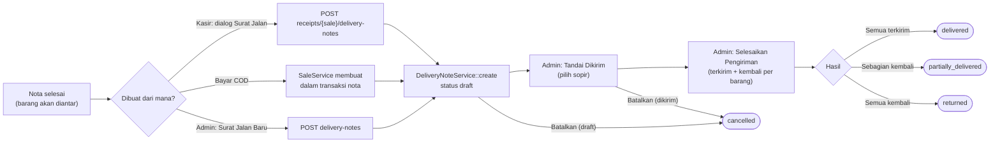
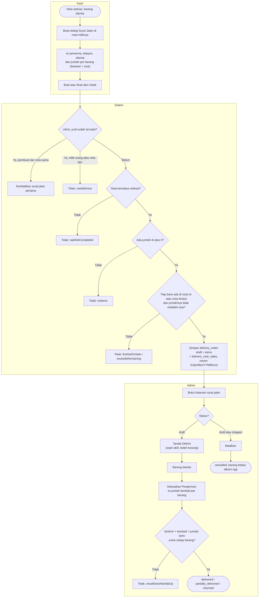
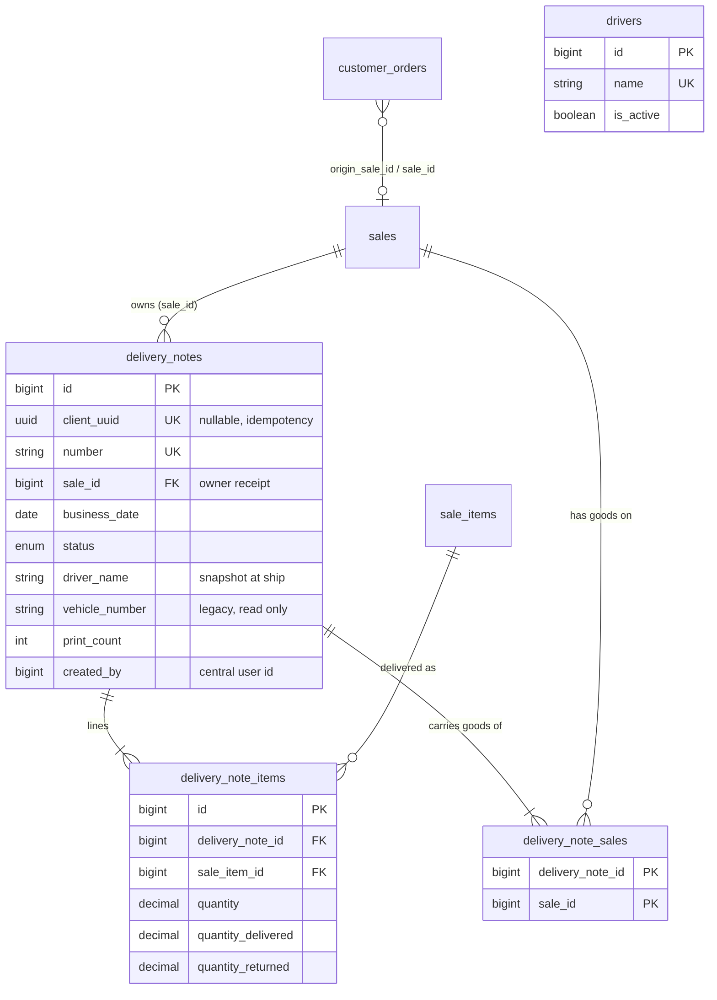
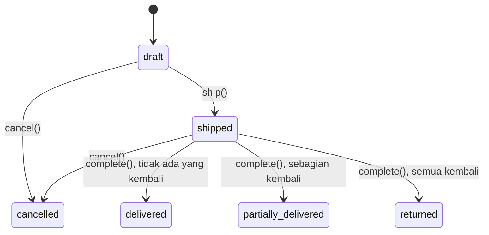
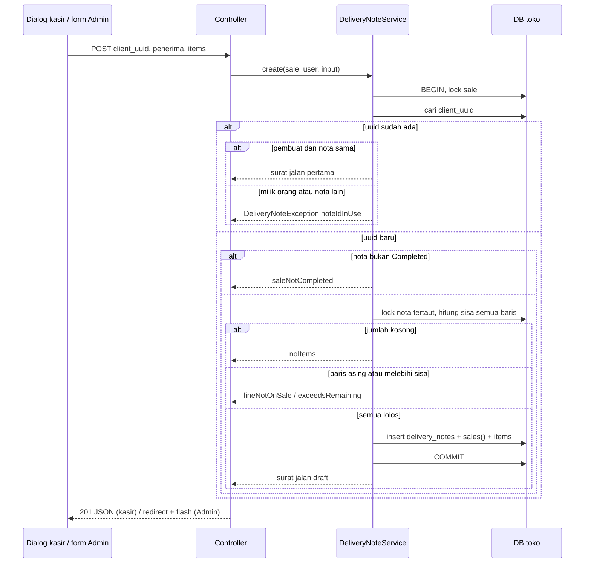

# Surat Jalan dan Sopir — Dokumentasi Teknis

> **Modul:** Surat jalan (delivery note, kode `SJ`) dan daftar sopir (`drivers`)
> **Stack:** Laravel 13 (PHP 8.3), Inertia 3, Vue 3, Quasar 2, stancl/tenancy
> **Audiens:** Engineer yang memelihara atau memperluas fitur ini
> **Database:** per toko (semua tabel di DB toko, bukan DB pusat)
> **Terakhir diperbarui:** 2026-11-17

## 1. Ringkasan

Surat jalan adalah dokumen pengantaran barang untuk **nota yang sudah selesai**: siapa penerimanya, ke alamat mana, barang apa dan berapa banyak, lalu hasilnya (terkirim, sebagian terkirim, atau kembali). Dokumen ini **tidak pernah mengubah stok**: stok sudah berkurang ketika nota dibuat, dan barang yang kembali ke toko diselesaikan lewat Retur nota, bukan lewat surat jalan (kolom `quantity_returned` hanya penanda). Kasir membuat dan mencetak surat jalan untuk nota miliknya dari layar kasir (dan otomatis ikut dibuat saat nota dibayar COD); Admin membuat surat jalan untuk nota mana pun dan satu-satunya yang boleh mengubah statusnya: *Tandai Dikirim* (memilih sopir), *Selesaikan Pengiriman*, atau *Batalkan*.

Dua hal yang membuat modul ini lebih rumit dari kelihatannya. Pertama, satu nota boleh punya beberapa surat jalan (kirim bertahap), jadi sisa yang bisa diantar dihitung per baris nota di semua surat jalan yang tidak dibatalkan. Kedua, satu surat jalan boleh membawa barang **dua nota** bila nota pemilik adalah nota pengambilan pesanan pelanggan yang dibuat bersama nota lain (`origin_sale_id`), supaya pelanggan diantar sekali jalan, bukan dua kali.



### BPMN — dari nota sampai barang diterima



## 2. Skema Database

Semua tabel ada di **DB toko** (`database/migrations/tenant`).

### 2.1 `delivery_notes`

Dibuat oleh `2026_10_27_152511_create_delivery_notes_tables.php`, lalu ditambah `client_uuid` dan indeks `business_date` oleh `2026_11_02_110000_add_client_uuid_to_delivery_notes_table.php`.

| Kolom | Tipe | Null | Catatan |
|---|---|---|---|
| `id` | bigint PK | tidak | |
| `client_uuid` | uuid | **ya** | unique. Nullable hanya karena surat jalan yang dibuat sebelum kolom ini ada tidak punya uuid; semua jalur pembuatan sekarang mengisinya |
| `number` | string | tidak | unique, `SJ/{receipt_prefix}/{YYMM}/{0001}` |
| `sale_id` | FK `sales` | tidak | **nota pemilik** surat jalan. Tanpa `on delete`, jadi nota tidak bisa dihapus selama punya surat jalan |
| `business_date` | date | tidak | diisi `today()` saat dibuat; yang dipakai filter tanggal daftar (berindeks) |
| `status` | enum | tidak | `draft` (bawaan), `shipped`, `delivered`, `partially_delivered`, `returned`, `cancelled`; berindeks |
| `recipient_name` | string | tidak | |
| `recipient_phone` | string | ya | |
| `recipient_address` | text | ya | nullable di skema, tetapi wajib untuk surat jalan COD (dicek `SaleService`) |
| `driver_name` | string | ya | **snapshot nama sopir** yang dipilih saat *Tandai Dikirim*; kosong selama draft atau bila dikirim tanpa sopir |
| `vehicle_number` | string | ya | **sudah tidak diminta** di UI maupun API; hanya terisi di surat jalan lama, tetap ditampilkan |
| `shipped_at`, `completed_at` | datetime | ya | diisi `ship()` dan `complete()` |
| `notes` | text | ya | |
| `print_count` | unsigned int | tidak | bawaan 0; naik setiap cetak (cetak pertama = asli, kedua dst. = SALINAN) |
| `created_by` | unsigned bigint | tidak | id pengguna **pusat**, tanpa foreign key lintas database |
| `created_by_name` | string | tidak | snapshot nama pembuat |
| `created_at`, `updated_at` | timestamps | | |

### 2.2 `delivery_note_items`

| Kolom | Tipe | Null | Catatan |
|---|---|---|---|
| `id` | bigint PK | tidak | |
| `delivery_note_id` | FK | tidak | `cascadeOnDelete` |
| `sale_item_id` | FK `sale_items` | tidak | baris nota yang diantar; **bisa milik nota lain** pada surat jalan gabungan |
| `product_id`, `product_unit_id` | FK | tidak | disalin dari baris nota |
| `product_name`, `unit_name` | string | tidak | snapshot |
| `quantity` | decimal(15,3) | tidak | jumlah yang diantar, dalam satuan jual |
| `quantity_delivered` | decimal(15,3) | tidak | bawaan 0; diisi saat pengiriman diselesaikan |
| `quantity_returned` | decimal(15,3) | tidak | bawaan 0; hanya penanda, stok tidak bergerak |

### 2.3 `delivery_note_sales` (pivot)

Dibuat `2026_11_07_100000_create_delivery_note_sales_table.php`. Mencatat **setiap nota yang barangnya ada di sebuah surat jalan**, termasuk nota pemilik. Kunci utama gabungan `(delivery_note_id, sale_id)`, indeks `sale_id`, `delivery_note_id` `cascadeOnDelete`. Migrasi mengisinya dari `delivery_notes` (`INSERT ... SELECT id, sale_id`), jadi surat jalan lama hanya membawa barang nota pemiliknya. Event `created` di `DeliveryNote::booted()` selalu menautkan nota pemilik, jadi baris pemilik ada walau surat jalan dibuat lewat factory atau jalur lain.

Pivot inilah yang membuat `Sale::deliveryNotes()` berarti "surat jalan yang membawa barang nota ini", bukan "surat jalan yang dimiliki nota ini". Status COD "sudah diantar", daftar COD kasir, tombol *Sudah diantar*, dan blokir void semuanya membaca relasi itu.

### 2.4 `drivers`

Dibuat `2026_11_07_110000_create_drivers_table.php`.

| Kolom | Tipe | Null | Catatan |
|---|---|---|---|
| `id` | bigint PK | tidak | |
| `name` | string | tidak | **unique** (pembanding collation MySQL tidak membedakan huruf besar kecil) |
| `is_active` | boolean | tidak | bawaan true |
| `created_at`, `updated_at` | timestamps | | |

Sopir **tidak pernah dihapus**, hanya dinonaktifkan, dan surat jalan menyimpan namanya (bukan id), jadi mengganti nama atau menonaktifkan sopir tidak mengubah surat jalan lama. Daftar sopir dikelola di halaman Pengaturan Toko sampai ada master karyawan.

### 2.5 ERD



`drivers` sengaja tidak punya garis ke `delivery_notes`: tidak ada foreign key, hanya salinan nama.

## 3. Model / Entity

| Model | Tabel | Catatan |
|---|---|---|
| `DeliveryNote` | `delivery_notes` | `Auditable`. Relasi `sale()` (pemilik), `sales()` (pivot `delivery_note_sales`), `items()`. Cast `status` ke `DeliveryNoteStatus`, `business_date` ke date. `#[Fillable]` tidak memuat `driver_name`/`vehicle_number`: `driver_name` ditulis `ship()` lewat `forceFill`, `vehicle_number` tidak ditulis lagi |
| `DeliveryNoteItem` | `delivery_note_items` | `Auditable` dengan `$auditEvents = ['updated']`: hanya perubahan yang diaudit, dan di situlah tercatat apa yang terkirim dan kembali. Relasi `deliveryNote()`, `saleItem()` |
| `Driver` | `drivers` | `Auditable`, cast `is_active` boolean, `#[Fillable]` name dan is_active |
| `DeliveryNoteStatus` (enum) | | `label()`, `canBeShipped()` (draft), `canBeCompleted()` (shipped), `canBeCancelled()` dan `isUnfinished()` (draft atau shipped), `hasDeliveredGoods()` (delivered atau partially_delivered), `withDeliveredGoods()`, `unfinished()` |

Mesin status:



`delivered`, `partially_delivered`, `returned` dan `cancelled` adalah status akhir: tidak ada jalur keluar.

## 4. Hak Akses

| Area | Rute | Penjaga |
|---|---|---|
| Layar kasir | `tenant.cashier.receipts.delivery`, `receipts.delivery-notes.store`, `delivery-notes.print`, `delivery-notes.sheet` | `auth` + `store.access`. Kasir boleh bertindak hanya untuk nota yang boleh ia tangani: `User::canHandleReceipt()` benar bila `sale.cashier_id` = pengguna **atau** pengguna admin di toko itu |
| Halaman Admin | seluruh `tenant.delivery-notes.*` | tambahan middleware `store.admin` (`EnsureUserIsStoreAdmin`: Super Admin atau Admin Toko, selain itu 403) |

Aturan otorisasi surat jalan di sisi kasir:

- `show()` (dialog) dan `store()` memeriksa nota dari alamatnya (`{sale}`), lewat `authorizeFor()` dan, untuk `store`, lewat `SaveCashierDeliveryNoteRequest::authorize()` (diperiksa **sebelum** isi permintaan divalidasi).
- `print()` dan `sheet()` memeriksa **semua nota di `$deliveryNote->sales`**: pengguna boleh mencetak bila boleh menangani salah satunya. Ini perlu karena dialog nota B menampilkan surat jalan gabungan milik nota A (lewat pivot), jadi kasir nota B harus bisa mencetaknya walau pemiliknya kasir lain.
- Mengubah status (kirim, selesai, batal) **tidak ada di sisi kasir**; hanya Admin.

## 5. Konfigurasi

Modul ini tidak membaca kunci config atau env sendiri. Dua hal yang tampak seperti konfigurasi:

| Hal | Sumber | Catatan |
|---|---|---|
| Kop surat (nama, alamat, telepon toko) | `StoreSettingService::letterhead()` | dipakai `sheetOf()` untuk kertas |
| `delivery_note_show_prices` | hanya `docs/analisis-sistem.md` | **tidak ada di kode** (sudah dicek lewat Grep di seluruh proyek di luar `vendor`). Kertas selalu tanpa harga |

## 6. Rute / API

Prefiks `t/{tenant}/`, middleware dasar `web`, `InitializeTenancyByPath`, `auth`, `store.access`, `shift.remember`.

### 6.1 Kasir

| Method | Path | Action | Nama |
|---|---|---|---|
| GET | `cashier/receipts/{sale}/delivery` | `CashierDeliveryNoteController@show` | `tenant.cashier.receipts.delivery` |
| POST | `cashier/receipts/{sale}/delivery-notes` | `CashierDeliveryNoteController@store` | `tenant.cashier.receipts.delivery-notes.store` |
| POST | `cashier/delivery-notes/{delivery_note}/print` | `CashierDeliveryNoteController@print` | `tenant.cashier.delivery-notes.print` |
| GET | `cashier/delivery-notes/{delivery_note}/sheet` | `CashierDeliveryNoteController@sheet` (+ `signed`) | `tenant.cashier.delivery-notes.sheet` |

### 6.2 Admin (`store.admin`)

| Method | Path | Action | Nama |
|---|---|---|---|
| GET | `delivery-notes` | `index` | `tenant.delivery-notes.index` |
| GET | `delivery-notes/create` | `create` (`?sale=` opsional) | `.create` |
| GET | `delivery-notes/sales` | `sales` (JSON pencarian nota) | `.sales` |
| POST | `delivery-notes` | `store` | `.store` |
| GET | `delivery-notes/{delivery_note}` | `show` | `.show` |
| POST | `delivery-notes/{delivery_note}/ship` | `ship` | `.ship` |
| POST | `delivery-notes/{delivery_note}/complete` | `complete` | `.complete` |
| POST | `delivery-notes/{delivery_note}/cancel` | `cancel` | `.cancel` |
| POST | `delivery-notes/{delivery_note}/print` | `print` | `.print` |
| GET | `delivery-notes/{delivery_note}/sheet` | `sheet` (+ `signed`) | `.sheet` |

Rute terkait COD di kasir (`cashier/cod`, `cod/{sale}/deliveries`, `cod/{sale}/voids`) dimiliki modul COD dan void; lihat `cod-dan-void-docs.md`.

### 6.3 Contoh payload

Nilai di bawah **ilustratif**, disusun dari bentuk resource dan test, bukan hasil tangkapan dari sistem berjalan.

Dialog kasir, `GET cashier/receipts/{sale}/delivery`:

```json
{
  "data": {
    "number": "INV/TCD/K1/2611/0001",
    "customer_name": "Pak Budi",
    "lines": [
      { "id": 41, "name": "Cat Tembok", "unit": "PAIL", "quantity": "10.000", "remaining": "4.000", "sale_number": "INV/TCD/K1/2611/0001" }
    ],
    "notes": [
      { "id": 7, "number": "SJ/TCD/2611/0001", "status": "draft", "status_label": "Draft", "print_count": 0,
        "print_url": "https://.../t/test/cashier/delivery-notes/7/print",
        "items": [{ "sale_item_id": 41, "name": "Cat Tembok", "unit": "PAIL", "quantity": "6.000", "quantity_delivered": "0.000", "quantity_returned": "0.000" }] }
    ]
  }
}
```

Galat dari `store` kasir (HTTP 422, JSON): `{ "message": "Cat Tembok melebihi sisa nota yang belum diantar, sisa 10 PAIL." }`. Dari halaman Admin, galat bisnis kembali sebagai flash `error` (`back()->with('error', ...)`), bukan JSON.

Hasil cetak, `POST .../print`:

```json
{ "data": { "is_copy": true, "print_count": 2, "sheet_url": "https://.../sheet?print=2&expires=...&signature=..." } }
```

## 7. Komponen Backend

### 7.1 `DeliveryNoteService`

Satu-satunya tempat logika surat jalan. Controller hanya meneruskan.

**`create(Sale, User, NoteInput)`**, dalam satu `DB::transaction`:

1. Mengunci baris nota pemilik (`lockForUpdate`).
2. Mencari `client_uuid` yang sudah tercatat (di bawah kunci nota, supaya dua pengiriman bersamaan tidak sama-sama lolos). Bila ada: dikembalikan hanya jika `created_by` dan `sale_id` sama, selain itu `noteIdInUse` (uuid tidak boleh dipakai untuk membaca surat jalan orang lain).
3. Menolak nota yang bukan `Completed`.
4. `requestedQuantities()`: membuang baris berjumlah 0 dan **menjumlahkan** baris yang sama yang dikirim dua kali, sehingga batas sisa diperiksa terhadap total.
5. Mengambil nota tertaut lewat `linkedSaleOf(isLocked: true)` (ikut dikunci), memuat baris dari kedua nota, menghitung sisa dengan `remainingQuantities()`, dan menolak baris yang bukan milik kedua nota (`lineNotOnSale`) atau melebihi sisa (`exceedsRemaining`).
6. Membuat surat jalan `draft` dengan nomor dari `DocumentNumberGenerator::next('SJ', now())` (tanpa register, jadi urutan per bulan se-toko), `business_date = today()`, lalu `sales()->syncWithoutDetaching` untuk semua nota yang barangnya ikut, lalu baris-barisnya.

Urutan kunci: nota pemilik, lalu nota tertaut. `lockedNotesOf()` mengunci surat jalan menurut urutan `id`, sama seperti kunci surat jalan lain.

**`deliverableLines(Sale)` dan `deliverableLinesOf(Collection<Sale>)`.** Baris nota beserta sisa yang belum ada di surat jalan aktif, lalu hal yang sama untuk nota tertaut, masing-masing dengan `sale_number` supaya UI bisa menandai asalnya. Versi massal memakai jumlah query tetap (`linkedSalesOf()` 2 query, baris nota dimuat sekali, `remainingQuantities()` 1 query) sehingga pencarian nota di form Admin tidak lagi membengkak per hasil. `deliverableLines()` hanya membungkusnya untuk satu nota.

**`linkedSaleOf(Sale)`.** Nota tertaut adalah `customer_orders.origin_sale_id` dari pesanan yang dipenuhi nota ini (`customer_orders.sale_id`), selama nota asal masih `Completed`. Inilah satu-satunya cara dua nota berbagi satu surat jalan.

**`remainingQuantities()`.** `quantity` baris nota dikurangi jumlah di semua `delivery_note_items` yang suratnya **bukan** `cancelled`, dalam satu query agregat. Surat jalan `returned` tetap menghitung sebagai sudah diantar; barang itu kembali lewat Retur, bukan dengan membebaskan sisa.

**`deliverableSales(term, limit)`.** Pencarian nota untuk form Admin: nota `Completed` yang masih punya baris dengan sisa positif. Syarat "masih ada sisa" dijalankan di query (`exists ... quantity > coalesce(sum, 0)`), bukan setelah `limit`, jadi nota yang sudah habis tidak menyingkirkan nota yang belum.

**`ship(note, ?Driver)`, `complete(note, outcomes)`, `cancel(note)`.** Masing-masing dalam transaksi dan lewat `lockedWhere()`: surat jalan dibaca ulang dengan kunci baris dan statusnya diperiksa di DB, sehingga dua permintaan tidak bisa sama-sama memajukan surat jalan yang sama dan layar basi mendapat pesan "berstatus X, muat ulang halaman".

- `ship` menulis `driver_name` dari `$driver?->name ?? $note->driver_name` dan `shipped_at`.
- `complete` mewajibkan **setiap** baris surat jalan punya tepat satu hasil (`resultMissing`, `resultNotOnNote`) dan `terkirim + kembali = quantity` (`resultDoesNotAddUp`). Status akhir dari `finalStatus()`: tak ada yang kembali = `delivered`; tak ada yang terkirim = `returned`; selain itu `partially_delivered`.



### 7.2 Pembuatan otomatis untuk nota COD (`SaleService::recordDeliveryNoteOfCod`)

Nota yang dibayar COD **tidak boleh pergi tanpa surat jalan**, jadi surat jalannya dibuat di transaksi yang sama dengan nota (tidak bisa lupa, dan tidak ada surat jalan tanpa nota). Syaratnya nama dan alamat penerima; bila kosong `SaleException::deliveryNoteRequired()`. Barisnya adalah semua sisa nota (`linesOfCodNote`), ditambah sisa nota tertaut hanya bila `include_linked_sale_items` dicentang. `DeliveryNoteException` dibungkus menjadi `SaleException`. Pengecualian: bila checkout juga membuat pesanan dan `hold_delivery` dicentang, surat jalan **sengaja tidak dibuat**; barang disimpan di toko dan keluar pada surat jalan pesanan saat pesanannya datang. Detail di modul penjualan dan pesanan.

### 7.3 `CodSaleService::markDelivered`

Tombol *Sudah diantar* di kasir (modul COD) memakai surat jalan sebagai mesinnya: untuk setiap surat jalan nota itu yang belum selesai, `ship()` bila masih draft lalu `complete()` dengan semua barang terkirim penuh. Surat jalan dikunci dulu lewat `lockedNotesOf()`, jadi Admin yang menyelesaikan atau membatalkan surat jalan yang sama pada saat itu menunggu. Selisih barang (ada yang kembali) memang tidak ditangani di sini; Admin mengisinya di halaman surat jalan.

### 7.4 Cetak

`PrintsDeliveryNotes` memakai `AnswersPrints`. Mencetak dua langkah: `POST .../print` memanggil `PrintCounter::recordPrint()` (transaksi + `lockForUpdate` + `increment('print_count')`, jadi dua register yang mencetak bersamaan sama-sama terhitung) lalu menjawab URL kertas **bertanda tangan** (`URL::temporarySignedRoute`, berlaku 30 menit) yang memuat nomor cetak. Rute `sheet` memakai middleware `signed`, sehingga kertas tidak bisa dibuka tanpa dihitung, dan tulisan SALINAN bergantung pada **nomor cetak di URL**, bukan `print_count` saat ini: cetak ke-2 tetap bertulis SALINAN walau sudah ada cetak ke-5. Surat jalan `cancelled` tercetak bertanda BATAL.

`PrintableDeliveryNoteResource` memperluas `DeliveryNoteResource` dengan `created_at`, `is_copy`, dan kop toko, dan dirender `Pages/Tenant/Print/DeliveryNote.vue` + `Components/DeliveryNoteSheet.vue` (kertas continuous form dot matrix, tanpa harga, empat kolom paraf Pembuat, Penyiap, Pengantar, Penerima).

### 7.5 `DeliveryNoteController`, `CashierDeliveryNoteController`

Tipis. Admin: daftar (`paginateNotes`, 25 per halaman, filter status, tanggal dari-sampai, pencarian), form (`create` menerima `?sale=` dari halaman nota), pencarian nota JSON (`sales`, batas 10), `store`, `show`, `ship`/`complete`/`cancel` yang membungkus hasil lewat `redirectWithOutcome()` (sukses jadi flash `success`, `DeliveryNoteException` jadi flash `error`). Kasir: dialog (`show`), `store` (JSON 201 atau 422), cetak.

Pencarian daftar memakai `orWhereHas('sales', ...)`, jadi surat jalan gabungan ditemukan lewat nomor **nota mana pun** di dalamnya; kolom *Nota* menampilkan nota pemilik lalu `other_sale_numbers`.

### 7.6 Resource

| Resource | Dipakai untuk | Catatan |
|---|---|---|
| `DeliveryNoteResource` | halaman Admin dan dasar kertas | tanpa harga; `other_sale_numbers` (nota lain di surat jalan); `return_sales` = nota tempat barang yang kembali itu dijual, masing-masing dengan `new_return_url` (retur dibuat lewat nota asal barang, bukan selalu nota pemilik); `can_ship`/`can_complete`/`can_cancel`; URL aksi |
| `DeliveryNoteListResource` | baris daftar | mengharapkan `sale`, `sales`, dan `items_count` |
| `CashierDeliveryNoteResource` | dialog kasir | hanya isi dan kemajuan serta `print_url`; tanpa aksi status |
| `PrintableDeliveryNoteResource` | kertas | lihat 7.4 |

### 7.7 `DriverService`

`all()`, `active()` (urut nama), `create()`, `update()` (memakai `forceFill`), dan `sync(rows)` yang dipanggil halaman Pengaturan: baris beridentitas diganti nama atau status, baris tanpa id ditambahkan, sopir yang **tidak ada** di daftar dibiarkan (sopir tidak pernah dihapus). Validasi dan pemeriksaan nama kembar ada di `SaveStoreSettingsRequest` (modul pengaturan toko).

### 7.8 Frontend

| Halaman/komponen | Fungsi |
|---|---|
| `Pages/Tenant/DeliveryNotes/Index.vue` | daftar dengan filter dan pencarian |
| `Pages/Tenant/DeliveryNotes/Create.vue` | cari nota (JSON `sales`), isi penerima dan jumlah. Baris dari nota tertaut diberi tanda *dari nota …* dan **bawaan 0**, sementara baris nota yang dipilih bawaannya sisa penuh |
| `Pages/Tenant/DeliveryNotes/Show.vue` | status, tombol *Tandai Dikirim* (dialog pilih sopir, kosong boleh, tautan ke Pengaturan bila belum ada sopir), *Selesaikan Pengiriman* (jumlah kembali per barang; sisanya dianggap terkirim), *Batalkan*, cetak, dan tombol *Buat Retur* per nota dari `return_sales` |
| `Components/Cashier/DeliveryNoteDialog.vue` | dialog kasir: surat jalan yang sudah ada (dengan *Cetak/Cetak ulang*) dan form baru (*Buat*, *Buat & Cetak*) |
| `Pages/Tenant/Print/DeliveryNote.vue`, `Components/DeliveryNoteSheet.vue` | kertas |
| `Composables/useDeliveryNoteStatus.js` | kelas chip per status |

## 8. Aturan Validasi

**`SaveDeliveryNoteRequest`** (dasar untuk Admin; `SaveCashierDeliveryNoteRequest` mewarisinya dan mengisi `sale_id` dari alamat):

| Field | Aturan | Masuk ke |
|---|---|---|
| `client_uuid` | required, uuid | `delivery_notes.client_uuid` |
| `sale_id` | required, integer, ada di `sales` | `delivery_notes.sale_id` |
| `recipient_name` | required, string, max 255 | `recipient_name` |
| `recipient_phone` | nullable, string, max 255 | `recipient_phone` |
| `recipient_address` | nullable, string, max 1000 | `recipient_address` |
| `notes` | nullable, string, max 1000 | `notes` |
| `items` | required, array, min 1 | baris surat jalan |
| `items.*.sale_item_id` | required, integer, ada di `sale_items` | `delivery_note_items.sale_item_id` |
| `items.*.quantity` | required, numeric, min 0, max 999999, `decimal:0,3` | `delivery_note_items.quantity` (0 = baris dibuang) |

`driver_name` dan `vehicle_number` **tidak lagi diterima** di request ini maupun di `StoreSaleRequest` (`delivery_note.*`): UI tidak menanyakannya dan sopir hanya diisi saat dikirim.

**`ShipDeliveryNoteRequest`:** `driver_id` nullable, integer, ada di `drivers` dengan `is_active = true`; pesan "Sopir tidak ditemukan atau sudah dinonaktifkan. Pilih sopir lain."

**`CompleteDeliveryNoteRequest`:** `results` required array min 1; `results.*.item_id` required, integer, **distinct**; `quantity_delivered` dan `quantity_returned` required, numeric, min 0, max 999999, `decimal:0,3`. Kecocokan dengan isi surat jalan dan jumlahnya diperiksa service, bukan request.

Perilaku gagal semua-atau-tidak: seluruh `create`, `ship`, `complete`, dan `cancel` berjalan dalam transaksi, jadi surat jalan tidak pernah setengah jadi.

## 9. Guard Kepemilikan & Status

| Endpoint | Dicek ulang di server | Diblokir |
|---|---|---|
| Kasir `show`, `store` | `canHandleReceipt(nota di alamat)` | kasir lain (403); `store` diperiksa sebelum body divalidasi |
| Kasir `print`, `sheet` | pengguna boleh menangani **salah satu** nota di `deliveryNote->sales` | pengguna asing (403) |
| `create` (semua jalur) | status nota di DB (`Completed`), `client_uuid` milik pembuat dan nota yang sama, baris milik nota ini atau tertaut, jumlah ≤ sisa di semua surat jalan aktif | nota void, uuid orang lain, baris asing, melebihi sisa |
| `ship` | status DB `draft`; sopir ada dan aktif | surat jalan bukan draft (`wrongStatus`), sopir nonaktif |
| `complete` | status DB `shipped`; setiap baris punya tepat satu hasil; terkirim + kembali = dikirim | status lain, hasil tidak lengkap atau tidak cocok |
| `cancel` | status DB `draft` atau `shipped` | surat jalan yang sudah selesai |

Status selalu dibaca ulang dari DB dengan `lockForUpdate`, bukan dari klien. Pesan galat menyuruh memuat ulang halaman.

## 13. Keterbatasan / Utang Teknis

- **`ship(?Driver)` menerima sopir nonaktif.** Aturan "hanya sopir aktif" hanya ada di `ShipDeliveryNoteRequest`; service tidak memeriksanya dan controller mencari `Driver` lagi di luar transaksi. Aman selama satu-satunya pemanggil adalah controller itu (`DeliveryNoteController::ship`); `CodSaleService::markDelivered` memanggil `ship()` tanpa sopir.
- **`vehicle_number` adalah kolom yatim.** Tidak ada jalur yang menulisnya lagi, tetapi tetap dibaca dan ditampilkan (`DeliveryNoteResource`, `DeliveryNoteSheet.vue`, `Show.vue`) demi surat jalan lama. Menghapusnya butuh migrasi di setiap DB toko.
- **`PrintableDeliveryNoteResource` membocorkan terlalu banyak ke kertas.** Ia memperluas `DeliveryNoteResource`, sehingga halaman cetak yang juga dibuka kasir ikut menerima URL aksi Admin, `return_sales` (URL buat retur), dan flag `can_*`. Tidak berbahaya karena rute Admin tetap dijaga `store.admin`, tetapi bentuk responsnya lebih lebar dari yang dibutuhkan kertas.
- **Surat jalan `returned` tidak membebaskan sisa.** `remainingQuantities()` hanya mengabaikan `cancelled`, jadi barang yang kembali utuh tidak bisa langsung dimasukkan ke surat jalan baru; jalurnya Retur nota lalu nota baru.
- **`delivery_note_show_prices`** disebut di `docs/analisis-sistem.md` tetapi tidak ada di kode.
- **Kasir tidak bisa mengubah status.** Sengaja (Admin saja), tetapi artinya surat jalan yang dibuat kasir tetap `draft` sampai Admin menyentuhnya, kecuali lewat tombol *Sudah diantar* pada nota COD.
- **Balapan nama sopir yang unik** berakhir sebagai galat database 500 (tidak ada penanganan khusus; teoretis karena validasi `after()` sudah memeriksa duplikat).
- **Perilaku kunci `lockedNotesOf()`**: pencarian lewat `whereRelation('sales', ...)` (subquery) lalu `lockForUpdate` belum diverifikasi pada beban nyata bahwa baris yang dikunci persis surat jalan yang dimaksud.
- Tes surat jalan gabungan (void saat Kembali, cetak lintas kasir, sisa lintas dua nota, pencarian, tombol retur, jumlah query) hidup di `CustomerOrderTest`, bukan `DeliveryNoteTest`, karena fixture pesanan hanya ada di sana.

## 14. Indeks File

| Concern | Path |
|---|---|
| Migrasi | `database/migrations/tenant/2026_10_27_152511_create_delivery_notes_tables.php`, `2026_11_02_110000_add_client_uuid_to_delivery_notes_table.php`, `2026_11_07_100000_create_delivery_note_sales_table.php`, `2026_11_07_110000_create_drivers_table.php` |
| Model | `app/Models/DeliveryNote.php`, `DeliveryNoteItem.php`, `Driver.php`; enum `app/Enums/DeliveryNoteStatus.php` |
| Service | `app/Services/DeliveryNoteService.php`, `DriverService.php`, `PrintCounter.php`, `DocumentNumberGenerator.php`; pemanggil lain: `SaleService.php` (COD), `CodSaleService.php`, `SaleVoidService.php` |
| Controller | `app/Http/Controllers/Tenant/DeliveryNoteController.php`, `CashierDeliveryNoteController.php`; trait `Concerns/PrintsDeliveryNotes.php`, `Concerns/AnswersPrints.php` |
| Request | `app/Http/Requests/Tenant/SaveDeliveryNoteRequest.php`, `SaveCashierDeliveryNoteRequest.php`, `ShipDeliveryNoteRequest.php`, `CompleteDeliveryNoteRequest.php` |
| Resource | `app/Http/Resources/DeliveryNoteResource.php`, `DeliveryNoteListResource.php`, `CashierDeliveryNoteResource.php`, `PrintableDeliveryNoteResource.php` |
| Exception | `app/Exceptions/DeliveryNoteException.php` |
| Middleware | `app/Http/Middleware/EnsureUserIsStoreAdmin.php` (`store.admin`) |
| Rute | `routes/tenant.php` (grup `cashier` dan grup `store.admin` → `delivery-notes`) |
| Halaman Admin | `resources/js/Pages/Tenant/DeliveryNotes/Index.vue`, `Create.vue`, `Show.vue` |
| Kasir | `resources/js/Components/Cashier/DeliveryNoteDialog.vue` |
| Kertas | `resources/js/Pages/Tenant/Print/DeliveryNote.vue`, `resources/js/Components/DeliveryNoteSheet.vue` |
| Composable | `resources/js/Composables/useDeliveryNoteStatus.js` |
| Test | `tests/Feature/Tenancy/DeliveryNoteTest.php`, `CashierDeliveryNoteTest.php`, `DriverTest.php`, `CodSaleTest.php`, `CustomerOrderTest.php` (surat jalan gabungan) |
