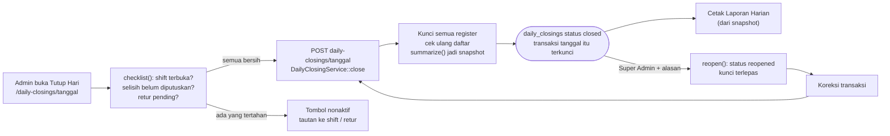
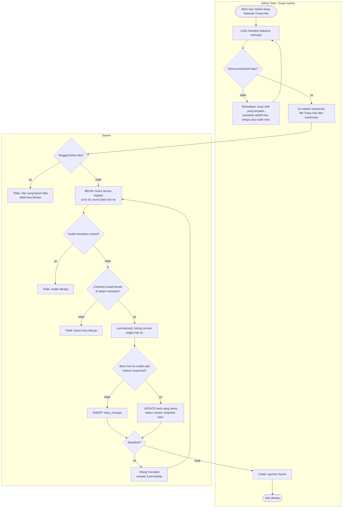
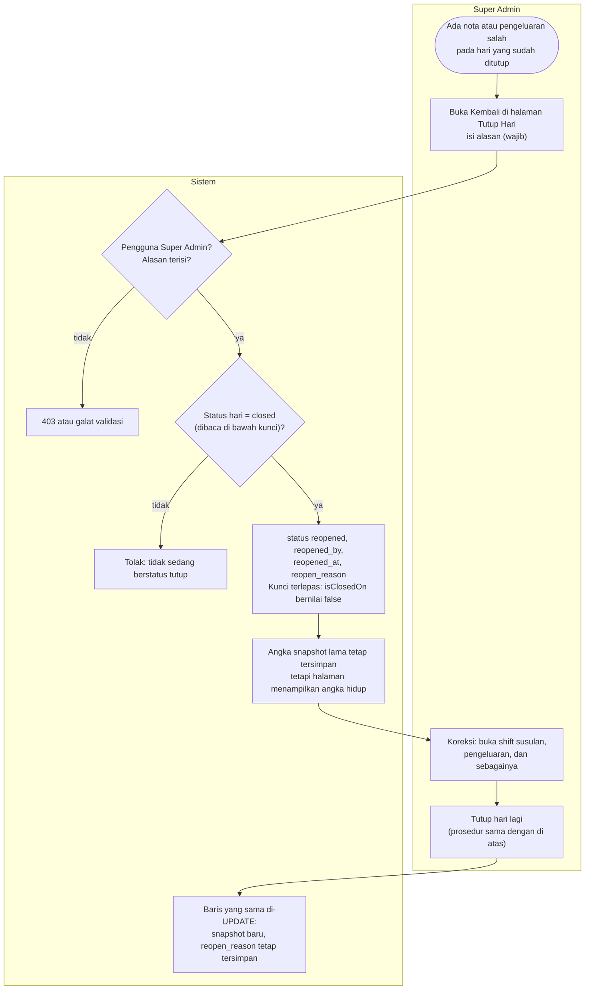
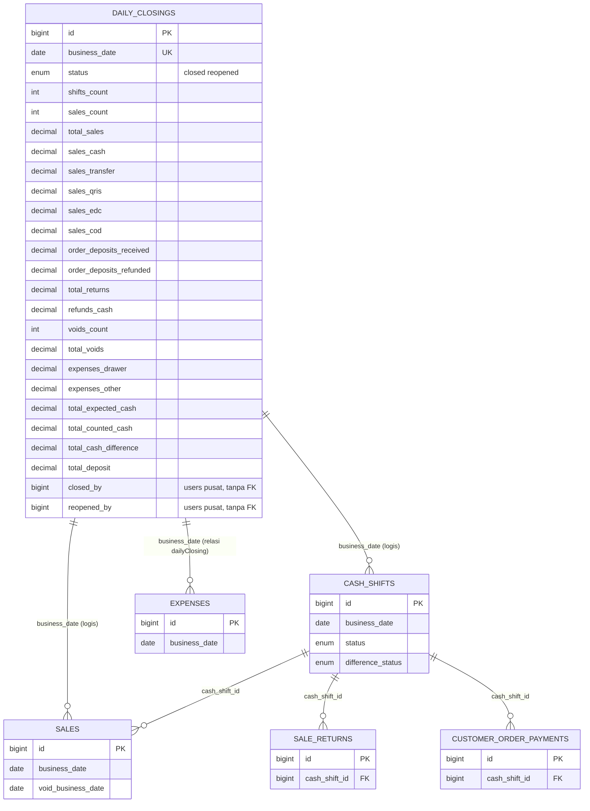
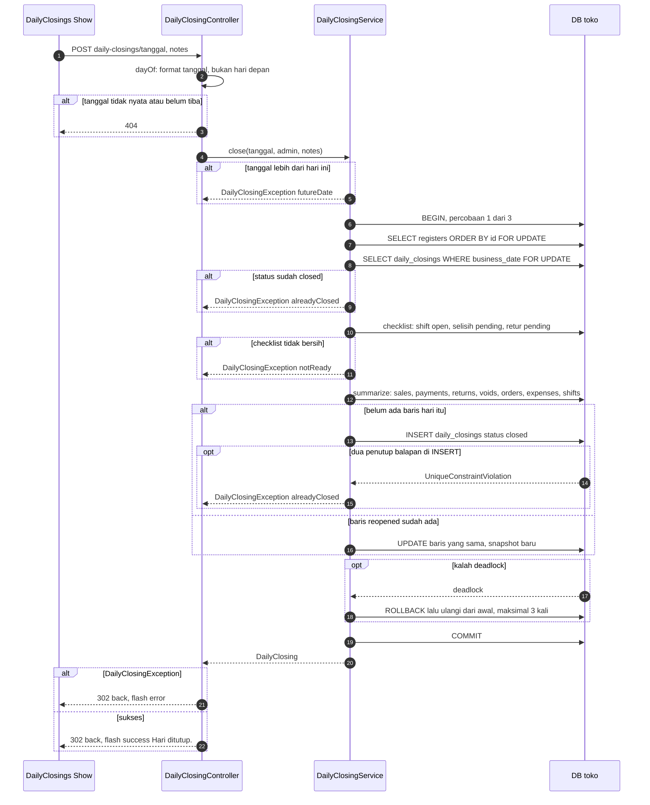

# Tutup Hari, Laporan Penjualan, dan Dashboard Toko — Dokumentasi Teknis

> **Modul:** Tutup hari (`DailyClosing`), laporan penjualan per periode (`SalesReportService`), dan dashboard toko (`StoreDashboardService`)
> **Stack:** Laravel 13 (PHP 8.3), Inertia 3, Vue 3, Quasar 2, stancl/tenancy
> **Audiens:** Engineer yang memelihara atau memperluas fitur ini
> **Database:** per toko (satu-satunya tabel baru, `daily_closings`, ada di DB toko; laporan dan dashboard hanya membaca tabel modul lain). `closed_by` dan `reopened_by` menunjuk ke `users` di DB pusat tanpa foreign key
> **Terakhir diperbarui:** 2026-11-17

## 1. Ringkasan

Tiga hal yang berbagi satu gagasan: **hari bisnis** (`business_date`) adalah tanggal buka shift, dan semua angka dikelompokkan ke hari itu, bukan ke jam kalender.

- **Tutup hari** dipakai Admin untuk menyelesaikan satu hari: memastikan tidak ada shift berjalan, tidak ada selisih kas yang belum diputuskan, dan tidak ada retur menunggu persetujuan; lalu menyimpan **snapshot angka hari itu** ke `daily_closings` dan **mengunci** transaksi tanggal itu (shift baru dan pengeluaran sumber lain pada tanggal itu ditolak). Hari yang sudah ditutup hanya bisa dibuka kembali oleh Super Admin dengan alasan, lalu harus ditutup ulang. Laporan Harian (A4) dicetak dari snapshot, bukan dihitung ulang.
- **Laporan penjualan** menampilkan periode bebas (bawaan 7 hari, maksimum 366 hari): penjualan kotor, retur, bersih, nota, perkiraan laba kotor, rincian per hari, per metode bayar (COD dipecah sudah/belum diantar), per kasir, dan per barang (30 teratas).
- **Dashboard toko** memberi Admin ringkasan hari ini: penjualan bersih, jumlah barang di bawah stok minimum, daftar "Perlu tindakan" (selisih kas, retur menunggu, surat jalan belum selesai), dan shift yang sedang berjalan. Kasir tidak pernah melihatnya; ia dialihkan ke layar kasir.

Mengapa snapshot, bukan hitung ulang: nota, retur, dan pengeluaran bisa dikoreksi atau di-void di hari-hari sesudahnya (mis. COD ditolak di pintu). Laporan harian yang sudah dicetak dan ditandatangani tidak boleh berubah angkanya. Karena itu hari tertutup selalu menampilkan angka yang tersimpan, dan hari yang dibuka kembali menampilkan angka hidup (sementara) sampai ditutup ulang.



### BPMN — tutup hari



### BPMN — buka kembali dan tutup ulang



---

## 2. Skema Database

### `daily_closings` (DB toko)

Satu baris per tanggal bisnis. Tidak ada FK ke tabel lain: baris ini adalah **salinan angka** (snapshot) plus penanda kunci, dan terhubung ke data hari itu hanya secara logis lewat `business_date`.

| Kolom | Tipe | Null | Catatan |
|---|---|---|---|
| `id` | bigint, PK | | |
| `business_date` | date | tidak | **unique**: satu baris per hari; hari yang dibuka kembali memakai baris yang sama |
| `status` | enum | tidak | `closed`, `reopened`; default `closed` |
| `shifts_count` | unsigned int | tidak | default 0; semua shift hari itu apa pun statusnya |
| `sales_count` | unsigned int | tidak | default 0; nota `completed` |
| `total_sales` | decimal(15,2) | tidak | default 0; total nota `completed` |
| `sales_cash` | decimal(15,2) | tidak | default 0; tunai diterima setelah kembalian |
| `sales_transfer`, `sales_qris`, `sales_edc` | decimal(15,2) | tidak | default 0 |
| `sales_cod` | decimal(15,2) | tidak | default 0; ditambah migrasi `2026_11_03_100000`; bagian COD dari nota `completed` (belum uang masuk) |
| `order_deposits_received` | decimal(15,2) | tidak | default 0; ditambah migrasi `2026_11_05_130000`; DP pesanan pelanggan diterima di shift hari itu, semua metode |
| `order_deposits_refunded` | decimal(15,2) | tidak | default 0; DP pesanan dikembalikan |
| `total_returns` | decimal(15,2) | tidak | default 0; nilai retur `completed` |
| `refunds_cash` | decimal(15,2) | tidak | default 0; refund tunai retur ditambah DP void tunai yang dikembalikan |
| `voids_count` | unsigned int | tidak | default 0; ditambah migrasi `2026_11_03_100000` |
| `total_voids` | decimal(15,2) | tidak | default 0; jumlah total nota yang di-void pada hari ini |
| `expenses_drawer`, `expenses_other` | decimal(15,2) | tidak | default 0; pengeluaran `recorded` per sumber |
| `total_expected_cash`, `total_counted_cash`, `total_cash_difference`, `total_deposit` | decimal(15,2) | tidak | default 0; jumlah dari shift **berstatus `closed`** pada hari itu |
| `notes` | text | ya | catatan penutupan Admin (opsional) |
| `closed_by` | unsigned bigint | tidak | `users.id` pusat; tanpa FK karena beda database |
| `closed_at` | dateTime | tidak | |
| `reopened_by` | unsigned bigint | ya | terisi saat dibuka kembali |
| `reopened_at` | dateTime | ya | |
| `reopen_reason` | string(255) | ya | |
| `created_at`, `updated_at` | timestamp | ya | |

Kolom `closed_by`/`closed_at` tidak nullable karena baris **hanya** dibuat saat penutupan berhasil. Kolom `reopened_*` nullable karena kebanyakan hari tidak pernah dibuka kembali. Setelah ditutup ulang, `reopened_by/at/reason` **tidak dihapus** (hanya ditimpa oleh pembukaan berikutnya); ini dikunci oleh tes `test_a_super_admin_reopens_a_day_with_a_reason_and_it_is_closed_again_afterwards`, walaupun docblock model menyebut "until it is closed again".

Tidak ada tabel baru untuk laporan penjualan maupun dashboard.

### Tabel yang dibaca modul ini (modul lain)

| Tabel (DB toko) | Kolom yang dipakai |
|---|---|
| `cash_shifts` | `business_date`, `status`, `difference_status`, `expected_cash`, `counted_cash`, `cash_difference`, `deposit_amount`, `opened_at`, `register_id` |
| `sales` | `business_date`, `status`, `total`, `change_amount`, `cash_shift_id`, `void_business_date`, `void_cash_shift_id`, `void_cash_refund`, `voided_at`, `cashier_id`, `cashier_name` |
| `sale_payments` | `method`, `amount`, `sale_id` |
| `sale_items`, `sale_return_items` | `subtotal`, `cost_total`, `base_quantity`, `refund_subtotal`, `product_id` |
| `sale_returns` | `status`, `cash_shift_id`, `credit_amount`, `refund_amount`, `refund_method` |
| `customer_order_payments` | `cash_shift_id`, `kind`, `amount` |
| `expenses` | `business_date`, `status`, `source`, `amount` |
| `delivery_notes` | `status`, `business_date`, `sale_id` |
| `stock_opnames`, `stock_opname_items` | `status`, `reason_code`, `posted_at`, `dead_stock_quantity`, `cost_price_at_posting`, `variance` (rugi dead stock di laporan) |
| `products` | `is_active`, stok minimum (dashboard) |

### Diagram relasi



Garis `DAILY_CLOSINGS` ke tabel lain adalah hubungan **logis** (sama-sama `business_date`), bukan foreign key. Satu-satunya relasi Eloquent ke arah ini adalah `Expense::dailyClosing()` (`belongsTo` dengan kunci `business_date` ke `business_date`), dipakai agar daftar pengeluaran menanyakan status hari sekali untuk semua baris, bukan per baris.

---

## 3. Model / Entity

| Model | Tabel | Hal penting |
|---|---|---|
| `App\Models\DailyClosing` | `daily_closings` | `Auditable` (penutupan dan pembukaan kembali tercatat di `audits` toko; tes memastikan event `created` lalu `updated` dengan `status = reopened`). Cast `business_date` date, `status` → `DailyClosingStatus`, semua kolom uang `decimal:2` (daftar di konstanta `MONEY_FIELDS`, juga dipakai `DailyClosingResource`). Relasi `closedBy()`, `reopenedBy()` ke `User` (DB pusat). **Statis:** `isClosedOn(CarbonInterface)` (true hanya bila status `closed`; hari `reopened` terbuka) dan `lockAgainstClosing()` (mengunci semua baris `registers` berurutan id) |
| `App\Enums\DailyClosingStatus` | | `Closed` ("Ditutup"), `Reopened` ("Dibuka kembali") |
| `App\Exceptions\DailyClosingException` | | `alreadyClosed`, `notReady`, `futureDate`, `notClosed`; pesannya aman ditampilkan ke Admin |

`DailyClosing` tidak punya factory; tes membuat baris lewat layanan sungguhan. `SalesReportService` dan `StoreDashboardService` tidak punya model sendiri.

---

## 4. Hak Akses

| Aksi | Rute | Siapa | Cara ditegakkan |
|---|---|---|---|
| Lihat dashboard toko | `GET t/{tenant}/` | Admin Toko, Super Admin | `store.access`; **Kasir dialihkan** ke `tenant.cashier.index` di `DashboardController` (bukan middleware) |
| Lihat Tutup Hari, riwayat, laporan harian | `GET daily-closings...` | Admin Toko, Super Admin | grup `store.admin` |
| Tutup hari | `POST daily-closings/{date}` | Admin Toko, Super Admin | `store.admin`; `CloseDailyRequest::authorize()` selalu `true` |
| Buka kembali hari | `POST daily-closings/{date}/reopenings` | **Super Admin saja** | `ReopenDailyClosingRequest::authorize()` memeriksa `is_super_admin` (jawaban `403`); tombol di halaman hanya tampil bila `can_reopen` |
| Laporan penjualan dan cetaknya | `GET reports/sales`, `reports/sales/sheet` | Admin Toko, Super Admin | grup `store.admin` |

Halaman cetak (`daily-closings/{date}/sheet`, `reports/sales/sheet`) **tidak** memakai middleware `signed` (berbeda dengan nota, surat jalan, dan pesanan): sesuai komentar di `routes/tenant.php`, lembar laporan boleh dibuka berulang oleh siapa pun yang punya akses ini, jadi tidak perlu tanda tangan satu kali pakai.

---

## 5. Konfigurasi

Tidak ada kunci `config/` atau variabel `.env` untuk modul ini. Batas-batasnya adalah konstanta kode:

| Konstanta | Nilai | Dibaca oleh | Arti |
|---|---|---|---|
| `DailyClosingService::HISTORY_LIMIT` | 10 | `recent()` | Riwayat hari yang ditutup atau dibuka kembali, terbaru dulu |
| `DailyClosingService::TRANSACTION_ATTEMPTS` | 3 | `close()` | Percobaan ulang transaksi bila kalah deadlock |
| `SalesReportService::MAX_DAYS` | 366 | `period()`, `ReportController` | Periode lebih panjang dipotong dari awalnya (`is_cut_back` memberi tahu halaman) |
| `SalesReportService::DEFAULT_DAYS` | 7 | `period()` | Bila tanggal tidak dikirim: 7 hari terakhir, hari ini termasuk |
| `SalesReportService::PRODUCT_LIMIT` | 30 | `report()` | Barang yang dirinci; `product_count` memberi total sebenarnya |
| `StoreDashboardService::APPROVAL_LIMIT` | 5 | dashboard | Panjang daftar approval dan surat jalan; hitungan total tetap penuh |
| `StoreSettingService::letterhead()` | kop toko (nama, alamat, telepon) | `DailyClosingController::sheet`, `ReportController::salesSheet` | Kop pada lembar cetak. Laporan Harian dan laporan penjualan dicetak A4 dan **tidak** memakai `paperWidth()` (58/80 mm hanya untuk laporan shift dan struk) |

---

## 6. Rute / API

Semua di bawah `t/{tenant}/` dengan `web`, `InitializeTenancyByPath`, `auth`, `store.access`, `shift.remember`; semua kecuali dashboard juga `store.admin`. Seluruhnya halaman Inertia atau redirect (tidak ada JSON).

| Method | Path | Action | Nama rute |
|---|---|---|---|
| GET | `/` | `DashboardController` (invokable) | `tenant.dashboard` |
| GET | `daily-closings` | `DailyClosingController@index` (redirect ke hari ini) | `tenant.daily-closings.index` |
| GET | `daily-closings/{date}` | `@show` | `tenant.daily-closings.show` |
| POST | `daily-closings/{date}` | `@store` | `tenant.daily-closings.store` |
| POST | `daily-closings/{date}/reopenings` | `@reopen` | `tenant.daily-closings.reopen` |
| GET | `daily-closings/{date}/sheet` | `@sheet` | `tenant.daily-closings.sheet` |
| GET | `reports/sales` | `ReportController@sales` | `tenant.reports.sales` |
| GET | `reports/sales/sheet` | `ReportController@salesSheet` | `tenant.reports.sales.sheet` |

`{date}` dibatasi regex `\d{4}-\d{2}-\d{2}`, lalu `DailyClosingController::dayOf()` memvalidasi lagi: format harus cocok persis, tanggal yang tidak nyata (`2026-02-30`, yang oleh Carbon bisa "berguling" menjadi 2 Maret) ditolak dengan **404**, begitu juga tanggal setelah hari ini. `reports/sales` menerima query `from` dan `to` (`Y-m-d`); nilai tidak valid diabaikan seolah tidak dikirim.

### Contoh (ilustratif, bukan hasil tangkapan)

**Tutup hari:** `POST /t/mitra_utama/daily-closings/2026-11-16` dengan `{ "notes": "Selisih kas shift 2 disetujui" }`. Sukses: redirect `back()` dengan flash `success = "Hari ditutup."`. Gagal: flash `error`, salah satu dari:

```text
Hari 16/11/2026 belum bisa ditutup. Selesaikan dulu shift yang masih terbuka, selisih kas yang belum diputuskan, atau retur yang menunggu persetujuan, lalu coba lagi.
Hari 16/11/2026 sudah ditutup.
Hari yang belum tiba tidak bisa ditutup.
```

**Buka kembali:** `POST /t/mitra_utama/daily-closings/2026-11-16/reopenings` dengan `{ "reason": "Nota salah catat" }`. Sukses: flash `success = "Hari dibuka kembali. Tutup lagi setelah koreksi selesai."`. Alasan kosong: `errors.reason = "Isi alasan membuka kembali hari ini."`. Bukan Super Admin: `403`. Hari tidak sedang `closed`: flash `error = "Hari 16/11/2026 tidak sedang berstatus tutup, jadi tidak bisa dibuka kembali."`.

**Props halaman `Tenant/DailyClosings/Show`** (kerangka dari kode; nilai ilustratif):

```json
{
  "date": "2026-11-16",
  "closing": { "business_date": "2026-11-16", "status": "closed", "status_label": "Ditutup", "closed_by_name": "Rina", "figures": { "shifts_count": 2, "sales_count": 41, "voids_count": 1, "total_sales": "5120000.00" } },
  "checklist": { "can_close": true, "open_shifts": [], "pending_differences": [], "pending_return_count": 0, "unfinished_delivery_note_count": 2 },
  "figures": { "sales_count": 41, "total_sales": "5120000.00" },
  "can_reopen": false
}
```

`closing` bernilai `null` untuk hari yang belum pernah ditutup. `figures` adalah snapshot bila `closing.status = closed`, selain itu angka hidup dari `summarize()`.

---

## 7. Komponen Backend

### `DailyClosingService`

**`checklist(date)`** menjawab "apa yang menahan penutupan hari ini". Tiga hal **memblokir** (`can_close`), satu hanya pengingat:

| Syarat | Cara dicek |
|---|---|
| Tidak ada shift terbuka | `cash_shifts` pada `business_date` itu dengan `status = open` |
| Tidak ada selisih kas belum diputuskan | `cash_shifts` pada hari itu dengan `difference_status = pending_approval`. Shift `pending_review` selalu berstatus selisih ini, jadi tertutup lewat sini; karena itu tidak ada pemeriksaan terpisah untuk status `pending_review` |
| Tidak ada retur `pending` | `sale_returns` dengan `cash_shift_id` ∈ shift hari itu, `status = pending` |
| *(pengingat)* surat jalan belum selesai | `delivery_notes` berstatus `unfinished()` (draft, dikirim) dengan `business_date <= hari ini yang ditutup`; **tidak** memblokir karena pengiriman bisa memakan hari |

Cakupan checklist hanya shift pada tanggal yang dipilih. Shift terlupa dari hari sebelumnya tidak menghalangi penutupan hari ini; ia menghalangi penutupan hari ia dibuka. Dokumen kebutuhan menyebut juga peringatan "void pending", yang **tidak ada** di kode (lihat §13).

**`summarize(date)`** menyusun semua angka snapshot. Setiap angka dan sumbernya:

| Kolom | Cara menghitung |
|---|---|
| `shifts_count` | semua shift pada `business_date` (status apa pun) |
| `sales_count`, `total_sales` | nota `completed` dengan `sales.business_date` = hari itu |
| `sales_cash/transfer/qris/edc` | `sum(sale_payments.amount)` per metode untuk nota `completed` **dan `voided`** pada hari itu; tunai dikurangi `sum(change_amount)` nota yang sama. Uang DP dari nota yang kemudian di-void memang pernah masuk, dan keluar kembali sebagai `refunds_cash`. Itu sebabnya jumlah metode bisa lebih besar dari `total_sales` (UI memberi catatan) |
| `sales_cod` | bagian COD (`method = cod`) dari nota **`completed`** saja. Uang yang akan ditagih saat barang diantar |
| `total_returns` | `credit_amount` retur `completed` pada shift-shift hari itu (retur dihitung ke **hari shift tempat retur dibuat**, bukan hari nota asal) |
| `refunds_cash` | `refund_amount` retur `completed` bermetode tunai di shift hari itu, **ditambah** `void_cash_refund` nota yang di-void oleh shift hari itu (`void_cash_shift_id`) |
| `voids_count`, `total_voids` | nota `voided` dengan `void_business_date` = hari itu, **apa pun hari nota dijual**. Nota COD kemarin yang ditolak di pintu hari ini adalah void **hari ini**, dan hilang dari angka penjualan hari ia dijual |
| `order_deposits_received/refunded` | `customer_order_payments` pada shift-shift hari itu, per `kind` (`deposit`/`refund`), semua metode. DP **bukan penjualan**: barang baru terjual ketika pesanan diambil |
| `expenses_drawer`, `expenses_other` | `expenses` berstatus `recorded` dengan `expenses.business_date` = hari itu, dikelompokkan per `source` |
| `total_expected_cash`, `total_counted_cash`, `total_cash_difference`, `total_deposit` | jumlah kolom yang sama dari shift **berstatus `closed`** pada hari itu |

**`close(date, admin, notes)`:**

1. Tanggal setelah hari ini → `futureDate` (sebelum membuka transaksi).
2. `DB::transaction(..., 3)`: ulang bila kalah deadlock.
3. Di dalam: `DailyClosing::lockAgainstClosing()` (kunci semua `registers` berurut id) **sebelum membaca apa pun**; kunci baris `daily_closings` hari itu; bila sudah `closed` → `alreadyClosed`; **checklist dihitung ulang** (bukan memercayai halaman) → `notReady` bila tidak bersih; `summarize()`; bila belum ada baris → `INSERT`, bila ada (status `reopened`) → `UPDATE` baris yang sama dengan snapshot baru, status `closed`, `closed_by`, `closed_at`. `notes` dipangkas, kosong menjadi `null`.
4. `UniqueConstraintViolationException` (dua penutupan hari yang belum punya baris sama-sama sampai ke `INSERT`) ditangkap di luar transaksi dan diubah menjadi `alreadyClosed`.

Mengapa mengunci register? Tidak ada satu baris yang bisa dikunci untuk "hari" sebelum baris itu ada. Register adalah baris yang **semua** pemesan hari itu berbagi: `ShiftService::open` mengunci register-nya sendiri, dan `ExpenseService`, `CustomerOrderService`, serta `SaleVoidService` memanggil `DailyClosing::lockAgainstClosing()`. Hasilnya: pembukuan yang sedang berjalan ikut masuk ke daftar dan angka, atau ditolak oleh hari yang sudah tertutup, tidak pernah "lolos" setelah angka dibaca. Urutan kunci (register urut id) menghindari deadlock antar pemanggil; deadlock yang tersisa ditangani percobaan ulang.



**`reopen(date, superAdmin, reason)`**: `DB::transaction`, baca baris hari itu dengan `lockForUpdate`; bila bukan `closed` (tidak ada baris atau sudah `reopened`) → `notClosed`; set `status = reopened`, `reopened_by`, `reopened_at`, `reopen_reason` (dipangkas). Service **mengandalkan pemanggil** sudah memeriksa Super Admin (`ReopenDailyClosingRequest`); service sendiri tidak memeriksa. Snapshot lama tidak dihapus, tetapi tidak ditampilkan sebagai "angka resmi": untuk hari `reopened`, `DailyClosingController::show` memakai `summarize()` hidup.

**`find`, `recent`, `voidsOf(date)`**: `voidsOf` mendaftar nota yang di-void pada hari itu (berdasar `void_business_date`, urut `voided_at`) untuk halaman dan cetakan; selalu hidup, bukan snapshot (aman karena void pada hari tertutup ditolak).

### Siapa yang menghormati kunci hari tertutup

"Terkunci" tidak berarti satu tempat memeriksa semuanya. Yang benar-benar ditolak oleh hari tertutup, hasil Grep `isClosedOn` di `app/`:

| Tempat | Pemeriksaan |
|---|---|
| `ShiftService::open` | `DailyClosing::isClosedOn(today())`: **hanya hari ini**, karena shift selalu dibuka pada tanggal hari ini |
| `ExpenseService::recordFromOtherSource` | `isClosedOn($businessDate)` di bawah `lockAgainstClosing()`; pengeluaran sumber lain tidak bisa ditambah ke hari tertutup |
| `Expense::voidBlocker()` | tidak bisa membatalkan pengeluaran hari tertutup; pengeluaran laci sudah terkunci karena shift-nya bukan `open` |
| `SaleVoidService::voidBlocker` | void nota COD ditolak bila **hari ini** tertutup |
| `CustomerOrderService::refundDeposit` | pengembalian DP ditolak bila hari ini tertutup |

Penjualan dan retur tidak punya pemeriksaan sendiri: keduanya butuh shift `open`, dan tidak ada shift yang bisa terbuka di hari tertutup. **Opname stok tidak dikunci** (sesuai `docs/analisis-sistem.md` 7.7d butir 3).

### `DailyClosingController` dan `DailyClosingResource`

- `show`: `figures` = `closing->figures` (snapshot) bila `closed`, selain itu `summarize()`; checklist; `voids`; `history` (`recent()`); `can_reopen = is_super_admin`; URL aksi.
- `sheet`: hanya hari `closed` (selain itu 404). Isi: `DailyClosingResource` (snapshot), kop toko, baris per shift (`shiftRowsOf`: seharusnya, dihitung, selisih, setoran per shift) dan daftar void.
- `DailyClosingResource` mengeluarkan `figures` dari `MONEY_FIELDS` plus `shifts_count`, `sales_count`, `voids_count`; mengharapkan `closedBy` dan `reopenedBy` sudah dimuat (tes menjaga agar riwayat tidak N+1).

### `SalesReportService`

Dipanggil `ReportController` dua kali (halaman dan lembar cetak) dengan `period()` yang sama.

- **`period(from, to)`**: `to` bawaan hari ini, `from` bawaan `to − 6 hari`; `from > to` ditukar; periode lebih dari 366 hari dipotong dari awal (`is_cut_back`).
- **`report(from, to)`** → `totals`, `days`, `methods`, `cashiers`, `products`, `product_count`, `products_without_cost`.
- **Aturan hari**: nota dan penjualan ke `sales.business_date`; retur ke `cash_shifts.business_date` shift tempat retur dibuat; void ke `sales.void_business_date`; rugi dead stock ke `date(stock_opnames.posted_at)` (kalender, bukan hari bisnis). Nota yang dijual hari A dan di-void hari B dihitung di penjualan A dan di void B, tidak pernah dua kali atau nol kali. Hari tanpa penjualan tetap punya baris.
- **Per hari** (`days`): `gross_total` (nota `completed`), `returns_total` (`credit_amount`), `net_total = gross − returns`, `receipt_count`, `voids_count/voids_total`, `dead_stock_loss`, dan `gross_profit = (omzet barang − HPP) − (omzet barang retur − HPP retur) − rugi dead stock`. HPP = `sale_items.cost_total`, yang di R1 mengikuti harga beli terakhir saat nota dibuat, jadi laba **perkiraan**. Barang tanpa harga beli dihitung sebagai biaya 0 dan ditandai `is_cost_missing`.
- **Per metode** (`methods`): hanya nota `completed`. Tunai dikurangi kembalian; transfer, QRIS, EDC apa adanya; **COD dipecah** menjadi `cod_delivered` ("COD (sudah diantar)", nilai COD nota yang barangnya ada di surat jalan berstatus terkirim atau sebagian terkirim, dicari lewat pivot `delivery_note_sales` sehingga satu surat jalan gabungan menandai kedua notanya, sama dengan ringkasan shift) dan `cod_undelivered` ("COD (belum diantar)": total COD dikurangi bagian sudah diantar); `order_deposit` dan `return_credit` hanya muncul bila positif (nota yang dilunasi DP pesanan atau kredit retur). Maksud halaman: baris-baris ini menjumlah ke penjualan kotor periode (dijaga tes `test_the_methods_add_up_to_the_sales_of_the_period`). Beda dengan snapshot tutup hari yang **menyertakan** nota void (lihat §13).
- **Per kasir**: dari nota `completed`, **sebelum retur** (retur tidak terikat ke kasir penjual maupun metode bayar nota asal), urut total terbesar.
- **Per barang**: 30 teratas menurut laba; `margin_percent` satu desimal, nol bila omzet nol.

### `StoreDashboardService` dan `DashboardController`

(Dashboard toko juga disinggung di `multi-toko-pengguna-docs.md`; penjelasan angka di bawah adalah satu-satunya yang ada di sisi dokumen ini.)

`DashboardController` mengalihkan Kasir ke layar kasir, selain itu merender `Tenant/Dashboard` dengan `StoreDashboardService::summary(today())`:

| Prop | Angka | Sumber |
|---|---|---|
| `sales.gross_total/returns_total/net_total/receipt_count` | penjualan bersih **hari ini** | nota `completed` dengan `business_date = today`, dikurangi `credit_amount` retur `completed` pada shift-shift berhari bisnis hari ini (aturan sama dengan laporan dan tutup hari) |
| `low_stock_count` | barang di bawah stok minimum | `Product::belowMinimumStock()`: produk aktif yang stok gudang jualnya di bawah minimum; produk tanpa minimum tidak pernah "rendah" |
| `pending.returns/cash_differences/delivery_notes/total` | hitungan "Perlu tindakan" | retur `pending`, shift dengan `difference_status = pending_approval`, surat jalan `unfinished()`; **seluruh riwayat**, tidak dibatasi hari |
| `approvals` | 5 retur pending terbaru dan 5 selisih kas terbaru | `ApprovalKind::SaleReturn` (`return`) dan `ApprovalKind::CashDifference` (`cash_difference`); nilai enum itulah kunci yang dibaca `Dashboard.vue` untuk memilih label dan tautan |
| `unfinished_delivery_notes` | 5 surat jalan tertua yang belum selesai | `delivery_notes` urut `id` naik, dengan `show_url` |
| `open_shifts` | shift yang sedang berjalan | `cash_shifts` berstatus `open` (bukan `pending_review`), urut `opened_at` |

Dashboard **tidak** mengingatkan bahwa hari kemarin belum ditutup, dan tidak menampilkan shift yang ditahan menunggu review kecuali lewat hitungan selisih.

### Frontend

| Berkas | Peran |
|---|---|
| `Pages/Tenant/DailyClosings/Show.vue` | Halaman Tutup Hari: ganti tanggal (`DateInput`, maksimum hari ini), kartu "Sebelum menutup" (tiga syarat dengan tautan ke shift atau retur, ditambah pengingat surat jalan), catatan penutupan, tombol Tutup Hari (konfirmasi dialog Quasar), kartu Ringkasan (berlabel "(sementara)" bila belum ditutup), daftar void hari ini, riwayat 10 hari. Bila `closed`: info penutup, tombol Cetak Laporan Harian, tombol Buka Kembali hanya bila `can_reopen` (dialog meminta alasan, wajib terisi) |
| `Pages/Tenant/Print/DailyReport.vue`, `Components/DailyReportSheet.vue` | Laporan Harian A4: penjualan per metode, retur dan pengeluaran, kas per shift, daftar void, catatan, tanda tangan Admin dan Pemilik. **Tidak menampilkan** `order_deposits_received/refunded` (lihat §13) |
| `Pages/Tenant/Reports/Sales.vue` | Laporan penjualan: pemilih periode (dua `DateInput`), KPI, grafik batang bersih per hari, tabel per hari, per metode, per kasir, per barang; tombol Cetak lewat `printSheet` |
| `Pages/Tenant/Print/SalesReport.vue`, `Components/SalesReportSheet.vue` | Versi cetak laporan yang sama dengan kop toko |
| `Pages/Tenant/Dashboard.vue` | Kartu penjualan bersih dan stok minimum (tautan ke Penjualan dan Opname), kartu "Perlu tindakan" dikelompokkan per jenis, kartu "Shift berjalan" |
| `Layouts/StoreLayout.vue` | Menu samping "Tutup Hari" dan "Laporan" (`daily_closings_url`, `reports_url` dari `HandleInertiaRequests`) |

---

## 8. Aturan Validasi

| Field | Aturan | Masuk ke | Pesan galat |
|---|---|---|---|
| `{date}` (path) | regex rute `\d{4}-\d{2}-\d{2}`; `hasFormat` + dibaca balik harus sama; tidak boleh setelah hari ini | tanggal yang ditutup/dibuka | 404 (bukan galat validasi) |
| `notes` (tutup) | `nullable`, `string`, `max:500` | `daily_closings.notes` | (pesan bawaan Laravel) |
| `reason` (buka kembali) | `required`, `string`, `max:255` | `daily_closings.reopen_reason` | "Isi alasan membuka kembali hari ini." |
| `from`, `to` (laporan) | tidak divalidasi keras: `DateRangeRequest` mengubah nilai non-tanggal menjadi `null` | periode laporan | tidak ada galat; nilai buruk jatuh ke bawaan |

Semua-atau-tidak: penutupan hari adalah satu transaksi; bila ada satu pemeriksaan gagal, tidak ada baris yang ditulis.

---

## 9. Guard Kepemilikan & Status

| Endpoint | Dicek ulang di server | Diblokir |
|---|---|---|
| `POST daily-closings/{date}` | `daily_closings` (status hari di bawah kunci), `cash_shifts` (open, selisih pending), `sale_returns` (pending), tanggal ≤ hari ini | Menutup hari depan; menutup hari yang sudah `closed`; menutup saat masih ada shift berjalan, selisih belum diputuskan, atau retur pending. Daftar **dihitung ulang** di transaksi, bukan dari halaman |
| `POST daily-closings/{date}/reopenings` | `is_super_admin` dari pengguna login (di Form Request); status hari = `closed` di bawah kunci | Admin Toko (403); membuka hari yang tidak `closed` atau sudah `reopened` |
| `GET daily-closings/{date}/sheet` | status hari = `closed` | Laporan hari yang belum ditutup atau sedang dibuka kembali (404) |
| `GET daily-closings/{date}` | tanggal valid dan ≤ hari ini | Tanggal tidak nyata atau di masa depan (404) |
| `GET reports/sales[/sheet]` | `store.admin`; periode dinormalisasi | Kasir (403); periode lebih dari 366 hari dipotong, bukan ditolak |

---

## 10. Job / Jadwal

Tidak ada. Tidak ada job, listener terjadwal, atau command untuk tutup hari; `routes/console.php` hanya berisi `inspire`, dan `.github/workflows/build-for-hostinger.yml` hanya membangun artefak (tidak ada penjadwal atau cron di workflow). Menutup hari **sepenuhnya manual** oleh Admin; tidak ada tutup hari otomatis, pengingat, atau laporan terjadwal.

---

## 13. Keterbatasan / Utang Teknis

1. **Hari terlupa tidak terdeteksi.** Dashboard tidak mengingatkan hari yang belum ditutup (juga diakui di `docs/analisis-sistem.md` 7.7d "Belum"). Selama Admin lupa, hari tetap terbuka dan transaksi terkoreksi bebas.
2. **Kunci hanya sebagian.** `isClosedOn` diperiksa di buka shift, pengeluaran sumber lain, void pengeluaran, void nota COD, dan pengembalian DP pesanan; yang terakhir dua **hanya untuk hari ini**, tidak untuk tanggal bisnis nota yang dikoreksi. Opname dan pengubahan lain tidak terkunci. Pernyataan dialog "Nota, retur, pengeluaran, dan shift pada tanggal itu terkunci" (`DailyClosings/Show.vue`, `confirmClose`) lebih luas daripada kenyataan; keamanannya bersandar pada fakta bahwa nota dan retur butuh shift `open`.
3. **`order_deposits_received` dan `order_deposits_refunded` disimpan tetapi tidak ditampilkan.** Diisi di `DailyClosingService::orderDepositFigures`, masuk ke `figures` resource, tetapi tidak dirender di `DailyClosings/Show.vue` maupun `DailyReportSheet.vue` (Grep seluruh `resources/js`: tidak ada). Hanya tes (`CustomerOrderTest`) yang membacanya. Laporan Harian tercetak karena itu tidak menjelaskan DP pesanan yang masuk atau keluar hari itu.
4. **Dua definisi "per metode bayar".** Snapshot tutup hari memasukkan nota `voided` (uang yang sempat masuk), sedangkan laporan penjualan hanya `completed` agar menjumlah ke penjualan kotor. Dengan data yang sama, `sales_cash` hari itu di Laporan Harian dan baris Tunai di Laporan Penjualan bisa berbeda; UI Tutup Hari menjelaskannya dalam catatan, laporan tidak.
5. **`total_expected_cash`/`counted`/`difference`/`deposit` hanya dari shift `closed`.** Shift `pending_review` memang tidak bisa ada saat hari ditutup (checklist), tetapi baris warisan berstatus `closed` dengan `difference_status = pending_approval` (kasus yang disebut migrasi `2026_11_08_110000`, dan helper `CashShiftFactory::closedWithPendingDifference`) tetap menghalangi tutup hari lewat `pending_differences`, bukan lewat status.
6. **Dokumen kebutuhan tidak sepenuhnya diikuti.** `docs/analisis-sistem.md` 7.7d menyebut prasyarat "semua shift berstatus `closed`" dan peringatan "void pending". Kode memeriksa `status = open` (shift `pending_review` ditangkap lewat selisih tertunda) dan **tidak ada** peringatan void pending; void nota sekarang langsung berlaku, sehingga tidak ada keadaan "pending". Teks 7.7d butir "void nota belum dibangun" juga sudah usang.
7. **Rugi dead stock memakai tanggal kalender, bukan hari bisnis.** `SalesReportService::days()` mengelompokkan `date(stock_opnames.posted_at)`, sedangkan penjualan, retur, dan void memakai hari bisnis. Tidak berdampak kecuali opname diposting di sekitar tengah malam atau pada shift lintas hari.
8. **Tanpa cache dan belum diukur.** Dashboard menjalankan beberapa `count()`/`sum()` atas seluruh riwayat tiap kali dibuka (selisih, retur, surat jalan tanpa filter tanggal). Laporan penjualan menjalankan belasan query agregat per tampilan (hari, metode, kasir, barang) dan dijalankan **dua kali** bila pengguna mencetak (halaman lalu lembar cetak); dibatasi 366 hari dan 30 barang.
9. **Dashboard menampilkan selisih yang tidak bisa diputuskan peninjau.** Admin Toko melihat selisih shift Admin Toko lain, padahal hanya Super Admin yang boleh memutuskannya (`StoreDashboardService::summary`, baris 42 dan 113; dicatat juga di `docs/hasil-review-kode.md` bagian 7).
10. **Pesan `alreadyClosed` untuk balapan INSERT** (`DailyClosingService::close`, tangkapan `UniqueConstraintViolationException`) benar untuk kasus yang dimaksud, tetapi konstrain yang sama juga akan memicunya bila `business_date` unik dilanggar karena sebab lain.
11. **`DailyClosingService::reopen` tidak memeriksa wewenang sendiri.** Aman hanya selama semua pemanggil lewat `ReopenDailyClosingRequest`; pemanggil lain (command, tinker, kode baru) harus memeriksa `is_super_admin` sendiri.
12. **Kosmetik:** docblock `SalesReportService` memuat tanda kurung penutup nyasar ("... never twice and never in neither)"), dan docblock `DailyClosing` menyebut alasan buka kembali tersimpan "until it is closed again" padahal tidak pernah dihapus.

---

## 14. Indeks File

| Concern | Path |
|---|---|
| Migrasi tabel | `database/migrations/tenant/2026_10_27_152513_create_expenses_and_daily_closings_tables.php` (juga `expenses`, `expense_categories`) |
| Migrasi kolom tambahan | `.../2026_11_03_100000_add_cod_and_void_details.php` (`sales_cod`, `voids_count`, `total_voids`, kolom void di `sales`), `2026_11_05_130000_create_customer_orders_tables.php` (`order_deposits_*`), `2026_11_10_110000_add_void_business_date_to_sales_table.php` |
| Model | `app/Models/DailyClosing.php` (`isClosedOn`, `lockAgainstClosing`, `MONEY_FIELDS`), `app/Models/Expense.php` (relasi `dailyClosing`) |
| Enum | `app/Enums/DailyClosingStatus.php`, `ApprovalKind.php` |
| Service | `app/Services/DailyClosingService.php`, `SalesReportService.php`, `StoreDashboardService.php` (dipakai bersama: `ShiftService`, `ExpenseService`, `CustomerOrderService`, `SaleVoidService`, `CodSaleService`) |
| Exception | `app/Exceptions/DailyClosingException.php` |
| Controller | `app/Http/Controllers/Tenant/DailyClosingController.php`, `ReportController.php`, `DashboardController.php` |
| Request | `app/Http/Requests/Tenant/CloseDailyRequest.php`, `ReopenDailyClosingRequest.php`, `DateRangeRequest.php` |
| Resource | `app/Http/Resources/DailyClosingResource.php` |
| Rute | `routes/tenant.php` (grup `store.admin`: `daily-closings`, `reports/sales`; `/` dashboard) |
| Halaman Vue | `resources/js/Pages/Tenant/DailyClosings/Show.vue`, `Pages/Tenant/Reports/Sales.vue`, `Pages/Tenant/Dashboard.vue`, `Pages/Tenant/Print/DailyReport.vue`, `Pages/Tenant/Print/SalesReport.vue` |
| Komponen Vue | `Components/DailyReportSheet.vue`, `Components/SalesReportSheet.vue`, `Components/DateInput.vue`, `Layouts/StoreLayout.vue` |
| Composable | `Composables/printSheet.js`, `Composables/useMoneyFormat.js`, `Composables/useQuantityFormat.js` |
| Test | `tests/Feature/Tenancy/DailyClosingTest.php`, `SalesReportTest.php`, `StoreDashboardTest.php`; fixture `tests/Concerns/BuildsCashierFixtures.php` |
